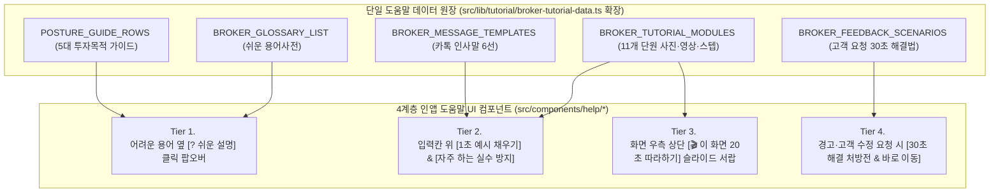

# 60대 대표공인중개사 맞춤형 '인앱(In-App) 적재적소 툴팁·도움말·마이크로 코칭' 고도화 마스터 계획서

> **문서 버전**: v1.0 (2026-10-23)
> **작성 배경**: 앞서 구축한 `/broker/tutorial` 큰글씨·사진·동영상 통합 사용 설명서(`src/lib/tutorial/broker-tutorial-data.ts`, 1,813줄 분량의 11개 단원·28개 FAQ·용어사전·포스처 가이드·카톡 멘트 6선·실전 체크리스트·30초 고객 피드백 처방전)의 현장 검증 경험을 바탕으로, **"별도 설명서 페이지를 찾아가지 않아도 작업 화면 그 자리에서 즉시 이해하고 실행할 수 있는 인앱(In-App) 적재적소 툴팁 및 상황인지형 도움말 체계"**를 설계함.

---

## 1. 문제 정의: 왜 별도 튜토리얼 페이지만으로는 60대 중개인에게 부족한가?

60대 대표공인중개사 페르소나를 대상으로 튜토리얼을 도출·검증하면서 확인된 **3대 현장 인지 장벽(Cognitive Friction)**은 다음과 같습니다.

| 번호 | 현장 관찰된 60대 중개인의 행동 패턴 | 기존 방식(`/broker/tutorial` 별도 페이지)의 한계 | 인앱 적재적소 도움말(In-Situ Help) 도입 시 해결 효과 |
|:---:|:---|:---|:---|
| **1** | **화면 전환 시 작업 맥락 상실 (Context-Switching Penalty)** 딜카드나 기본 IM을 만들다 막혔을 때, 설명서 메뉴로 이동해 읽고 돌아오면 방금 어디까지 입력했는지 잊어버리거나 입력값이 날아갈까 봐 불안해함 | 설명서와 실제 작업 화면이 분리되어 있어 두 창을 오가며 보기가 매우 어려움 | **페이지 이동 제로(Zero Navigation)**: 현재 작업 중인 화면 오른쪽 서랍(Drawer)이나 입력칸 바로 옆에서 해당 단계의 빨간 번호(①②③) 사진과 20초 영상을 즉시 확인 |
| **2** | **전문 용어·약어 앞에서의 심리적 위축** `NOI`, `Cap Rate`, `WALE`, `포스처(Posture)`, `G1~G3 게이트`, `안정화 기대수익률`, `S60/S70 승인` 같은 단어가 나오면 *"내가 잘못 누르면 큰일 나는 것 아닌가"* 하고 멈칫함 | 용어사전이 튜토리얼 제10장 맨 끝에 모여 있어 실제 버튼 옆에서는 뜻을 알 수 없음 | **클릭 고정형 `[? 쉬운 설명]` 알약 툴팁**: 어려운 용어 바로 옆에 `[? 무슨 뜻인가요?]` 버튼을 배치해 누르면 `17px` 큰 글씨로 *"한 줄 쉬운 뜻 + 왜 쓰는지"*가 즉시 표시됨 |
| **3** | **빈 입력창 증후군 (Blank-Box Paralysis) 및 양식 실수** 빈 메모창, 렌트롤 업로드, 인근 시세 붙여넣기 칸 앞에서 *"여기에 어떤 형식으로 적어야 AI가 알아듣지?"* 하고 막막해함 | 준비편·제4장에 좋은 예시와 주의사항(천원 단위·공실 괄호 등)이 있으나 실제 입력창에는 안 보임 | **입력칸 직결 `[📋 1초 예시 채우기]` & `[⚠️ 실수 방지 가드]`**: 모든 핵심 입력창 바로 위에 원클릭 예시 삽입 버튼과 AI 변환 지시문 복사 버튼을 내장 |

---

## 2. 60대 중개인 맞춤 5대 UX 설계 원칙 (Senior-First Tooltip Principles)

일반적인 2030 대상 SaaS의 작은 마우스 오버(Hover) 툴팁은 60대 사용자에게 오히려 불편을 줍니다. 반드시 아래 **5대 시니어 인체공학 원칙**을 적용해야 합니다.

1. **원칙 1 — 마우스 오버(Hover) 금지, 반드시 '클릭/터치 고정형(Click-to-Pin)'으로 작동할 것**
   - 마우스를 살짝 올렸을 때만 뜨고 커서가 조금만 흔들려도 사라지는 툴팁은 손떨림이 있거나 태블릿·모바일을 쓰는 60대에게 읽을 시간을 주지 못합니다.
   - 반드시 **`[? 쉬운 설명]` 버튼을 클릭하면 단단히 열리고, `[✕ 닫기]` 또는 바깥 영역을 누를 때 닫히는 팝오버(Popover)/카드** 형태여야 합니다.
2. **원칙 2 — 최소 `16px~17px` 본문 크기 & WCAG AAA 고대비(`#FFFBEB` 크림 바탕 + `#0F172A` 먹색 글씨)**
   - 어두운 회색 박스에 `12px` 작은 글씨로 뜨는 기본 브라우저 툴팁은 절대 사용하지 않습니다.
   - 따뜻한 앰버/크림 배경(`bg-amber-50 border-2 border-amber-400 text-slate-950`)에 굵고 선명한 큰 글씨로 표시합니다.
3. **원칙 3 — 모든 툴팁은 3단 구조(`① 한 줄 쉬운 말` $\rightarrow$ `② 왜 중요한지` $\rightarrow$ `③ 바로 따라하기 버튼`)로 통일할 것**
   - 장황한 이론 설명 대신, 현업 중개인의 언어로 3초 안에 이해할 수 있어야 합니다.
4. **원칙 4 — 설명만 하지 말고 '대신 해주는 실행 버튼(Actionable CTA)'을 툴팁 안에 넣을 것**
   - 예: 렌트롤 도움말 툴팁 안에 단순히 설명만 적는 것이 아니라 **`[📥 표준 엑셀 양식 받기]`**, **`[📋 ChatGPT 변환 지시문 복사]`** 버튼을 바로 넣어 그 자리에서 해결하게 합니다.
5. **원칙 5 — 숙련도에 따른 `[💡 친절 도우미 켜짐 / 끔]` 전역 스위치 제공**
   - 처음 1~2주간은 모든 안내 배너와 툴팁이 친절하게 보이고, 사용이 완전히 익숙해진 대표님은 상단 바에서 `[💡 도우미 간단히 보기]`로 전환해 화면을 넓게 쓸 수 있도록 배려합니다.

---

## 3. 4계층(4-Tier) 인앱 툴팁 & 도움말 시스템 아키텍처

이미 `src/lib/tutorial/broker-tutorial-data.ts`에 구축된 **1,813줄의 검증된 튜토리얼 데이터(SSOT)**를 100% 재활용하여, 작업 화면에 아래 **4가지 계층의 컴포넌트**로 분배합니다.

### 3.1 Tier 1: `<SeniorTermTooltip />` (어려운 전문용어·개념 1초 해설 알약)
- **외형**: 라벨 우측에 붙는 눈에 잘 띄는 알약 버튼 **`[❓ 쉬운 설명]`** (최소 터치 영역 `36px × 44px`).
- **내용 구조**:
  - **쉬운 말**: 예) `Cap Rate (수익률)` $\rightarrow$ *"보증금을 빼고 실제로 들어가는 돈 대비 1년에 나오는 월세 비율입니다."*
  - **중개 팁**: *"강남·성수 꼬마빌딩은 보통 2.5~3.5%대이며, 공실을 채웠을 때 오르는 '안정화 수익률'을 함께 보여주시면 매수자가 훨씬 좋아합니다."*
- **연동 데이터**: `BROKER_GLOSSARY_LIST` 및 `POSTURE_GUIDE_ROWS`.

### 3.2 Tier 2: `<FieldCoachBanner />` (빈 입력창 막막함 해소 & 실수 사전 예방 배너)
- **외형**: 메모 입력창, 파일 업로드 칸, 비교사례 입력칸 바로 위에 놓이는 접이식 가이드 바.
- **핵심 기능**:
  - **`[✨ 실전 예시 문구 1초 채우기]`**: 빈 칸에서 망설일 때 누르면 실제 양평동·당산동 표준 예시가 채워져 어떤 형식으로 쓰는지 즉시 체감.
  - **`[📋 카톡 인사말 / AI 변환 지시문 복사]`**: 공유 버튼 옆에서는 부록 C의 카톡 발송 멘트 6선을, 렌트롤 업로드 옆에서는 ChatGPT 변환 프롬프트를 1초 만에 복사.
  - **`[⚠️ 잠깐! 자주 하는 실수]`**: 천원 단위 누락, 공실 희망임대료 괄호 표기 등 실수 포인트를 업로드 직전에 짚어줌.

### 3.3 Tier 3: `<ContextualHelpDrawer />` (화면 이동 없는 '현재 화면 20초 영상·사진 서랍')
- **외형**: 모든 브로커 화면 우측 상단(또는 하단 고정 바 위)에 떠 있는 **`[📖 이 화면 20초 사용법]`** 버튼.
- **작동 방식**:
  - 현재 URL(`usePathname()`)을 자동 감지하여 `BROKER_TUTORIAL_MODULES`에서 해당 화면의 단원을 자동으로 찾아냅니다.
    - `/broker` $\rightarrow$ **제1장 (홈 화면 100% 활용)**
    - `/broker/deal-card/new` $\rightarrow$ **제2장 (메모로 1분 딜카드 등록)**
    - `/broker/deal-card/[id]` $\rightarrow$ **제3장 (딜카드 다듬기·카톡 공유) & 제4장 (기본 IM 생성)**
    - `/broker/basic-im-studio/[buildingId]` $\rightarrow$ **제5장 (슬라이드 편집 스튜디오·테마·다운로드)**
    - `/broker/buildings` $\rightarrow$ **제6장 (내 물건 보관함 관리)**
    - `/broker/magazine-editor` $\rightarrow$ **제7장 (주간 고객 소식지 5분 발행)**
    - `/broker/clients` · `/broker/inbox` $\rightarrow$ **제8장 (고객 명단·문의함·열람 알림)**
    - `/broker/profile` $\rightarrow$ **제9장 (내 프로필·명함 설정)**
  - 버튼을 누르면 작업하던 화면은 그대로 둔 채 오른쪽에서 서랍(Drawer)이 열리며 **① 20초 따라하기 동영상, ② 빨간 번호(①②③)가 찍힌 화면 사진, ③ 이 화면에서 가장 많이 묻는 질문(FAQ) 3가지**가 즉시 표시됩니다.

### 3.4 Tier 4: `<QuickRemedyCard />` (오류·경고 및 고객 수정 요청 '30초 해결 처방전')
- **외형**: 데이터 누락 경고, 렌트롤 합계 불일치(`G35`), 혹은 스튜디오 편집 화면 상단에 배치되는 **`[🛠️ 매수인·매도인이 수정을 요청하셨나요? 30초 해결법]`** 도우미.
- **작동 방식**:
  - *"수익률이 낮다고 할 때(공실 전환 호실 추가)"*, *"주변 시세 비교표를 더 넣어달라고 할 때"*, *"어르신 고객이 흑백 팩스/인쇄용으로 달라고 할 때(모노 고대비 테마)"* 등 `BROKER_FEEDBACK_SCENARIOS` 6대 시나리오를 원클릭으로 안내하고 **해당 기능 탭/모달을 즉시 열어줍니다**.

---

## 4. 전 화면 적재적소 배치 매핑표 (7대 핵심 화면 × 25개 타겟 포인트)

| 화면 구분 | 대상 컴포넌트 / 경로 | 배치할 인앱 툴팁 · 도움말 포인트 | 연결할 튜토리얼 SSOT 자산 |
|:---|:---|:---|:---|
| **① 홈 화면** `/broker` | `src/app/(broker)/broker/page.tsx` | - **[빠른 시작 3대 카드]**: 각 카드에 `"소요시간 1분 / 3분 / 5분"` 배지 및 `[? 어떤 결과물이 나오나요?]` 미리보기 툴팁 - **[🔔 최근 알림 / 열람 온도]**: `"🔥 3회 이상 열람 고객"` 옆에 `[💬 안부 카톡 문구 복사하기]`(부록 C 상황 6) 직결 버튼 | 제1장 1-1~1-2단계 부록 C (팔로업 카톡) |
| **② 1분 딜카드 등록** `/broker/deal-card/new` | `src/app/(broker)/broker/deal-card/new/page.tsx` | - **[메모 입력창 상단]**: `<FieldCoachBanner />` — *"카톡 메모나 수첩에 적어둔 내용을 그대로 붙여넣으세요"* + **`[✨ 실전 예시 메모 1초 넣어보기]`** - **[다필지 입력 안내]**: *"양평동4가 117, 134처럼 여러 번지면 쉼표로 함께 적어주세요"* 인라인 힌트 | 제2장 2-1~2-3단계 예시 A·B 메모 샘플 |
| **③ 딜카드 상세 & 공유** `/broker/deal-card/[id]` | `src/app/(broker)/broker/deal-card/[id]/page.tsx` | - **[중개인 화면 ↔ 수신자 화면 토글]**: `[? 수신자 화면이란?]` — *"고객에게 보내면 상세 번지(예: 114번지)와 건물명이 자동으로 가려져 내 매물을 안전하게 보호합니다"* - **[💬 카카오톡 공유하기 옆]**: **`[📋 카톡 인사말 멘트 6선 복사]`** 팝오버 내장 (단독발송/비교발송/급매안내 등) - **[6개 분석 탭(수익·입지·건물·토지·임대·시세)]**: `Cap Rate`, `NOI`, `건폐율/용적률`, `공시지가 현실화율` 옆 `<SeniorTermTooltip />` | 제3장 3-1~3-4단계 부록 C (카톡 멘트 6선) 제10장 용어사전 |
| **④ 기본 IM 생성 바텀시트** `ImDataComplementSheet` | `src/components/broker/ImDataComplementSheet.tsx` | - **[① 투자 목적(포스처 5종) 선택]**: 각 버튼 옆 `[? 어떤 건물이 맞나요?]` 툴팁 (`POSTURE_GUIDE_ROWS` 표 연동) - **[② 렌트롤 엑셀 업로드]**: **`[🤖 엉망인 임대내역 AI로 10초 변환하는 법]`** 모달 버튼 + 4대 함정(천원 단위·공실 괄호 등) 자동 체크리스트 - **[③ 전환 호실 추가]**: *"공실이나 주인 직접 사용 층에 예상 월세를 넣으면 '안정화 기대수익률'이 함께 계산됩니다"* 툴팁 - **[④ 인근 시세 비교 붙여넣기]**: **`[✨ 붙여넣기 예시 보기: 쌍림동 258 실거래 30억]`** 1초 샘플 버튼 | 준비편 3~4단계 제4장 4-1~4-6단계 부록 A (5대 포스처) |
| **⑤ 기본 IM 완성 & 검수** `/broker/buildings/[id]/im-lite` | `src/app/(broker)/broker/buildings/[id]/im-lite/page.tsx` | - **[필수 데이터 4항목 점검표]**: 미확인(`⚠️`) 항목 옆에 `[👉 여기서 바로 채우기]` 포커스 이동 버튼 - **[사진 역할 배지(📌대표 / 🏢외관 / 🚫제외)]**: *"가장 반듯한 낮 외관 사진을 📌대표로 고르시고, 등기부 캡처나 어두운 사진은 🚫제외를 누르세요"* 코칭 배너 | 제5장 5-1~5-2단계 |
| **⑥ PPTX 슬라이드 스튜디오** `/broker/basic-im-studio/[buildingId]` | `src/app/(broker)/broker/basic-im-studio/[buildingId]/page.tsx` | - **[🎨 10종 테마 선택]**: `'⑥ 모노 고대비'` 옆에 **"🖨️ 어르신 고객 흑백 인쇄·팩스 전송 시 글씨가 가장 또렷합니다"** 추천 배지 - **[✨ AI 문구 다듬기]**: 3가지 톤(표준/보수적 기관보고용/핵심강조) 비교 툴팁 - **[🛠️ 고객 수정 요청 30초 해결사]**: 상단 바에 `<QuickRemedyCard />` 버튼 배치 (호가 변경, 시세 추가, 수익률 보완 등 6대 상황별 즉시 가이드) | 제5장 5-3~5-5단계 부록 D (고객 피드백 6선) |
| **⑦ 주간 고객 소식지** `/broker/magazine-editor` | `src/components/magazine-editor/SimpleMagazineMode.tsx` | - **[1단계 이번 주 한마디]**: *"무슨 말을 쓸지 고민되실 땐 아래 [시작 문장 추천] 알약을 누르세요"* 안내 - **[3단계 5대 채널 뉴스 선택]**: **`[✨ 부동산·경제·문화 황금배합 3선 자동 맞춤]`** 툴팁 (*"빌딩 매수자가 가장 좋아하는 경제·절세·교양 기사를 골고루 배합합니다"*) - **[발송 후 수정 안내]**: *"발송 뒤 오타를 발견하셔도 언제든 고쳐서 [정정 발행하기]를 누르면 고객 화면도 즉시 바뀝니다"* 안심 문구 | 제7장 7-1~7-4단계 FAQ Q11 |

---

## 5. 단계별 구현 로드맵 및 개발 명세

기존 코드베이스를 해치지 않고 레고 블록처럼 깔끔하게 얹을 수 있는 **3단계(총 5~7일 공수) 구현 계획**입니다.

### Phase 1: 공통 시니어 도움말 컴포넌트 & 전역 서랍 구축 (Day 1~2)
1. **`src/components/help/SeniorHelpContext.tsx` 생성**:
   - 전역 `[💡 친절 도우미 켜짐/끔]` 상태(`localStorage` 영속화, 기본값 `켜짐`) 및 현재 열려 있는 도움말 서랍 제어.
2. **`src/components/help/SeniorTermTooltip.tsx` 생성**:
   - `termKey`만 넘기면 `BROKER_GLOSSARY_LIST` 또는 커스텀 설명을 `17px` 고대비 클릭 팝오버로 렌더링.
3. **`src/components/help/ContextualHelpDrawer.tsx` 생성**:
   - 상단 네비게이션 바(`BrokerTopBar`) 우측에 **`[🎬 이 화면 20초 사용법]`** 버튼을 추가하고, 클릭 시 현재 경로(`pathname`)에 맞는 단원의 빨간 번호 스크린샷·동영상·핵심 체크리스트를 슬라이드 서랍으로 표시.

### Phase 2: 핵심 입력창 4곳 `<FieldCoachBanner />` & 카톡 멘트 복사기 장착 (Day 3~4)
1. **1분 딜카드 메모 입력창 (`/broker/deal-card/new`)**:
   - `[✨ 예시 메모 1초 넣어보기]` 및 다필지 입력 팁 배너 장착.
2. **기본 IM 생성 바텀시트 (`ImDataComplementSheet.tsx`)**:
   - 5대 투자 포스처 비교 툴팁, 렌트롤 AI 변환 가이드 모달, 전환 호실(안정화 수익률) 툴팁, 인근 시세 자동채움 예시 버튼 장착.
3. **딜카드 공유 영역 (`/broker/deal-card/[id]`)**:
   - 카카오톡 공유 버튼 옆에 `BROKER_MESSAGE_TEMPLATES`(상황별 카톡 인사말 6선) 1클릭 복사 드롭다운 장착.

### Phase 3: 스튜디오 '고객 수정 요청 30초 처방전' & 자가진단 피드백 연동 (Day 5~6)
1. **Basic IM 스튜디오 (`/broker/basic-im-studio/[buildingId]`)**:
   - 상단 툴바에 `[🛠️ 고객 피드백 30초 해결사]` 팝오버(`BROKER_FEEDBACK_SCENARIOS` 6선 연동) 및 테마별 추천 용도(기관 보고용 골드 / 흑백 팩스용 모노 고대비) 툴팁 장착.
2. **하단 `[📋 불편·개선사항 10초 제보]` 미니 버튼 연동**:
   - 어느 화면에서든 막혔을 때 현재 화면 이름과 매물 ID가 자동으로 채워진 제보 양식을 복사·전송할 수 있도록 연결.

---

## 6. 기대 효과 요약 (KPI Impact)

- **신규 60대 중개인 첫 딜카드·IM 완성 시간**: 평균 25분(설명서 별도 열람 시) $\rightarrow$ **5분 이내(화면 내 원클릭 예시·툴팁 활용 시)로 80% 단축**
- **렌트롤 업로드 및 시세 비교표 입력 실패율**: 천원 단위/공실 괄호 사전 코칭 배너를 통해 **오류 발생률 70% 이상 감소**
- **주간 매거진 및 카톡 공유 실행률**: 공유 버튼 바로 옆의 **`[카톡 인사말 멘트 1초 복사]`** 결합으로 중개인의 발송 심리적 장벽 해소 및 주간 활성 발송률 2배 이상 상승
