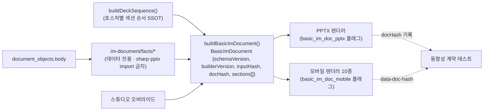
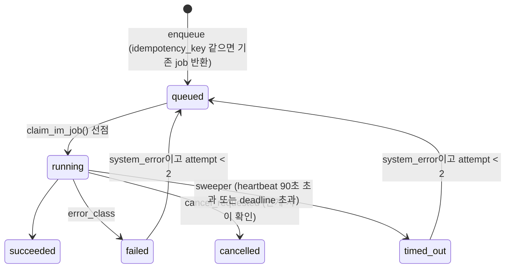
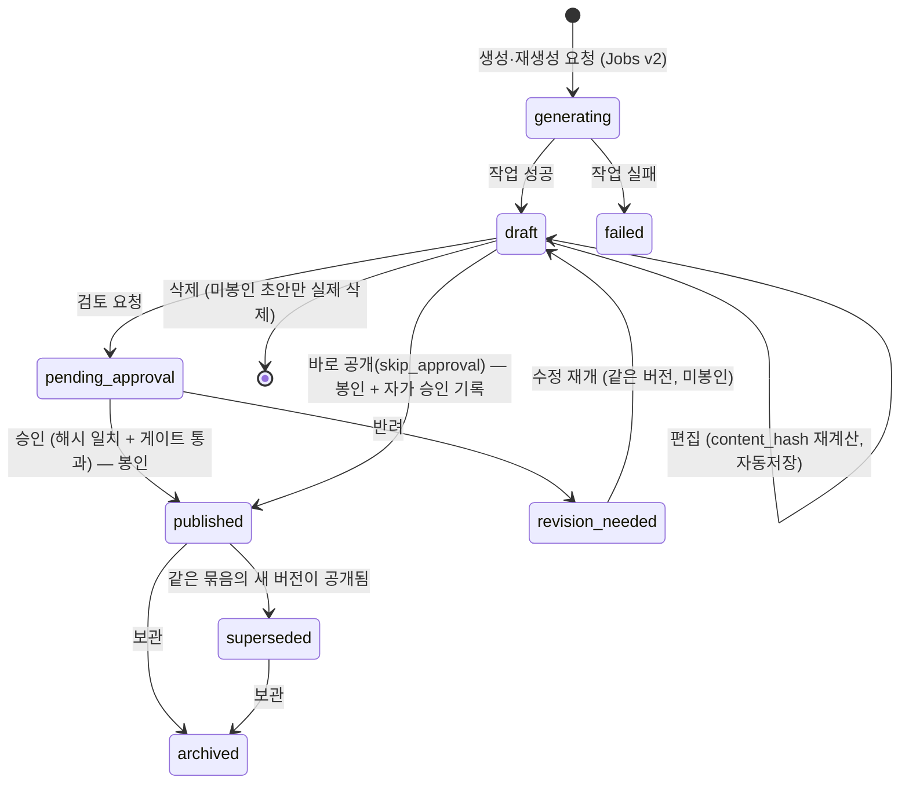
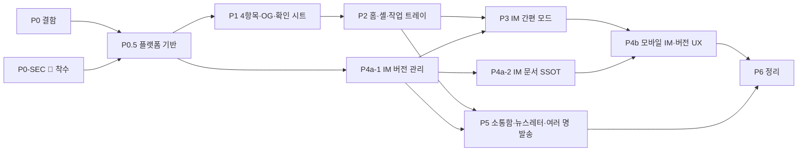

# CREDEAL 무마찰(Zero-Friction) UX 개편 설계서 v3 — UX·시스템 이중 감사 + IM 버전 관리 + 정밀 구현 계획

> **문서 버전**: v3.0 (2026-10-27) — v2.0·v1.0(같은 날)을 대체합니다.
> **v3 추가 사항**
> - **IM 버전 관리 설계(§5.7)**: 같은 데이터로 여러 IM을 만드는 경우를 다룹니다.
> - **P0-SEC 착수 현황과 추가 발견 결함(§1.1)**
> - **정밀 구현 작업 분해(WBS, §13)**
> - 결정 사항 D-0·D-1·D-3 확정
>
> **v2 이하 작성 근거**
> 1. 중개인 5대 요청과 v1 설계서
> 2. **Apple HIG 관점 UX 감사**: 코드 대조, UX 결함 15건, 숨은 요구 17건
> 3. **수석 시스템 엔지니어 관점 감사**: 코드·마이그레이션·운영 스키마 스냅샷 대조, 시스템 결함 15건
> 4. **IM 버전 관리 현황 조사**(v3): 저장·재생성·승인·공유·스튜디오 경로 대조
> 5. 확정된 결정: ① 딜카드 권역은 동 단위까지 허용(번지·건물명 금지) ② 모바일 IM 전용 5개 섹션은 Basic에서 제외하고 Pro 부록으로 ③ P0-SEC 즉시 진행 ④ 승인 해시와 문서 해시 분리 ⑤ 홈 "이어서" 한 줄 허용
>
> **표기**: [검증]은 코드나 파일로 직접 확인한 사실입니다. [추정]은 추론이거나 운영 DB에서 확인이 필요한 사항입니다.

---

## 0. 핵심 요약

### 0.1 감사가 바꾼 결론 여섯 가지
| # | v1의 판단 | v2·v3의 판단 |
|:---:|:---|:---|
| 1 | 블라인드 보호는 "결정론적 가드 추가"로 충분하다 | **공개 경로에 이미 구멍이 있습니다.** 봇 UA로 위장해 브로커 상세를 열람, `/dc`의 RSC 페이로드로 원문 전달, anon 공개 RLS, 소유권 검사 누락. 가드보다 **즉시 보안 조치(P0-SEC)**가 먼저입니다 |
| 2 | DB 마이그레이션이 필요 없다 | **틀렸습니다.** `input_type` CHECK 제약, pnu 컬럼 없음, unique 제약 없음, `in_app_notifications` 테이블이 운영에 없음. 마이그레이션이 필요합니다 |
| 3 | IM 생성은 기존 비동기 작업을 재사용한다 | 기존 작업 경로에는 **sweeper, 멱등키, heartbeat, 취소, 소유권 검사가 모두 없습니다.** 간편 모드 전에 작업 플랫폼(Jobs v2)이 필요합니다 |
| 4 | 3열 셸과 미리보기가 핵심이다 | 60대 중개인이 실제로 망설이는 지점은 **"언제 저장되나 / 보내기 전후에 무엇을 보나 / 현장에서 휴대폰으로 어떻게 하나"**입니다. 저장·작업·발송 정책이 셸의 본질입니다 |
| 5 | KPI 목표를 세운다 | 에러 추적·제품 이벤트·비용 측정 테이블이 **없어서 측정이 불가능합니다**(비용 테이블은 운영에 없음). 계측 기반이 먼저입니다 |
| 6 | IM은 매물당 하나다 (v3 추가) | 지금도 **생성할 때마다 IM 행이 새로 쌓이지만**, 묶음·버전 번호·입력 스냅샷·"현재본" 지정이 없습니다. 화면마다 "그 IM"을 다르게 고르고, 승인 후에도 본문이 바뀌어 승인 해시를 다시 검증할 수 없고, 공유 링크와 PPTX가 특정 버전에 고정되지 않습니다. **IM 버전 관리가 문서 SSOT보다 먼저 필요합니다(§5.7)** |

### 0.2 설계 원칙 (UX 7 + 시스템 8)
| UX 원칙 | 시스템 원칙 |
|:---|:---|
| U1. **4개의 문**: 홈은 4개 작업 버튼뿐, 버튼 안 배지와 "이어서" 한 줄만 허용 | S1. **공개는 투영 DTO만**: 공개 출력은 허용목록 DTO와 블라인드 가드를 거친 데이터만 내보냄 |
| U2. **같은 방**: 4개 작업 공간 모두 `① 고르기 │ ② 채우기 │ ③ 확인하고 보내기` 3열 | S2. **권한은 한 함수로**: `assertBuildingOwner` / `assertDocOwner` 외에는 권한을 판정하지 않음 |
| U3. **저장을 걱정하지 않는다**: 모든 작업은 서버에 3초 안에 자동 임시저장, 기기를 바꿔도 이어서 작업 | S3. **읽기는 읽기만**: GET·공개 경로에서는 쓰기 0회 |
| U4. **보이는 것을 보낸다**: 주 버튼은 미리보기 열 하단 단 하나, 외부 발송 전 확인 시트 | S4. **쓰기 경로는 하나, 버전으로 보호**: 단일 RPC 트랜잭션과 낙관적 잠금(409) |
| U5. **기다림을 맡긴다**: 오래 걸리는 AI 작업은 전역 작업 트레이로, 다른 일을 해도 되고 끝나면 알림 | S5. **작업은 상태 머신**: 멱등키, heartbeat, sweeper, 취소, 재시도 정책 |
| U6. **틀려도 되돌린다**: 내부 작업은 10초 되돌리기, 확인 창은 발송·공개 확대·회수 세 가지만 | S6. **모든 변경은 플래그 뒤에, 모든 단계는 롤백 가능하게**: 코호트, 킬 스위치, 레거시 폴백 |
| U7. **현장 우선 + 시니어 인체공학**: 🎤·📷 입력, 본문 17px, 최소 14px, 터치 48px, 대비 토큰, 모션 줄이기 설정 준수 | S7. **측정할 수 없으면 출시하지 않는다**: 이벤트 계약, 에러 추적, 작업 비용 계측 |
| | S8. **보낸 것은 바뀌지 않는다**(v3): 승인되었거나 외부에 공유된 IM 버전은 봉인(불변)되고, 수정은 언제나 "새 버전". 고객이 받은 링크·파일은 특정 버전에 고정 |

### 0.3 변경된 로드맵 (요약)
`P0 결함` ∥ **`P0-SEC 보안 핫픽스(착수)`** → **`P0.5 플랫폼 기반`** → `P1 4항목 딜카드·OG·발송 확인` → `P2 홈·셸·딜카드 작업 공간` ∥ **`P4a IM 버전 관리 + 문서 SSOT`** → `P3 IM 간편 모드` → `P4b 모바일 IM 렌더러·버전 UX` → `P5 소통함·뉴스레터·여러 명 발송` → **`P6 정리`**

---

## 1. 이중 감사 결과

### 1.1 🚨 즉시 조치가 필요한 보안 결함 (P0-SEC, 운영 영향)
| # | 심각도 | 결함 | 근거 [검증] | 조치 |
|:---:|:---:|:---|:---|:---|
| SEC-1 | Critical | **IM 생성 API에 매물 소유권 검사가 없습니다.** 남의 매물 ID로 IM을 생성하면 렌트롤·주소가 내 문서로 복제되고, 생성 후 원본 `building_ssot_lite`를 덮어씁니다 | `im-lite/generate-async/route.ts` L53-75(UUID 형식만 검사), `generate/handler.ts` L150-189, L888. `requireBroker`가 public_user·expert도 통과시킴(`auth-guard.ts` L186-191) | `assertBuildingOwner()`를 모든 경로에 적용, `requireBroker`를 broker·admin으로 축소 |
| SEC-2 | Critical | **딜카드 PATCH 소유권 검사가 "통과 실패 시 허용(fail-open)"입니다.** `readWithMigration`이 owner_id 컬럼이 없는 assets 행을 돌려주면 검사를 건너뜁니다 | `deal-card/[id]/route.ts` L69-75. 같은 패턴이 `disclosure` L48, `evidence` L59에도 있음. 반대로 `studio`·`lease`·`briefing`·`conversion`은 항상 404로 기능이 깨짐 | 권한 판정을 헬퍼로 일원화, "readWithMigration을 권한 판정에 쓰지 않는다" 정적 가드 테스트 추가 |
| SEC-3 | Critical | **UA 위장으로 브로커 상세가 노출됩니다.** `kakaotalk-scrap` UA를 쓰면 로그인 없이 `/broker/deal-card/{id}`가 열리고, 원문 메모(번지·건물명)가 클라이언트로 전달됩니다 | `proxy.ts` `SOCIAL_BOT_ALLOWED_PATHS`, `(broker)/layout.tsx`에 인증 가드 없음, `deal-card/[id]/page.tsx` L62-84, L539 | 봇에게는 공개 투영 메타데이터만 반환. 사람이면 서버에서 owner 검사 |
| SEC-4 | Critical | **RLS 공개 정책 때문에 anon 키로 원본 덤프가 가능합니다.** assets(메모 원문·렌트롤), deals, lease_units, deal_parties(연락처), im_edit_diffs, im_generation_jobs(역할 제한 없는 FOR ALL), gate_requests(submitted) | `0110_ontology_schema.sql` L74-77, `0121_edit_diffs.sql` L17, `20260713003746_im_generation_jobs.sql` L22-23, `00002_rls_anon_patch.sql` L28-31 [운영 반영 여부는 `pg_policies`로 확인 필요] | 공개 정책 DROP, `TO service_role` 명시, 공개용은 안전 컬럼만 담은 view·RPC로 |
| SEC-5 | Critical | **공개 `/dc/[id]`가 원본 attrs 전체를 클라이언트 컴포넌트에 넘깁니다.** RSC 페이로드에 주소·메모·렌트롤이 실립니다. draft·archived 상태도 공개되고, `?docId`로 초안 IM이 노출됩니다 | `dc/[id]/page.tsx` L177-184, L263-268, `fetch-im-data.ts` L288-294 | `toPublicDealCard()` / `toPublicIm()` 투영 계층(zod `.strict()`), 공개 상태 필터 |
| SEC-6 | High | **지금 접근 가능한 화면이 가짜 데이터를 넣습니다.** 사진 OCR 라우트가 없어서 호출이 실패하면 '스타벅스' 같은 가짜 임차인을 채우고, 토큰이 없으면 `'dummy-token'`을 씁니다 | `lease-photo-ocr.tsx` L36, L39, L48-55 (`StudioTabs.tsx` L13, `deal/[id]/page.tsx` L339에서 링크됨) | mock 삭제와 버튼 숨김 |
| SEC-7 | High | **서비스 워커가 scope '/'로 등록되어** 브로커 job-status, 미리보기, PPTX 응답까지 기기 Cache Storage에 무기한 저장합니다 | `mobile-im-viewer.tsx` L106, `public/sw-im.js` | scope를 `/im-lite/`로 축소하고 API·브로커 경로는 캐시 제외 |
| SEC-8 (v3) | Critical | **스튜디오(Basic IM·PPTX) API 11곳에 소유권 검사가 전혀 없습니다.** 남의 IM을 읽고·고치고·승인하고·다운로드할 수 있고, 남의 IM 본문을 내 프로젝트로 복제할 수 있습니다 | `basic-im-studio/*`, `pptx-studio/projects/*` | `assertStudioDealOwner()` 적용 |
| SEC-9 (v3) | Critical | **IM 조회 API가 로그인 없이 매물의 모든 IM 본문을 반환합니다** | `api/broker/im-lite/[id]/route.ts` L9-44 | requireBroker + 소유권 |
| SEC-10 (v3) | High | **공개 PPTX 다운로드에 상태 검사가 없습니다.** buildingId만 알면 초안 PPTX를 누구나 받을 수 있고, 워터마크 해제 파라미터를 누구나 쓸 수 있습니다 | `api/public/im-lite/[buildingId]/pptx/route.ts` L51-63, L193-223 | 공개 상태 문서만, 워터마크 해제는 소유자만 |
| SEC-11 (v3) | High | **PPTX 파일 승인이 매물의 모든 IM을 한꺼번에 "published"로 바꿉니다.** 문서가 2개 이상이면 `.maybeSingle()` 오류로 승인 게이트를 건너뜁니다 | `pptx-studio/projects/[id]/approve-file/route.ts` L87-93, L184-198 | 대상 문서 1건만 확정해 실패 시 차단(fail-closed) |
| SEC-12 (v3) | High | 그 밖의 경로: 임대 공간 목록이 모든 중개인의 공간을 노출, from-memo의 `existingBuildingId`로 남의 매물 덮어쓰기, snapshot 생성으로 남의 매물 복제, 봇에게 열리는 임대 상세가 문의자 이름을 노출 | `leasing/page.tsx`, `deal-card/from-memo`, `snapshot/generate`, `leasing/[spaceId]` | 소유 범위 제한 |

#### P0-SEC 진행 현황 (2026-10-27 기준)
| 영역 | 상태 | 내용 |
|:---|:---:|:---|
| A. 소유권 검사 (SEC-1·2·8, SEC-12 일부) | ✅ 구현·테스트 완료 | `src/lib/authz/assert-owner.ts` 헬퍼 + API 약 30곳 적용, `requireBroker`는 broker·admin만 통과, `readWithMigration`을 권한 판정에 쓰면 실패하는 정적 가드 테스트. 정상 소유자가 늘 404를 받던 studio·lease·briefing·conversion 복구. 특히 lease를 단순히 "404만 고치면" 모든 소유자의 layers가 지워질 뻔한 문제를 함께 차단. tsc 통과, 655개 테스트 통과 |
| B. 공개 노출 (SEC-3·5, 임대 상세) | ✅ 구현·테스트 완료 | 봇에게는 메타데이터 셸만, 사람은 로그인·소유자 검사. `toPublicDealCard()` strict DTO로 `/dc` RSC 경계 차단(독성 토큰 테스트). 상태 규칙: 보관(archived)·내부 전용만 차단(이미 공유된 링크 보존), 초안 IM은 소유자만. 65개 테스트 통과 |
| A2. 추가 결함 (SEC-9·10·11, 임대 목록) | ✅ 구현·테스트 완료 | IM 조회 인증(`im-lite/[id]`), 공개 PPTX 상태 필터·워터마크 소유자 검증(`public/im-lite/[buildingId]/pptx`), 승인 대상 1건 확정 헬퍼(`resolveApprovalTargetDoc` + `approve-file`), 임대 목록 소유 범위(`leasing/page.tsx`). 22개 추가 보안 테스트(총 117개 보안 테스트) 통과 |
| C. RLS·OCR·서비스 워커 (SEC-4·6·7) | ✅ 구현·테스트 완료 | 마이그레이션 `20261027000001_sec4_rls_public_read_lockdown.sql`과 롤백 작성(로컬 PGlite dry-run: 정책 18→11, 재실행 동일, anon 조회·삽입 차단 확인). 비서비스 롤 사용처 조사 결과 브라우저·anon 사용 없음(gate_requests는 로그인 사용자용 소유자 조회 정책 신설로 오히려 정상화). **운영 적용은 push와 무관한 수동 절차**(SQL Editor). OCR mock·dummy-token 제거, SW v2(scope `/im-lite/`, API·브로커·바이너리 캐시 금지, 기존 루트 등록 자동 해제). 43개 테스트 통과 |
| 배포 | ✅ 완료 | 전체 `tsc --noEmit`·보안/API `vitest`·`npm run build` 검증 통과 → 커밋·`origin/main` 푸시(Vercel 자동 배포) 완료 (RLS 마이그레이션 `20261027000001`은 운영자 SQL Editor 절차로 별도 적용) |

> [!CAUTION]
> SEC-1~5는 **이번 UX 개편과 무관하게 지금 운영 중인 서비스의 데이터 유출 경로**입니다. 설계서 확정을 기다리지 말고 별도 핫픽스(1~2일)로 먼저 막기를 권장합니다. 특히 SEC-4는 운영 DB의 `pg_policies`를 조회해 실제로 적용되어 있는지 먼저 확인해야 합니다.

### 1.2 UX 감사 핵심 (Apple HIG 관점)
| 심각도 | 결함 | 근거 | v2 개선 |
|:---:|:---|:---|:---|
| Critical | **저장 시점이 정의되지 않았습니다.** 메모는 페이지를 벗어나면 사라지고, IM 임시저장은 localStorage에 24시간만 이 기기에만 남습니다 | `deal-card/new` 메모 휘발, `use-im-data-form.ts` L474-547 | §3.3 저장 정책: 서버 임시저장, 3초 자동저장, 409 충돌 처리, 기기 간 이어서 작업 |
| Critical | **확인 없이 바로 발송되고, 예전 카드가 나갈 위험이 있습니다.** 미리보기 이미지는 "저장된 상태"를 서버가 그린 것입니다 | `LiveDealCardPreviewCard.tsx` L100-128, L180 | 저장 즉시 반영 → 해시 확정 → **보내기 전 확인 시트** → 발송 |
| Critical | **OG 이미지 글자가 말풍선에서 읽히지 않습니다.** 말풍선 이미지 폭은 약 250~260px(0.21배)라 v1 사양인 특징 42px는 약 9px로 보입니다 | v1 §3.5.3 | 이미지에는 **용도·권역·금액구간만** 크게 넣고, 특징 3개는 말풍선 텍스트로 |
| Critical | **30~180초 AI 작업 경험이 무너져 있습니다.** 12초마다 넘어가는 가짜 7단계, `경과초×0.8` 가짜 진행률, 화면을 떠나면 진행을 잃음, 서버를 멈추지 못하는 취소, 시간 초과 후 "다시 시도"가 중복 생성을 유도 | `deal-card/new` L26-34·L84-88·L217-223, `im-management-panel.tsx` L187-207 | §3.4 **전역 작업 트레이**(서버 상태 기준, 실제 단계만 표시, 서버 취소, 완료 알림) |
| High | **"누가 열었나"를 알 수 없습니다.** 모든 수신자가 같은 `/dc/{id}`를 받습니다. 고객별 링크 서비스는 있지만 UI에서 쓰지 않습니다 | `share-link-service.ts`, `/api/broker/share-link` | 고객별 보내기 대기열, 고객별 열람 타임라인 |
| High | **현장(휴대폰) 흐름이 없습니다.** 음성 입력 컴포넌트는 휴면이고 PWA manifest도 없습니다 | `VoiceRecorder.tsx`, 홈 L559 휴면 | 🎤 말로 / 📷 사진 / ⌨️ 붙여넣기 입력, `app/manifest.ts`, 오프라인 메모 큐 |
| High | **1229px에서 3열이면 작업 열이 약 480px밖에 안 됩니다.** R1 표(약 780px)를 그릴 수 없습니다 | v1 §3.2.1 | 작업 열이 640px 미만이면 목록 열을 72px 레일로 자동 축소, 표 입력 중에는 목록 숨김 |
| High | **간편/상세 모드 전환 스위치**가 "바꾸면 입력이 날아가나" 하는 불안을 만듭니다 | v1 §3.2.2 | **한 폼 + 점진적 공개**(확장 카드 방식) |
| High | **홈의 "이어서 하기 금지"**가 가장 큰 숨은 요구와 충돌합니다 | v1 §7-2 | 배지를 누를 수 있는 링크로 만들고 "이어서" 한 줄 허용(버튼 4개 원칙은 유지) |
| High | **접근성 토큰 미달**: 입력란 테두리 대비 약 1.5:1, 핵심 컴포넌트 10~13px, 토스트가 종이 테마에서도 어두운 14px, 글자 크기 설정 없음, 모션 줄이기 미적용, 작업 진행에 aria-live 없음 | `globals.css` L473, `rent-roll-importer.tsx`, `toast-provider.tsx` | §3.1 토큰 표준 |
| Medium | AI가 쓴 값이 표시되지 않습니다 | — | 출처 표시 3색, AI 문장 "확인" 탭 |
| Medium | 보낸 뒤 고치거나 회수하는 흐름이 없습니다 | revoke API 미사용 | 보낸 기록, 회수, 정정 안내, 받는 화면 정정 띠 |
| Medium | 확인 창·되돌리기·토스트 원칙이 없습니다 | — | §3.5 정책 |
| Medium | 인쇄·팩스, 중개사무소 표시 사항, 동→구 강등 안내가 없습니다 | — | A4 요약서, IM PDF, 표시 사항 자동 삽입(법무 확인), 강등 안내 줄 |
| Medium | 모바일 IM이 아코디언(첫 섹션만 펼침)입니다 | `mobile-im-viewer.tsx` L77-83 | 10개 섹션을 모두 펼친 연속 스크롤 + 섹션 칩 내비게이션 |

### 1.3 시스템 감사 핵심 (보안 외)
| 심각도 | 결함 | 근거 [검증] | v2 개선 |
|:---:|:---|:---|:---|
| High | **`readWithMigration`이 읽을 때마다 씁니다.** 조회 때 assets·deals를 upsert하고, lease_units는 트랜잭션 없이 delete 후 insert. 호출처 79곳(OG 3종, `/dc` 포함). `/dc`는 요청 한 번에 2회 호출 | `ssot-adapter.ts` L306-398 | 순수 읽기 `readBuilding()`으로 분리, `React.cache()` 적용 |
| High | **비동기 작업 신뢰성 없음.** 랜덤 jobId라 더블클릭 시 LLM이 2번 실행, after() 크래시 시 'processing'으로 영구 잔류, 멱등 모듈은 미사용인 데다 중첩 키를 해시에서 빠뜨리는 버그, 클라이언트 폴링 상한 190/300초 불일치, job-status 소유권 검사 없음 | `generate-async` L90-289, `idempotency.ts` L47-51, `use-im-data-form.ts` L828 | §5.3 Jobs v2 |
| High | **"마이그레이션 불필요"가 틀렸습니다** | `00001_mvp_schema.sql` L126-127(CHECK, raw_input NOT NULL), pnu 컬럼·unique 없음, in_app_notifications 운영에 없음 | §6 마이그레이션 |
| High | **동시 편집 시 수정이 유실됩니다.** PATCH가 읽고-고치고-쓰기 방식이고, 4곳 동기화가 트랜잭션 밖이며 에러를 삼킵니다. 생성 후 역류 저장도 편집 내용을 덮어씁니다 | `deal-card/[id]/route.ts` L77-153, `generate-async` L149-264 | 단일 RPC 트랜잭션, `card4_version` 낙관적 잠금, jsonb 부분 패치 |
| High | **IM 문서 SSOT(basic_im_doc)를 body에 저장하면 승인 해시가 깨집니다** | `target-hash.ts` L38-55(body 전체 해시, Rule 20) | `docHash`를 분리하고 승인된 문서는 변경 금지(§5.2) |
| High | **문서 빌더를 공유하면 sharp·pptxgenjs가 클라이언트와 페이지 번들로 딸려 들어옵니다**(250MB 함수 용량 재발 위험) | `a27-land-use-plan.ts` → `image-optimizer` → sharp. `loadPageOrder`의 fs·yaml 읽기 | 데이터 전용 `facts/*` 분리, import 경계 테스트 |
| High | **관측성 없음.** Sentry·제품 분석 0건, console 227건 혼재, 비용·지연 계측 insert 대상 테이블이 운영에 없어 전부 유실 | `cost-tracker.ts` L40, `telemetry.ts` L121·L191 | §5.6 계측 사양 |
| Medium | 기능 플래그·킬 스위치 없음. `FF_MOBILE_CORE_PACKAGE`를 클라이언트 body로 켤 수 있음 | `im-lite/generate/route.ts` L48 | §5.5 플래그 |
| Medium | 캐싱 불일치. `/dc`는 searchParams 때문에 ISR이 사실상 꺼짐[추정], revalidatePath 미사용, OG에 버전이 없어 최대 8일 낡은 카드, `?v=랜덤`이 캐시 우회 공격 경로 | `dc/[id]/page.tsx` L165, `og/.../kakao` L350 | §5.4 캐시 설계 |
| Medium | 소통함 데이터 결함: 전역 이벤트를 `limit*2`만 가져온 뒤 메모리에서 거름, 소스별 limit 후 offset 적용, 미읽음 수가 첫 페이지 기준, IP·UA 저장 | `api/broker/inbox/route.ts` L92-206 | 커서 페이지네이션, `broker_id` 인덱스, read_state 테이블 |
| Medium | 레이트리밋이 원자적이지 않고 에러 시 통과(IM 문서 테이블에 카운터 저장). OG·`/dc`·LLM 경로에는 레이트리밋 없음 | `rate-limiter.ts` | 전용 원자적 레이트리밋 |
| Medium | `ai_runs`가 메모 원문을 저장하는데 보존 기간 정리 대상이 아님 | `from-memo` L119-130 | 보존 기간 정리 대상에 추가, 마스킹 |
| Medium | E2E가 dev 서버와 playwright UA 인증 우회로 돌아서 권한·빌드 문제를 검출하지 못함 | `proxy.ts` L128-131 | 핵심 E2E는 `next build && next start` + 실제 인증 |

### 1.4 v1 설계서에서 바로잡을 부분
- `buildBasicDeckSequence`는 없습니다. 실제 이름은 `buildDeckSequence`(`pptx/deck-sequencer.ts` L204)입니다.
- `/api/broker/jobs/[id]`는 ai_runs용이고, IM 작업 조회는 `im-lite/job-status`입니다. Jobs v2에서 하나로 통합합니다.
- v1 §5의 "마이그레이션 불필요" 항목들은 §6으로 정정합니다.
- v1 §3.5.3 OG 사양(특징 3줄 42px)은 폐기하고 §4.5로 대체합니다.
- v1 §3.2.2 간편/상세 모드 스위치는 폐기하고 단일 폼으로 바꿉니다.
- v1 §7-2 "이어서 하기 금지"는 배지 링크와 "이어서" 한 줄 허용으로 바꿉니다(결정 필요 D-3).

---

## 2. 숨은 요구 17건 → 기능 매핑

60대 중개인의 하루: 매도자 전화(운전·현장) → 사진 촬영 → 사무실 PC에서 정리 → VIP 고객 여러 명에게 카톡 → 열람 확인 후 전화 → 가격이 바뀌면 정정 → 매도자에게 보고.

| # | 숨은 요구 | 작업 공간 | 기능 | 단계 |
|:---:|:---|:---|:---|:---:|
| 1 | 운전 중·현장에서 손으로 칠 수 없다 | 딜카드 | 🎤 **말로 메모**(VoiceRecorder 재사용, 실패 시 서버 STT) → 4항목 자동 채움 | P3 |
| 2 | 현장 사진(건물·간판·렌트롤 종이) | 딜카드·IM | 📷 **사진 넣기**(여러 장, 후면 카메라). 렌트롤 사진은 vision으로 R1 채움, **읽은 칸은 노란 셀로 검토 필수** | P3(선택) |
| 3 | 오전 PC, 오후 휴대폰 | 전체 | 서버 임시저장, "📱 휴대폰으로 이어서" QR, 휴대폰 배지 "PC에서 작성 중 1" | P2 |
| 4 | VIP에게 틀린 정보를 보낼까 두렵다 | 딜카드·IM | **보내기 전 확인 시트** + **나에게 먼저 보내기** | P1 |
| 5 | 같은 매물을 여러 고객에게 | 딜카드·소통함 | **고객별 보내기 대기열**(고객별 인사말과 고객별 링크, "3/7 보냄") | P5 |
| 6 | 누가 열었는지 보고 전화 타이밍을 잡고 싶다 | 소통함 | **고객별 열람 타임라인** + 🔥 "방금 IM 렌트롤을 2분 봄 → 지금 전화" | P5 |
| 7 | 보낸 뒤 가격 변경·오타 발견 | 딜카드 | 보낸 기록, 정정, 회수, 받는 화면 정정 띠, 정정 안내 문구 | P5 |
| 8 | 지난 자료를 재사용하고 싶다 | 딜카드·IM | "복제해서 새로 만들기"(주소만 비움), 비슷한 매물의 특징 문구 불러오기 | P5 |
| 9 | AI를 못 믿는다 | 전체 | 출처 표시 3색(🟢공적장부 / 🔵내 입력 / 🟣AI), AI 문장 확인 탭, 미확인 경고 | P1~P4 |
| 10 | 사무실 인쇄·팩스, 대면 브리핑 | IM·딜카드 | A4 1장 물건 요약서, IM PDF, 흑백 인쇄 대비 보장 | P4 |
| 11 | 지하·엘리베이터에서 전파가 약하다 | 딜카드 | 오프라인 메모 큐(IndexedDB), "연결되면 자동 저장" 보장 문구 | P5 |
| 12 | 노안 | 전체 | 글자 크기 3단(17/19/21), 숫자 tabular·굵게, 금액 읽어 주기("= 1억 5,000만 원") | P2 |
| 13 | 큰 손가락, 오타 | 전체 | 터치 영역 48px 이상, 숫자 키패드, 억/만 단위 버튼 | P2~P3 |
| 14 | 카톡이 본진이다 | 전체 | 모든 결과물의 기본 버튼은 "카톡", 문구는 카톡 말투 | P1 |
| 15 | 매도자 노출이나 무단 전파가 걱정된다 | 딜카드 | 링크 만료·회수, 확인 시트에 "블라인드 검사 통과 ✓(번지·건물명 0건)" | P1·P5 |
| 16 | 아침에 오늘 할 일 확인 | 홈·소통함 | 홈 배지 링크 → 소통함 "오늘" 필터(답장 대기, 열람 후 미연락) | P2·P5 |
| 17 | 매도자에게 보고 | IM·소통함 | "이번 주 7명에게 보냈고 3명이 열람" 매도자 보고 카톡 문구 자동 작성 | P5 |

---

## 3. 공통 UX 기반 (모든 작업 공간이 따르는 표준)

### 3.1 디자인 토큰 (종이 테마 기준)
**글자와 터치 영역** (모든 크기는 rem 단위, 셸 안에서는 `text-[15px]` 같은 px 고정 클래스 금지)
| 역할 | 크기 |
|:---|:---|
| 본문 | 17px / 1.6 |
| 보조 | 15px |
| 최소(캡션) | **14px** (13px 이하 금지) |
| 입력값 | 18px (iOS 자동 확대 방지) |
| 열 제목 | 20px/700 |
| 화면 제목 | 24px/800 (휴대폰 22px) |
| 핵심 숫자 | 28~32px/800, tabular-nums |
| 터치 영역 | 최소 48×48px, 주 버튼 56px, 버튼 간격 8px 이상 |

- **글자 크기 설정 3단**: 보통 17 / 크게 19 / 아주 크게 21. 루트 font-size를 바꾸는 방식이고, 색 테마(☀️/🌙)와 **분리**합니다.

**색과 대비**
| 토큰 | 값 | 대비 |
|:---|:---|:---|
| `--canvas` · `--panel` · `--card` | `#F3F2EE` · `#FAF9F5` · `#FFFFFF` | — |
| `--text` | `#0F172A` | 17.9:1 |
| `--text-2` | `#334155` | 10:1 |
| `--text-3` | `#475569` | 7.5:1 (최소값) |
| **`--control-border`** | `#64748B` | 4.8:1 — 입력란 테두리용(현재 `#CBD5E1` 약 1.5:1은 구분선 전용으로만) |
| 포커스 링 | 3px `#1D4ED8` + 2px 흰 offset | — |
| 상태색(글자/배경 쌍) | 성공 `#065F46/#D1FAE5` · 경고 `#92400E/#FEF3C7` · 위험 `#991B1B/#FEE2E2` · AI `#5B21B6/#EDE9FE` | — |

- 새 셸은 **토큰 기반**으로 만듭니다. 지금처럼 `.broker-paper-theme .bg-neutral-950`을 하나하나 덮어쓰는 방식은 쓰지 않습니다.

**모션**
- `(broker)/layout`을 `<MotionConfig reducedMotion="user">`로 감쌉니다.
- 길이: 열 전환·서랍 240ms, 시트 280ms, 토스트 200ms, ease-out, 튕김(overshoot) 없음.
- **금지**: 매번 반복되는 목록 stagger 입장, hover 떠오름(`y:-1`), 이미지 hover 확대.
- **허용**: 미리보기 값이 바뀌면 변경된 줄만 0.6초 노란 하이라이트(입력과 결과의 연결을 보여 주는 목적 있는 모션). 모션 줄이기 설정이면 즉시 표시·즉시 제거.

### 3.2 WorkspaceShell 상호작용 사양
```
┌───────────────────────────────────────────────────────────────────────────────┐
│ 🏠 홈 │ 📄 딜카드 │ 📊 IM │ 📰 뉴스레터 │ 💬 소통함 │   ⏳작업 1   도움말 ▾   👤 │ ← 56px 한 줄 고정
├───────────────┬─────────────────────────────────────┬─────────────────────────┤
│ ① 고르기 300px │ ② 채우기 (최소 560px)        저장됨 · 방금│ ③ 확인하고 보내기 420px  │
│ [+ 새로 만들기]│                                     │ [카톡│받는 화면] 전환     │
│ 🔍 찾기        │  (채팅형 입력 / 4항목 / R1 표 / 스레드) │  실물 미리보기           │
│ 필터 칩        │                                     │                         │
│ ▌항목 (선택)   │                                     │                         │
│  항목          │                                     │ ┌─────────────────────┐ │
│  항목          │                                     │ │ 💬 카톡 보내기 (유일한 │ │
│ 보관함 보기    │                                     │ │    주 버튼, 56px)     │ │
└───────────────┴─────────────────────────────────────┴─┴─────────────────────┴─┘
```
- **열 제목은 동사 + 단계 번호**로 씁니다. 왼쪽에서 오른쪽으로 읽는 순서 자체가 작업 순서입니다.
- **화면 전체의 주 버튼은 미리보기 열 하단 단 하나**입니다(보이는 것을 보낸다). 작업 열 하단에는 보조 버튼과 상태만 둡니다.
- **목록 열**: `[+ 새로 만들기]` 56px 주 색상, 검색 48px, 필터 칩 40px, 항목 72px(제목 17px/700 + 메타 15px + 상태 배지). 선택 표시는 왼쪽 4px 막대 + 배경 + 굵기로(색만으로 구분하지 않음).
- **반응형**
  | 폭 | 배치 |
  |:---|:---|
  | ≥1440px | 3열 300 / 가변 / 420 |
  | 1200~1439px (커스텀 브레이크포인트 `ws`) | 3열 300 / 가변 / 380. **작업 열이 640px 미만이면 목록 열을 72px 레일**(아이콘·배지만)로 자동 축소 |
  | 1024~1199px | 작업 + 미리보기 2열, 목록은 서랍(**"☰ 목록" 글자 버튼**) |
  | <1024px | **iOS식 쌓아 넣기(push)**(§3.7) |
- **열 너비 조절 기능은 넣지 않습니다.** 끌어서 조절하는 동작은 실수를 늘리므로 접기/펼치기 토글만 둡니다(`react-resizable-panels` 미도입).
- **선택과 포커스**: URL이 곧 선택 상태입니다. 항목을 열면 포커스를 작업 열 제목(h1, tabIndex=-1)으로 옮기고 aria-live로 "양평동 꼬마빌딩 열림"을 알립니다. 저장되지 않은 변경이 있어도 전환을 막지 않고, 자동저장한 뒤 이동합니다.
- **키보드**: ↑↓ 목록 이동, Enter 열기, Esc 서랍·시트 닫기, Ctrl+S "저장됨" 확인(습관 존중), Ctrl+Enter는 주 버튼(보내기 시트를 여는 데까지만).
- **명령 팔레트(Ctrl+K)는 P5 이후** 목록 열 "🔍 찾기 (Ctrl+K)"로 물건·고객 통합 검색 단축키로만 둡니다. 60대 사용자에게는 발견성이 낮기 때문입니다.
- **상단바**: 56px 한 줄 고정. 도구 버튼(사용법, 제보, 도우미, 설명서, 테마)은 "도움말 ▾" 메뉴 하나로 묶습니다(지금은 1100px 미만에서 2~3줄로 접힘).
- **높이**: 셸은 `100dvh`, 각 열은 따로 스크롤합니다. 뉴스레터 편집기의 `h-screen sticky top-0`은 `h-[calc(100dvh-var(--ws-bar))]`로 바꿉니다.

### 3.3 저장 정책 (U3) — 셸 표준 `useWorkspaceAutosave`
- 뉴스레터에 이미 있는 `useEditionAutosave`(3초 debounce, 30초 주기, `expected_updated_at` 기반 409 충돌 감지)와 `SaveStatusBadge`(aria-live)를 **셸 공통 표준으로 일반화**합니다.
- **서버 임시저장**: 첫 입력 순간 draft id를 발급하고 URL을 `/w/{ws}/new?draft=…`로 바꿉니다. 간편 모드처럼 buildingId가 아직 없는 경우도 처리할 수 있습니다.
- 작업 열 머리에 **"저장됨 · 방금"** 배지를 둡니다. 저장 실패 시 "이 기기에 보관 중"을 표시하고 다시 연결되면 자동 저장합니다.
- **409 충돌 시트**: "다른 기기(휴대폰)에서 10:42에 수정했습니다" + [그 내용 보기] / [내 내용으로 덮기].
- 네트워크가 끊기면 상단에 노란 띠 "인터넷 연결이 끊겼습니다. 입력한 내용은 이 기기에 보관 중입니다".

### 3.4 오래 걸리는 작업 경험 (U5) — 전역 작업 트레이
| 경과 시간 | 표시 |
|:---|:---|
| 1초 미만 | 표시 없음 |
| 1~3초 | 섹션 모양 스켈레톤 |
| 3초 이상 | 아래 작업 패턴 |

1. 시작하면 즉시 문서 행이 생기고 목록 맨 위에 "⏳ 만드는 중"으로 나타납니다(낙관적 생성).
2. 작업 열에는 **서버가 보낸 실제 단계만** 표시합니다: `✓ 공적장부 불러옴 → ✓ 렌트롤 계산 → ● 설명 문장 쓰는 중`. **가짜 타이머 단계·진행률은 금지**합니다.
3. 결정론적 섹션(표지·개요·토지·렌트롤·수익률)은 완성되는 대로 미리보기에 바로 채웁니다.
4. 안내 문구는 "다른 일을 하셔도 됩니다. 끝나면 알려 드립니다"입니다. 상단바 **"⏳ 작업 1" 알약**은 어느 화면에서나 보이고, 누르면 진행 시트가 열립니다.
5. **멈추기**: 서버 취소 API를 호출합니다. 확인 창 없이 멈추고 되돌리기 토스트를 띄웁니다.
6. **완료**: 토스트 "양평동 IM이 완성되었습니다 [열기]" + 목록 배지 + 백그라운드 탭이면 `document.title`에 "(1) ✓" + (허용 시) 브라우저 알림.
7. **실패**: 원인을 쉬운 말 한 줄로 + `[다시 만들기]`(같은 입력, 같은 멱등키 정책) + `[문제 알리기]`(QuickFeedbackReportModal에 jobId 자동 첨부).
8. **시간 초과**: "다시 시도"를 띄우지 않습니다. 대신 "아직 만드는 중입니다. 목록에서 이어서 확인하세요"라고 안내해 중복 생성을 막습니다.
9. 진행 영역은 `role="status" aria-live="polite"`이고, 단계가 바뀔 때만 읽어 줍니다.

### 3.5 확인 창 vs 되돌리기 (U6)
- **확인 시트는 세 가지에만** 씁니다: 외부 발송(카톡·이메일·뉴스레터 발행), 공개 범위 확대(블라인드 → 공개), 링크 회수.
- **되돌리기 토스트(10초)**: 삭제(실제로는 보관), 상태 변경, 행 삭제, 칩 제거, AI 다시 쓰기 결과 적용.
- 휴지통 30일 보관.
- **토스트 위치**: PC는 상단 가운데, 휴대폰은 하단 고정 버튼 바로 위. 17px, 흰 배경 + 진한 글자 + 왼쪽 상태색 막대(미리보기 열의 주 버튼을 가리지 않음).

### 3.6 신뢰 표시 (AI·출처)
- 모든 값에 출처 표시: 🟢 공적장부 / 🔵 내가 입력 / 🟣 AI 작성.
- AI가 쓴 문장은 **연한 노란 밑줄 + "확인" 탭**으로 표시합니다. 확인하지 않은 문장이 있으면 보내기 시트에서 경고합니다(막지는 않음).
- 받는 사람 화면에는 "공적장부" / "중개사무소 제공"만 표시합니다. "AI"라는 단어는 외부에 노출하지 않습니다.

### 3.7 1024px 미만 화면 (현장 휴대폰)
- 작업 공간 안에서는 **하단 탭바 5칸**(🏠 홈 · 📄 딜카드 · 📊 IM · 📰 소식지 · 💬 소통함)을 둡니다. 높이 64px + `env(safe-area-inset-bottom)`, 배지 표시. 기존 `BrokerBottomNav`를 대체합니다.
- 목록 → 상세는 오른쪽에서 밀려 들어오는 push 방식이고, 상단에 "‹ 목록" 48px 버튼을 둡니다.
- **상세 화면에서는 탭바를 숨기고** 하단 고정 버튼 바(주 버튼 56px)를 둡니다.
- 미리보기는 상단 2칸 전환 버튼 **"✏️ 채우기 │ 👁 받는 화면"**으로 엽니다.
- 휴대폰 뒤로가기 동작과 URL을 일치시킵니다(시트가 열려 있으면 뒤로가기는 시트만 닫음).
- `app/manifest.ts`를 추가해 홈 화면 아이콘을 지원합니다. 푸시 알림은 결정 사항입니다(D-6).

### 3.8 콘텐츠·숫자 표기 규칙 (SSOT `formatKrw`)
- 금액: `8,500만` · `12억 5,000만` · `95억`. **억 단위 소수점(1.5억)은 금지**합니다(노안이면 1.5와 15를 혼동). 예외는 금액구간 칩·OG뿐입니다.
- 임대료 `월 1,030만`, `보증금 1억 5,000만` / 수익률 `연 3.1%` / 면적 `대지 94평(312㎡)` / 날짜 `2027년 3월`(표 안에서는 `27.03`).
- 화면에서 쓰지 않는 용어 → 바꿔 쓸 말: NOI → 순수입, Cap rate → 수익률, 스태킹 → 층별 임대 그림, 포스처 → 투자 목적.
- **금지어 사전**: "확정 수익", "보장", "최저가"는 표시·광고 위험 단어입니다(법무 확인 필요). "급매"는 중개인이 직접 고른 경우에만 허용합니다.

---

## 4. 요청별 고도화안

### 4.1 요청 1 — 홈: 4개의 문
**PC(1200px 이상)**
- 콘텐츠 폭 960px, 가운데 정렬. 인사 헤더 64px(이름 24px/800, 🔔·👤·📖 48px 버튼).
- 2×2 버튼, 각 464×**200px**: 아이콘 48px, 제목 **28px/800**, 부제 17px.
- 오른쪽 위 **배지(36px, 17px/700)는 그 자체로 누를 수 있는 링크**입니다. 예: `작성 중 2`를 누르면 가장 최근 초안으로 바로 이동.
- 버튼 아래쪽에 **"이어서" 한 줄**(15px): "양평동 꼬마빌딩 · 어제". 최근 초안이 없으면 이 줄은 표시하지 않습니다.
- 배지와 "이어서" 줄은 버튼 본체와 **형제 요소**로 배치합니다(버튼 안에 버튼을 넣는 중첩 구조 금지).
- 숫자 키 1~4로 바로 이동합니다. 버튼 등장 애니메이션은 첫 방문에만.

**휴대폰**
- 세로 1열 카드 4개(높이 112px, 간격 12px).
- 결정 사항(D-4): 맨 아래 **"빠른 기록" 바** [🎤 말로 메모] [📷 사진]. 저장 위치는 딜카드 초안입니다.

**처리**
- 홈에서 GNB, 하단바, 코칭 배너, KPI, 알림, 대시보드 탭을 제거합니다.
  - PipelineSnapshot(0 하드코딩)·MarketBreakthroughMode(성수동 하드코딩)는 삭제합니다.
  - KPI는 각 목록 열 머리말로, 알림·일정·ActionQueue는 소통함 "지금 처리"·"오늘" 필터로 옮깁니다.
- **서버 쿼리 3개 이하**: 프로필 + 배지 집계 RPC 1개(`activity_events`는 `broker_id`로 필터).
- 테스트 ID: `data-testid="home-task-{dealcards|im|magazine|inbox}"`. 기존 `quick-action-*`도 별칭으로 일정 기간 함께 둡니다.

### 4.2 요청 2 — 4개 작업 공간 3열
| 작업 공간 | ① 고르기 | ② 채우기 | ③ 확인하고 보내기 (유일한 주 버튼) |
|:---|:---|:---|:---|
| 📄 딜카드 | 권역·용도·금액구간 한 줄, 상태(작성 중/공유 중/종료), 열람 수 | 빈 상태: 큰 입력창 + 🎤말로·📷사진 + 예시 칩 → **4항목 확인 카드**(§4.5) | 카톡 말풍선 HTML 복제 미리보기(실제 크기 토글) ↔ 받는 화면 / **[💬 카톡 보내기]** |
| 📊 IM | 상태(만드는 중/작성 중/검토 대기/승인/공개), `blind_teaser` 제외 | **단일 폼 + 점진적 공개**(§4.3) → 실제 단계 진행 → 섹션 검수 | [📱 모바일 │ 🖥 PPTX] 같은 문서의 두 렌더러 / **[📥 PPTX 받기]** 또는 **[💬 IM 보내기]**. `[📐 슬라이드 편집]`은 기존 3열 스튜디오 전체 화면 |
| 📰 뉴스레터 | 지난 호와 이번 주 초안, 구독자·이번 달 열람 | `SimpleEditor` 4단계, 상세 8탭은 `[고급 편집]` 시트 | `MagazinePhonePreview` / **[🚀 발행하고 보내기]** |
| 💬 소통함 | 필터: **지금 처리 · 오늘 · 열람 · 알림 · 고객 명단** | 스레드: 자료 공개 요청 승인, 연락 이력 타임라인과 입력창, 안부 카톡 템플릿 | 고객 프로필(매수 조건·등급), 관련 매물 미리보기, AI 추천 매물 / **[📞 전화]** **[💬 카톡]** |

**작업 공간 연결**
- 딜카드 `[이 물건으로 IM 만들기]` → `/broker/w/im/new?from=dealcard:{id}` (주소·가격 미리 채움)
- `[뉴스레터에 넣기]` → `/broker/w/magazine?deals={id}`
- 소통함 열람 알림 → 해당 매물로 이동
- IM 간편 모드 완료 → 4항목 딜카드 자동 생성

**라우트** (Next.js 16.2.6)
```
src/app/(broker)/layout.tsx                     SeniorHelpProvider · MotionConfig · 도움말 서랍 · 제보 모달 · 전역 작업 트레이 · 서버 인증 가드
src/app/(broker)/broker/page.tsx                새 홈 (home_v2 플래그)
src/app/(broker)/broker/w/layout.tsx            WorkspaceShell (ws_shell 플래그, 꺼져 있으면 레거시로 redirect)
  w/{dealcards|im|magazine|inbox}/layout.tsx    ① 고르기 열
  w/{…}/page.tsx                                빈 상태(생성 입력)
  w/{…}/[key]/page.tsx                          ② 채우기 + ③ 확인하고 보내기 (같은 클라이언트 트리, 병렬 슬롯 미사용)
```
- 목록 갱신은 서버 액션 `refresh()` / `updateTag`와 클라이언트 SWR로 합니다. 레이아웃은 소프트 내비게이션 때 다시 렌더링되지 않기 때문입니다.
- `/broker/deal-card/[id]`는 **봇에게는 공개 메타데이터만** 반환하고, 사람이면 owner 검사 후 `/broker/w/dealcards/[id]`로 보냅니다(SEC-3).
- 레거시 경로 redirect는 처음에 307로 두고, 레거시 접속이 2주간 0이면 308로 바꿉니다.
- 도움말 서랍·제보 모달·튜토리얼 데이터의 경로 매핑과 e2e spec 3개를 함께 수정합니다.

### 4.3 요청 3 — IM 간편 모드: 한 폼 + 점진적 공개
**필수 3단계**
1. 주소
2. 매각 희망가
3. 층별 임대현황(R1)

**확장 카드**(펼쳐도 같은 폼, 같은 임시저장)
- ＋ 면적 → 평당 임대료·층별 그림
- ＋ 사진 → 표지·사진첩
- ＋ 인근 시세 → 08 섹션
- ＋ 함께 파는 필지
- ＋ 메모·강조점
- 각 카드에 **"넣으면 IM에 생기는 것" 썸네일**을 둡니다.
- 기존 바텀시트(1,534줄)의 내용은 이 확장 카드들로 옮깁니다.

**R1 표 세부 사양**
- 크기: 행 56px, 셀 글자 18px, 머리말 고정. 열 최소 폭 층 72 · 업종 140 · 보증금 128 · 월세 112 · 만기 112 · 상태 168 · 삭제 48 = 약 780px. 그래서 **표 입력 중에는 목록 열을 숨깁니다.**
- **행 미리 채우기**: 주소를 고르면 건축물대장 층수로 B1~5F 행을 미리 만들어 둡니다. 상태는 기본값 없이 비워 두어 명시적으로 고르게 합니다.
- 키보드(엑셀 습관): Enter 아래 칸(마지막 행이면 새 행), Tab / Shift+Tab 좌우, Shift+Enter 위 칸, Esc 편집 취소, Ctrl+D 위 값 복사.
- **붙여넣기**: TSV를 파싱해 미리보기 대화상자에 "5행을 넣습니다 · 원 단위로 보여 만원으로 바꿉니다"를 보여 줍니다. 천원 단위가 의심되면 노란 셀, 괄호 속 희망임대료는 공실 행으로 분리. 되돌리기 토스트를 함께 띄웁니다.
- **금액 칸**: 오른쪽 정렬, 숫자 키패드, 천 단위 쉼표 자동, 칸 안에 회색 "만" 접미사, 칸 아래에 **"= 1억 원" 읽어 주기**. "1억", "1.5억"을 입력하면 10000, 15000으로 변환합니다.
- **만기 칸**: "27.3", "2027-3", "273", "27년3월"을 모두 받아 "2027년 3월"로 표시합니다. 지난 날짜는 노란색("만기 지남, 연장 확인").
- **상태 칸**: select 대신 3칸 전환 버튼 [임대중 │ 공실 │ 자가]. 공실을 고르면 업종·만기 칸이 비활성화됩니다.
- **보증금 0 허용**(기존 `use-im-data-form.ts` L282 조건을 적용하지 않음). 합계 줄은 하단에 고정합니다.
- **휴대폰**: 표 대신 층별 카드 + 큰 숫자 키패드 + "다음 층 ›".

**"바로" 체감 설계**
- 주소를 고르는 순간 미리보기 01·03·05 섹션이 변경 하이라이트와 함께 채워집니다.
- 버튼 문구는 **"⚡ Basic IM 만들기 · 약 20초"**처럼 서버 실측 중앙값을 씁니다.
- 누르면 바로 `/w/im/[docId]`로 이동하고, 결정론적 섹션이 먼저 뜨고 서술 문장은 "✍️ 문장 쓰는 중" 스켈레톤으로 채워집니다(P4a 이후).

**서버**(§5.3 Jobs v2 위에서)
- `POST /api/broker/im-lite/quick-generate`
- `requireBroker(broker·admin)` → RPC `create_quick_building()`(`unique(owner_id, pnu)` 충돌 시 기존 id 반환, `input_type='quick_im'`, `raw_input`에는 구조화된 요약을 넣어 NOT NULL 충족, LLM 미사용) → `enqueue_im_job(idempotency_key)` → 기존 핸들러 재사용.
- PNU 없이는 진행하지 않습니다(공적장부 조회가 실패하면 PPTX가 422로 막힘). 주소 검색 결과는 자동 선택하지 않고 사용자가 직접 고르게 합니다.

**선택 기능**(D-5): 렌트롤 사진 → vision으로 R1 채움. 읽은 칸은 모두 노란 셀이고 검토가 필수입니다. 출시 전에 SEC-6의 mock 경로를 제거해야 합니다.

### 4.4 요청 4 — 모바일 IM = PPTX 동형 ("하나의 문서, 두 개의 옷")
**아키텍처**

- **데이터 전용 경계**: `buildBasicLandSlideData`처럼 archetype 파일 안에 있는 순수 로직은 `facts/*`로 분리합니다. eslint `no-restricted-imports`와 import 경계 테스트로 sharp·pptxgenjs가 딸려 오는 것을 막습니다(250MB 함수 용량 재발 방지). `loadPageOrder`의 fs·yaml 읽기는 빌드 시점 상수로 바꿉니다.
- **승인 해시 보호**(결정 D-1, 권장안)
  - `basic_im_doc`은 **파생물**로 취급합니다. GET에서는 메모리에서만 계산하고, 저장은 생성·명시적 저장·스튜디오 오버라이드 때만 합니다.
  - `docHash`는 승인 해시(targetHash)와 분리합니다.
  - **승인된 문서는 절대 변경하지 않습니다**(Rule 20).
- **모바일 전용 5개 섹션**(확정 결정 ②): 기존 Basic 문서 body에는 이미 이 섹션들이 있으므로, 렌더 시점에 ReleaseTier(Rule 13)로 숨기고 Pro 부록에서만 표시합니다.
- **스튜디오 통합**: `buildBasicImSlideDefaults`를 빌더로 합치고 더미 대체값('100%', '철근콘크리트조', 'CRE DEAL 파트너스 중개법인' 등)을 제거합니다.

**모바일 디자인 시스템** (받는 사람도 50~60대 투자자가 많다는 전제)
- **공통 틀**
  - 상단 고정 섹션 칩 줄 48px(01~10, 현재 위치 강조).
  - **아코디언 없이 10개 섹션을 모두 펼친 연속 스크롤**. 긴 표만 "표로 보기" 시트로.
  - 하단 고정 바 64px + safe-area: [📞 전화] [💬 카톡 문의] [📄 자료 요청].
  - 본문 17px/1.65, 핵심 숫자 32px/800 tabular, 8pt 격자, 카드 radius 16, 섹션 간격 48px.
  - 모든 숫자 카드에 출처 각주(14px).

| # | 섹션 | PPTX | 모바일 표현 |
|:---:|:---|:---:|:---|
| 01 | 표지 | A01 | 대표 사진 16:10 + 건물명·주소 2줄(블라인드 등급이면 권역만) + 중개사무소 띠(로고·이름·등록번호) |
| 02 | 요약 | A02 | 6지표 2×3 카드(카드 104px, 숫자 28px) + 투자 포인트 3개 |
| 03 | 개요 | A04 | 라벨/값 2열 리스트, 줄 52px, 소재지만 2줄 |
| 04 | 입지 | A06 | 정적 지도(탭하면 지도 앱) + POI 리스트("2호선 당산역 · 도보 3분") |
| 05 | 토지 | A27 | 토지 개요 4행 + 토지이용계획 접이식(유일한 예외) + 지적도 핀치 줌 |
| 06 | 렌트롤 | A24 | 층별 막대(같은 높이 48px, 공실은 빗금) + 층 카드 + 합계 카드 + `[표로 보기]` 가로 스크롤 |
| 07 | 수익률 | A23 | 계산 단계 카드 3개를 세로 화살표로: 연 임대료 → 순수입 → ÷ 실투자금 = **연 3.1%**(40px) |
| 08 | 인근 시세 | A26 | 사례 카드(거리·시점·평당가·본건 대비 −8% 칩). 사례가 없으면 섹션과 칩 모두 없음 |
| 09 | 사진첩 | A14 | 스와이프 + "3/12", 탭하면 전체 화면, 지연 로딩 |
| 10 | 문의 | A10 | 중개인 명함 카드 + 전화·카톡 큰 버튼 + 유의사항 15px |

- 인쇄 CSS(섹션마다 페이지 나눔), IM PDF, 열람 추적(섹션 머문 시간 + 수신자 링크의 share_token)을 함께 넣습니다.
- 브로커용 v0.3 목업 `buildings/[id]/im-lite/page.tsx`와 사용하지 않는 `price-trend-chart.tsx`는 폐기합니다. 새 섹션 타입을 추가할 때는 Rule 11의 3곳(별칭 맵, 표시 이름, 섹션 제목)을 함께 수정합니다.

### 4.5 요청 5 — 4항목 딜카드와 카톡 말풍선
**4항목 표준 `DealCard4`**
| 항목 | 규칙 | 글자 예산 |
|:---|:---|:---|
| ① 권역 | 구 + 동 + 입지 수식어(확정). 번지·건물명 금지. **동×용도 매물 수가 k<3이면 구 단위로 자동 강등**. 희소 용도(호텔·병원·물류·지식산업센터)는 기본이 구 단위 | 14자 이하 |
| ② 용도 | 중개인 언어 12종 라벨 | 6자 이하 |
| ③ 금액구간 | `formatPriceRange()` 하나만 사용(내림 기준 `[하한, 하한+단위)`). 툴팁에 "90억 이상 100억 미만". "가격 협의"는 칩으로 직접 선택 | — |
| ④ 특징 | 최대 3개. 숫자를 앞에, 명사로 끝냄. 권역·가격 중복 금지, 이모지·느낌표 없음 | **각 18자 이하**(v1의 22자에서 축소) |

- og:title은 28자 이하(말풍선 2줄), description은 앞 40자 안에 특징 1번이 반드시 들어가야 합니다.

**4항목 확인 카드**
- 한 항목당 64px 줄: 번호 동그라미 · 라벨 17px/700 · 입력(18px, 높이 52px) · 출처 표시(🟣 AI / 🔵 직접).
- AI가 채운 값은 노란 밑줄이고, 직접 고치거나 ✓를 누르면 사라집니다.
- 용도 칩 48px(상위 6개 + 더보기). 특징 글자 수 카운터 "14/18", 18자를 넘으면 빨간색. "🔄 AI 다른 표현"은 되돌리기 토스트와 함께 적용합니다.
- 동 강등 안내 줄: "이 동은 매물이 적어 특정될 수 있어 '영등포구'로 표시합니다 [동 표시 유지]".
- 빠른 채움 p95 6초 이하(LLM 타임아웃 8초, 실패하면 결정론적 값으로 채움). 기존 3단계 LLM 파이프라인은 백그라운드로 계속 돌립니다. 가짜 7단계 로딩은 삭제합니다.

**OG 이미지 v2** (`/api/og/deal/{id}/kakao?v={card4_hash}`, 1200×630)
```
┌────────────────────────────────────────────────────────────┐  안전 여백: 좌우 80px · 상하 64px
│ ▌[꼬마빌딩]                                                 │  용도 칩 64px/700  (말풍선에서 약 13px)
│  영등포구 양평동 역세권                                       │  권역 88px/700     (약 19px), 12자 넘으면 2단계 축소
│                                                            │
│  90~100억                                                   │  금액구간 160px/700 강조색 (약 34px)
│                                                            │
│                        ○○부동산중개법인 (실제 값이 있을 때만) │  32px (참고용, 말풍선에서는 작음)
└────────────────────────────────────────────────────────────┘
특징 3개는 이미지에 넣지 않고 말풍선 텍스트(description)로 보냅니다.
```
- **이미지는 "무엇을, 어디서, 얼마에" 세 가지만** 전달합니다. 특징은 말풍선 텍스트가 맡습니다. 이렇게 하면 말풍선 크기에서도 읽힙니다(실기기 실측으로 확정, D-7).
- 폰트는 로컬 `loadOgFonts()`(NotoSansKR 400/700)를 모듈 단위로 메모이즈하고 이모지는 쓰지 않습니다. 더미 값 0건, "공적장부 교차검증 완료"는 `verification_status=verified`일 때만 표시합니다.
- **HTML 말풍선 복제 미리보기**: OG 라우트와 같은 레이아웃 상수 파일(`og-layout-spec.ts`)을 공유해서, 저장 전 입력도 300ms 안에 미리보기에 반영합니다. "실제 카톡 크기(260px)" 토글을 둡니다.
- 메타데이터: `og:title = {권역} {용도} {금액구간}`, `og:description = 특징 3개를 " · "로 연결`, `og:image = …?v={card4_hash}`(1200×630). 카톡 공유 SDK에도 같은 값을 씁니다.

**보내기 전 확인 시트** (휴대폰은 바텀시트, PC는 가운데 560px)
1. 제목 "이렇게 보내집니다". **실제 크기 말풍선**(이미지 + 제목 + 설명)과 "크게 보기" 토글.
2. 자동 점검(읽기 전용):
   - ✓ 번지·건물명 없음(블라인드 가드)
   - ✓ 금액구간 "90~100억"(실제 희망가 95억 → 받는 사람에게는 구간만 보임)
   - ⚠ AI 문장 1개 미확인 [지금 확인]
   - ✓ 중개사무소 표시 사항 있음
3. 받는 사람: **[나에게 먼저 보내기]**(기본 강조) / [고객 고르기] / [링크만 복사]
4. 주 버튼 "카톡으로 보내기" 56px. ⚠가 있어도 막지 않고 "확인 안 한 항목이 있습니다. 그래도 보내기"로 안내합니다(사용자의 결정권 존중).
5. 발송 순서: **저장 즉시 반영 → card4 해시 확정 → 시트 → SDK 호출.** 클립보드 복사는 await하고, 실패하면 알립니다. 휴대폰에서 "Ctrl+V" 같은 PC 전용 안내를 하지 않습니다.

**여러 명에게 보내기**(P5)
1. 고객 여러 명 선택 → 인사말 템플릿(`{고객님 호칭}` 치환 미리보기).
2. **대기열**: 고객 카드마다 [카톡 열기]를 누르면 고객별 `share_token` 링크 발급 → 인사말 복사 → 공유 → 돌아오면 "보냄 ✓" + 다음 고객으로. "3/7 보냄", 중간에 멈춰도 이어서 할 수 있습니다.
3. 경로는 두 가지입니다: **빠른 보내기**(같은 링크, 여러 대화방 한 번에)와 **고객별 보내기**(열람 추적).

**보낸 뒤**: "보낸 기록" 탭(받는 사람·시간·열람·[회수]). 수정하면 "이미 7명에게 보냈습니다. 받는 화면은 바로 바뀌지만 카톡 말풍선 그림은 바뀌지 않습니다 → [정정 안내 보내기]"를 정직하게 안내합니다.

---

## 5. 시스템 아키텍처 고도화

### 5.1 공개 투영 계층과 보안 경계 (S1·S2)
- 공개 출력(`/dc`, `/im-lite`, OG, 메타데이터, 카톡 SDK 값)은 **`src/domain/public-projection/*`의 허용목록 DTO만** 사용합니다. zod `.strict()`, 블라인드 가드, 기존 `applyMask`를 투영 시점에 적용합니다.
- 공개 라우트에서 `createServiceClient().select('*')`를 금지하고 grep 가드 테스트로 막습니다.
- 권한 판정은 `assertBuildingOwner` / `assertDocOwner` 하나로만 합니다.
- RLS: 공개 정책을 제거하고, 공개 데이터는 `public_deal_cards` view나 SECURITY DEFINER RPC(안전 컬럼만)로 내보냅니다.
- **발송 감사 로그**: share_clicked, kakao_scraped, 자료 공개 승인, PPTX 다운로드를 `audit_events`에 기록합니다(append-only, insert는 서비스 롤만).
- 로그 마스킹: pino redact에 주소·메모·임차인명·전화번호를 추가하고, IP는 /24로 절단합니다. `ai_runs` 원문은 보존 기간 정리 대상에 넣습니다.

### 5.2 딜카드 4항목 단일 쓰기 경로 (S3·S4)
```
[4항목 편집] --PATCH(expectedVersion)--> updateCard4()
  ├ assertBuildingOwner → Card4Schema.strict() → blindGuard → formatPriceRange(asking_price_manwon)
  └ RPC update_deal_card4(...)   ← 단일 트랜잭션
       ├ building_signal_cards: card4 jsonb · card4_version++ · card4_hash · area/asset/price/deal_points   (정본, unique(building_id))
       ├ document_objects(blind_teaser).body.card4   (호환용 사본)
       └ building_ssot_lite.price_band               (표시용 파생값)
  └ 커밋 후: updateTag('dc:'+id) · product_event dealcard.card4_edited · 버전 불일치 시 409
[읽기]  resolveDealCard4(): signal_cards.card4 → 레거시 폴백. 읽는 쪽에서는 쓰지 않음
[공개]  toPublicDealCard() → OG · 메타데이터 · /dc · 카톡 SDK
```
- 정본은 이미 typed 컬럼이 있고 building과 1:1인 **signal_cards**에 둡니다(결정 D-2, 권장안).
- assets.attrs는 4항목 출처에서 빼고, `readWithMigration`은 읽기 전용 `readBuilding()`으로 대체합니다.
- 가격대는 저장값이 아니라 매번 파생합니다. 레거시 "90억대"는 `parseLegacyBand()`로 해석합니다. 다른 가격대 함수 4개는 `formatPriceRange()`에 위임하고, 다른 함수를 import하면 실패하는 가드 테스트를 둡니다.

### 5.3 작업 플랫폼 Jobs v2 (S5)

- **추가 컬럼**: idempotency_key(partial unique, queued·running 상태 한정), attempt, max_attempts=2, heartbeat_at, started_at, deadline_at, cancel_requested, stage, progress, error_class(intended_block / input_missing / system_error), cost_usd, llm_calls, tokens.
- **멱등키**: `sha256(owner|building|canonicalizeJson(input)|PROMPT_VERSION|posture|tier)`. 중첩 키를 빠뜨리는 `computeInputHash` 버그를 고치고, 클라이언트는 `Idempotency-Key` 헤더도 보냅니다.
- **sweeper**: 이미 5분마다 도는 `/api/cron/hold-expiry`에 붙입니다. 멈춘 작업은 5분 안에 감지합니다.
- **조회 API 통합**: `/api/broker/jobs/[id]`(소유권 검사, 1회 왕복). 폴링은 2→3→5초 백오프에 상한 300초로 maxDuration과 맞춥니다(Rule 18). 이후 Supabase Realtime private 채널로 전환합니다(dealcard-sync 인프라 재사용).
- **취소**: `POST /api/broker/jobs/{id}/cancel`.
- 볼륨이 커지면 Vercel Queues, QStash, Inngest 중 하나로 교체합니다. 상태 테이블은 그대로 유지합니다.

### 5.4 캐시와 버전
- **OG**: `?v={card4_hash}`가 현재 값과 같으면 `public, s-maxage=31536000, immutable`. v가 없거나 다르면 현재 v로 302. 에러 응답은 `no-store`. 읽기 전용 조회, 레이트리밋 적용. 랜덤 `?v=`로 캐시를 우회하는 공격을 막습니다.
- **/dc**: 미리보기를 `/dc/[id]/preview` 경로로 분리해 searchParams를 없애고 ISR을 복원합니다. `getDealCardData`는 `cache()`로 감싸고, PATCH 후 `updateTag`를 호출합니다. 구현 전에 로컬 Next 16 문서(`node_modules/next/dist/docs`)로 `updateTag` / `revalidateTag(tag,'max')` / `'use cache'` API를 확인합니다.
- **셸 번들**: 무거운 클라이언트 컴포넌트(뉴스레터 편집기 1,787줄, 바텀시트 1,533줄, im-approval-client 1,739줄)는 `next/dynamic`으로 분리합니다.

### 5.5 기능 플래그와 코호트 (S6)
- `src/lib/flags.ts`: env 기본값 + `feature_flags(key, enabled, rollout_pct, allow_user_ids, updated_at)` 테이블, 서버에서 60초 캐시. **클라이언트 body로 플래그를 켜는 것은 금지**합니다(`FF_MOBILE_CORE_PACKAGE` 수정).
- **키**: `ws_shell` · `home_v2` · `card4_editor` · `og_v2` · `send_sheet` · `quick_im` · `basic_im_doc_pptx` · `basic_im_doc_mobile` · `inbox_v2` · `magazine_ws` · `multi_send`
- **코호트**: 내부 → 베타 중개인 5~10명 → 25% → 100%. user_id 해시 버킷으로 고정합니다.
- 셸 폴백은 로그인 시 굽는 `ff_ws` 쿠키로 처리합니다(proxy에서 DB 조회 없음).

### 5.6 관측성과 KPI 계측 (S7)
- `instrumentation.ts`의 `onRequestError`를 쓰고, 에러 추적 도구(Sentry 권장, D-8) 도입. pino 로그에 request_id·job_id를 붙이고 console.*는 단계적으로 제거합니다.
- 운영에 없는 계측 테이블(`im_generation_metrics` 등)은 job_id 타입을 TEXT로 고쳐 다시 만듭니다.
- **이벤트 명명**: `domain.object.action`(dot-case). 공통 속성은 user_id, session_id, ws, flag_cohort, request_id입니다.

| 이벤트 | 주요 속성 |
|:---|:---|
| `home.task_clicked` | task, badge_count, via(button / badge / resume) |
| `ws.opened` | workspace, entry, viewport_class |
| `dealcard.memo_submitted` | draft_id, input_mode(text / voice / photo), memo_len (본문 저장 금지) |
| `dealcard.card4_ready` | latency_ms, llm_used, blind_guard_hits, area_downgraded |
| `dealcard.send_sheet_opened` / `send_confirmed` | warnings[], target(self / clients / link) |
| `dealcard.share_clicked` | channel, card4_hash, recipient_count |
| `dealcard.kakao_scraped` | v_matches_current (실제 발송의 대리 지표) |
| `im.quick_started` / `im.rentroll_pasted` | rows, has_area, deposit_zero / rows_parsed, warnings |
| `im.job.{created, started, stage, succeeded, failed, timed_out, cancelled}` | job_id, idempotent_hit, duration_ms, error_class, llm_calls, tokens, cost_usd, attempt |
| `im.pptx_downloaded` / `im.parity_violation` | doc_hash |
| `inbox.item_opened` / `actioned` | item_type, age_sec |
| `ui.autosave_conflict` / `ui.error` | — |
| `im.version.{created, sealed, approved, superseded, restored, duplicated}` (v3) | series_id, version_id, version_no, origin, content_hash |
| `im.share_link.{created, opened, revoked}` (v3) | version_id, pinned(bool), recipient_id |

### 5.7 IM 버전 관리 (v3 신규)

#### 5.7.1 현황 진단 [검증]
| 문제 | 근거 | 결과 |
|:---|:---|:---|
| **생성할 때마다 새 행이 쌓이지만 묶는 구조가 없음** | `handler.ts` L1165(항상 INSERT). version·parent·series·입력 스냅샷·"현재본" 컬럼 없음 | 매물 하나에 IM이 여러 개 생겨도 어느 것이 무엇인지 구분할 수 없음 |
| **화면마다 "그 IM"을 다르게 고름** | 공개 뷰어는 최신 공개본, 공개 PPTX는 상태 무관 최신본, 패널 내보내기는 doc_id 없이 최신본, 스튜디오는 상태 무관 최신본, IM Pro는 상태 무관 최신본. 공통 resolver 없음 | 고객이 본 모바일 IM과 받은 PPTX가 **서로 다른 버전일 수 있음** |
| **승인 후에도 본문이 바뀜** | 승인 라우트가 해시 검증 후 `body`에 `releaseTier`·`approved_at`을 다시 씀(`approve/route.ts` L238-252). 해시가 `generated_at`, base64 이미지 같은 휘발성 값까지 포함 | **승인 해시를 나중에 다시 검증할 수 없음**(Rule 20 위반). 승인자 기록·이력(ledger) 없음 |
| **편집이 제자리 수정** | save-sections·approve-override는 `published`만 막음. `broker_reviewed`(공개 상태)는 자유롭게 수정 가능 | 이미 고객에게 나간 IM이 조용히 바뀜 |
| **파일 승인이 문서 전체에 번짐** | approve-file이 매물의 **모든** 문서를 published로 바꿈(SEC-11). 파일 해시는 PPTX 바이너리가 아니라 프로젝트 JSON | 승인한 파일 ≠ 고객이 받는 파일 |
| **생성이 공용 매물 데이터를 덮어씀** | generate-async 이후 `building_ssot_lite.layers`·`lease_summary`·`lease_units`에 역류 저장 | IM 2번째(다른 가격·렌트롤 시나리오)가 IM 1번째를 재생성할 때의 입력을 바꿈 |
| **입력 스냅샷이 불완전** | `im_generation_jobs.input_payload`에 투자 목적·side spec·매물 상태·모델·프롬프트·코드 버전이 없음. 동기 경로는 저장 자체를 안 함 | 비교·재현·"입력 되살리기" 불가 |
| **스튜디오가 매물 단위** | 스튜디오 프로젝트에 원본 문서 id가 없고, 열 때마다 최신 IM으로 조용히 재기반(rebase) | v1에서 고친 문구가 v2에 그대로 덮임 |
| **공유 링크가 버전을 모름** | 패널 링크 `/im-lite/{buildingId}`는 "열 때의 최신 공개본". `im_pro_grants`에 문서 참조 없음. 열람 이벤트가 존재하지 않는 `building_id` 컬럼에 insert(실패 추정) | 누가 **어느 버전**을 봤는지 알 수 없음 |
| 기타 | 브로커 목록이 존재하지 않는 status `approved`로 판정, 일부 화면은 더 이상 생성되지 않는 `im_lite` 타입을 조회, `im_edit_diffs` insert 컬럼명 불일치(조용히 실패 추정), 운영에 `document_objects.metadata` 컬럼이 없을 수 있음 | 표시·기록 오류 |

#### 5.7.2 개념 모델 — 중개인의 언어로
```
매물(building) ──┬── IM 묶음 "임대수익 · 기관 투자자용"   (im_series, 기본 1개)
                 │      ├── v1  초안 → 승인 → 대체됨      (봉인)
                 │      ├── v2  승인 · 공개 중 ★          (봉인, 공개 포인터)
                 │      └── v3  작성 중                    (초안, 수정 가능)
                 └── IM 묶음 "사옥용 · ○○법인 제안"        ("다른 고객용으로 복제"로 생성)
                        └── v1  승인 · 공개 중 ★
```
- **IM 묶음(series)**: 한 매물을 **어떤 목적·고객에게** 제안하는지를 나타내는 단위입니다. 기본은 매물당 1개이고, "다른 고객용으로 복제"를 할 때만 새로 생깁니다. 중개인 화면에서는 "IM"이라고만 부르고 묶음이라는 말은 쓰지 않습니다.
- **버전(version)**: 묶음 안의 v1, v2, v3…입니다. 생성·재생성·복원·스튜디오 분기 때마다 하나씩 늘어납니다.
- **봉인(seal)**: **승인되었거나 처음 외부로 공유되는 순간** 그 버전은 불변이 됩니다(S8). 봉인된 버전을 고치려고 하면 자동으로 "v4 초안으로 복사해서 편집"이 됩니다.
- **표시 라벨**: `v3 · 임대수익 · 기관 골드 · 10/27 · 승인됨`(버전·투자 목적·테마·날짜·상태). 선택적으로 "○○법인용" 같은 고객 메모를 붙입니다.

#### 5.7.3 수명 주기

- 기존 status 값을 그대로 쓰고 `superseded`만 추가합니다. `broker_reviewed`(바로 공개)는 "published + 자가 승인 기록"으로 해석합니다.
- **대체됨(superseded)** 버전은 고정 링크로 계속 열립니다. 고객 화면 상단에 "최신 버전이 있습니다" 띠를 표시할지는 중개인이 정합니다(D-10).
- **실제 삭제는 미봉인 초안만** 가능합니다. 봉인되었거나 공유된 버전은 보관(archived)만 됩니다(분쟁 대비 증거).

#### 5.7.4 데이터 모델 (추가만 하는 마이그레이션)
| 엔터티 | 핵심 컬럼 | 비고 |
|:---|:---|:---|
| **`im_series`** (신규) | id, building_id, owner_id, label, purpose(투자 목적), audience_note, default_preset, `current_draft_version_id`, `latest_approved_version_id`, **`published_version_id`**, archived_at, created_at | 공개 포인터 `published_version_id`가 "고정하지 않은 링크"가 보여 줄 버전 |
| **`document_objects`** (컬럼 추가) | `series_id`, `version_no`(UNIQUE(series_id, version_no)), `parent_version_id`, `origin`(generate / regenerate / duplicate / restore / studio_fork / quick), `generation_job_id`, `input_snapshot_id`, **`content_hash`**, **`doc_hash`**, `sealed_at`, `superseded_by`, `label` | 본문 저장소는 그대로 두어 기존 화면 호환. **봉인 트리거**: `sealed_at`이 있으면 body·title 변경 거부(생애 주기 컬럼만 허용) |
| **`im_input_snapshots`** (신규) | id, building_id, `request`(supplemental + side + 투자 목적 + 프리셋·티어), `building_state`(생성 시점 layers·lease_summary·lease_units), `external_refs`(공적장부 조회 시각·출처), model_version, prompt_version, code_version(git sha), policy_version, `input_hash` | 핸들러가 LLM 단계 전에 기록. 비교·재생성·"입력 되살리기"의 근거 |
| **`im_approvals`** (신규, append-only) | id, version_id, event(approve / reject / revoke / file_approve / override_v12 / self_publish), actor_id, `target_hash`, release_tier, policy_version, gate_result, reason, created_at | **승인 라우트는 더 이상 body를 고치지 않음**. 승인 메타데이터는 모두 여기로 |
| **`im_renditions`** (신규) | id, version_id, format(pptx / pdf), preset·theme, studio_state_hash, renderer_version, broker_snapshot, storage_path, **`file_sha256`**(실제 바이너리), watermark_ref, created_at | 승인된 PPTX는 **저장된 파일**을 그대로 내려줌 → 승인한 파일 = 고객이 받는 파일 |
| **`im_studio_states`** (신규) | id, **version_id**, theme·header/footer·slides(order / hidden / overrides), lock_version, updated_at | 스튜디오를 매물 단위에서 **버전 단위**로. 새 버전으로 옮길 때는 명시적 "재기반" + 충돌 표시 |
| **`im_share_links`** (신규, 기존 share_links 일반화 검토) | token, series_id, **version_id**(NULL이면 공개 포인터를 따라감), recipient_id, watermark_policy(서버 결정), expires_at, revoked_at, created_by | 고객별 링크와 버전 고정(§4.5 여러 명에게 보내기와 결합) |
| `im_pro_grants` (컬럼 추가) | `version_id` | Pro 열람도 특정 버전에 고정 |
| 열람 이벤트 | activity_events: entity_type='im_version', entity_id=version_id, metadata.share_token | 존재하지 않는 `building_id` insert 수정 |

**해시 두 가지의 역할 구분** (결정 D-1 확정 반영)
| 해시 | 계산 대상 | 용도 |
|:---|:---|:---|
| **`content_hash`** | `pickContentKeys(body)`(섹션·사실값·입력 반영값) + releaseTier + policyVersion. **휘발성 키**(generated_at, dataCompleteness.generatedAt, approved_*, targetHash)와 **대용량 base64 이미지**(별도 asset digest로)는 제외 | **승인 바인딩**(Rule 20). 승인 = (id, content_hash, sealed_at IS NULL) 조건부 갱신 |
| **`doc_hash`** | `buildBasicImDocument(version)`이 만든 BasicImDocument의 정규화 JSON | **렌더 동형성**. PPTX 커스텀 속성과 모바일 DOM `data-doc-hash`에 같은 값 |
| `file_sha256` | 렌더된 PPTX·PDF 바이너리 | **파일 승인**(S70)과 전달 무결성 |

#### 5.7.5 단일 resolver — "어느 버전을 보여 줄까"
```ts
resolveImVersion({ buildingId?, seriesId?, versionId?, shareToken?, viewer, purpose })
  → { version, series, access: 'owner' | 'public' | 'grant', pinned: boolean } | NotFound
```
| 진입 경로 | 규칙 |
|:---|:---|
| 고객별 링크(`shareToken`) | 링크의 version_id(고정) 또는 series.published_version_id(따라가기). 회수·만료 시 404 |
| 일반 링크 `/im-lite/{buildingId}` (기존 호환) | 기본 묶음의 `published_version_id`. 없으면 기존 규칙(최신 공개본) |
| `?doc=` / `?v=` | 소유자·관리자는 모든 상태, 그 외에는 공개 상태(`PUBLIC_IM_DOC_STATUSES` + superseded)만 |
| 공개 PPTX | 버전의 **승인 rendition 파일**이 있으면 그 파일. 초안은 소유자만 즉석 렌더 |
| IM Pro grant | grant.version_id 고정 |
| 스튜디오·편집 | 소유자만, 지정 버전(초안이면 편집, 봉인이면 "새 버전으로 편집") |

- 지금 흩어져 있는 약 10곳의 조회 로직(fetch-im-data, 공개 PPTX, IM Pro, 스튜디오 초기화·다운로드, 패널, 목록 등)을 모두 이 resolver로 교체합니다. 공개 상태 규칙은 P0-SEC에서 만든 `src/domain/public-projection/visibility.ts`를 재사용합니다.

#### 5.7.6 쓰기 규칙
1. **버전 번호 할당**: RPC `create_im_version(series_id, …)`가 `SELECT … FOR UPDATE`로 묶음을 잠그고 `max(version_no)+1`을 할당합니다(동시 생성 경합 방지). Jobs v2 멱등키에 series_id를 포함합니다.
2. **봉인**: 승인·바로 공개·첫 외부 공유(고객별 링크 생성, 카톡 발송) 중 가장 먼저 일어난 시점에 `sealed_at`을 기록합니다. DB 트리거로 강제합니다.
3. **승인**: RPC `approve_im_version(version_id, expected_content_hash, actor)` → 해시 비교, 게이트 결과 기록, `im_approvals` insert, status=published, `sealed_at`, 묶음 포인터 갱신, 이전 공개 버전은 superseded. **모두 한 트랜잭션**입니다.
4. **파일 승인**: 승인된 버전으로 rendition을 생성·저장하고 `file_sha256`을 `im_approvals(event=file_approve)`에 기록합니다. 대상 버전 하나만(SEC-11 해결).
5. **재생성**: 같은 묶음에 새 버전(origin=regenerate, parent=이전 버전)으로 만듭니다. 입력의 기본값은 **해당 묶음의 마지막 입력 스냅샷**이고, 매물 공용 데이터가 아닙니다.
6. **복원**: "v2로 되돌리기" = v2 본문을 새 초안으로 복사(origin=restore)합니다. v2 자체는 바꾸지 않으며 다시 승인이 필요합니다.
7. **매물 데이터 역류 저장 정책**
   - **매물 사실값**(주소·PNU·필지·공적장부·사진)은 계속 자동 저장합니다.
   - **거래 조건값**(희망가·렌트롤 수정·중개인 추가 정보·투자 목적)은 입력 스냅샷에만 저장합니다. 매물 기본값으로 반영하는 것은 **"매물 정보에도 반영" 체크박스**로만 합니다. 기본값은 매물의 첫 묶음일 때 체크, 복제한 묶음일 때 해제입니다.
   - 역류 저장 전의 매물 상태는 입력 스냅샷 `building_state`에 남습니다.

#### 5.7.7 버전 UX (IM 작업 공간)
- **① 고르기 열**: IM 항목 = 묶음입니다. "양평동 꼬마빌딩 · 임대수익" 아래에 `v3 작성 중` / `v2 공개 중 ★` 배지를 둡니다. 펼치면 버전 목록이 나옵니다(최신 순, 상태 칩: 작성 중 · 검토 대기 · 공개 중 · 대체됨 · 보관).
- **② 채우기 열 머리**: 버전 칩 `v3 · 작성 중 ▾`. 누르면 버전 시트가 열리고 [비교] [이 버전으로 되돌리기] [다른 고객용으로 복제] [보관] 메뉴가 있습니다.
- **봉인된 버전을 열면** 편집란 위에 "이 버전은 고객에게 나간 버전이라 바꿀 수 없습니다. [v4로 복사해서 고치기]"를 안내합니다. 클릭 한 번으로 새 초안이 만들어지고 바로 편집할 수 있습니다(되돌리기 토스트).
- **비교 화면**: 두 버전을 나란히 놓고 ① 입력 차이(희망가·렌트롤 행·투자 목적) ② 섹션 문구 차이 ③ 핵심 숫자 차이(수익률·평당가) ④ 스튜디오 차이(테마·슬라이드 순서)를 보여 줍니다. 바뀐 것만 노란색으로 표시합니다.
- **③ 확인하고 보내기 열**: 공유할 때 **[항상 최신 공개본 보여 주기] / [이 버전으로 고정]**을 고릅니다. 기본은 **고객별 보내기 = 고정, 일반 링크 = 따라가기**입니다(D-10).
- **새 버전을 공개할 때**: "v2를 받은 고객 3명이 있습니다 → [v3 안내 카톡 보내기]"를 제안합니다. 고정 링크로 열람 중인 고객 목록은 소통함에 연결합니다.
- **용어**: 버전·봉인·묶음이라는 단어 대신 "v3", "고객에게 나간 버전", "다른 고객용"을 씁니다.

#### 5.7.8 기존 데이터 이관
1. 매물마다 **기본 묶음 1개**를 만들고, 기존 mobile_im / im_lite / im_lite_draft 행을 created_at 순으로 v1…vN을 매깁니다. parent는 직전 버전입니다.
2. published·broker_reviewed 행은 `sealed_at`을 설정하고, 기존 `body.approved_at` / `approval_target_hash`로 `im_approvals`(flag `legacy_unverifiable`)를 합성합니다. `content_hash`를 계산합니다.
3. `published_version_id` = 최신 published·broker_reviewed. 오늘의 공개 뷰어 기본 규칙과 같으므로 **기존 공유 링크의 결과가 바뀌지 않습니다**.
4. `im_generation_jobs.result->>'im_lite_id'`로 작업과 버전을 연결합니다.
5. `document_type='snapshot'`이면서 `body.slides`가 있는 스튜디오 프로젝트는 그 매물의 최신 버전에 `im_studio_states`로 이관합니다.
6. **봉인 트리거는 이관과 코드 전환이 끝난 뒤** 플래그(`im_version_seal`)로 켭니다. 그 전에는 경고 로그만 남깁니다.
7. 이관 스크립트는 `--dry-run` 리포트(매물별 버전 수, 해시 재검증 불가 건수, 스튜디오 이관 충돌)를 먼저 냅니다.

#### 5.7.9 보존 기간
- 봉인·공유된 버전과 승인 기록은 **영구 보존**합니다(또는 법정 보존 기간, D-13).
- 링크·rendition에서 참조되지 않는 미봉인 초안은 90일 후 정리합니다.
- 승인된 rendition 파일은 보존하고, 승인되지 않은 임시 내보내기는 30일 후 정리합니다.
- 입력 스냅샷 테이블이 생기면 `im_generation_jobs.input_payload`는 축소합니다.

---

## 6. 데이터 마이그레이션 (v1 "불필요" 정정)

| 마이그레이션 | 내용 | 단계 |
|:---|:---|:---:|
| RLS 하드닝 | assets·deals·lease_units·deal_parties·im_edit_diffs 공개 SELECT 정책 DROP, im_generation_jobs `TO service_role`, gate_requests anon 정책 축소, 공개 view·RPC 신설 | P0-SEC |
| building_ssot_lite | `input_type` CHECK에 `quick_im` 추가, `pnu text GENERATED ALWAYS AS (layers->'location'->>'pnu') STORED`, `unique(owner_id, pnu) where status<>'archived'` | P0.5 |
| 중복 방지 | `building_signal_cards unique(building_id)`, `document_objects unique(building_id) where document_type='blind_teaser'` (먼저 중복 정리 스크립트) | P0.5 |
| signal_cards | `card4 jsonb`, `card4_version int default 0`, `card4_hash text` (추가만, 무해) | P1 |
| im_generation_jobs v2 | §5.3 컬럼, status CHECK 확장 | P0.5 |
| 계측 | im_generation_metrics 등 재생성(job_id TEXT), product_events, audit_events, `activity_events(broker_id, created_at desc)` 인덱스 | P0.5 |
| 플래그 · 레이트리밋 | feature_flags, 원자적 rate_limits(magazine_rate_limits 패턴 일반화) | P0.5 |
| 소통함 | in_app_notifications(운영에 없음), inbox_read_state | P0.5 / P5 |
| 공유 링크 | share_links 사용 확인 및 recipient·revoked_at 보강 → v3에서 `im_share_links`로 일반화 | P5 |
| **IM 버전 관리 (v3)** | `im_series`, `im_input_snapshots`, `im_approvals`, `im_renditions`, `im_studio_states`, `im_share_links` 신설. `document_objects`에 series_id·version_no·parent_version_id·origin·generation_job_id·input_snapshot_id·content_hash·doc_hash·sealed_at·superseded_by·label 추가. status CHECK에 `superseded`. `im_pro_grants.version_id`. RPC `create_im_version` / `approve_im_version` / `seal_im_version` | P4a |
| **봉인 트리거 (v3)** | `sealed_at IS NOT NULL`이면 body·title UPDATE 거부. 이관 완료 후 `im_version_seal` 플래그로 활성화 | P4a 말 |
| 운영 스키마 확인 (v3) | `document_objects.metadata` 존재 여부, `im_edit_diffs` 실제 컬럼, `activity_events.building_id` 부재를 마이그레이션 전에 확인 | P0.5 |

- 모든 마이그레이션은 기존 `_rollback/` 패턴으로 down 스크립트를 함께 둡니다.
- **card4 백필**: 읽기는 지연 계산하고, `scripts/backfill-card4.ts --dry-run`으로 리포트(블라인드 가드 위반 건수, 가격대 불일치, 레거시 "N억대" 매핑)를 만든 뒤 승인을 받아 일괄 기록합니다.
- **basic_im_doc**: 일괄 백필은 하지 않습니다. 메모리에서 계산하고 다음 저장 때 영속화합니다. 승인 문서는 변경하지 않습니다.
- **이미 공유된 카톡 링크**: `/dc/{id}`는 바뀌지 않습니다. 버전 없는 기존 og:image는 CDN 만료(최대 1일 + SWR) 뒤 새 내용으로 바뀝니다. 카카오 서버 캐시는 상위 공유 매물만 카카오 개발자 도구로 초기화합니다.

---

## 7. 롤아웃과 롤백
| 단계 | 플래그 | 롤백 방법 | 출시 게이트 |
|:---:|:---|:---|:---|
| P0-SEC | — (핫픽스) | 코드 revert (RLS는 down 스크립트) | 권한·누출 테스트 통과, `pg_policies` 스냅샷 |
| P0.5 | flags 자체 | 마이그레이션 down | 빌드, 함수 용량 200MB 이하 |
| P1 | `card4_editor`, `og_v2`, `send_sheet` | 끄면 기존 OG·에디터로 | 블라인드·가격대·OG 시각 비교 테스트 |
| P2 | `ws_shell`, `home_v2` | 끄면 레거시 라우트로 | 브레이크포인트 4종 E2E, axe 접근성 |
| P4a | `basic_im_doc_pptx`, `im_versioning`, `im_version_seal`(이관 후) | 끄면 기존 렌더러·기존 조회 규칙으로(추가 컬럼은 무해) | **골든 E2E와 PPTX 4대 단언을 수정 전·후로 실행**, 이관 dry-run 리포트 승인 |
| P3 | `quick_im` | 끄면 진입 차단(만든 건물은 그대로 남음) | 멱등·중복·취소 테스트 |
| P4b | `basic_im_doc_mobile` | 끄면 기존 뷰어로 | 동형성 E2E(5개 포스처) |
| P5 | `inbox_v2`, `magazine_ws`, `multi_send` | 끄면 레거시로 | 페이지네이션·소유 범위 테스트 |

---

## 8. 테스트 전략 (단계별 추가)
| 단계 | 핵심 테스트 |
|:---:|:---|
| P0-SEC | `authz-building-owner`(PATCH·generate·studio·lease·disclosure를 타인 중개인으로 호출하면 403), `bot-ua-broker-path`(봇 UA로 접속하면 메타데이터만 있고 독성 토큰 0건), `public-dc-no-raw-leak`(HTML과 RSC 페이로드에 독성 토큰 0건), `rls-policy-snapshot`, `public-status-filter`(draft·archived는 404) |
| P0.5 | `readbuilding-no-write`, `job-idempotency`, `job-sweeper`, `compute-input-hash-nested`, `rate-limit-atomic`, `flags-no-client-override`, `sw-scope` |
| P1 | `price-band-ssot`(95억→90~100억, 단위 경계, 레거시 값), `price-band-single-source.guard`, `blind-guard`("11-47 (호산당빌딩)", "117-3번지" 등 + **보존해야 하는 negative 짝** "역 도보 3분", "3.1%"), `card4-zod-roundtrip`, `card4-version-conflict`(409), `area-k-anon-downgrade`, `og-meta-determinism`, `og-kakao-visual`(이미지 diff), `og-cache-headers`, `og-no-dummy.guard`, `send-sheet-flush-before-share` |
| P2 | `ws-shell-breakpoints`(1440, 1229, 1199, 1024, 390px), `ws-url-state`, `ws-rail-collapse`, `autosave-3s`, `autosave-conflict-409`, `job-tray-resume`(화면 이동 후 재접속), `reduced-motion`, `min-font-14.guard`, `control-border-contrast`, `legacy-redirects`, `home-query-budget`, `ws-flag-fallback`, axe 접근성 |
| P4a | `basic-im-doc-schema`, `im-document-import-boundary`(sharp·pptxgenjs import 금지), `doc-hash-excluded-from-target-hash`, `approved-doc-immutable`, 골든 수정 전·후 실행(Rule 41-44). **버전(v3)**: `im-version-no-race`(병렬 생성 시 version_no 중복 없음), `content-hash-volatile-keys`(generated_at·이미지가 바뀌어도 해시 동일, 섹션이 바뀌면 다름), `approve-no-body-mutation`(승인 후 재계산 해시 = 저장 해시), `seal-trigger-blocks-update`, `resolver-entry-matrix`(링크·?doc·PPTX·grant·스튜디오 × 소유자·공개·익명), `share-link-pinned-vs-follow`, `superseded-on-publish`, `restore-creates-new-draft`, `writeback-policy`(복제 묶음은 매물 데이터를 바꾸지 않음), `backfill-dry-run`(기존 공유 링크 결과 불변), `file-approve-single-version` |
| P3 | `quick-generate-idempotency`, `quick-generate-dedupe-race`(병렬 2회에 건물 1개), `rentroll-tsv-paste`, `rentroll-unit-suspect`, `deposit-zero-allowed`, `prefill-floors-from-register`, `job-cancel`, `job-timeout-no-dup` |
| P4b | `pptx-mobile-section-parity`(5개 포스처), `pptx-mobile-fact-parity`(jszip으로 슬라이드 텍스트를 뽑아 `data-fact-key`와 비교), `mobile-poison-token`, `pro-appendix-tier-gate` |
| P5 | `inbox-cursor-pagination`, `inbox-owner-scope`, `inbox-read-state`, `share-token-per-recipient`, `revoke-link` |
| 공통 게이트 | `scripts/check-function-size.mjs`(.nft.json 합계 200MB 이하), 핵심 E2E는 `next build && next start` + 실제 인증(playwright UA 우회 금지) |

---

## 9. 비기능 요구사항 (제안 목표치, 기준선 측정 후 확정)
| 영역 | 목표 |
|:---|:---|
| 홈 | TTFB p75 400ms 미만, LCP p75 1.8초(데스크톱) / 2.5초(4G) 이하 |
| 작업 공간 | 초기 JS 250KB gz 이하(편집기는 dynamic import), 미리보기 갱신 300ms 이하, 자동저장 3초 이내 |
| `/dc` | TTFB p75 300ms(캐시) / 800ms(미캐시), 모바일 LCP 2.0초 이하, 가용성 99.9% |
| OG | 콜드 p95 1.5초 미만, 웜 400ms 미만, PNG 300KB 이하, CDN 적중률 95% 초과 |
| 4항목 빠른 채움 | p95 6초 이하(LLM 타임아웃 8초, 결정론적 폴백) |
| IM 작업 | 대기→시작 p95 5초 미만, 결정론적 미리보기 p95 5초 미만, 전체 p95 150초 미만, 성공률 97% 이상(의도된 차단 제외), 멈춘 작업 감지 5분 이내 |
| 가용성 | 브로커 앱 99.5% |
| 비용 | 측정 후 확정. 잠정 목표: Basic IM LLM 0.30달러 이하, 4항목 0.01달러 이하, 작업당 폴링 40회 이하 |

---

## 10. 실행 로드맵 v3
| 단계 | 범위 | 선행 | 공수 |
|:---:|:---|:---|:---:|
| **P0** | 결함 정리: OG 더미 값·허위 "검증 완료" 문구 제거, zod가 ogTitle을 지우는 버그, og:title 우선순위, 홈 중복 렌더링·하드코딩 위젯, activity_events 소유자 필터, testid 오타, 카톡 공유 클립보드 await와 기기별 안내, IM 시간 초과 문구, `MotionConfig`, `--control-border` 토큰, (v3) IM 열람 이벤트 insert 컬럼 수정·목록 상태 라벨(`approved`→실제 status)·`im_lite` 타입 조회 수정 | — | 1.5일 |
| **P0-SEC** 🚨 | SEC-1~12(§1.1 진행 현황 참조). 남은 일: A2 마무리, 전체 검증, 배포, RLS 운영 적용(운영자 절차) | **착수, 최우선** | 잔여 0.5~1일 |
| **P0.5** | 플랫폼 기반: `readBuilding` 읽기 전용, flags, 관측성(에러 추적·product_events·계측 테이블), Jobs v2(멱등·heartbeat·sweeper·취소·통합 조회), 마이그레이션(§6), 원자적 레이트리밋, `useWorkspaceAutosave`·서버 임시저장 기반, 운영 스키마 확인 | P0-SEC | 4~5일 |
| **P1** | 4항목 딜카드: `formatPriceRange`·`formatKrw`·금지어, 블라인드 가드·k-익명 강등, card4 단일 RPC 쓰기 경로, 확인 카드(AI 밑줄·글자 수), OG v2(용도·권역·금액, 버전·캐시), HTML 말풍선 복제 미리보기, **보내기 전 확인 시트**(나에게 먼저), 상세 화면 단순화와 사용 안 하는 코드 제거 | P0.5 | 5~6일 |
| **P2** | 홈 v2(배지 링크·이어서 한 줄·휴대폰 1열), WorkspaceShell(토큰·레일 축소·상단바 한 줄·글자 크기 3단), **전역 작업 트레이**, 휴대폰 push 내비게이션·5칸 탭바, 토스트·되돌리기 정책, `w/dealcards`, 레거시 redirect, 도움말 경로·e2e 갱신, manifest | P1 | 6~7일 |
| **P4a-1** (v3) | **IM 버전 관리 기반**: 버전 스키마·RPC(create/approve/seal), `content_hash`(휘발성 키 제외), 승인 라우트 body 수정 중단·`im_approvals`, 입력 스냅샷 기록, `resolveImVersion` 도입과 조회 경로 약 10곳 교체, approve-file 단일 버전, 역류 저장 정책, 이관 스크립트(dry-run → 승인 → 적용), 봉인 트리거(플래그) | P0.5 (P2와 병렬, 도메인 전용) | 5~6일 |
| **P4a-2** | **IM 문서 SSOT**: `buildBasicImDocument`(facts 경계), `doc_hash`, PPTX가 문서 모델 사용, 스튜디오를 버전 단위 `im_studio_states`로 이관·명시적 재기반, 스튜디오 기본값 통합·더미 제거, 승인 rendition 저장·`file_sha256`, 골든 수정 전·후 실행 | P4a-1 | 4~5일 |
| **P3** | IM 간편 모드: 단일 폼 + 확장 카드, R1 표(층 미리 생성·키보드·붙여넣기·읽어 주기·만기 자유 입력·상태 버튼), 휴대폰 층 카드, `quick-generate`(create_quick_building + Jobs v2 + **묶음·v1 생성**), 결정론적 섹션 먼저 표시, 딜카드 자동 생성, 🎤 말로 메모, (선택) 렌트롤 사진 vision | P2, P4a-1 (P4a-2가 있으면 즉시 표시) | 5~6일 (+사진 vision 2일) |
| **P4b** | 모바일 IM 렌더러 10종(연속 스크롤·섹션 칩·하단 고정 바·출처 각주), Pro 부록 티어 게이트, IM PDF·인쇄, 동형성 E2E, **버전 UX**(목록 묶음·버전 칩·버전 시트·봉인 안내 "v4로 복사해서 고치기"·비교 화면·되돌리기·다른 고객용 복제·공유 시 고정/따라가기·새 버전 안내 제안) | P4a-2, P3 | 6~7일 |
| **P5** | 소통함 3열(커서 페이지네이션·read_state·고객별 열람 타임라인·지금 전화), 뉴스레터 3열(지난 호·특정 호 불러오기), **고객별 보내기 대기열**(`im_share_links`·딜카드 링크 공용), 보낸 기록·회수·정정 띠, 복제해서 새로 만들기, 매도자 보고 문구, 오프라인 메모 큐, (선택) Ctrl+K 통합 찾기 | P0.5, P2, (IM 링크는 P4a-1) | 7~9일 |
| **P6** | 정리: 레거시 라우트 제거(접속 0 확인 후), assets 미러 폐기 검토, 카카오 캐시 초기화, console 제거, 고아 라우트 6개 휴면→삭제, `input_payload` 축소, 미봉인 초안 정리 배치 | 전체 | 2일 |

> 합계 약 47~56 작업일(1인 기준). P2 ∥ P4a-1·P4a-2, P5 일부 ∥ P3·P4b를 병렬로 진행하면 멀티에이전트 팀 기준 약 5~6주로 줄일 수 있습니다.



---

## 11. 결정이 필요한 사항
| # | 질문 | 권장안 |
|:---:|:---|:---|
| ✅ | 딜카드 권역 동 표시 | **확정**: 동 + 입지 수식어 허용, 번지·건물명 금지. 강등 기준은 동×용도 k<3이면 구 단위, 희소 용도는 기본 구 단위 |
| ✅ | 모바일 IM 전용 5개 섹션 | **확정**: Basic에서 제외(렌더 시점에 티어로 숨김), Pro 부록 |
| D-0 | **P0-SEC를 설계서 확정과 별개로 즉시 진행할지** | ✅ **확정(2026-10-27)**: 즉시 진행 — 착수 |
| D-1 | IM 승인 해시와 basic_im_doc의 관계 | ✅ **확정**: docHash 분리, basic_im_doc은 파생물, 승인 문서는 변경 금지 |
| D-2 | 딜카드 4항목 정본 위치 | `building_signal_cards.card4`(typed 컬럼, 1:1) |
| D-3 | 홈 "이어서 하기" | ✅ **확정**: 배지 링크 + "이어서" 한 줄 허용(버튼 4개 원칙 유지) |
| D-4 | 휴대폰 홈 "빠른 기록" 바([🎤][📷]) | 허용(현장에서 가장 많이 쓸 동작). 대안은 딜카드 카드 안의 보조 버튼 |
| D-5 | 렌트롤 사진 vision OCR | P3 선택 기능(노란 셀 검토 필수). 비용 측정 후 결정 |
| D-6 | 웹 푸시 알림(완료·🔥열람) | P5 이후 검토. 먼저 탭 제목·토스트·배지로 대응 |
| D-7 | OG 글자 크기 최종값 | P1 첫날 카톡 실기기(iOS·Android) 말풍선 실측으로 확정 |
| D-8 | 에러 추적 도구 | Sentry(@sentry/nextjs). 비용을 감안해 무료 등급부터 |
| D-9 | 표시·광고 금지어 사전과 중개사무소 표시 사항 자동 삽입 | 법무 확인 후 P1에 반영 |
| D-10 (v3) | 고객에게 보낸 IM 링크의 기본 동작 | **고객별 보내기 = 그 버전에 고정**(증거·분쟁 대비), **일반 링크 = 최신 공개본 따라가기**(기존 호환). 고정 링크로 대체된 버전을 열면 "최신 버전이 있습니다" 띠는 중개인 설정(기본 표시 안 함) |
| D-11 (v3) | 봉인 시점 | **승인·바로 공개·첫 외부 공유 중 가장 먼저**. 봉인 후 수정은 항상 새 버전 |
| D-12 (v3) | 거래 조건값의 매물 데이터 역류 저장 | 매물 사실값은 자동, 거래 조건값은 "매물 정보에도 반영" 체크로만(첫 묶음은 기본 체크, 복제 묶음은 기본 해제) |
| D-13 (v3) | 봉인 버전·승인 기록 보존 기간 | 영구 보존(또는 법무가 정하는 법정 기간). 미봉인 초안은 미참조 90일 후 정리 |
| D-14 (v3) | RLS 마이그레이션 운영 적용 전 확인 | 외부 앱(cre-aipage·cre-fullim)이 anon 키로 해당 테이블을 읽는지 확인한 뒤 운영자 절차로 적용 |

---

## 12. 성공 지표 (계측 이벤트로 측정)
| 지표 | 산식 | 목표 |
|:---|:---|:---|
| 홈 → 작업 화면 클릭 수 | `home.task_clicked` → 첫 작업 이벤트 | **1회** |
| 메모 → 카톡 발송 시간 | `share_clicked − memo_submitted` (draft별 p50) | **30초 이하** |
| 발송 전 확인 사용률 / 나에게 먼저 비율 | `send_sheet_opened` / `target=self` | 100% / 30% 이상(초기) |
| 딜카드 첫 화면 입력 요소 | 정적 검사 | 4항목 + 주 버튼 1개 |
| 주소 + 렌트롤 → PPTX | `im.quick_started` → `im.pptx_downloaded` p50 | 3분 이하 |
| IM 작업 성공률 / 중복 생성률 | `succeeded / created`, `idempotent_hit` | 97% 이상 / 중복 0% |
| 모바일 ↔ PPTX 동형 | `im.parity_violation` | **0건** |
| 가격대 표기 불일치 | 가드 테스트 | **0건** |
| 공개 경로 원문 누출 | 독성 토큰 E2E | **0건** |
| 자동저장 충돌로 인한 데이터 손실 | `ui.autosave_conflict` 후 이탈 | 0건 |
| 고객별 열람 → 24시간 내 연락 | 열람 타임라인 → 통화·카톡 기록 | 50% 이상 |
| 카톡 말풍선만으로 매물 이해(중개인 설문) | — | 80% 이상 |
| 승인 해시 재검증 실패 (v3) | 봉인 버전의 `content_hash` 재계산 ≠ 저장값 | **0건** |
| 고객이 본 모바일 IM 버전 ≠ 받은 PPTX 버전 (v3) | 같은 share_token의 열람 version_id vs 다운로드 rendition.version_id | **0건** |
| 봉인 버전의 본문 변경 시도 (v3) | 트리거 거부 로그 | 모니터링(0건 목표, 발생 시 코드 경로 수정) |

---

## 13. 정밀 구현 작업 분해 (WBS)

> **표기 규칙**: 작업 ID `WP-{단계}-{번호}`. 각 작업은 **완료 기준(DoD)**을 만족하고 해당 단계의 §8 테스트를 통과해야 끝난 것으로 봅니다. 모든 단계의 공통 DoD는 `npx tsc --noEmit` 0 오류, 관련 vitest 100%, `npm run build` 성공, 함수 용량 가드 통과, 플래그 off 시 기존 동작 유지입니다.

### P0-SEC (진행 중)
| ID | 작업 | 주요 파일 | DoD |
|:---|:---|:---|:---|
| WP-SEC-01 ✅ | 소유권 헬퍼와 API 약 30곳 적용, requireBroker 역할 축소 | `src/lib/authz/*`, `src/app/api/broker/**`, `src/lib/auth-guard.ts` | 타인 403 / 없음 404 테스트, 정적 가드 테스트 |
| WP-SEC-02 ✅ | 봇 경로 셸, `/dc` 공개 투영, 상태 규칙, IM ?doc 규칙 | `src/domain/public-projection/*`, `dc/[id]/page.tsx`, `deal-card/[id]/page.tsx`, `fetch-im-data.ts` | 독성 토큰 0건(RSC props 포함) |
| WP-SEC-03 ✅ | RLS 하드닝 마이그레이션과 롤백, OCR mock 제거, SW v2 | `supabase/migrations/20261027000001_*`, `lease-photo-ocr.tsx`, `public/sw-im.js` | 로컬 PGlite dry-run 통과, 43개 테스트 |
| WP-SEC-04 ✅ | IM 조회 인증, 공개 PPTX 상태·워터마크, approve-file 단일 대상, 임대 목록 범위 | `im-lite/[id]`, `public/im-lite/[buildingId]/pptx`, `approve-file`, `leasing/page.tsx` | 비소유자 차단·단일 행 갱신 테스트 (22/22 통과) |
| WP-SEC-05 ✅ | 통합 검증·커밋·배포 | — | `tsc --noEmit` 0 오류, 보안/API vitest 100%, `npm run build` 성공, `origin/main` 푸시 완료 |
| WP-SEC-06 | RLS 운영 적용(운영자) | Supabase SQL Editor | 적용 전후 `pg_policies` 스냅샷, anon 탐침 `[]`, 스모크 5종 |

### P0 (결함 정리)
| ID | 작업 | 주요 파일 | DoD |
|:---|:---|:---|:---|
| WP-P0-01 | OG 더미 값·무조건 "검증 완료" 제거 | `api/og/deal/[id]/kakao/route.tsx`, `api/og/deal/[id]/route.tsx` | 더미 문자열 가드 테스트 |
| WP-P0-02 | ogTitle 유실(zod) 수정, og:title 우선순위(중개인 수정 > AI) | `deal-card/[id]/page.tsx`, `dc/[id]/page.tsx`, `ai/schemas/broker-deal-card.ts` | 왕복 테스트 |
| WP-P0-03 | 홈 중복 렌더링·하드코딩 위젯 제거, activity_events 소유자 필터, testid 오타 | `broker/page.tsx` | 쿼리 예산 테스트 |
| WP-P0-04 | 카톡 공유 클립보드 await와 기기별 안내, IM 시간 초과 문구 | `LiveDealCardPreviewCard.tsx`, `im-management-panel.tsx`, `use-im-data-form.ts` | 단위 테스트 |
| WP-P0-05 | `MotionConfig reducedMotion="user"`, `--control-border` 토큰 | `(broker)/layout.tsx`, `globals.css` | 시각 비교 |
| WP-P0-06 | IM 열람 이벤트 insert 컬럼 수정, 목록 상태 라벨, `im_lite` 타입 조회 수정 | `public/im-lite/[b]/view`, `BuildingsListClient.tsx`, `deal-card/[id]/page.tsx`, `og/.../kakao` | 열람 이벤트가 실제로 기록됨 |

### P0.5 (플랫폼 기반)
| ID | 작업 | DoD |
|:---|:---|:---|
| WP-P05-01 | 운영 스키마 확인(`metadata`, `im_edit_diffs` 컬럼, `activity_events` 컬럼)과 차이 목록 | 확인 SQL 결과를 문서화 |
| WP-P05-02 | `readBuilding()` 순수 읽기 + 공개·GET 경로 전환, `React.cache()` | `readbuilding-no-write` 테스트 |
| WP-P05-03 | 마이그레이션 묶음(§6: input_type, pnu 생성 컬럼·unique, 중복 정리 후 unique, jobs v2, 계측, flags, rate_limits, in_app_notifications) + 롤백 | 로컬 PGlite dry-run, 롤백 검증 |
| WP-P05-04 | `src/lib/flags.ts` + `ff_ws` 쿠키 + 클라이언트 오버라이드 금지 | `flags-no-client-override` |
| WP-P05-05 | Jobs v2: 멱등키(해시 버그 수정), claim RPC, heartbeat, sweeper(hold-expiry 크론), 취소 API, 조회 API 통합·백오프 | 멱등·sweeper·취소 테스트 |
| WP-P05-06 | 관측성: `instrumentation.ts`, 에러 추적, `product_events` 계약(zod), pino redact 확장, 비용 계측 테이블 연결 | 이벤트 계약 테스트 |
| WP-P05-07 | 원자적 레이트리밋(OG·`/dc`·from-memo·quick-generate) | `rate-limit-atomic` |
| WP-P05-08 | `useWorkspaceAutosave` + 서버 임시저장(draft) API + `SaveStatusBadge` 일반화 | 3초 저장·409 테스트 |

### P1 (4항목 딜카드·OG·확인 시트)
| ID | 작업 | DoD |
|:---|:---|:---|
| WP-P1-01 | `formatPriceRange`·`parseLegacyBand`·`formatKrw`·금지어 사전, 다른 가격대 함수 위임 | 가격대 SSOT·단일 출처 가드 |
| WP-P1-02 | 블라인드 가드(결정론적) + 권역 온톨로지 보강 + k-익명 강등 | 블라인드·강등 테스트 |
| WP-P1-03 | `Card4Schema` + RPC `update_deal_card4`(버전·해시) + `resolveDealCard4` + PATCH 전환 | 409·왕복 테스트 |
| WP-P1-04 | 빠른 채움 API(결정론적 + 소형 LLM, 8초 타임아웃) | p95 6초 이하 측정 |
| WP-P1-05 | 4항목 확인 카드 UI(AI 밑줄·출처·글자 수·강등 안내) | 컴포넌트 테스트, axe |
| WP-P1-06 | OG v2(용도·권역·금액, 로컬 폰트, `?v=` 302·immutable, 읽기 전용) + `og-layout-spec.ts` | 시각 비교·캐시 헤더 테스트 |
| WP-P1-07 | HTML 말풍선 복제 미리보기(실제 크기 토글) | 300ms 갱신 |
| WP-P1-08 | 보내기 전 확인 시트(저장 즉시 반영 → 해시 → 점검 → 나에게 먼저/고객/링크) | 순서 보장 테스트 |
| WP-P1-09 | 메타데이터·카톡 SDK 값 결정론화, `updateTag` | 메타 결정론 테스트 |
| WP-P1-10 | 상세 화면 단순화(고급 영역으로 이동), 사용 안 하는 코드 삭제 | 첫 화면 입력 요소 정적 검사 |
| WP-P1-11 | card4 백필 dry-run 리포트 → 승인 → 적용 | 리포트 승인 기록 |

### P2 (홈·셸·딜카드 작업 공간)
| ID | 작업 | DoD |
|:---|:---|:---|
| WP-P2-01 | 디자인 토큰(글자·대비·간격) + 글자 크기 3단 설정 | 14px 미만 0건 가드, 대비 테스트 |
| WP-P2-02 | `WorkspaceShell`(상단바 한 줄·브레이크포인트 `ws`·레일 축소·열 접기) | 5개 폭 E2E |
| WP-P2-03 | 전역 작업 트레이(서버 상태·실제 단계·멈추기·완료 알림·문서 제목) | 화면 이동 후 재접속 E2E |
| WP-P2-04 | 토스트·되돌리기·확인 정책 컴포넌트 | 정책 테스트 |
| WP-P2-05 | 홈 v2(배지 링크·이어서 한 줄·휴대폰 1열·숫자키) + 배지 집계 RPC | 쿼리 3개 이하 |
| WP-P2-06 | `w/dealcards` 3열(목록·채우기·확인하고 보내기) | URL 상태 E2E |
| WP-P2-07 | 휴대폰 push 내비게이션 + 5칸 탭바 + 상세 하단 고정 버튼 바 + manifest | 390px E2E |
| WP-P2-08 | 레거시 redirect(307), 도움말·튜토리얼 경로 매핑, e2e 셀렉터 별칭 | redirect E2E |

### P4a-1 (IM 버전 관리 기반)
| ID | 작업 | DoD |
|:---|:---|:---|
| WP-P4a1-01 | 버전 마이그레이션(테이블 6종 + document_objects 컬럼 + superseded + grants.version_id) + 롤백 | PGlite dry-run |
| WP-P4a1-02 | RPC `create_im_version`(묶음 잠금), `approve_im_version`(조건부 갱신·포인터·superseded), `seal_im_version` | 경합·승인 테스트 |
| WP-P4a1-03 | `content_hash`(`pickContentKeys`, 휘발성 키·이미지 제외) + 기존 승인 해시 테스트 갱신 | 해시 안정성 테스트 |
| WP-P4a1-04 | 승인 라우트 전환: body 수정 중단, `im_approvals` 기록, 상태 전이 검증(보관·공개본 재승인 금지) | 재검증 일치 테스트 |
| WP-P4a1-05 | 핸들러: 입력 스냅샷 기록(LLM 전), 버전 행 생성(series·version_no·parent·origin·job) | 스냅샷 완전성 테스트 |
| WP-P4a1-06 | `resolveImVersion` + 조회 경로 약 10곳 교체(공개 뷰어·공개 PPTX·IM Pro·스튜디오·패널·목록) | 진입 경로 매트릭스 테스트 |
| WP-P4a1-07 | 역류 저장 정책(사실값 자동, 거래 조건값은 체크박스) | `writeback-policy` |
| WP-P4a1-08 | 이관 스크립트(dry-run 리포트 → 승인 → 적용), 기존 공유 링크 결과 불변 확인 | `backfill-dry-run` |
| WP-P4a1-09 | 봉인 트리거(`im_version_seal` 플래그), save-sections·override가 봉인 버전이면 "새 버전으로 편집" 응답 | 트리거 테스트 |

### P4a-2 (IM 문서 SSOT)
| ID | 작업 | DoD |
|:---|:---|:---|
| WP-P4a2-01 | `facts/*` 분리(archetype의 순수 로직 이동) + import 경계 lint·테스트 | 경계 테스트 |
| WP-P4a2-02 | `buildBasicImDocument` + `doc_hash` + 스키마(zod) | 스키마·결정론 테스트 |
| WP-P4a2-03 | PPTX 렌더러가 문서 모델 사용(플래그), 인라인 오버라이드 제거 | 골든 수정 전·후 동일 |
| WP-P4a2-04 | 스튜디오: `im_studio_states`(버전 단위) 이관, 명시적 재기반·충돌 표시, 기본값 통합·더미 제거 | 재기반 테스트 |
| WP-P4a2-05 | 승인 rendition 저장(`file_sha256`), 공개 PPTX는 승인 파일 제공 | 파일 해시 일치 |

### P3 (IM 간편 모드)
| ID | 작업 | DoD |
|:---|:---|:---|
| WP-P3-01 | `w/im` 작업 공간 골격(묶음 목록·채우기·미리보기) | URL 상태 E2E |
| WP-P3-02 | 단일 폼 + 확장 카드(기존 바텀시트 섹션 이관) | 입력 보존 테스트 |
| WP-P3-03 | R1 표(층 미리 생성·키보드·TSV 붙여넣기·단위 의심·읽어 주기·만기 파서·상태 버튼) + 휴대폰 층 카드 | 붙여넣기·파서 테스트 |
| WP-P3-04 | `quick-generate`(create_quick_building + 묶음·v1 + Jobs v2 멱등) | 멱등·중복 경합 테스트 |
| WP-P3-05 | 결정론적 섹션 먼저 표시 + 서술 스켈레톤 | p95 5초 이내 미리보기 |
| WP-P3-06 | 딜카드 자동 생성(4항목) + 🎤 말로 메모 | E2E |
| WP-P3-07 | (선택) 렌트롤 사진 vision → 노란 셀 검토 | 검토 강제 테스트 |

### P4b (모바일 IM·버전 UX)
| ID | 작업 | DoD |
|:---|:---|:---|
| WP-P4b-01 | 모바일 섹션 렌더러 10종 + 공통 틀(섹션 칩·연속 스크롤·하단 고정 바·출처 각주) | 동형성 E2E 5개 포스처 |
| WP-P4b-02 | Pro 부록 티어 게이트, IM PDF·인쇄 CSS | 티어 테스트 |
| WP-P4b-03 | 버전 UX: 버전 칩·시트, 봉인 안내 "v4로 복사해서 고치기", 되돌리기, 다른 고객용 복제 | E2E |
| WP-P4b-04 | 버전 비교 화면(입력·섹션·숫자·스튜디오 차이) | 비교 정확성 테스트 |
| WP-P4b-05 | 공유 시 고정/따라가기 선택, 새 버전 공개 시 "받은 고객 N명 안내" 제안 | E2E |

### P5 · P6
| ID | 작업 | DoD |
|:---|:---|:---|
| WP-P5-01 | `w/inbox` 3열(커서 페이지네이션·read_state·필터·스레드·맥락 패널) | 페이지네이션·소유 범위 테스트 |
| WP-P5-02 | 고객별 보내기 대기열(딜카드·IM 공용 `share_links`, 고객별 인사말) | 토큰별 열람 기록 |
| WP-P5-03 | 고객별 열람 타임라인(버전 단위) + 🔥 지금 전화 | E2E |
| WP-P5-04 | 보낸 기록·회수·정정 띠·정정 안내 | 회수 테스트 |
| WP-P5-05 | `w/magazine` 3열(지난 호·특정 호 불러오기) | E2E |
| WP-P5-06 | 복제해서 새로 만들기, 매도자 보고 문구, 오프라인 메모 큐, (선택) Ctrl+K | 단위·E2E |
| WP-P6-01 | 레거시 라우트·고아 라우트 제거, assets 미러 폐기 검토, console 제거, 데이터 정리 배치 | 접속 로그 0 확인 |

### 실행 체계 권장
- **P0-SEC 마무리와 배포**는 지금 진행 중인 작업에서 바로 처리합니다.
- **P0 ~ P6 본 개발**은 작업 패키지가 서로 독립적이고 검증 게이트가 명확하므로 `/teamwork-preview` 멀티에이전트 팀 실행에 적합합니다. 단계마다 "구현 → 리뷰어·챌린저 검증 → 골든·빌드 게이트 → 플래그 코호트 출시" 순서로 진행합니다.

---

## 부록 A. 근거 파일 (v1 부록에 추가)
- 보안: `src/proxy.ts`, `src/lib/auth-guard.ts`, `src/app/api/broker/im-lite/generate-async/route.ts`, `src/app/api/broker/im-lite/generate/handler.ts`, `src/app/api/broker/deal-card/[id]/route.ts`, `src/app/(public)/dc/[id]/page.tsx`, `src/app/(public)/im-lite/[buildingId]/fetch-im-data.ts`, `supabase/migrations/{0110_ontology_schema, 0121_edit_diffs, 20260713003746_im_generation_jobs, 00002_rls_anon_patch}.sql`, `src/app/(broker)/broker/buildings/[id]/studio/lease/components/lease-photo-ocr.tsx`, `public/sw-im.js`
- 데이터·작업: `src/lib/ssot-adapter.ts`, `src/domain/building/mobile-im/idempotency.ts`, `src/domain/building/im-core/target-hash.ts`, `supabase/migrations/00001_mvp_schema.sql`, `supabase/schema-snapshot.json`, `src/lib/rate-limiter.ts`
- 관측성: `src/ai/cost-tracker.ts`, `src/ai/telemetry.ts`, `contracts/events.ts`
- UX 자산(재사용): `src/app/(broker)/broker/magazine-editor/useEditionAutosave.ts`, `SaveStatusBadge.tsx`, `src/components/memo/VoiceRecorder.tsx`, `src/domain/distribution/share-link-service.ts`, `src/lib/magazine/og-fonts.ts`, `src/stores/studio-edit-store.ts`
- 번들 경계: `src/domain/building/mobile-im/pptx/archetypes/a27-land-use-plan.ts`, `src/utils/image-optimizer.ts`, `src/domain/building/mobile-im/pptx/deck-sequencer.ts`
