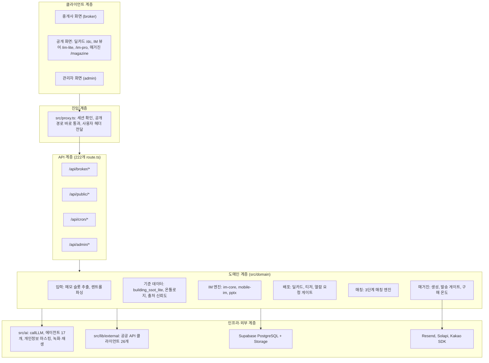
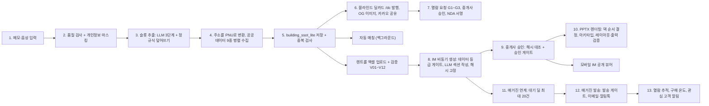
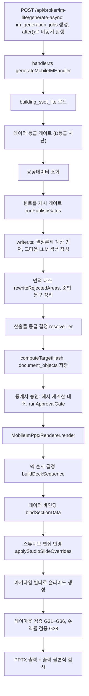
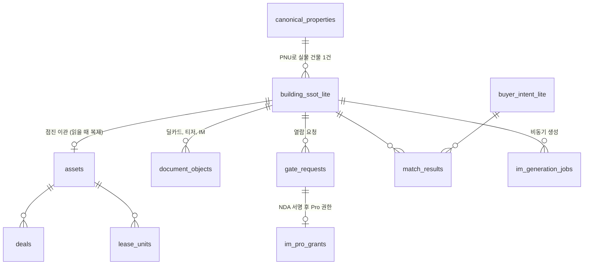
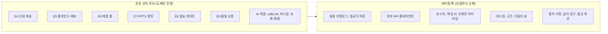

# CREDEAL 시스템 아키텍처·기능명세 소개서

> **용도**: 타 산업 전이 응용 기획(예: [시스템 전이응용 및 사업화 전략](./CREDEAL_시스템_전이응용_및_사업화_전략.md))의 기준 문서
> **기준 시점**: 2026-10-23, `main` @ `c8d184f8`
> **작성 원칙**: 이 문서의 모든 기능·모듈 설명은 **실제 코드로 확인한 사실**만 담았습니다. 기획서에 적혀 있지만 운영 경로에 연결되지 않은 모듈은 "미연결", 메뉴에서 숨긴 기능은 "휴면"으로 따로 표시했습니다. 경로는 저장소 루트 기준입니다.

---

## 목차

1. [한 줄 정의와 핵심 가치](#1-한-줄-정의와-핵심-가치)
2. [시스템 규모 한눈에 보기](#2-시스템-규모-한눈에-보기)
3. [기술 스택](#3-기술-스택)
4. [전체 아키텍처](#4-전체-아키텍처)
5. [엔드투엔드 업무 흐름](#5-엔드투엔드-업무-흐름)
6. [기능 명세 (모듈별)](#6-기능-명세-모듈별)
7. [데이터 모델](#7-데이터-모델)
8. [AI 계층과 "숫자는 코드가 계산" 원칙](#8-ai-계층과-숫자는-코드가-계산-원칙)
9. [품질 보증 체계](#9-품질-보증-체계)
10. [플랫폼·보안·운영](#10-플랫폼보안운영)
11. [기능 성숙도: 운영 / 미연결 / 휴면](#11-기능-성숙도-운영--미연결--휴면)
12. [전이 응용 관점 분석: 범용 엔진 vs 도메인 종속](#12-전이-응용-관점-분석-범용-엔진-vs-도메인-종속)
13. [전이 착수 전 선결 과제](#13-전이-착수-전-선결-과제)
14. [부록](#14-부록)

---

## 1. 한 줄 정의와 핵심 가치

**CREDEAL**은 중소형 상업용 빌딩(꼬마빌딩) 중개사가 **메모 한 줄**에서 출발해 **① 블라인드 딜카드 → ② 투자설명서(모바일 IM·16:9 PPTX) → ③ 고객 정기 매거진**까지 만들고 배포하는 B2B SaaS입니다. 주 사용자는 IT에 익숙하지 않은 60대 중개사입니다.

| 핵심 가치 | 이를 구현하는 시스템 특성 |
|:---|:---|
| **입력 최소화** | 자유 메모·음성을 구조화 데이터로 변환하고, 주소(PNU)만으로 공공데이터 9종을 병렬 수집 |
| **숫자 신뢰성** | 금액·면적·수익률은 정규식·결정론적 계산이 최종 결정. LLM은 문장만 작성 |
| **기밀 보호** | 공개 티저는 가격·수익률을 구간(밴드)으로만 표시. 상세 정보는 열람 요청 → 중개사 승인 → NDA 서명 단계를 거쳐 공개 |
| **전문가급 산출물** | 아키타입(슬라이드 유형) 24종 + 테마 15종 기반 PPTX 자동 조판, 레이아웃 물리 시뮬레이션과 출력 검증 게이트 |
| **장기 고객 관리** | 매거진 발송(이메일·카카오 알림톡), 수신 동의·수신 거부 법규 준수, 열람 행동 기반 "구매 온도" 산정 |

> [!NOTE]
> 2026-10-18부터 제품 범위를 **딜카드 · PPTX Basic IM · 매거진** 3개 축으로 좁혔습니다. 임대·펀딩·파이프라인 등 나머지 기능은 코드에 남아 있지만 메뉴에서 숨겨져 있습니다(`DORMANT: ux60-focus`, [docs/rollback/2026-10-18-dormant-features.md](./rollback/2026-10-18-dormant-features.md)).

---

## 2. 시스템 규모 한눈에 보기

| 항목 | 수치 | 측정 기준 |
|:---|---:|:---|
| 소스 파일 (테스트 제외) | 1,375개 | `src/**/*.ts(x)`에서 `*.test.*`, `tests/`, `__tests__/` 제외 |
| 소스 코드 줄 수 (테스트 제외) | 약 25.9만 줄 | 같은 범위의 전체 줄 수 |
| API 라우트 | 222개 | `src/app/**/route.ts` (브로커 112 · 공개 36 · 관리자 16 · 크론 8 등) |
| 화면(페이지) | 109개 | `src/app/**/page.tsx` |
| UI 컴포넌트 | 205개 | `src/components/**/*.tsx` |
| DB 마이그레이션 | 119개 | `supabase/migrations/*.sql`, 테이블 약 180개 |
| AI 에이전트 | 17개 | `src/ai/agents`, 에이전트마다 버전 관리되는 프롬프트와 Zod 스키마 |
| 단위·통합 테스트 파일 | 488개 | Vitest |
| E2E 테스트 스펙 | 67개 | Playwright (`e2e/`) |
| 골든 테스트 | 회귀 케이스 12종 + 포스처별 E2E 7종 | `tests/fixtures/golden-cases`, `e2e/golden` |

---

## 3. 기술 스택

| 계층 | 기술 | 비고 |
|:---|:---|:---|
| 프레임워크 | **Next.js 16.2.6** (App Router, Turbopack), React 19.2 | 미들웨어 대신 Next 16 방식의 `src/proxy.ts` 사용 |
| 언어·검증 | TypeScript, **Zod 4** | LLM 출력, API 입력, 매거진 콘텐츠를 모두 Zod로 검증 |
| DB·인증·저장소 | **Supabase** (PostgreSQL, Auth, Storage, RLS) | `@supabase/ssr` 쿠키 세션 |
| 배포·스케줄 | **Vercel** (서버리스 함수, Cron) | `vercel.json`: 크론 6개, 긴 작업은 `maxDuration` 180~300초 |
| AI | **OpenAI** (`openai` SDK, 일부 `ai`/`@ai-sdk/openai`) | 3단계 모델 티어(sol/terra/luna), 임베딩 `text-embedding-3-small`, 음성 `whisper-1` |
| 문서 생성 | **pptxgenjs 4**, **sharp 0.33**, jspdf, html2canvas | PPTX 조판, 이미지 최적화 |
| 데이터 파싱 | xlsx(SheetJS), papaparse, pdf-parse, fast-xml-parser | 렌트롤 엑셀, 토지이음 PDF, 공공 API XML |
| 메시징 | **Resend**(이메일), **Solapi**(카카오 알림톡 + SMS 대체 발송), Kakao JS SDK(공유) | |
| 관측성 | pino(모듈별 로거) | APM·Sentry 없음 |
| 테스트 | Vitest 4, Playwright 1.62, 시각 회귀(PNG 비교) | LLM 녹화·재생으로 결정론적 골든 테스트 |

---

## 4. 전체 아키텍처

### 4.1 계층 구조

### 4.2 디렉터리 구조

| 경로 | 역할 | 주요 내용 |
|:---|:---|:---|
| `src/app/(broker)` | 중개사 화면 | `deal-card`, `basic-im-studio`, `buildings/[id]/studio/*`, `magazine-editor`, `inbox`, `tutorial` 등 26개 메뉴 경로 |
| `src/app/(public)` | 비로그인 공개 화면 | `dc/[id]`, `d/[id]`(→`/dc` 리다이렉트), `deal/[region]/[id]`(SEO), `im-lite`, `im-pro`, `nda` |
| `src/app/(magazine)` | 매거진 독자 화면 | `magazine/[brokerId]`, `/[date]`, `/subscribe` |
| `src/app/api` | API | broker 112 · public 36 · admin 16 · cron 8 · funding 7 · pulse 5 등 |
| `src/domain/building` | 핵심 도메인 (파일 302개) | `im-core`(34) · `mobile-im`(202) · `pptx-studio` · `memo-intake` · `common-pipeline` · `*-publication` |
| `src/domain/{matching,gate,magazine,ontology,deal,...}` | 보조 도메인 44개 | 매칭, 열람 요청 게이트, 매거진, 온톨로지(슬롯·열거형·출처) |
| `src/ai` | AI 계층 | `agents`, `prompts`, `providers`, `sanitizer`, `schemas` |
| `src/lib/external` | 공공·외부 API | 건축물대장, 토지이용, 공시지가, 실거래, 등기, V-World, 카카오, 소상공인 상권(SEMAS), 공동주택(KAPT), 부동산원(R-ONE), 네이버 |
| `src/platform/im-pipeline` | 파이프라인 런타임 | 승인 원장의 Supabase 어댑터, 무효화 엔진, 단계 오케스트레이터(미연결) |
| `src/assurance/im-harness` | 품질 하네스 | 골든 실행기, PPTX 바이너리 검사기 |
| `credeal/ssot/*.yaml` | 정책 YAML 17종 | 면수, 마스킹, 용어집, 게이트, 면적 체계 등 (§7.4) |

---

## 5. 엔드투엔드 업무 흐름

---

## 6. 기능 명세 (모듈별)

### F1. 입력: 메모 → 구조화 데이터

| 항목 | 명세 | 근거 |
|:---|:---|:---|
| 주 진입점 | `POST /api/broker/deal-card/from-memo` | `src/app/api/broker/deal-card/from-memo/route.ts` |
| 처리 순서 | ① 메모 품질 검사(위치·자산유형·숫자·거래유형 중 1개 이상) → ② 금지 문구 정리 → ③ 정규식 슬롯 추출 → ④ 중복 검사(AI 비용 발생 전, 409) → ⑤ LLM 체인 → ⑥ 아키타입 분류 → ⑦ 자동 매칭(백그라운드) | `memo-quality-gate.ts:17-45`, `broker-deal-card.ts:73` |
| LLM 체인 | 메모 파싱 → 주소를 PNU로 변환 → 건물 요약 → 블라인드 티저 문구 | `src/ai/agents/broker-deal-card.ts:101,169,188,277` |
| 숫자 확정 | 금액·면적은 **정규식 추출값으로 덮어씀**. AI 값과 1.5배 이상 차이 나면 정규식 값 채택 | `broker-deal-card.ts:168-210`, `price-reconcile.ts` |
| 정규식 슬롯 | 금액(보증금·월세·매가·대출), 면적(연면적·대지), 준공연도, 층수, 공실률, 수익률, 용적률·건폐율, 호텔 지표(객실·ADR·가동률·GOP) 등. 한국어 금액 단위(억·천만·만·원) 해석 | `memo-slot-mapper.ts:26-120` |
| 포스처 자동 판정 | 키워드 점수로 5종 중 선택 | `memo-slot-mapper.ts:241-297` |
| 음성 입력 | OpenAI `whisper-1`(한국어, 부동산 용어 힌트 프롬프트) → 텍스트 | `api/broker/memo/voice/route.ts` |
| 메모 분류 | 신규 매물 / 건물 갱신 / 매수 조건 / 일정 / 일반 메모 | `src/ai/prompts/memo-router.ts` |
| 없는 것 | 카카오톡 대화 자동 수집 없음(붙여넣은 텍스트는 일반 메모로 처리). 건축물대장·등기 이미지 OCR 미구현(`[NOT_IMPLEMENTED]`) | `src/lib/ocr/*` |

### F2. 렌트롤(임대차 현황) 파싱·검증

| 항목 | 명세 | 근거 |
|:---|:---|:---|
| 표준 템플릿 | `CREDEAL_rentroll_template_v1.5.xlsx`. A1 셀로 v1.3/1.4/1.5 판별, A~AF 고정 열 | `src/lib/rentroll/parse-rentroll-workbook.ts` |
| 비표준 파일 | 상위 30행에서 헤더 행 자동 탐지, 열 이름 별칭 사전(예: 월세 = 월임대료/임대료/rent/월차임), 금액 단위 추정, 합계·소계 행 제외 | `parse-rentroll-sheet.ts:157-383` |
| 텍스트 렌트롤 | LLM으로 추출한 뒤 **합계·공실률은 코드가 다시 계산**(LLM 계산을 신뢰하지 않음) | `text-parse-normalize.ts:5-8` |
| 검증 | V01~V12(금액 중복·누락, 기준일, 임대면적 ÷ 연면적, 만기 집중도, 면적 단위 등). 행 합계와 총계가 1% 넘게 다르면 G35 | `rentroll-checks.ts`, `rentroll-classifier.ts:106-111` |
| 데이터 수준 제한 | 렌트롤 충실도(없음/최소/표준/완전)에 따라 NOI·Cap Rate·IRR 산출 허용 여부 결정 | `im-core/evidence/rentroll-tier-engine.ts:63-70` |
| 단위 원칙 | 단위를 **자동으로 고치지 않음**. 단위가 의심되면 중개사 확인을 요구(V12) | `parse-rentroll-workbook.ts` |

### F3. 공공데이터 자동 수집

| 항목 | 명세 | 근거 |
|:---|:---|:---|
| 병렬 수집 | PNU 하나로 9종 동시 호출(건축물대장, 총괄표제부, 공시지가, 토지이용, 상업용 실거래, 카카오 주변시설, 등기, 소상공인 상권, 지적도 WMS). 개별 실패는 `errors[]`에 기록하고 나머지는 계속 진행 | `src/lib/external/enrich-by-pnu.ts:35-114` |
| 캐시 | `external_data_cache` 테이블, 출처별 유효기간(건축물대장 90일, 공시지가·토지이용 180일, 실거래 30일, 등기 7일 등). 만료된 출처만 다시 호출 | `external-data-orchestrator.ts:21-32` |
| 재시도 | 15초 타임아웃, 1회 재시도(지수 백오프), 429 응답의 `Retry-After` 준수 | `fetch-with-retry.ts` |
| 키 없을 때 | 등기 API는 `checked:false, source:'fallback_mock'` 반환. 네이버 부동산은 빈 결과를 돌려주는 스텁 | `registry-api.ts:89-100`, `naver-realestate-api.ts` |
| 필요 환경변수 | §14.2 참조 | |

### F4. 블라인드 딜카드 발행·공유

| 항목 | 명세 | 근거 |
|:---|:---|:---|
| 공개 화면 | `/dc/[id]`: 티저 생성(`projectToTeaser`), 1시간 재검증(ISR), OG 이미지 `/api/og/deal/{id}/kakao` | `src/app/(public)/dc/[id]/page.tsx:134,161` |
| 단축 경로 | `/d/*`는 `/dc/*`로 308 리다이렉트 | `src/proxy.ts:51-55` |
| SEO 페이지 | `/deal/[region]/[id]`, schema.org `RealEstateListing` | |
| 블라인드 규칙 | 가격·수익률 구간 표시, 노출 여부 판정 | `src/domain/dealcard/teaser-rules.ts:20,34,58`, `deal/teaser/visibility-gate.ts` |
| 카카오톡 공유 | 브라우저의 Kakao JS SDK 2.7.2 | `broker/deal-card/[id]/kakao-share-button.tsx:67-80` |
| 마스킹 정책 YAML | 항목별 공개 단계(공개 / NDA / Pro). 예: 주소는 Pro 전까지 동 단위까지만, 건물명은 비공개 | `credeal/ssot/im.masking.yaml` (Python 로더만 읽음) |

### F5. 열람 요청 게이트 (단계별 공개)

| 항목 | 명세 | 근거 |
|:---|:---|:---|
| 단계 | **G1~G3** (G4·G5는 "MVP 범위 아님"으로 거부) | `src/domain/gate/gate-request.ts:34-38` |
| 상태 | `submitted → broker_review → approved / rejected / expired`. **자동 승인 없음** + 5분 주기 크론(`hold-expiry`)에서 만료 요청 자동 전환(`expireGateRequests`) | `gate-request.ts:51,127`, `api/cron/hold-expiry/route.ts` |
| 요청 | G1은 비로그인 요청 가능(`/api/gate-requests`), G2는 `/api/public/gate/submit`(IP 호출 제한 및 서버 측 딜 소유 중개사 조회로 `tenantId` 위조 차단) | `dc/[id]/GateRequestForm.tsx:27`, `api/public/gate/submit/route.ts` |
| 승인 | 해당 건물·딜을 소유한 중개사만 승인 가능 (`review`, `pro-grants/[id]/approve` 소유권 검증) | `api/gate-requests/[id]/review/route.ts:31,52-58`, `api/broker/pro-grants/[id]/approve/route.ts` |
| NDA·Pro 권한 | `/nda/[id]`에서 서명하면 `im_pro_grants`가 활성화됨(24시간 만료, `generateProIMWatermark` 표준 워터마크 생성). `/im-pro/[grantId]`는 만료 시 410 응답, 검색엔진 비노출(noindex), 열람 시 `logGateAccess` 감사 로그 기록 | `api/gate-requests/[id]/sign`, `api/public/im-pro/[grantId]/route.ts`, `domain/gate/nda-watermark.ts`, `domain/gate/gate-audit-logger.ts` |
| 중개사 수신함 | 열람 요청, 활동 이벤트, 앱 알림 통합 | `api/broker/inbox` |

### F6. IM(투자설명서) 생성 엔진 — 핵심 자산

#### 6.1 실제 운영 경로

근거: `api/broker/im-lite/generate-async/route.ts:23,93,104`, `generate/handler.ts:160,251,328,575,716,747,901,1144`, `mobile-im/pptx/pptx-renderer.ts:140,1415-1423`

#### 6.2 im-core 개념 모델 (도메인 무관 설계)

| 개념 | 정의 | 운영 연결 | 근거 |
|:---|:---|:---|:---|
| **Claim** | 화면에 표시되는 모든 사실은 `{대상, 값, 단위, 근거(1개 이상), 출처, 기준일, 상태}`. 상태: 미검증 / 중개사 확인 / 대조 완료 / 충돌 / 만료 / 자료 없음 | ✅ | `im-core/claim.ts:20-26,72,115` |
| **ClaimRegistry** | Claim 저장소와 충돌 목록 | ✅ (승인 단계) | `claim-registry.ts:64` |
| **해시 고정 승인** | 정규화한 JSON(키 정렬)의 `sha256`. 검토 뒤 내용이 바뀌면 해시가 달라져 승인 거부(422) | ✅ | `target-hash.ts:38`, `approve/route.ts:97-110` |
| **승인 게이트** | 충돌 Claim, 빈 저장소, 포스처별 필수 항목 누락 시 차단(예: 수익형은 매가·면적·수익률 필수) | ✅ | `approval-gate.ts:46,70-85` |
| **산출물 등급(ReleaseTier)** | 데이터 충실도에 따라 산출물 종류 결정: 내부용 / 사실 OM / 분석 IM / 의사결정 IM / 전문가 필요 | ✅ | `release-tier.ts:26,83,136` |
| **무효화 엔진** | 변경 유형 13종 → 영향받는 채널·단계·재승인 필요 여부 | ✅ (섹션 저장 시) | `platform/im-pipeline/regeneration/invalidation-engine.ts` |
| **승인 원장** | machine_check / human_approve / reject / invalidate / withdraw 이벤트, 채널(딜카드·모바일·PPTX)별 게시 상태 | ⚠️ PPTX 스튜디오 승인에서만 사용 | `approval/ledger-port.ts`, `supabase-approval-ledger.ts` |
| 수식 그래프 평가 | 수식 의존 그래프와 계보(lineage) 추적 | ❌ 미연결 | `claims/evaluation-engine.ts:24` |
| 유효 스냅샷 / 게시 패키지 / 채널 간 일치 검사 | 면적 기준 4종 고정, L1~L3 게시 자격, 웹 ↔ PPTX 7개 필드 대조 | ❌ 미연결 | `effective-snapshot.ts`, `package-builder.ts`, `cross-channel-checker.ts` |

#### 6.3 투자 포스처와 덱 구성

| 항목 | 명세 | 근거 |
|:---|:---|:---|
| 포스처 5종 | `income`(수익형) · `owner_occupied`(사옥) · `development`(개발) · `operating`(운영형·호텔) · `trading`(시세차익) | `src/domain/ontology/enums.ts:171` |
| Basic IM | 슬롯 9개 계약(표지, 요약, 건물, 입지, 토지, 렌트롤, 수익률, 사진, 마무리), 7~12장. 렌트롤·수익률은 수익형 중심 | `pptx/basic-im-contract.ts:34,83-87` |
| 포스처별 분기 | 개발형: 토지·규모·명도·공사비·적층·사업성 / 운영형: KPI·매출·계절성·운영사 / 시세차익형: 비교사례·추세·회전율 | `pptx/deck-sequencer.ts:204,251-326` |
| Pro IM | 5개 챕터, 30~40장 | `pptx/pro-deck-sequencer.ts:24-26` |
| 면 순서 YAML | `im.pages.yaml`은 수익형만 다루며 프리셋 3종. **PPTX 면 순서는 TS 코드에 고정**되어 있고, 이 YAML은 모바일 섹션 순서에만 쓰임 | `lib/ssot-adapter.ts:519`, `mobile-im/writer.ts:709` |

#### 6.4 PPTX 조판 엔진

| 구성 요소 | 명세 | 근거 |
|:---|:---|:---|
| 아키타입 | **범용 14종**: 표지, 수치 그리드, 대형 표, 비대칭 7:5·7:4, 다이어그램·지도, 3단 블록, 이중 표, 프로세스, 마무리, 갤러리, 투자 논지, 체크리스트, 챕터 구분 / **부동산 전용 10종**: 객실 사양, 소유 구조, 운영 KPI, 투자 구조, 준공 전 마케팅, 사선제한 적층도, 수익률 공식, 렌트롤 적층도, 중개사 부록, 토지이용계획. A19~A21은 비활성 | `pptx/archetypes/*` |
| 레이아웃 물리 | 한중일 문자 폭과 줄바꿈 시뮬레이션, 이진 탐색으로 글자 크기 맞춤, 이미지 최소 해상도 180/150 DPI, 잘림 25%면 경고·45%면 차단 | `pptx/layout-physics.ts`, `pptx/utils/layout-physics.ts` |
| 글자 수 예산 | 영역별 글자 수 상한 적용 | `pptx/text-budget.ts` |
| 레이아웃 게이트 | G31~G36. G34를 제외한 위반은 렌더링 중단(`[LAYOUT_GATE]`) | `layout-validator.ts:127`, `pptx-renderer.ts:1415-1423` |
| 테마 | 토큰 세트 15종. 스튜디오 기본 프리셋 10종(Basic 6 + Pro 4)과 사용자 정의 프리셋. 강조색 하나로 팔레트를 만들고 WCAG 대비를 보장 | `pptx-theme.ts:68-813`, `src/contexts/ThemeContext.tsx:24`, `brand-skin.ts` |
| Basic IM Studio | 16:9 실시간 미리보기, 슬라이드 순서·숨김·제목·머리말/꼬리말·테마 편집. 편집 내용은 `_studio*` 필드로 저장하고 렌더링 시 반영 | `app/(broker)/broker/basic-im-studio/[buildingId]`, `studio-overrides-applier.ts` |
| 이미지 처리 | sharp: 10MB 상한, EXIF 회전 보정, 최대 폭 1800px, mozjpeg 품질 75, 동시 처리 4개. 카카오 정적 지도와 주변시설 오버레이 | `pptx/utils/image-optimizer.ts:45-150` |

#### 6.5 IM 공개 뷰어

| 화면 | 명세 | 근거 |
|:---|:---|:---|
| `/im-lite/[buildingId]` | 공개용. `published` 또는 `broker_reviewed` 상태의 최신 문서 표시 | `fetch-im-data.ts:299-307` |
| `/im-pro/[grantId]` | NDA 서명과 유효한 권한이 있어야 열람. 검색엔진 비노출, 워터마크 표시, 내보내기는 `pdf_export_allowed`일 때만 허용 | `im-pro/layout.tsx:11`, `api/public/im-pro/[grantId]/*` |

#### 6.6 비동기 실행

| 항목 | 명세 | 근거 |
|:---|:---|:---|
| 방식 | `im_generation_jobs` 테이블 + Next `after()` + 클라이언트가 3초마다 최대 190초 동안 상태 조회 | `use-im-data-form.ts`, `im-lite/job-status/route.ts` |
| 함수 시간 한도 | 동기 180초, 비동기·PPTX 300초 | `vercel.json` |
| 진행률 표시 | 실제 진행 단계가 아니라 **경과 시간 기준 추정 문구** | `job-status/route.ts:37-48` |

### F7. 매칭 엔진

| 항목 | 명세 | 근거 |
|:---|:---|:---|
| 1단계 필수 조건 | 예산 ≤ 최대 예산 × 1.2, 지역 계층, 자산유형 분류, 필수 조건(명도·위반건축물·구분소유), 일정(선택) | `src/domain/matching/matching-engine.ts:25-129` |
| 2단계 의미 유사도 | `text-embedding-3-small` 코사인 유사도 | `matching-engine.ts:133-169` |
| 3단계 가중 합산 | 시장·재무·공실·의미·일정·세금 점수 합산 + 구매 온도 보정(+5/+2/−3). S ≥ 85, A ≥ 70, B ≥ 50, 나머지 C | `matching-engine.ts:225-267` |
| 목적별 가중치 | 수익형·사옥·개발·운영·시세차익·증여(세금 0.5)·기본 | `matching-types.ts:79-87` |
| 변형 | 임대 매칭, 펀딩 매칭(같은 3단계 구조) | `lease-matching-engine.ts`, `funding-matching-engine.ts` |
| 중개사 간 공동중개(Circles) | 신호만 → 기본 정보 → 전체 상세 순 공개, 양측 신원 공개 승인 시 공동중개 딜 자동 생성, 7일 내 미승인 시 만료(크론). **메뉴에서 숨김** | `team/circle-matching-service.ts:396,457,528-540` |

### F8. 매거진(정기 뉴스레터)

| 항목 | 명세 | 근거 |
|:---|:---|:---|
| 생성기 | 주간판(KST 기준, Zod 검증, 실패 시 생성 중단 후 `needs_review` 초안 저장), 특별판(단일 매물 속보), 세무 클리닉(숫자는 `tax-rules-2026.ts`에서만 가져옴), 5분 간편판(LLM 1회 호출, 실패 시 결정론적 대체) | `src/domain/magazine/*-generator.ts` |
| 콘텐츠 채널 | 뉴스 채널 5종 | `news-channels.ts` |
| 숫자 검증 | 본문의 모든 숫자가 원천 데이터의 숫자와 일치해야 통과 | `magazine/quality-gate.ts` |
| 발송 게이트 | 발송 중지 스위치 → 허용 목록 → 동의·수신 거부·대기 상태 → 야간 발송 제한 → 광고 표시·수신 거부 링크·발신자 → 발송 채널 → 중복 방지 원장(`magazine_dispatch_logs`) → 일일 상한 | `send-gate.ts:5-13` |
| 발송 채널 | Resend 이메일, Solapi 카카오 알림톡(실패 시 SMS 대체 문구). 무료 등급은 이메일만 가능 | `send-providers.ts:61-108`, `distribute-magazine.ts:112-116` |
| 법규 준수 | 정보통신망법 §50 이중 수신 동의, 자동 재구독 없음, 수신 거부·개인 링크 토큰은 HMAC 서명 | `consent-service.ts:1-16`, `unsub-token.ts`, `sid-token.ts` |
| 구매 온도 | 열람 참여도 × 0.4 + 채널 간 행동 × 0.6. 4단계(80/60/40/20), 183일 동안 열람이 없으면 비활성 | `buyer-temperature.ts:1-16` |
| IM 연계 | IM을 생성하면 매거진 대기 딜에 추가(최대 20건) | `im-to-magazine-bridge.ts` |
| 운영 스위치 | `MAGAZINE_SEND_ENABLED`, `_DRY_RUN`, `_ALLOWLIST`, `_CRON_GENERATE_ENABLED`, `_AUTO_SEND_ALLOWED`, `_TRACKING_ENABLED` | `src/lib/magazine/send-flags.ts` |

### F9. 분석·CRM·인텔리전스

| 항목 | 명세 | 근거 |
|:---|:---|:---|
| 이벤트 기록 | 타입이 정해진 이벤트 목록을 `activity_events`에 기록(일부 서비스는 테이블에 직접 기록) | `src/domain/analytics/record-event.ts:17` |
| 딜 단계 상태 기계 | 딜카드 생성 → 열람 요청 → IM 생성 → 매수자 미팅 → LOI → 계약 → 성사 / 실패 (8단계, 단계별 필수 항목) | `src/domain/pipeline/bridge-state-machine.ts:10-83` |
| 모닝 인텔리전스 | 뉴스, 실거래, 경매, 임대료, 공시지가, 상권 데이터를 묶어 매일 브리핑(크론 23:00 UTC) | `api/broker/morning-intelligence/route.ts:73-86` |
| 고객 관리 | 고객, 연락처, 맞춤 큐레이션 | `api/broker/clients/*` |
| 리포트 | 주간·월간 리포트 | `api/broker/*-report` |

---

## 7. 데이터 모델

### 7.1 기준 데이터(SSOT) 구조

- **`building_ssot_lite`**: 평면 레코드(PNU, 주소, 자산유형, 면적(평), 용적률, 용도지역, 매가, 신호 문구, 임대 요약, 층별 임대) + JSONB `layers`(재무·위치·좌표·사진) — `building-ssot-lite.types.ts`
- **v3 테이블 이관**: `readWithMigration`이 `assets` → 기존 테이블 순으로 읽고, 새 테이블에 지연 기록해 한 번에 전환하지 않고 점진적으로 옮김 — `src/lib/ssot-adapter.ts:306`
- **실물 건물 단일 식별**: `canonical_properties`(PNU 고유) — `canonical-property.ts`

### 7.2 주요 테이블 (약 180개 중 핵심)

| 영역 | 테이블 |
|:---|:---|
| 물건 | `building_ssot_lite`, `building_ssot_full`, `canonical_properties`, `assets`, `observations`, `evidence_files`, `source_artifacts`, `land_use_plans`, `official_land_prices` |
| 딜·배포 | `deals`, `deal_pipeline_states`, `deal_casepacks`, `deal_parties`, `building_signal_cards`, `document_objects`, `match_results`, `gate_requests`, `im_pro_grants` |
| 임대 | `lease_units`, `lease_ledger`, `lease_spaces`, `tenant_intent`, `lease_match_results` |
| 수요(매수자) | `buyer_intent_lite`, `buyer_condition`, `investor_profiles`, `broker_memos`, `broker_clients` |
| IM | `im_projects`, `im_documents`, `im_generation_jobs`, `im_golden_sets`, `pptx_projects`, `pptx_slides`, `approval_events`, `publish_records` |
| 외부 데이터 캐시 | `external_data_cache`, `external_transactions`, `commercial_district`, `rental_market_data` |
| 운영 | `ai_runs`, `activity_events`, `track_event`(월별 파티션), `usage_counters`, `user_subscriptions`, `organizations`, `profiles`, `broker_profiles`, `magazine_dispatch_logs` |

### 7.3 온톨로지와 데이터 신뢰도

| 요소 | 명세 | 근거 |
|:---|:---|:---|
| 슬롯 카탈로그 | 165개 이상(확장 슬롯은 JSONB `pack_slots`) | `src/domain/ontology/slots.ts` |
| 열거형 | 30개 열거형 집합과 버전 규칙 | `ontology/enums.ts` |
| 출처 신뢰도 10단계 | 등기 1.0 · 공공 API 0.95 · 전문가 0.95 · 식별된 공공 API 0.90 · 보강된 중개사 입력 0.80 · 장부 0.70 · 매도인 0.65 · 중개사 0.60 · 가정 0.30 · 파생값 = 입력 중 가장 낮은 값 | `ontology/provenance.ts`, `constants/thresholds.ts:37-46` |
| 문서 완성도 점수 | 100점 만점(렌트롤 25, 건축물대장 20, 등기 15 …), 최신성에 따라 감점. 점수에 따라 산출물 개방: 20점 관심 리포트 · 40점 티저 · 60점 스냅샷 · 80점 IM-lite · 100점 전체 IM | `building/layer-score-engine.ts` |
| 데이터 등급 A~D | 물건 확인 수준(P0~P3) × 리드 확인 수준(R0~R3) 매트릭스 | `src/domain/asset/grade-engine.ts:192-217` |

### 7.4 정책 YAML (`credeal/ssot/`)

| 파일 | 다루는 내용 | 런타임 사용 |
|:---|:---|:---|
| `im.pages.yaml` | 프리셋별 면 순서(수익형), 최대 면수 | ✅ TS가 직접 읽음 (`ssot-adapter.ts`, `thresholds.ts`) |
| `im.masking.yaml` | 텍스트·이미지 마스킹 단계 | Python 로더 전용 |
| `im.gating.yaml` · `im.tokens.yaml` · `im.budget.yaml` | 필드 49개·블록 51개 게이트, 토큰 60개, 필수 12면 | `build_ssot.py`가 생성. 일부는 테스트에서 참조 |
| `im.d56-lexicon.yaml` · `im.lexicon.yaml` | 부동산 용어 사전(4,133줄), 어휘 규칙 | TS 주석과 테스트에서 참조 |
| `im.area.yaml` · `im.parcel.yaml` | 면적 체계(연면적 → 계약면적 → 임대면적 → 전용면적), 필지 규칙 | |
| `im.errors.yaml` · `im.invariants.yaml` · `im.format.yaml` · `im.image.yaml` · `im.assumptions.yaml` · `im.bindings.yaml` | 오류 코드, 불변식, 숫자·날짜 서식, 사진 규격, 가정 상수, 산출물 ↔ 레지스트리 바인딩 | |
| `im.ontology.yaml` | 온톨로지 개선 요구사항 문서(정본 아님) | |

> [!WARNING]
> 정책 YAML 중 **TS 런타임이 직접 읽는 것은 `im.pages.yaml` 하나**입니다. 나머지 정책은 대부분 TS 코드에 직접 쓰여 있습니다. 다른 산업으로 옮길 때는 정책을 YAML이나 DB 데이터로 꺼내는 작업이 필요합니다.

---

## 8. AI 계층과 "숫자는 코드가 계산" 원칙

| 항목 | 명세 | 근거 |
|:---|:---|:---|
| 제공자 | 등록된 제공자는 OpenAI 하나. 키가 없거나 테스트 환경이면 Mock으로 대체(`allowMock:false`면 오류) | `src/ai/llm-client.ts:13-27` |
| 모델 티어 | `sol` / `terra` / `luna` 3단계. `AI_MODEL_*` 환경변수로 교체 | `src/ai/model-selector.ts` |
| 공통 호출 함수 `callLLM` | 제공자 대체 체인, 120초 데드라인, 백오프 재시도, 메모리 캐시. 약 40개 모듈이 사용 | |
| 에이전트 17종 | 에이전트마다 버전 관리 프롬프트(`prompts/`) + Zod 스키마(`schemas/`), 실행 기록은 `ai_runs` | `src/ai/agents` |
| 개인정보·공격 차단 | LLM 호출 전에 프롬프트 인젝션·웹 공격 패턴 차단, 개인정보(전화·이메일·주민번호·상세주소·건물명·임차인·소유주)를 토큰으로 바꿨다가 응답 후 복원 | `src/ai/sanitizer/memo-sanitizer.ts` |
| 녹화·재생 | `LLM_MODE` = live / record / replay / record-missing. 정규화한 프롬프트의 해시를 키로 사용, 재생할 녹화가 없으면 조용히 Mock으로 넘어가지 않고 오류 | `src/ai/providers/record-replay.ts` |

**숫자 결정 원칙**

- `im-core/financial-calculator.ts:1-8` 주석: "LLM은 Claim 참조 설명만 → 새 숫자 생성 불가". 계산 결과는 모두 `ClaimRegistry`에 등록합니다.
- 수익률 기준(GPI/EGI/NOI)과 표시 문구는 `calculation.ts`, 가치평가(거래사례비교법 + 수익환원법)는 `valuation-calc.ts`가 담당합니다.
- **안전장치는 휴리스틱입니다**:
  - 가격 20배·면적 10배 이상 벗어나면 환각으로 보고 템플릿으로 대체(`im-context-builder.ts:90`).
  - 섹션 간 숫자 교차 검증(`cross-validator.ts`).
  - 게이트 G06(환각)·G29(브랜드 환각)에 걸리면 승인 차단.

> [!IMPORTANT]
> "LLM이 쓴 숫자는 모두 허용 목록에 있어야 한다"는 **전역 강제 검사는 아직 없습니다**. 매거진에는 숫자 대조 검사가 있지만 IM에는 휴리스틱 검사뿐입니다. 의료·무역처럼 숫자 오류의 법적 책임이 큰 산업으로 옮길 때 최우선 보강 대상입니다.

---

## 9. 품질 보증 체계

| 계층 | 수단 | 근거 |
|:---|:---|:---|
| 출력 불변식 | 미치환 자리표시자, 회피 문구 16종, `NaN`/`undefined`/`[object Object]`, 빈 쌍, JSON·마크다운 노출, Mock 값, 중복 문장. `IM_INVARIANT_MODE`=warn(기본) 또는 block | `mobile-im/quality/output-invariants.ts:44`, `invariant-telemetry.ts` |
| PPTX 형상 검사 | 슬라이드 밖으로 나감(오류), 글자 넘침·겹침(경고) | `pptx-geometry-audit.ts` |
| 시각 회귀 | PNG 기준 이미지와 비교(차이 0.02 임계) → `npm run visual:check` / `visual:approve` | `visual-gate.ts`, `image-diff.ts` |
| PPTX 바이너리 검사 | 금지 토큰, Mock 노출, 회피 문구, 페르소나·법적 위험 패턴 | `assurance/im-harness/observers/pptx-binary-observer.ts` |
| 골든 회귀 12종 | 당산 L15, 상도 다필지, 양평 토지, 렌트롤 없음, 렌트롤 불일치, 사진 개인정보, PPTX 넘침, 역레버리지, 인허가 구역, 최소 메모, 용어 위반, 승인 후 변조 | `tests/fixtures/golden-cases` |
| 포스처별 골든 E2E | 7개 스펙(수익형 2, 개발형 2, 사옥, 운영형, 시세차익). LLM 재생으로 결정론적 실행 | `e2e/golden`, `npm run test:golden:replay` |
| 사전 점검 | 파이프라인 감사, 문구 교차 비교, 적층도 테스트 | `npm run preflight` |
| 출시 절차 | preflight → `tsc` → `next build` → `git push`(Vercel 자동 배포) | `.agents/rules/*` |

> [!NOTE]
> 골든 실행기(`golden-runner.ts:40-47`)는 `gateExpected`의 `'BLOCK'`·`'BLOCKER'`·`'ERROR'` 표기를 모두 `'BLOCK'`으로 정규화하여 12종 골든 픽스처 전체의 차단/통과 기대값을 일관되게 검증합니다(2026-10-23 보완 완료).

---

## 10. 플랫폼·보안·운영

| 항목 | 현재 상태 | 근거 |
|:---|:---|:---|
| 인증 | `/broker`, `/admin`만 Supabase 쿠키 세션 확인. 확인한 사용자 정보를 헤더로 넘기고 위조 헤더는 제거. `/api`는 각 라우트가 직접 확인(`teaser/publish` 등 브로커 전용 라우트 `requireBroker` 적용 완료) | `src/proxy.ts:61-63,102-115`, `api/broker/deal/[id]/teaser/publish/route.ts` |
| 역할 | broker / admin / expert / public_user. 알파 테스트 기간에는 자동 승격이 동작하되, 운영 환경에서 `ALLOW_ALPHA_ROLE_UPGRADE=false` 설정 시 자동 승격을 즉시 차단(403) | `src/lib/auth-guard.ts:186-210` |
| 행 단위 보안(RLS) | 48개 마이그레이션에서 활성화, 정책 약 233개(소유자 기준). 단, **서버 코드 대부분은 RLS를 우회하는 서비스 클라이언트 사용** | `supabase/migrations` |
| 보안 헤더 | CSP(보고 전용), HSTS, X-Frame-Options(DENY, `/magazine`·`/dc`만 SAMEORIGIN), CORS 허용 목록 | `next.config.ts` |
| 호출 제한 | 4개 라우트 적용(온보딩 사진, IM PPTX, 번역, 공개 게이트 G2 제출 `/api/public/gate/submit`) | `src/lib/rate-limiter.ts` |
| 크론 | 6개 (§14.3). 모든 크론 라우트가 `CRON_SECRET` 확인 (`hold-expiry`에서 슬롯 만료 + 게이트 요청 만료 동시 수행) | `vercel.json`, `api/cron/hold-expiry/route.ts` |
| 기능 플래그 | 코드 내 고정 맵 + 런타임 덮어쓰기(`posture_trading`, `give_to_get` 꺼짐). 휴면 기능은 `lib/dormant-features.ts`와 리다이렉트로 관리 | `building/feature-flags.ts` |
| 구독·과금 | 등급 free/pro/premium, 한도(free: 딜카드 3·IM 0, pro: IM 1) 정의. **사용량 차단 로직은 미연결이고 결제 연동 없음**(Stripe·토스·포트원 없음) | `subscription/tier-gate.ts:17-33` |
| 번들 최적화 | 서버리스 함수 용량 초과 대응: 동적 파일 접근에 `turbopackIgnore` 적용, 파일 추적 제외·포함 목록 지정(2026-10-20) | `next.config.ts`, commit `c8d184f8` |

---

## 11. 기능 성숙도: 운영 / 미연결 / 휴면

| 구분 | 기능·모듈 |
|:---|:---|
| ✅ **운영 중 (핵심 3축)** | 메모 → 딜카드, `/dc` 공개·OG·카카오 공유, 열람 요청 G1~G3·NDA·Pro 권한·만료 크론(`expireGateRequests`)·표준 워터마크(`generateProIMWatermark`)·접근 감사 로거(`logGateAccess`), 렌트롤 파싱·검증, IM 비동기 생성·해시 고정 승인·S70 파일 승인 선행 게이트, PPTX 렌더러·Basic IM Studio(프리셋 10종), 모바일 IM 뷰어, 자동 매칭, 매거진 생성·발송 게이트·구매 온도, 모닝 브리핑 크론 |
| ⚠️ **구현·테스트됐지만 운영 경로에 미연결** | 수식 그래프 평가 엔진, 유효 스냅샷, 게시 패키지(L1~L3), 채널 간 일치 검사, 모바일 컴포저(m00~m50), 단계 오케스트레이터(단계별 시간 예산), 응답 마스커(G1~G3 필드), k-익명성 가드, 설명 가능한 매칭, 구독 한도 차단 |
| 💤 **휴면 (메뉴 숨김 또는 리다이렉트)** | 파이프라인·퍼널, 공동중개, 캠페인, 메모 목록, 일정, 임대 카드·임대 매칭, 펀딩·마켓플레이스, 공개 pulse·insight·market·explore(`/hub`로 리다이렉트), 온보딩·바이브 카드 |
| 🔗 **접근 가능하지만 핵심 범위 밖** | agora(커뮤니티), services(협력업체), building-radar, space, 외부 cre-aipage 연동(space-ai-handoffs) |

> [!TIP]
> 전이 기획에서 "재사용"이라고 할 때는 이 표의 ✅ 행만 바로 쓸 수 있는 자산으로 보는 것이 안전합니다. ⚠️ 행은 "설계와 테스트가 끝난 부품"이라 연결 작업(보통 수일~수주)이 필요합니다.

---

## 12. 전이 응용 관점 분석: 범용 엔진 vs 도메인 종속

| 엔진 | 범용으로 재사용 가능한 부분 | 교체가 필요한 도메인 종속 부분 | 전이 난이도 |
|:---|:---|:---|:---:|
| **E1. 비정형 입력 → 구조화** | 품질 검사 → 개인정보 마스킹 → LLM 추출 → Zod 검증 → 정규식 덮어쓰기·대조 → 중복 검사 → 비동기 작업 흐름 | 정규식 어휘, 포스처 키워드, 한국어 금액 단위, LLM 스키마 필드 | 중 |
| **E2. 표 형식 원장 파싱** | 버전별 템플릿 + 별칭 사전 기반 대체 파싱 + 코드 재계산 + 데이터 수준별 지표 제한 + V 검증 체계 | 열 정의, 임대차법 항목, 평·㎡ 변환, V01~V12 규칙 | 중 |
| **E3. 외부 데이터 오케스트레이션** | 식별자 변환 → 병렬 호출 → 출처별 유효기간 캐시 → 부분 실패 허용 | API 클라이언트 26개 전부(한국 부동산 전용) | 상 (새 API 연동) |
| **E4. 신뢰 계층 (Claim·출처·등급)** | Claim·근거·상태 모델, 출처 신뢰도 계수, 완성도 점수와 산출물 개방 단계, 해시 고정 승인, 무효화 매트릭스 | Claim 대상 이름, 포스처별 필수 항목, 면적 기준, 한국 법규 계산 | **하** |
| **E5. 블라인드 배포·단계별 공개** | 티저 생성, 구간 표시 규칙, OG·공유, 열람 요청 상태 기계, NDA + 기간 제한 권한 + 워터마크 | 구간 규칙 표, 마스킹 항목, 요청 폼 항목 | **하** |
| **E6. 매칭** | 필수 조건 → 임베딩 → 목적별 가중 합산 → 등급 구조(임대·펀딩에 이미 이식된 선례) | 필터, 분류 체계, 가중치 표 | **하** |
| **E7. PPTX 조판** | 아키타입 레지스트리, 테마 토큰, 글자·레이아웃 물리 시뮬레이션, 레이아웃 게이트, 스튜디오 편집 반영, 이미지 처리 | 부동산 아키타입 10종, 데이터 바인더, TS에 고정된 덱 순서 | 중 (덱 순서 데이터화 필요) |
| **E8. 매거진·발송** | 발송 게이트, 동의·수신 거부·HMAC 토큰, 중복 방지 원장, 채널 추상화, 구매 온도, 숫자 대조 검사 | 뉴스 채널, 세무 규칙, 시장 데이터 출처 | **하** |
| **E9. 품질 보증** | 불변식 엔진, 형상·시각 게이트, LLM 녹화·재생, 골든 실행기 | 금지 문구·정규식 목록, 골든 케이스 | 하 |

---

## 13. 전이 착수 전 선결 과제 및 보완 현황

| 우선순위 | 상태 | 과제 | 내용 및 보완 결과 | 관련 위치 |
|:---:|:---:|:---|:---|:---|
| P0 | ✅ **보완 완료** | **역할 자동 승격 제어 스위치 도입** | `ALLOW_ALPHA_ROLE_UPGRADE=false` 환경변수 설정 시 미인가 사용자의 자동 broker 승격을 차단하고 403 반환 | `lib/auth-guard.ts:186-210` |
| P0 | ✅ **보완 완료** | 공개 게이트·티저 발행·Pro 승인 라우트 **인증·소유권·호출 제한 보강** | ① `/api/public/gate/submit` IP 호출 제한(분당 15회) 및 서버 측 딜 소유 중개사 조회로 `tenantId` 스푸핑 차단 ② `/api/broker/deal/[id]/teaser/publish`에 `requireBroker` 인증 및 실제 행위자 ID 기록 ③ `/api/broker/pro-grants/[id]/approve` 소유권 검증 및 `approve-file` S70 원장 기록 전 `runApprovalGate` 선행 검증 | `api/public/gate/submit`, `api/broker/deal/[id]/teaser/publish`, `api/broker/pro-grants/[id]/approve`, `approve-file/route.ts` |
| P0 | 📋 차기 과제 | **LLM 숫자 허용 목록 검사**를 IM 전체에 적용 | 매거진에는 숫자 대조 검사가 있으나 IM은 휴리스틱 중심. 의료·무역 전이 시 전역 숫자 화이트리스트 게이트로 확장 필요 | §8 |
| P1 | ✅ **보완 완료** | 기밀 공개 게이트 미연결 모듈(**만료 크론·워터마크·감사 로거**) 운영 연결 | ① `/api/cron/hold-expiry`에 `expireGateRequests` 연결 ② `/api/gate-requests/[id]/sign` 및 `/api/public/im-pro/[grantId]`에 `generateProIMWatermark`·`logGateAccess` 연결 ③ `handler.ts`의 `hasAsOf` 항진(`\|\| true`) 버그 수정 | `src/domain/gate/*`, `api/cron/hold-expiry`, `im-lite/generate/handler.ts:913` |
| P1 | 📋 차기 과제 | 정책(덱 순서, 마스킹, 구간, 가중치)을 **YAML·DB로 분리** | 현재 TS에 고정되어 있어 신규 버티컬 추가 시 버티컬 팩 설정 파일로 분리 필요 | `deck-sequencer.ts`, `teaser-rules.ts`, `matching-types.ts` |
| P1 | 📋 차기 과제 | **결제 연동 + 사용량 차단 연결** | 상용 과금 검증을 위해 PG(토스·Stripe) 및 `tier-gate.ts` 차단 로직 연결 필요 | `subscription/tier-gate.ts` |
| P2 | ✅ **보완 완료** | 출처 신뢰도 어휘 통일(`provenance.ts` ↔ `provenance-lint.ts`) | `provenance-lint.ts`의 `TIER_PRIORITY`에 표준 10단계 출처 어휘(`public_api`, `expert`, `ledger`, `seller`, `broker` 등) 통합 완료 | `domain/building/provenance-lint.ts` |
| P2 | ✅ **보완 완료** | 골든 기대값 표기 통일(`BLOCK`/`BLOCKER`/`ERROR`) | `golden-runner.ts`에서 `'BLOCK'`·`'BLOCKER'`·`'ERROR'`를 모두 차단 기대값으로 정규화 완료 | `assurance/im-harness/golden-runner.ts:40-47` |
| P2 | 📋 차기 과제 | 실제 진행 단계를 보고하는 작업 상태 + 단계 오케스트레이터 연결 | 긴 생성 시간 동안 사용자 경험 개선 | `platform/im-pipeline` |
| P2 | 📋 차기 과제 | 관측성(APM·오류 추적) 도입 | 운영하는 버티컬이 늘수록 장애 진단이 어려워짐 | |

---

## 14. 부록

### 14.1 핵심 파일 색인

| 영역 | 파일 |
|:---|:---|
| 메모 → 딜카드 | [`from-memo/route.ts`](../src/app/api/broker/deal-card/from-memo/route.ts), [`broker-deal-card.ts`(도메인)](../src/domain/building/broker-deal-card.ts), [`broker-deal-card.ts`(에이전트)](../src/ai/agents/broker-deal-card.ts), [`memo-slot-mapper.ts`](../src/domain/building/memo-slot-mapper.ts), [`price-reconcile.ts`](../src/domain/building/price-reconcile.ts) |
| 렌트롤 | [`parse-rentroll-workbook.ts`](../src/lib/rentroll/parse-rentroll-workbook.ts), [`rentroll-tier-engine.ts`](../src/domain/building/im-core/evidence/rentroll-tier-engine.ts) |
| 공공데이터 | [`enrich-by-pnu.ts`](../src/lib/external/enrich-by-pnu.ts), [`external-data-orchestrator.ts`](../src/lib/external/external-data-orchestrator.ts), [`fetch-with-retry.ts`](../src/lib/external/fetch-with-retry.ts) |
| 기준 데이터·온톨로지 | [`building-ssot-lite.types.ts`](../src/domain/building/building-ssot-lite.types.ts), [`ssot-adapter.ts`](../src/lib/ssot-adapter.ts), [`provenance.ts`](../src/domain/ontology/provenance.ts), [`enums.ts`](../src/domain/ontology/enums.ts) |
| IM 생성 | [`generate-async/route.ts`](../src/app/api/broker/im-lite/generate-async/route.ts), [`claim.ts`](../src/domain/building/im-core/claim.ts), [`approval-gate.ts`](../src/domain/building/im-core/approval-gate.ts), [`release-tier.ts`](../src/domain/building/im-core/release-tier.ts), [`target-hash.ts`](../src/domain/building/im-core/target-hash.ts) |
| PPTX | [`pptx-renderer.ts`](../src/domain/building/mobile-im/pptx/pptx-renderer.ts), [`deck-sequencer.ts`](../src/domain/building/mobile-im/pptx/deck-sequencer.ts), [`basic-im-contract.ts`](../src/domain/building/mobile-im/pptx/basic-im-contract.ts), [`pptx-theme.ts`](../src/domain/building/mobile-im/pptx/pptx-theme.ts), [`archetypes/`](../src/domain/building/mobile-im/pptx/archetypes) |
| 열람 요청 게이트 | [`gate-request.ts`](../src/domain/gate/gate-request.ts), [`teaser-rules.ts`](../src/domain/dealcard/teaser-rules.ts) |
| 매칭 | [`matching-engine.ts`](../src/domain/matching/matching-engine.ts), [`matching-types.ts`](../src/domain/matching/matching-types.ts) |
| 매거진 | [`send-gate.ts`](../src/domain/magazine/send-gate.ts), [`send-providers.ts`](../src/domain/magazine/send-providers.ts), [`buyer-temperature.ts`](../src/domain/magazine/buyer-temperature.ts), [`weekly-generator.ts`](../src/domain/magazine/weekly-generator.ts) |
| AI | [`llm-client.ts`](../src/ai/llm-client.ts), [`record-replay.ts`](../src/ai/providers/record-replay.ts), [`memo-sanitizer.ts`](../src/ai/sanitizer/memo-sanitizer.ts) |
| 품질 | [`output-invariants.ts`](../src/domain/building/mobile-im/quality/output-invariants.ts), [`golden-runner.ts`](../src/assurance/im-harness/golden-runner.ts) |
| 플랫폼 | [`proxy.ts`](../src/proxy.ts), [`auth-guard.ts`](../src/lib/auth-guard.ts), [`next.config.ts`](../next.config.ts), [`vercel.json`](../vercel.json) |

### 14.2 외부 연동 환경변수 (이름만)

| 영역 | 변수 |
|:---|:---|
| 공공데이터 | `DATA_GO_KR_API_KEY`, `PUBLIC_DATA_API_KEY`, `VWORLD_API_KEY`, `NEXT_PUBLIC_VWORLD_KEY`, `VWORLD_REFERER`, `JUSO_CONFIRM_KEY`, `REGISTRY_API_KEY`, `SEMAS_API_KEY`, `RONE_API_KEY` |
| 지도·검색 | `KAKAO_REST_API_KEY`, `NEXT_PUBLIC_KAKAO_APP_KEY`, `NAVER_CLIENT_ID`, `NAVER_CLIENT_SECRET` |
| AI | `OPENAI_API_KEY`, `AI_MODEL_SOL`, `AI_MODEL_TERRA`, `AI_MODEL_LUNA`, `AI_DEFAULT_MODEL`, `LLM_MODE`, `LLM_RECORDINGS_DIR` |
| 품질 | `IM_INVARIANT_MODE`, `PPTX_SELF_AUDIT` |
| 매거진 | `MAGAZINE_SEND_ENABLED`, `MAGAZINE_DRY_RUN`, `MAGAZINE_ALLOWLIST`, `MAGAZINE_CRON_GENERATE_ENABLED`, `MAGAZINE_AUTO_SEND_ALLOWED`, `MAGAZINE_TRACKING_ENABLED` |
| 운영 | `CRON_SECRET`, Supabase 키 일체 |

### 14.3 정기 작업 (Vercel Cron, UTC)

| 경로 | 주기 | 역할 |
|:---|:---|:---|
| `/api/cron/morning-briefing` | 매일 23:00 (KST 08:00) | 모닝 인텔리전스 |
| `/api/cron/weekly-magazine` | 매주 월 01:00 (KST 10:00) | 주간 매거진 초안 생성(발송 아님) |
| `/api/pulse/generate` | 매주 일 13:00 | 시장 펄스 생성 |
| `/api/cron/hold-expiry` | 5분마다 | 보류 상태 만료 |
| `/api/cron/retention-purge` | 매일 18:00 | 24개월 경과 개인정보·매거진 PII 파기 |
| `/api/cron/circle-approval-timeout` | 매일 00:00 | 공동중개 승인 7일 만료 |

크론 라우트는 있지만 일정에 등록되지 않은 작업: `ai-quality-monitor`, `consistency-check`, `data-hygiene`

### 14.4 관련 문서

- 전이 전략: [CREDEAL_시스템_전이응용_및_사업화_전략.md](./CREDEAL_시스템_전이응용_및_사업화_전략.md), [ODM_BRIDGE_무역버티컬_설계안.md](./ODM_BRIDGE_무역버티컬_설계안.md)
- 기존 설계 문서(작성 시점이 이전이라 현재 코드와 다를 수 있음): [01_system_architecture_spec.md](./01_system_architecture_spec.md), [03-domain-model.md](./03-domain-model.md), [07-database-schema.md](./07-database-schema.md), [11-gate-disclosure-policy.md](./11-gate-disclosure-policy.md), [53-universal-deal-os-expansion.md](./53-universal-deal-os-expansion.md)
- 운영 규칙: [.agents/AGENTS.md](../.agents/AGENTS.md)
