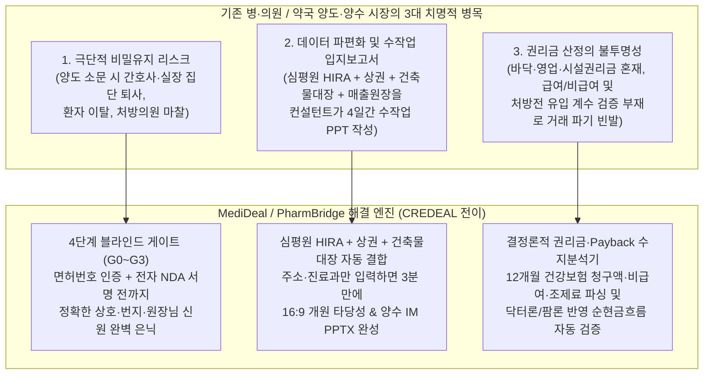
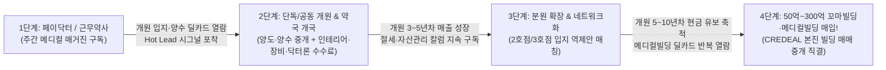
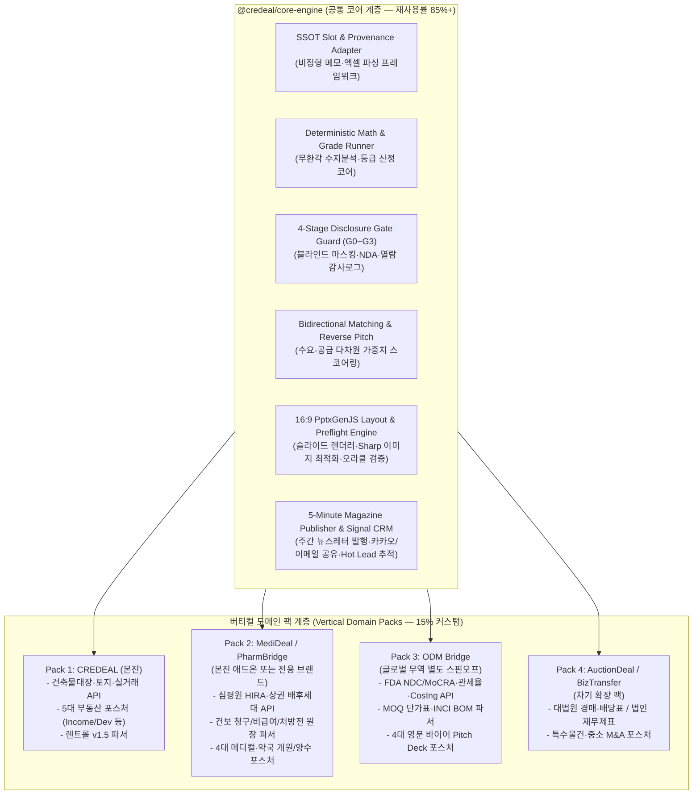
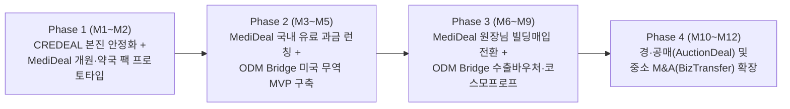

# CREDEAL 시스템 타 산업 전이 응용(System Transfer) 개발 및 사업화 마스터 전략

> **문서 버전**: v1.0 (2026-10-20)
> **작성 목적**: 현재 구축된 상업용 부동산 거래·마케팅 자동화 OS(`cre-dealcard`)의 6대 핵심 엔진을 해부하고, 코드 재사용률(75~92%)과 수익성·해자(Moat)가 가장 높은 타 산업 버티컬로의 **시스템 전이 응용(System Transfer) 아키텍처 및 사업화 전략**을 정립함.
> **집중 심화 버티컬**:
> 1. **[국내 고수익·본진 시너지 1위]** 병·의원 / 약국 / 대형 프랜차이즈 양도·양수 & 개원 컨설팅 OS (**`MediDeal / PharmBridge`**)
> 2. **[글로벌 수출·고성장 1위]** 미국 타겟 K-뷰티·건기식 OEM/ODM B2B 무역 거래 OS (**`ODM Bridge`**)

---

## 목차 (Table of Contents)

1. [Part I. CREDEAL 코어 자산 진단 및 6대 전이 엔진 해부](#part-i-credeal-코어-자산-진단-및-6대-전이-엔진-해부)
2. [Part II. 5대 유망 전이 도메인 포트폴리오 평가 매트릭스](#part-ii-5대-유망-전이-도메인-포트폴리오-평가-매트릭스)
3. [Part III. [집중 심화 #1] 병·의원 / 약국 / 대형 프랜차이즈 양도·양수 & 개원 컨설팅 OS (`MediDeal / PharmBridge`)](#part-iii-집중-심화-1-병의원--약국--대형-프랜차이즈-양도양수--개원-컨설팅-os-medideal--pharmbridge)
   - 3.1 시장 구조 및 3대 핵심 페인포인트
   - 3.2 타겟 페르소나 및 벨류체인 분석
   - 3.3 CREDEAL $\rightarrow$ MediDeal 1:1 도메인 및 DB 스키마 매핑
   - 3.4 심평원(HIRA)·상권 공공데이터 결합 & 결정론적 개원/양수 수지분석 엔진
   - 3.5 4단계 블라인드 기밀유지 게이트 (G0~G3: 직원 동요·환자 이탈 방지)
   - 3.6 4대 포스처(Posture) 기반 16:9 PPTX 개원·양수 IM 스튜디오
   - 3.7 5분 완성 주간 '원장님·약사님 라운지' 모바일 매거진 & 꼬마빌딩 업셀링 플라이휠
   - 3.8 핵심 화면 UI/UX 플로우 및 수익 모델(Monetization)
4. [Part IV. [집중 심화 #2] 미국 타겟 K-뷰티 OEM/ODM B2B 무역 거래 OS (`ODM Bridge`)](#part-iv-집중-심화-2-미국-타겟-k-뷰티-oemodm-b2b-무역-거래-os-odm-bridge)
5. [Part V. 멀티 버티컬 공유 코어 아키텍처 (`@credeal/core-engine`) 및 개발 전략](#part-v-멀티-버티컬-공유-코어-아키텍처-credealcore-engine-및-개발-전략)
6. [Part VI. 단계별 사업화 로드맵(Phased GTM) 및 3개년 Unit Economics](#part-vi-단계별-사업화-로드맵phased-gtm-및-3개년-unit-economics)

---

## Part I. CREDEAL 코어 자산 진단 및 6대 전이 엔진 해부

### 1.1 본질적 재정의: 왜 CREDEAL은 타 산업으로 즉시 전이 가능한가?

`cre-dealcard` 코드베이스는 외형상 중소형 빌딩 중개 SaaS이지만, 시스템 아키텍처 관점에서 보면 **"고관여·비대칭·기밀성 B2B 거래에서 흩어진 원장/공공 데이터를 정규화(SSOT)하고, 결정론적 재무 검증을 거쳐, 블라인드 티저(모바일 딜카드)·전문가용 제안서(16:9 PPTX IM)·정기 뉴스레터(모바일 매거진)를 원클릭 생성·배포·추적하는 거래 자동화 OS"**입니다.

이 아키텍처는 아래 **5가지 구조적 조건**을 가진 모든 시장에서 압도적인 위력을 발휘합니다:
1. **건당 거래 금액 또는 LTV가 크다** (최소 수천만 원 ~ 수백억 원 $\rightarrow$ 높은 지불용의(WTP) 확보)
2. **정보 비대칭과 기밀성(Confidentiality)이 극도로 중요하다** (매도 사실이 외부에 노출되면 치명적 손실이 발생하여 오픈 마켓에 올릴 수 없고 **블라인드 티저 + 단계별 NDA 게이트**가 필수적인 시장)
3. **공공 데이터·인증 원장과 민간 재무 원장을 결합해야 가치 평가가 가능하다** (수작업 조회·엑셀 취합에 2~5일이 걸리는 시장)
4. **중개자/컨설턴트/영업자의 연령대가 높거나(40~60대) 디자인·문서 조판 역량이 부족하다** ('3단계/5분 간편모드' UX와 자동 PPTX 생성의 체감 가치가 극대화되는 시장)
5. **거래 주기가 길어 장기 리드 너처링(Lead Nurturing)이 성패를 가른다** (주간 모바일 매거진과 열람 시그널 CRM이 강력한 해자가 되는 시장)

### 1.2 6대 핵심 재사용 엔진 (Core Reusable Engines) 및 코드베이스 매핑

| 엔진 번호 | 코어 엔진 명칭 | 현재 CREDEAL 코드베이스 핵심 모듈 | 타 산업 전이 시 역할 | 평균 코드 재사용률 |
|:---:|:---|:---|:---|:---:|
| **Engine 1** | **비정형 메모 & 엑셀 원장 SSOT 파서** | `src/domain/building/memo-slot-mapper.ts`<br>`src/lib/ssot-adapter.ts`<br>`src/lib/rentroll/parse-rentroll-workbook.ts` | 카톡 메모·엑셀 매출원장·처방전 내역·BOM 스펙시트를 단일 정규화 스키마(SSOT)로 즉시 변환 | **85%** |
| **Engine 2** | **공공 API 결합 & 결정론적 재무/등급 엔진** | `src/domain/building/im-core/financial-calculator.ts`<br>`src/domain/asset/grade-engine.ts`<br>`src/lib/external/*` | LLM 환각 없이 100% 수식 검증된 수익률·권리금·회수기간(Payback)·MOQ 단가 매트릭스 산출 | **80%** |
| **Engine 3** | **4단계 블라인드 정보공개 게이트 (G0~G3)** | `src/domain/gate/gate-request.ts`<br>`src/domain/dealcard/teaser-rules.ts`<br>`src/app/(public)/dc/[id]/*` | 매도자 신원·세부 원장·처방처·배합비(IP)를 단계별 인증/NDA 서명 후에만 점진적 언락 | **92%** |
| **Engine 4** | **양방향 스코어링 매칭 & 역제안 파이프라인** | `src/domain/matching/matching-engine.ts`<br>`src/app/(broker)/broker/MatchingTabContent.tsx` | 매수자(개원의·글로벌 바이어·투자자)의 자금·선호 스펙과 공급 물건을 0~100점 자동 매칭 및 역제안 | **88%** |
| **Engine 5** | **16:9 PPTX IM 자동 조판 & Preflight 게이트** | `src/domain/building/mobile-im/pptx/*`<br>`src/app/(broker)/broker/basic-im-studio/*` | 포스처별 맞춤형 12~16장 PPTX 제안서 자동 조판 + Poison Token/수치 불일치 사전 차단 | **82%** |
| **Engine 6** | **5분 완성 주간 모바일 매거진 & 시그널 CRM** | `src/domain/magazine/send-gate.ts`<br>`src/domain/magazine/buyer-temperature.ts`<br>`src/app/(broker)/broker/magazine-editor/*` | AI 업계 뉴스 브리프 + 추천 딜카드 결합 발송, VIP 독자의 반복 열람(Hot Lead) 실시간 감지 | **90%** |

---

## Part II. 5대 유망 전이 도메인 포트폴리오 평가 매트릭스

기존 시스템을 최소한으로 수정하여 진입할 수 있는 5대 고수익 B2B 버티컬의 정량·정성 비교 매트릭스입니다.

| 순위 | 타겟 응용 분야 (버티컬) | 핵심 타겟 고객 (유료 결제자) | 코드 재사용률 | 건당 거래 규모 / 기대 수익성 | 경쟁 강도 / 진입장벽 | CREDEAL 본진과의 시너지 |
|:---:|:---|:---|:---:|:---|:---|:---|
| **1위 (국내 시너지)** | **병·의원 / 약국 / 대형 프랜차이즈 양도·양수 & 개원 컨설팅 OS**<br>(`MediDeal / PharmBridge`) | 개원 컨설팅사, 제약사 영업망, 약국 전문 중개법인, 메디컬빌딩 PM, 프랜차이즈 본사 점포개발팀 | **86%** | 권리금 2억~30억+<br>월 구독 20~50만 원 + 개원·양수 리드/성사 수수료 | **매우 낮음**<br>(수작업 엑셀·폐쇄형 카페 중심, 전용 SaaS 전무) | **최상 (100%)**<br>(상가 공실 해소 + 성공 원장님의 꼬마빌딩/메디컬빌딩 매입으로 직결) |
| **1위 (글로벌 확장)** | **미국 타겟 K-뷰티·건기식 OEM/ODM B2B 무역 거래 OS**<br>(`ODM Bridge`) | 국내 OEM/ODM 제조사(4,500개+), 수출 무역상사(벤더), 미국 인디 브랜드·아마존 셀러 | **82%** | MOQ 발주 3천만~5억 원(반복 재발주)<br>연 구독 360~1,200만 원 + 수출바우처 + 에스크로 수수료 | **낮음**<br>(단순 디렉토리만 존재, 블라인드 포뮬라 딜카드+영문 Deck 자동화 전무) | **중립 (별도 법인/스핀오프 최적)**<br>정부 수출바우처·글로벌 VC 투자 유치에 최적 |
| **3위** | **경·공매 / NPL(부실채권) 권리분석 & 특수물건 브리핑 OS**<br>(`AuctionDeal`) | 경·공매 컨설팅 법인, NPL 매입추심사, 경매 학원/고액 투자자 클럽 | **90%** | 낙찰가 5억~200억 원<br>월 구독 15~30만 원 + 컨설팅 리포트 건당 과금 | **중간**<br>(지지옥션 등 조회 툴은 있으나 고객 제안용 PPTX IM·매거진 툴은 전무) | **높음 (90%)**<br>(급매 빌딩 소싱 및 특수물건 투자자 풀 공유) |
| **4위** | **중소기업 M&A / 가업승계 / 소부장 공장 매각 딜소싱 OS**<br>(`BizTransfer`) | 회계·세무법인 파트너, M&A 부티크, 기업금융 RM, 기술보증/중진공 컨설턴트 | **80%** | 기업가치 20억~300억 원<br>월 구독 50~100만 원 + 자문 성공보수 쉐어 | **낮음**<br>(베이비부머 은퇴로 매물 폭증 중이나 중소형 M&A 티저 자동화 툴 부재) | **높음 (75%)**<br>(법인 보유 사옥·공장 부동산 매각과 동시 연계) |
| **5위** | **산업용 부동산 (공장·물류센터·데이터센터·태양광) 인허가 딜 OS**<br>(`IndusDeal`) | 산업단지 전문 중개법인, 물류센터 PM사, 신재생에너지 시행사 | **88%** | 거래액 30억~1,000억 원<br>월 구독 30~80만 원 + 대형 딜 수수료 | **낮음**<br>(전력용량·하중·폐수·접도 조건 표준화 딜카드 부재) | **매우 높음 (85%)**<br>(기존 `industrial` 포스처 확장으로 즉시 진입 가능) |

---

## Part III. [집중 심화 #1] 병·의원 / 약국 / 대형 프랜차이즈 양도·양수 & 개원 컨설팅 OS (`MediDeal / PharmBridge`)

### 3.1 시장 구조 및 3대 핵심 페인포인트 (Why Now?)

대한민국에서 병·의원(의원·치과·한의원 약 7.2만 개소), 약국(약 2.5만 개소), 대형 프랜차이즈 직영/가맹점(스타벅스 DT, 메가급 식음료, 대형 헬스/클리닉 등)의 신규 개원 및 양도·양수 시장은 **일반 상업용 부동산 중개보다 정보 비대칭성이 5배 이상 높고, 권리금과 컨설팅 수수료 단가가 압도적으로 높은 특수 시장**입니다.



1. **페인포인트 1 — "양도 소문이 나는 순간 병원·약국 가치가 붕괴한다" (극단적 블라인드 니즈)**
   - 운영 중인 병·의원이나 약국이 매물로 나왔다는 사실이 노출되면 **① 핵심 간호사·상담실장·전산직원의 동요 및 선제 퇴사, ② 단골 만성질환 환자의 이탈, ③ 같은 건물 처방의원 원장과의 신뢰 파탄, ④ 건물주의 임대료 인상 요구**가 동시에 발생합니다.
   - 따라서 오픈 게시판(닥터스, 메디게이트, 약사 커뮤니티 등)에는 *"서울 강남구 / 피부과 / 월매출 1.2억 / 권리금 협의"*처럼 2~3줄짜리 텍스트만 올라오며, 매수 희망 의사·약사는 수십 곳에 일일이 전화해 비밀유지각서를 쓰고 비정형 엑셀을 받아야 합니다.
2. **페인포인트 2 — "개원 컨설턴트 1명이 입지·양수 제안서(PPT) 1건 만드는 데 4일이 걸린다"**
   - 개원 컨설팅 업체, 제약사 클리닉 영업팀, 의료기기 리스사, 약국 전문 브로커들은 대부분 **40~60대 베테랑**입니다.
   - 원장님께 브리핑할 제안서 1부를 만들려면 **① 건강보험심사평가원(HIRA) 사이트에서 반경 내 진료과별 의원 수·전문의 수 검색, ② 소상공인 상권정보에서 배후세대·연령대 캡처, ③ 세움터 건축물대장에서 근린생활시설 용도·엘리베이터·장애인 경사로 확인, ④ 양도 원장님의 12개월 매출 엑셀 정리, ⑤ 파워포인트 수작업 조판**까지 최소 3~4일이 소요됩니다.
3. **페인포인트 3 — "약국 독점처방 & 병·의원 권리금 산정의 주관성과 분쟁"**
   - 특히 **약국(문전약국·메디컬빌딩 독점약국)**은 권리금만 **3억~20억 원**, 분양가는 평당 **5,000만~1.5억 원**에 달하지만, 상층부 입점 병·의원의 진료과별 일평균 처방전 발행 건수와 건당 조제료 수지분석이 주먹구구식으로 이루어져 사기 분양이나 계약 파기가 빈발합니다.

---

### 3.2 타겟 페르소나 및 벨류체인 (3-Sided Market)

| 구분 | 페르소나 정의 | 핵심 니즈 (Jobs-to-be-Done) | MediDeal 제공 가치 |
|:---|:---|:---|:---|
| **공급/중개자 (B2B 유료 구독자)** | - **개원 컨설팅 법인 / 메디컬 PM사**<br>- **약국 전문 중개법인 / 분양대행사**<br>- **제약사·의료장비사 개원지원팀**<br>- **프랜차이즈 본사 점포개발팀** | - 봉직의·개원의·약사 VIP 풀을 장기 관리할 주간 뉴스레터 필요<br>- 주소·매출액만 넣으면 5분 만에 기관급 개원/양수 IM(PPTX) 생성<br>- 누가 어떤 입지/양수 카드를 몇 번 열람했는지 실시간 파악 | - **5분 간편모드 주간 메디컬 매거진**<br>- **원클릭 16:9 개원·양수 PPTX 스튜디오**<br>- **열람 시그널(Hot Lead) 알림 및 독점 매칭** |
| **양도자 / 임대인 (Seller / Landlord)** | - 은퇴·이전·확장 예정 **개원의 / 약사**<br>- 준공 앞둔 **메디컬빌딩 시행사·건물주**<br>- 메가 프랜차이즈 다점포 양도 점주 | - 직원과 환자가 절대 모르게 진성 매수자(면허 소지자)에게만 원장 공개<br>- 내 병원·약국의 시설·영업권리금을 객관적 데이터로 정당화 | - **4단계 블라인드 공개 게이트 (G0~G3)**<br>- **바닥·영업·시설 3종 권리금 가치평가서** |
| **매수자 / 개원예정자 (Buyer / Doctor & Pharmacist)** | - 개원 준비 **봉직의(페이닥터)·전공의**<br>- 분원 확장 **네트워크 병원 대표원장**<br>- 개국 준비 **근무약사 / 이전 개국 약사**<br>- 사옥 매입 추진 **성공 개원의** | - 허위 매물(부풀린 매출·처방전) 걸러내기<br>- 내 진료과·자기자본(닥터론 포함)에 맞는 최적 양수/신규 입지 역제안 받기<br>- 대출 이자 제외 후 **실제 원금 회수 기간(Payback)** 확인 | - **심평원+건보 청구원장 교차검증 배지**<br>- **닥터론/팜론 반영 순현금흐름 시뮬레이터**<br>- **맞춤 입지·양수 매물 역제안(Reverse Pitch)** |

---

### 3.3 CREDEAL $\rightarrow$ MediDeal/PharmBridge 1:1 도메인 및 DB 스키마 매핑

기존 `cre-dealcard`의 핵심 테이블과 도메인 어댑터(`ssot-adapter.ts`)를 86% 그대로 유지하면서 메디컬·약국·프랜차이즈 전용 슬롯(`pack_slots.MedicalSpec`, `pack_slots.PharmacySpec`, `pack_slots.FranchiseSpec`)을 확장합니다.

| 기존 CREDEAL 스키마 / 모듈 | MediDeal / PharmBridge 스키마 / 모듈 | 핵심 데이터 필드 및 1:1 전이 명세 |
|:---|:---|:---|
| **`assets` / `building_ssot_lite`** | **`medical_facilities_ssot`** | - 공통: `pnu`, `address`, `exclusive_area_pyung`(전용평수), `floor_info`, `deposit_krw`, `monthly_rent_krw`, `mgmt_fee_krw`<br>- 메디컬 확장: `facility_category`(`CLINIC` \| `DENTAL` \| `ORIENTAL` \| `PHARMACY` \| `MEGA_FRANCHISE`), `specialty_codes`(진료과목 코드 배열), `bed_count`(입원실 병상 수), `elevator_bed_capable`(침대용 승강기 여부), `zoning_medical_fit`(제1·2종 근생 의원/병원 인허가 적합성) |
| **`lease_units` + `rent-roll-parser.ts`** | **`clinic_revenue_ledgers` + `medical-ledger-parser.ts`** | - 기존 층별 임차인 파서를 **월별 진료·조제 매출원장 파서**로 전환<br>- 병·의원 슬롯: 최근 12~24개월 `nhis_claim_krw`(건보 급여 청구액), `non_covered_krw`(비급여 매출), `daily_outpatient_avg`(일평균 외래환자 수), `new_patient_ratio_pct`(신환 비율), `staff_roster`(의사·간호사·조무사·코디네이터 인원 및 인건비 합계)<br>- 약국 슬롯: `daily_rx_count_avg`(일평균 처방전 건수), `dispensing_fee_monthly_krw`(월 조제료 수익 — 부가세 면세), `otc_sales_monthly_krw`(월 일반의약품/건기식 매약 매출 — 과세), `linked_clinics`(상층부/인접 처방 병·의원 리스트 및 진료과별 처방 비중) |
| **`deals` (매각 딜 파이프라인)** | **`transfer_deals` (양도·양수 & 분양 딜)** | - `deal_posture`: `CLINIC_TRANSFER`(병의원 양도양수) \| `PHARMACY_TRANSFER`(약국 양도양수/독점분양) \| `NEW_OPENING_SITE`(신규 개원 입지 임대) \| `JOINT_OPENING`(공동개원/분원) \| `MEDICAL_BUILDING_SALE`(메디컬빌딩 통매각)<br>- **3종 권리금 분리 구조**: `key_money_floor_krw`(바닥권리금) + `key_money_goodwill_krw`(영업권리금) + `key_money_facility_krw`(인테리어·의료기기 양도가) = `total_key_money_krw` |
| **`buyer_needs` (매수자 조건 카드)** | **`doctor_pharmacist_intents` (개원의·약사 니즈 카드)** | - `license_type`(`MD` \| `DDS` \| `KMD` \| `PHARM` \| `FRANCHISE_CORP`), `license_verified`(면허 인증 여부)<br>- `target_specialties`(희망 진료과), `preferred_regions`(희망 진료권 시군구/행정동), `min_exclusive_pyung`(최소 전용평수: 예: 정형외과/통증 70평+, 피부과 50평+, 약국 15평+)<br>- `equity_budget_krw`(자기자본), `doctor_loan_limit_krw`(닥터론/팜론 가용 한도), `max_payback_months`(희망 원금회수 개월 수: 예: 24개월 이내) |
| **`disclosure_gates` (G0~G3)** | **`medical_confidential_gates` (G0~G3)** | - G0(오픈 블라인드 티저) $\rightarrow$ G1(면허번호+실명인증) $\rightarrow$ G2(전자 NDA 서명 + 자금증빙) $\rightarrow$ G3(원장 대면 미팅 & 야간/휴일 비밀 실사 예약) |

#### (1) Supabase PostgreSQL DDL 초안 (`supabase/migrations/20261101000000_medical_vertical.sql`)

> [!IMPORTANT]
> 기존 `building_ssot_lite`의 `NOT NULL FK` 및 포스처 격리(Rule 26~30)를 침범하지 않도록 `medical_*` 접두어 테이블로 분리하되, **3단계 매칭 엔진·G0~G3 게이트 상태 머신·NDA 워터마크·16:9 PPTX 렌더러·매거진 발행기**는 100% 공통 모듈로 재사용합니다.

```sql
-- ── 1. medical_offers : 병·의원 / 약국 / 대형 프랜차이즈 양도·개원 입지 SSOT ─────
create table if not exists medical_offers (
  id                     uuid primary key default gen_random_uuid(),
  owner_id               uuid references profiles(id) on delete set null, -- 개원 컨설턴트 / 약국 전문 중개사
  building_id            uuid references building_ssot_lite(id) on delete set null, -- 메디컬빌딩 본진 연동(선택)
  input_type             text not null check (input_type in ('consultant_memo','revenue_sheet','manual_form')),
  raw_input              text not null,

  -- 포스처 및 업종 구분
  deal_posture           text not null check (deal_posture in (
    'CLINIC_TRANSFER',     -- 운영 병·의원 양도·양수
    'PHARMACY_EXCLUSIVE',  -- 문전·독점 약국 양도·양수 및 독점 분양
    'NEW_OPENING_JOINT',   -- 신규 개원 입지 임대 / 공동개원·분원
    'MEDICAL_BUILDING_BUY',-- 원장님 메디컬빌딩 통매입 (사옥+임대)
    'MEGA_FRANCHISE'       -- 대형 프랜차이즈(DT점·직영·메가카페·대형클리닉) 양도·양수
  )),
  facility_category      text not null check (facility_category in ('clinic','hospital','dental','oriental','pharmacy','franchise')),
  specialty_codes        text[] not null default '{}', -- 심평원 진료과 코드 (예: {'01'(내과),'05'(정형외과),'14'(피부과)})

  -- G0 블라인드 공개 신호 (소문 방지용 — 행정동/상호/지번 비공개)
  region_signal          text not null,                -- 예: "서울 송파구 1만 세대 아파트 배후 초역세권"
  title_signal           text not null,                -- 예: "정형외과·통증의학과 양도 (전용 85평 / C-Arm·도수 6베드 완비)"
  exclusive_area_pyung   numeric(8,2),
  floor_signal           text,                         -- 예: "메디컬빌딩 3층 (침대용 승강기 2대)"
  revenue_band_signal    text,                         -- 예: "연매출 14~16억 / 월 순익 4,500만+"
  payback_months_est     numeric(5,1),                 -- 예: 11.5 (권리금 회수 예상 개월)

  -- 임대차 및 3종 권리금 결정론적 수치 (단위: 만원)
  deposit_manwon         bigint not null default 0,
  monthly_rent_manwon    bigint not null default 0,
  mgmt_fee_manwon        bigint not null default 0,
  key_money_floor_manwon    bigint not null default 0, -- 바닥권리금
  key_money_goodwill_manwon bigint not null default 0, -- 영업권리금 (환자 차트·처방전·단골 영업권)
  key_money_facility_manwon bigint not null default 0, -- 시설·인테리어·의료장비 잔존가액
  key_money_total_manwon    bigint generated always as (
    key_money_floor_manwon + key_money_goodwill_manwon + key_money_facility_manwon
  ) stored,

  -- G1~G2 이후 공개되는 민감 블라인드 필드 (재직 간호사·환자 동요 방지)
  exact_address          text,
  pnu                    text,
  facility_name          text,                         -- 실제 병원/약국/매장 상호
  hira_ykiho             text,                         -- 심평원 암호화 요양기관기호 (장비·전문의 자동조회 키)
  transfer_reason        text,                         -- 양도 사유 (예: 대표원장 타 지역 확장 이전 / 은퇴)
  hidden_fields          text[] not null default '{exact_address,pnu,facility_name,hira_ykiho}',

  -- 공공 API 결합 레이어 (심평원 경쟁포화도 CSI, 상권 배후세대, 건축물대장 인허가 적격성)
  hira_catchment         jsonb not null default '{}',  -- 반경 500m/1km 동일과 의원 수, CSI 지수, 주요 장비 분포
  building_compliance    jsonb not null default '{}',  -- 제1·2종 근생/의료시설 적합성, 직통계단 2개소, 장애인 승강기
  pharmacy_rx_matrix     jsonb not null default '{}',  -- [약국 전용] 상층부 입점 의원별 일평균 처방전·조제료 시뮬레이션

  status                 text not null default 'draft' check (status in ('draft','public_signal_ready','under_loi','closed','archived')),
  created_at             timestamptz not null default now(),
  updated_at             timestamptz not null default now()
);

-- ── 2. medical_revenue_ledgers : 월별 급여·비급여·조제료 원장 (렌트롤 행 대응) ────
create table if not exists medical_revenue_ledgers (
  id                       uuid primary key default gen_random_uuid(),
  offer_id                 uuid not null references medical_offers(id) on delete cascade,
  year_month               text not null,              -- '2026-01' ~ '2026-12' (최근 12~24개월)
  -- 병·의원 매출 구성 (단위: 만원)
  nhis_claim_manwon        numeric(12,2) default 0,    -- 건보 급여 청구액 (심평원 청구원장 대조)
  auto_work_ins_manwon     numeric(12,2) default 0,    -- 자보·산재 매출
  non_covered_manwon       numeric(12,2) default 0,    -- 비급여 매출 (도수·피부레이저·임플란트·비급여주사 등)
  -- 약국 매출 구성 (단위: 만원)
  rx_count_monthly         integer default 0,          -- 월 처방전 조제 건수
  dispensing_fee_manwon    numeric(12,2) default 0,    -- 월 조제료 수익 (부가세 면세, 순마진율 ~90%)
  drug_cost_pass_manwon    numeric(12,2) default 0,    -- 약값 청구액 (마진 0%, 매출 착시 분리용!)
  otc_sales_manwon         numeric(12,2) default 0,    -- 일반의약품·건기식 매약 매출 (과세, 평균 마진 ~28%)
  -- 비용 구성 (단위: 만원)
  staff_payroll_manwon     numeric(12,2) default 0,    -- 인건비 합계 (페이닥터·간호사·물리치료사·근무약사·전산원)
  material_device_manwon   numeric(12,2) default 0,    -- 의약품·소모품·기공료·장비리스료
  verified_source          text default 'broker_sheet' check (verified_source in ('hira_nhis_pdf','tax_vat_cert','pos_export','broker_sheet')),
  unique (offer_id, year_month)
);

-- ── 3. medical_buyer_intents : 개원의·약사·프랜차이즈 매수 조건 (buyer_intent 대응) ─
create table if not exists medical_buyer_intents (
  id                       uuid primary key default gen_random_uuid(),
  owner_id                 uuid references profiles(id) on delete set null,
  buyer_role               text not null check (buyer_role in ('pay_doctor','opening_doctor','network_director','pharmacist','franchise_corp')),
  license_type             text check (license_type in ('MD','DDS','KMD','PHARM','CORP')),
  license_verified         boolean not null default false,
  target_specialties       text[] not null default '{}',
  preferred_regions        text[] not null default '{}', -- 희망 진료권 (예: {'서울 강남구','서울 송파구','경기 분당구'})
  preferred_postures       text[] not null default '{CLINIC_TRANSFER,NEW_OPENING_JOINT}',
  min_area_pyung           numeric(6,1),
  equity_cash_manwon       bigint not null default 0,    -- 순수 자기자본
  doctor_loan_limit_manwon bigint not null default 0,    -- 닥터론/팜론 가용 한도 (신용+보증+담보)
  max_key_money_manwon     bigint,                       -- 감내 가능 최대 권리금
  max_payback_months       numeric(4,1) default 24.0,    -- 희망 권리금 회수기간 상한 (예: 24개월 이내)
  must_have_conditions     text[] not null default '{}', -- {'bed_elevator','parking_10plus','c_arm_room','exclusive_pharmacy_clause'}
  created_at               timestamptz not null default now()
);

-- ── 4. medical_match_results & medical_gate_requests ────────────────────────────
-- (기존 match_results 및 gate_requests와 동일 구조 + 면허번호 검증·야간 비밀실사 예약 슬롯 포함)
```

---

### 3.4 심평원(HIRA)·상권 공공데이터 결합 & 결정론적 개원/양수 수지분석 엔진

기존 `src/lib/external/*` (건축물대장·토지이용계획·공시지가·실거래가 API 클라이언트)와 `src/domain/im-core/financial-engine.ts`를 확장하여, **LLM이 숫자를 지어내지 못하는 100% 결정론적(Deterministic) 메디컬·약국 수지분석 엔진**을 구축합니다.

#### (1) 5대 공공·상권 API 자동 수집 파이프라인 (`src/lib/external/medical-public-api.ts`)

1. **건강보험심사평가원(HIRA) 병원·약국 기본정보 API (`getHospBasisList` / `getParmacyBasisList`)**:
   - 대상 물건 좌표(`lat`, `lng`) 기준 반경 **300m / 500m / 1,000m** 내 동일 진료과목(`dgsbjtCd`) 병·의원 수, 전문의 인원수, 개원일자(연차), 병상 수를 실시간 집계합니다.
2. **HIRA 의료장비 현황 API (`getMedOftInfo`)**:
   - 경쟁 의원의 주요 고가 장비(CT, MRI, 초음파, C-Arm, 체외충격파, 레이저 장비 등) 보유 대수를 파악하여 **양수 대상 의원의 장비 경쟁력 우위**를 자동 도출합니다.
3. **소상공인시장진흥공단 상권정보 & 행안부 주민등록 배후세대 API**:
   - 진료권 내 **총 배후세대 수, 연령대별 인구 비중**(예: 소아청소년과는 0~9세 영유아 및 3040 여성 비중, 정형외과·내과는 5070 고령층 비중, 피부과·성형외과는 2040 직장인/여성 유동인구 비중)을 결합하여 **'진료과별 인구 적합도 지수(Demographic Fit Score, 0~100점)'**를 산출합니다.
4. **건축물대장 & 건축법 메디컬 인허가 적격성 판정기 (`building-register.ts` 재사용)**:
   - 제1종 근린생활시설(의원·치과의원·한의원·조산원·안마시술소, 바닥면적 합계 $1,000\text{m}^2$ 미만) vs 제2종 근린생활시설/의료시설(병원) 용도 적합성 자동 판정
   - 입원실(30병상 이상 병원급 또는 의원급 입원실) 설치 시 **직통계단 2개소 이상 유무, 장애인용 승강기·경사로 유무, 주차대수(전용평수 대비 법정 주차대수 초과 여부)** 자동 체크리스트 생성

#### (2) 결정론적 메디컬·약국 재무 수지분석 산식 (`medical-financial-engine.ts`)

##### A. 진료권 경쟁 포화도 지수 (Catchment Saturation Index, $CSI$)
$$\text{CSI}_{\text{specialty}} = \frac{\text{반경 500m 내 동일 진료과 전문의 수} \times \text{진료과별 적정 배후인구 기준치}}{\text{반경 500m 내 유효 배후인구} + (\text{일평균 유동인구} \times 0.3)}$$
- $\text{CSI} < 0.7$: **블루오션 (개원 적극 추천)** / $0.7 \le \text{CSI} \le 1.1$: **적정 경쟁** / $\text{CSI} > 1.1$: **과밀 진료권 (양수 개원 또는 특화 클리닉 권고)**

##### B. 병·의원 양수 시 월 순현금흐름(Net Free Cash Flow) 및 원금 회수기간(Payback Period)
- **월 총매출($R_{\text{total}}$)**: $\text{건보 급여 매출}(R_{\text{NHIS}}) + \text{자동차보험/산재}(R_{\text{ins}}) + \text{비급여 매출}(R_{\text{non-cov}})$
- **월 영업비용($\text{OPEX}_{\text{clinic}}$)**:
  $$\text{OPEX}_{\text{clinic}} = \text{인건비}(\text{간호·코디·페이닥터}) + \text{임대료·관리비} + \text{의약품·소모품 원가} + \text{의료기기 리스료} + \text{마케팅·기공료·기타}$$
- **원장 세전 영업이익($\text{EBITDA}_{\text{clinic}}$)**: $R_{\text{total}} - \text{OPEX}_{\text{clinic}}$
- **닥터론 레버리지 후 월 가처분 현금흐름($\text{FCF}_{\text{after-debt}}$)**:
  $$\text{FCF}_{\text{after-debt}} = \text{EBITDA}_{\text{clinic}} - \text{예상 종합소득세(또는 성실신고/MS법인세)} - \text{닥터론 월 이자 상환액}$$
- **총 투자원금 회수기간(Payback Months, 권리금 기준 / 자기자본 기준)**:
  $$\text{권리금 회수기간(개월)} = \frac{\text{총 권리금}(\text{바닥} + \text{영업} + \text{시설})}{\text{EBITDA}_{\text{clinic}} - \text{봉직의 기회비용 급여(선택)}}$$

##### C. 문전·독점 약국 처방전 유입 및 조제료 수지분석 산식 (`Pharmacy Rx Engine`)
상층부 또는 인접 병·의원($i = 1 \dots n$)의 진료과목별 일평균 외래환자 수($P_i$), 원외처방 발행률($\alpha_i$), 해당 약국 유입 점유율($\beta_i$), 진료과별 평균 건당 조제료($F_i$), 영업일수($D \approx 25\text{일}$)를 결합하여 **허위 과장 없는 처방전 조제 수익**을 결정론적으로 산출합니다:

$$\text{일평균 예상 처방전 수}(Rx_{\text{daily}}) = \sum_{i=1}^{n} \left( P_i \times \alpha_i \times \beta_i \right)$$
$$\text{월 예상 조제료 수익}(R_{\text{dispensing}}) = \sum_{i=1}^{n} \left( P_i \times \alpha_i \times \beta_i \times F_i \right) \times D$$
$$\text{약국 월 순익}(\text{NOI}_{\text{pharmacy}}) = R_{\text{dispensing}} + \left(\text{월 매약 매출}(R_{\text{OTC}}) \times \text{매약 마진율}(m_{\text{OTC}} \approx 28\%)\right) - \left(\text{임대료·관리비} + \text{근무약사·전산원 인건비} + \text{팜론 이자}\right)$$

> **진료과별 표준 계수 테이블 내장**:
> - **소아청소년과 / 이비인후과 / 내과**: 원외처방 발행률 $\alpha \approx 85\sim 92\%$, 건당 조제료 $F \approx 7,500\sim 11,500\text{원}$
> - **정형외과 / 통증의학과**: 도수·체외충격파 비급여 비중으로 $\alpha \approx 55\sim 70\%$, 건당 조제료 $F \approx 8,000\sim 10,000\text{원}$
> - **안과 / 피부과**: $\alpha \approx 40\sim 65\%$, 건당 조제료 $F \approx 6,500\sim 8,500\text{원}$
> - **치과 / 한의원**: 원외처방 발행률 $\alpha < 10\%$ (약국 수지분석 시 허수 제외 경고 Gate 작동!)

---

### 3.5 4단계 블라인드 기밀유지 게이트 (G0~G3: 직원 동요·환자 이탈 완벽 차단)

기존 `cre-dealcard`의 정보공개 게이트(`studio/disclosure`)를 의료·약국·프랜차이즈 거래의 최대 리스크인 **'소문 유출 방지'**에 맞춰 특화합니다.

| 게이트 단계 | 명칭 및 언락 조건 | 매수 희망자(의사·약사·본사)에게 노출되는 정보 | 철저히 은닉(Masking)되는 정보 |
|:---:|:---|:---|:---|
| **G0**<br>(오픈 티저) | **블라인드 모바일 딜카드**<br>(카카오톡·매거진 링크 누구나 열람) | - **광역 위치**: `서울 송파구 대단지 아파트 배후 역세권` (행정동/번지 비공개)<br>- **진료과/업종**: `정형외과·통증의학과 (전용 85평)`<br>- **핵심 재무 밴드**: `연매출 14~16억 / 월 순익 4,500만+ / 권리금 4.5억(회수 10개월)`<br>- **양도 사유**: `대표원장 타 지역 확장 이전` | - 병원/약국 상호명, 정확한 도로명/지번 주소, 건물명, 외부 사진, 원장 실명 |
| **G1**<br>(자격 검증) | **면허번호 & 실명 본인인증 완료**<br>(의사/치과의사/한의사/약사 면허 확인 또는 프랜차이즈 법인 인증) | - **세부 상권**: `송파구 잠실동 ○○역 도보 2분 대로변 코너 메디컬빌딩 3층`<br>- **공간·장비 요약**: `진료실 2, 도수치료실 6, X-Ray, C-Arm(2024년식), 초음파 2대`<br>- **권리금 3분할 내역**: `바닥 1.0억 + 시설·장비 잔존가 2.0억 + 영업 1.5억`<br>- **반경 500m 심평원 경쟁의원 분포표** | - 정확한 건물 지번/호수, 병원 상호명, 건보 청구 원장 원본 파일 |
| **G2**<br>(기밀 실사) | **전자 NDA(비밀유지확약서) 서명 + 자기자본/닥터론 한도 확인 + 중개자 승인** | - **정확한 건물명·주소 및 평면도(도면)**<br>- **최근 12~24개월 건보 급여 청구내역서 및 비급여 월별 정산표** (워터마크 자동 삽입)<br>- **인력 구성(간호조무사·물리치료사 급여/근속연수) 및 의료기기 리스 승계 스케줄**<br>- **16:9 전체 개원·양수 타당성 PPTX IM 다운로드 허용** | - 재직 직원 직접 접촉 금지 조항(위약벌 명시) |
| **G3**<br>(클로징) | **야간/휴진일 비밀 현장 실사 예약 & 양도·양수 가계약(LOI)** | - **진료 종료 후(야간 21시 이후 또는 일요일 휴진일) 양도 원장님 1:1 비밀 미팅 확정**<br>- 권리금 에스크로·임대차 재계약(건물주 동의)·보건소 개설신고/심평원 요양기관 승계 체크리스트 오픈 | - (전체 언락 완료) |

---

### 3.6 4대 포스처(Posture) 기반 16:9 PPTX 개원·양수 IM 스튜디오

기존 `src/domain/building/mobile-im/pptx/*`의 5대 부동산 포스처(`income`, `trading`, `dev`, `owner_use`, `hospitality`) 조판 파이프라인과 3대 프리미엄 스킨(`JSRE Field Navy`, `Evidence First`, `Land Value First`)을 재사용하여 **메디컬·약국·프랜차이즈 4대 전용 포스처**를 구성합니다.

| 포스처 코드 | 포스처 명칭 (한글) | 표준 슬라이드 구성 (12~16장) | 핵심 차별화 슬라이드 (킬러 페이지) |
|:---|:---|:---|:---|
| **`CLINIC_TRANSFER`** | **병·의원 양도·양수 제안서** | 12p | - **Slide 4**: 최근 12개월 급여 vs 비급여 매출 추이 및 계절성 분석 차트<br>- **Slide 6**: 보유 의료장비 연식·취득가·감가상각 후 잔존가치 명세표<br>- **Slide 8**: 바닥·영업·시설 3종 권리금 산정 근거 및 닥터론 적용 시 원금 회수(Payback) 시뮬레이션 |
| **`PHARMACY_EXCLUSIVE`** | **문전·독점 약국 양수 및 신규 분양 IM** | 12p | - **Slide 3**: 동일 건물/인접 입점 병·의원 현황 및 진료과별 처방전 발행 계수 매트릭스<br>- **Slide 5**: 일평균 처방전(100건 / 150건 / 200건) 시나리오별 월 조제료·매약 손익분기점(BEP) 테이블<br>- **Slide 7**: 상가 관리규약 및 분양계약서상 **'약국 독점 업종 지정'** 법적 보호 검증 슬라이드 |
| **`NEW_OPENING_JOINT`** | **신규 개원 입지 타당성 & 공동개원 IM** | 14p | - **Slide 3**: 심평원 HIRA 기반 반경 500m/1km 경쟁 의원 분포 지도 및 포화도 지수($\text{CSI}$)<br>- **Slide 6**: 인테리어·의료기기·초기 운전자금 **개원 총 투자비(CAPEX) 예산표 & 렌트프리(Rent-Free) 협상안**<br>- **Slide 9**: 2인/3인 공동개원 시 지분율·진료기여도별 수익 배분 및 Exit 약정 시뮬레이션 |
| **`MEDICAL_BUILDING_BUY`** | **원장님 메디컬빌딩 통매입 (사옥+임대) IM** | 16p | - **기존 CREDEAL `owner_use` + `income` 포스처 100% 융합!**<br>- **Slide 5**: 본인 병원 직영 층 임대료 절감액 + 타 층(약국·타과 의원·학원과) 임대수익 통합 Cash-on-Cash 수익률<br>- **Slide 10**: 원장 개인 명의 vs 부동산임대법인/MS법인 활용 시 취득세·종부세·양도세 절세 비교표 |

---

### 3.7 5분 완성 주간 '원장님·약사님 라운지' 모바일 매거진 & 꼬마빌딩 업셀링 플라이휠

기존 `cre-dealcard`에서 60대 중개사를 위해 완성한 **'골디락스 5분 간편모드 매거진 에디터'(`src/app/(broker)/broker/magazine-editor`)**를 그대로 적용하여, 개원 컨설턴트·약국 브로커·메디컬 PM이 매주 월요일 아침 카카오톡으로 원장님·약사님 500~2,000명에게 발송하는 **'메디컬 웰스 & 개원 라운지(Medical Wealth & Opening Lounge)'**를 운영합니다.



#### 왜 이 플라이휠이 CREDEAL 본진에 결정적인가?
- 대한민국 중소형 빌딩(50억~300억 꼬마빌딩) 시장의 **최대 진성 매수자 집단은 성공한 개원의(의사·치과의사·한의사)와 대형 약국 약사, 메가 프랜차이즈 다점포 점주**입니다.
- `MediDeal`을 통해 봉직의가 개원할 때부터 고객으로 락인(Lock-in)하고 주간 매거진으로 세무·절세·메디컬빌딩 정보를 지속 공급하면, **타 부동산 중개법인이 절대 따라올 수 없는 '독점 빌딩 매수자 VIP 파이프라인'**을 선점하게 됩니다.

---

### 3.8 3단계 양방향 매칭 엔진 (`medical-matching-engine.ts`) 이식 설계

기존 [`matching-engine.ts`](file:///c:/Users/User/cre-dealcard/src/domain/matching/matching-engine.ts)의 **`1단계 하드 필터 → 2단계 의미 유사도(임베딩) → 3단계 포스처별 가중 합산`** 구조를 그대로 이식합니다.

| 단계 | 판정 로직 및 규칙 |
|:---|:---|
| **1단계: 하드 필터 (AI 개입 없음)** | ① **면허·업종 적격성**: 의사(`MD`)↔의원/병원, 치과의사(`DDS`)↔치과, 한의사(`KMD`)↔한의원, 약사(`PHARM`)↔약국 불일치 시 즉시 제외<br>② **가용 총자금 하드 필터**: $(\text{보증금} + \text{총 권리금} + \text{초기 CAPEX}) \le (\text{자기자본} + \text{닥터론/팜론 한도}) \times 1.10$<br>③ **건축법·의료법 필수 요건**: 입원실 필요 진료과인데 직통계단 2개소/침대용 승강기 미비 시 탈락 (`stage1_fail_reasons`에 한국어 사유 기록)<br>④ **희망 권리금 회수기간**: $\text{예상 Payback Months} \le \text{희망 상한} \times 1.20$ |
| **2단계: 의미 유사도 (`embedText`)** | 양도 물건의 진료 특화점(예: *"도수치료·C-Arm 통증 특화, 소아 성장클리닉 병행"*) ↔ 개원 희망 원장의 전문 세부전공·장비 선호 텍스트 간 코사인 유사도 계산 |
| **3단계: 매수자 유형별 가중 합산** | 아래 가중치 테이블에 따라 0~100점 스코어 및 **S / A / B / C 등급** 부여 |

| 매수자 프로필 (`buyer_role`) | 권리금 회수기간 (Payback) | 심평원 진료권 비포화도 ($\text{CSI}$) | 전용면적·주차·시설 적합성 | 청구원장 증빙 신뢰도 | 진료 세부전공 유사도 |
|:---|:---:|:---:|:---:|:---:|:---:|
| **첫 개원 봉직의 (`pay_doctor`)** | **0.30** | **0.25** | 0.15 | **0.20** | 0.10 |
| **네트워크 분원 확장 (`network_director`)** | 0.20 | **0.30** | **0.25** | 0.10 | 0.15 |
| **개국/이전 약사 (`pharmacist`)** | **0.35** | 0.15 (처방의원 안정성) | 0.10 | **0.30** (조제료 원장) | 0.10 |
| **메가 프랜차이즈 본사 (`franchise_corp`)** | 0.25 | **0.30** (배후·유동인구) | **0.25** (전면 가시성·DT) | 0.15 | 0.05 |

---

### 3.9 화면 라우트 구성 및 의료법·약사법 안전장치 (Poison Token Gate)

#### (1) 화면 라우트 매핑 (`cre-dealcard` 본진 재사용)

| 경로 | 용도 | 재사용 원본 컴포넌트 |
|:---|:---|:---|
| `/broker/medical` | 메디컬·약국·프랜차이즈 딜 홈 (양도 물건·개원의 니즈·열람 시그널 요약) | `/broker` 홈 + `ActionQueue` |
| `/broker/medical/offers/new` | 컨설턴트 카톡 메모 + 12개월 매출/조제료 엑셀 업로드 $\rightarrow$ 오퍼 생성 | [`/broker/deal-card/new`](file:///c:/Users/User/cre-dealcard/src/app/(broker)/broker/deal-card/new/page.tsx) |
| `/broker/medical/offers/[id]` | 3종 권리금 분석·심평원 경쟁의원 지도·처방전 시뮬레이터·G0~G3 게이트 관리 | `/broker/deal-card/[id]` |
| `/broker/medical/offers/[id]/studio` | 4대 포스처 기반 16:9 개원·양수 타당성 PPTX IM 편집 및 다운로드 | `/broker/basic-im-studio/[buildingId]` |
| `/broker/medical/intents` | 개원 예정의·약사·프랜차이즈 매수 조건 관리 및 역제안 발송 | `/broker/buyer-intents` |
| `/m/[id]` (공개 블라인드 카드) | 카카오톡 공유용 블라인드 병·의원/약국 티저 카드 + 면허 인증·NDA 모달 | [`/dc/[id]`](file:///c:/Users/User/cre-dealcard/src/app/(public)/dc/[id]/page.tsx) |

#### (2) 의료법·약사법 컴플라이언스 및 품질 게이트 (`medical-preflight-gate.ts`)

| 리스크 유형 | 자동 차단 및 안전장치 (Preflight Gate Rules) |
|:---|:---|
| **약사법 제24조 (담합 행위 및 처방전 보장 허위 문구)** | - 약국 분양/양도 제안서에 **`"일 처방전 ○○건 100% 보장"`, `"원장 리베이트/인테리어 지원 약정"`, `"처방전 독점 담합"`** 등 약사법 위반 소지가 있는 문구 감지 시 **Poison Token Gate가 PPTX 생성을 즉시 차단**하고 *"상층부 의원 진료과 기준 추정치이며 약사법상 처방전 보장은 불가함"* 표준 면책 문구로 강제 치환 |
| **약국 매출 착시 (약값 포함 총매출 과장)** | - 약국은 건강보험 청구액 중 **약값(Drug Cost, 마진 0%)이 70~80%**를 차지하므로, 총매출만 크게 적어 순익을 왜곡하는 행위를 차단하기 위해 반드시 **`순수 조제료 수익(면세) + 매약 마진(과세)`** 분리 표기를 의무화 (미분리 시 Grade D 강등) |
| **의료법 제27조 제3항 (환자 유인·알선 금지) 및 개인정보보호법** | - 양도·양수 실사 과정에서 **개별 환자의 성명·주민번호·병력이 포함된 전자의무기록(EMR) 캡처본 업로드 엄격 금지** (월별 통계 집계표 및 심평원 요양급여비용 결정통보서만 허용) |
| **양도 원장님 신원 역추적 방지 (G0 단계)** | - G0 오픈 카드에 **`특정 의대 출신`, `개원 연월(예: 2019년 5월 개원)`, `정확한 병상 수·고유 장비 조합`** 등 경쟁 의원이나 직원이 검색만으로 특정할 수 있는 식별자가 포함되면 정규식 필터가 자동으로 브래킷 처리(예: `개원 5년차 이상`) |

---

### 3.10 MediDeal / PharmBridge 수익 모델 (Monetization) 및 실행 계획

| 수익원 구분 | 과금 대상 | 상세 가격 정책 | 비고 |
|:---|:---|:---|:---|
| **1. B2B SaaS 구독료** | 개원 컨설팅사, 약국 전문 부동산, 메디컬 PM, 프랜차이즈 점포개발팀 | - **Pro 플랜**: 월 **290,000원** (딜카드 무제한, 16:9 개원/양수 PPTX 월 20건, 주간 매거진 발송)<br>- **Enterprise (제약사/프랜차이즈 본사/대형 컨설팅사)**: 월 **990,000원~** (소속 컨설턴트 10석, 커스텀 브랜딩, 심평원 상권 API 대량 조회) | 높은 객단가로 인해 중개사 대비 구독 저항이 매우 낮음 |
| **2. 개원 생태계 제휴 리드 피 (B2B Referral Fee)** | 닥터론/팜론 취급 은행, 메디컬 전문 인테리어사, 의료장비 리스사, 병의원 전문 세무법인 | - 개원 확정 원장님의 동의 하에 **인테리어·의료기기·세무기장·닥터론 패키지 비교견적 매칭** 시 제휴사로부터 건당 **100만~500만 원** 리드/성사 수수료 수취 | 원장님께는 100% 무료 혜택 제공 |
| **3. 메디컬빌딩 매입 전환 수수료 쉐어** | CREDEAL 제휴 빌딩 중개법인 | - 매거진 구독 원장님이 `MEDICAL_BUILDING_BUY` 딜카드를 통해 100억 대 꼬마빌딩/메디컬빌딩 매입 성사 시 중개보수(약 1~1.8억 원)의 **20~30% 플랫폼 레퍼럴 쉐어** | 건당 2,000만~5,000만 원 고수익 창출 |

---

## Part IV. [집중 심화 #2] 미국 타겟 K-뷰티 OEM/ODM B2B 무역 거래 OS (`ODM Bridge`)

> **별도 상세 산출물 안내**: 미국 타겟 K-뷰티 OEM/ODM B2B 무역 거래 플랫폼(`ODM Bridge`)에 대한 전체 아키텍처, 인터뷰 질문지, 콜드 아웃리치 킷, 7대 핵심 화면 고해상도 목업은 아래 문서에 상세 구축되어 있습니다.
> - [K-뷰티 OEM/ODM 무역 거래 플랫폼 상세 설계서 (`trade_vertical_design.md`)](file:///C:/Users/User/.gemini/antigravity/brain/eced67a6-c4d1-472a-bb8e-631d55ee7900/trade_vertical_design.md)
> - [제조사 & 미국 바이어 인터뷰 질문지 (`odm_bridge_interview_kit.md`)](file:///C:/Users/User/.gemini/antigravity/brain/eced67a6-c4d1-472a-bb8e-631d55ee7900/odm_bridge_interview_kit.md)
> - [한/영 콜드 아웃리치 & 수출바우처 제안 킷 (`odm_bridge_outreach_kit.md`)](file:///C:/Users/User/.gemini/antigravity/brain/eced67a6-c4d1-472a-bb8e-631d55ee7900/odm_bridge_outreach_kit.md)
> - [7대 핵심 화면 인터랙티브 목업 (`odm_bridge_mockups.html`)](file:///C:/Users/User/.gemini/antigravity/brain/eced67a6-c4d1-472a-bb8e-631d55ee7900/odm_bridge_mockups.html)

### 4.1 핵심 요약: CREDEAL $\rightarrow$ ODM Bridge 시스템 전이 구조

1. **Building SSOT $\rightarrow$ Base Formula & Factory SSOT**:
   - 국내 4,500개+ OEM/ODM 화장품·건기식 제조사의 베이스 처방(선세럼, PDRN 앰플, 립오일 등)과 공장 인증(`ISO 22716`, `CGMP`, `FDA OTC Drug Establishment`, `EVE Vegan`)을 정규화합니다.
2. **Rent Roll & Financial Engine $\rightarrow$ MOQ Tiered Pricing & US Landed Cost Calculator**:
   - 수량 구간별(3,000 / 5,000 / 10,000 / 50,000 pcs) 내용물·부자재·충진 단가 매트릭스와 **FOB Korea / CIF LA / DDP US Warehouse(미국 HTS 관세율 + 해상/항공 운임 포함)** 개당 도착원가 및 리테일 마진율을 결정론적으로 자동 계산합니다.
3. **Disclosure Gate (G0~G3) $\rightarrow$ Formula IP Protection Gate**:
   - G0(블라인드 베이스 포뮬라 카드) $\rightarrow$ G1(미국 바이어 비즈니스 이메일·도메인 인증 시 MOQ 단가표 오픈) $\rightarrow$ G2(전자 NNN Agreement 서명 시 전성분 INCI % 브래킷·임상 리포트·규제 체크리스트 오픈) $\rightarrow$ G3(실제 공장 실명 오픈 및 Lab Sample $80~$150 결제/발송).
4. **Basic IM Studio $\rightarrow$ 1-Click 16:9 English Buyer Pitch Deck (PPTX)**:
   - 제조사 영업담당자가 한글 스펙만 넣으면 미국 세포라·얼타·아마존 바이어가 요구하는 **12장 영문 Custom ODM Proposal PPTX**를 3분 만에 자동 조판합니다.

---

## Part V. 멀티 버티컬 공유 코어 아키텍처 (`@credeal/core-engine`) 및 개발 전략

하나의 코드베이스 자산을 복수의 산업 버티컬로 확장할 때, 코드를 단순 복사(Fork & Forget)하면 유지보수 부채가 폭증합니다. 따라서 **'공유 코어 엔진(Shared Core) + 버티컬 도메인 팩(Vertical Domain Pack)'** 구조로 분리하는 것이 최적의 기술 전략입니다.



### 5.1 버티컬별 배포 및 법인/브랜드 분리 원칙

1. **`MediDeal / PharmBridge` (병·의원 / 약국 / 프랜차이즈 개원·양수 OS)**:
   - **배포 전략**: `cre-dealcard` 본진 코드베이스 내 **'메디컬·프랜차이즈 전용 모드(Vertical Mode)'**로 우선 탑재한 뒤, 전용 랜딩 도메인(`medideal.kr` 등)을 멀티테넌트 라우팅으로 연결합니다.
   - **이유**: 건축물대장·토지이용계획·공시지가·실거래가 API와 DB 인프라를 100% 그대로 쓰며, 상가 임대차 $\rightarrow$ 병·의원/약국 양도·양수 $\rightarrow$ 원장님의 메디컬빌딩 통매입까지 **데이터와 고객 풀이 한 몸처럼 움직여야 시너지가 극대화**되기 때문입니다.
2. **`ODM Bridge` (미국 타겟 K-뷰티 OEM/ODM B2B 무역 OS)**:
   - **배포 전략**: `@credeal/core-engine`을 공유하되 **별도 프로젝트/스핀오프 브랜드**로 독립 배포합니다.
   - **이유**: UI 언어가 영문(US Buyer Portal) + 국문(제조사 스튜디오) 이원화 구조이고, 정부 **수출바우처 수행기관 등록** 및 글로벌 커머스/무역 전문 VC 투자 유치 시 독립 브랜드가 기업가치(Valuation) 산정에 훨씬 유리하기 때문입니다.

### 5.2 버티컬 1개 추가 시 개발 공수(Man-Week) 절감 효과

| 개발 영역 | 바닥부터 신규 개발 시 (Scratch) | CREDEAL 코어 전이 개발 시 | 단축률 |
|:---|:---:|:---:|:---:|
| DB 스키마 & 인증/권한/RLS & 멀티테넌트 | 4주 | **0.5주** | **88% 단축** |
| 모바일 블라인드 딜카드 & 4단계 공개 게이트(G0~G3) | 5주 | **1주** | **80% 단축** |
| 16:9 PPTX 자동 생성 엔진 & Preflight 품질 게이트 | 8주 | **1.5주** (슬라이드 템플릿·산식 교체) | **81% 단축** |
| 양방향 스코어링 매칭 & 역제안 워크플로우 | 4주 | **0.5주** (가중치·필터 교체) | **88% 단축** |
| 5분 간편모드 매거진 에디터 & 열람 시그널 CRM | 6주 | **0.5주** (RSS/뉴스 프롬프트 교체) | **92% 단축** |
| 도메인 특화 공공 API 연동 & 전용 수지분석기 | 3주 | **2주** (HIRA 또는 FDA/Landed Cost) | **33% 단축** |
| **합계 (MVP 상용 출시까지 총 소요 기간)** | **30주 (약 7.5개월)** | **6주 (약 1.5개월)** | **80% 단축** |

---

## Part VI. 단계별 사업화 로드맵(Phased GTM) 및 3개년 Unit Economics

### 6.1 4단계 실행 로드맵 (Phased Go-To-Market)



- **Phase 1 (Month 1~2): 내수 고수익 확장 준비 & 글로벌 무역 시장 검증**
  - **트랙 A (`MediDeal`)**: 건강보험심사평가원(HIRA) 공공데이터 API 키 연동 + `CLINIC_TRANSFER` / `PHARMACY_EXCLUSIVE` 2대 포스처 PPTX 템플릿 구현 + 강남·서초·송파 메디컬 전문 부동산 및 개원 컨설팅사 10곳 클로즈드 베타.
  - **트랙 B (`ODM Bridge`)**: 기구축된 [인터뷰 질문지](file:///C:/Users/User/.gemini/antigravity/brain/eced67a6-c4d1-472a-bb8e-631d55ee7900/odm_bridge_interview_kit.md), [콜드 아웃리치 킷](file:///C:/Users/User/.gemini/antigravity/brain/eced67a6-c4d1-472a-bb8e-631d55ee7900/odm_bridge_outreach_kit.md), [7대 화면 목업](file:///C:/Users/User/.gemini/antigravity/brain/eced67a6-c4d1-472a-bb8e-631d55ee7900/odm_bridge_mockups.html)을 활용하여 국내 화장품 OEM/ODM 제조사 15곳 및 미국 인디 브랜드 바이어 15곳 고객 발견(Customer Discovery) 완료.
- **Phase 2 (Month 3~5): 듀얼 엔진 상용 출시**
  - **트랙 A (`MediDeal`)**: 개원 컨설턴트·약국 브로커 대상 월 29만 원 Pro 플랜 정식 출시 및 '원장님·약사님 주간 라운지 매거진' 배포 시작.
  - **트랙 B (`ODM Bridge`)**: 별도 도메인 MVP 런칭, 시드 포뮬라 딜카드 300개 등록, 유료 Lab Sample($120) 에스크로 결제 가동.
- **Phase 3 (Month 6~9): 트랜잭션 수수료 및 업셀링 본격화**
  - **트랙 A (`MediDeal`)**: 닥터론·메디컬 인테리어·의료장비 제휴 리드 피 과금 시작 + 매거진 구독 원장님의 **꼬마빌딩/메디컬빌딩 통매입(`MEDICAL_BUILDING_BUY`)** 크로스셀링 달성.
  - **트랙 B (`ODM Bridge`)**: 중소벤처기업부/KOTRA **수출바우처 공식 수행기관** 등록을 통해 국내 제조사 연간 구독료(연 600~1,200만 원)의 70~80% 정부보조금 결제 연동.
- **Phase 4 (Month 10~12): 제3·제4 버티컬 수평 확장**
  - 경·공매/NPL(`AuctionDeal`) 및 중소기업 가업승계 M&A(`BizTransfer`) 도메인 팩 출시.

---

### 6.2 핵심 버티컬별 Unit Economics 및 3개년 ARR 시뮬레이션

| 지표 (Metrics) | CREDEAL 본진 (중소형 빌딩 중개) | MediDeal / PharmBridge (병의원·약국·프랜차이즈) | ODM Bridge (미국 타겟 K-뷰티 OEM/ODM 무역) |
|:---|:---|:---|:---|
| **핵심 유료 고객 풀 (SAM)** | 전국 빌딩·상업용 전문 중개사 약 15,000명 | 개원 컨설팅사·약국 중개·메디컬 PM·프랜차이즈 개발팀 약 4,000개사 + 개원의·약사 9.7만 명 | 화장품·건기식 OEM/ODM 제조사 4,500개사 + 수출 벤더 3,000개사 + 글로벌 바이어 50,000+ |
| **객단가 (ARPU / 월)** | 월 **9.9만 ~ 19.9만 원** | 월 **29만 ~ 99만 원** (+ 개원 제휴/빌딩 매입 레퍼럴) | 월 **30만 ~ 100만 원** (연 360~1,200만 원, 수출바우처 연동) + 샘플/발주 수수료 |
| **고객획득비용 (CAC)** | 약 25만 원 | 약 40만 원 (제약사/컨설팅 네트워크 제휴) | 약 80만 원 (전시회·수출바우처·링크드인) |
| **예상 생애가치 (LTV)** | 약 360만 원 (LTV/CAC = 14.4x) | **약 1,200만 원** (LTV/CAC = **30.0x**) | **약 1,800만 원** (LTV/CAC = **22.5x**) |
| **Year 1 목표 ARR** | 6억 원 | **5억 원** | **6억 원** |
| **Year 2 목표 ARR** | 18억 원 | **16억 원** | **24억 원** |
| **Year 3 목표 ARR** | 40억 원 | **38억 원** | **65억 원** |

---

### 6.3 최종 전략 제언 (Executive Recommendation)

1. **단기 현금흐름 & 본진 시너지 극대화 (`MediDeal / PharmBridge`)**:
   - 현재 코드베이스와 공공데이터 파이프라인을 **86% 그대로 재사용**할 수 있으며, 특히 **"개원/양수 컨설팅 $\rightarrow$ 원장님 주간 매거진 락인 $\rightarrow$ 메디컬빌딩/꼬마빌딩 통매입 중개"**로 이어지는 업셀링 구조는 CREDEAL 본진의 딜 클로징 확률을 비약적으로 높여주는 최고의 캐시카우(Cash Cow)입니다.
2. **글로벌 스케일업 & 높은 기업가치 멀티플 (`ODM Bridge`)**:
   - 내수 부동산 경기에 영향을 받지 않는 **글로벌 달러(USD) 매출 파이프라인**이자, 국내 4,500개 화장품 제조사의 미국 진출 병목을 해결하는 수출 인프라로서 **별도 스핀오프 및 VC 투자 유치 / 수출바우처 사업화**에 최적화된 성장 엔진입니다.
3. **실행 우선순위**:
   - **즉시 실행(Now)**: 기구축된 `ODM Bridge` 인터뷰·목업 킷으로 제조사/바이어 사전 검증을 진행하는 동시에, `cre-dealcard` 본진에 **심평원(HIRA) API 연동 및 병·의원/약국 양도·양수 포스처(`MediDeal` 애드온)**를 추가하여 국내·글로벌 투트랙 검증을 전개할 것을 권장합니다.
