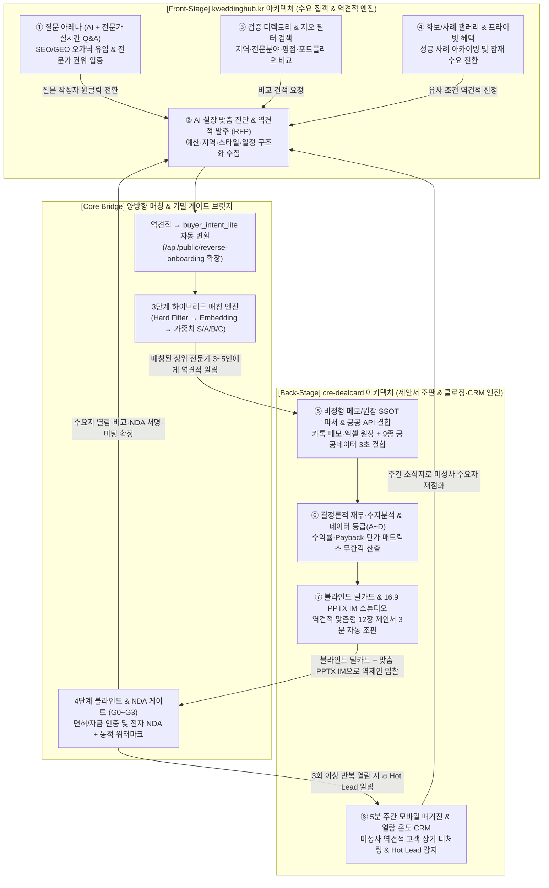
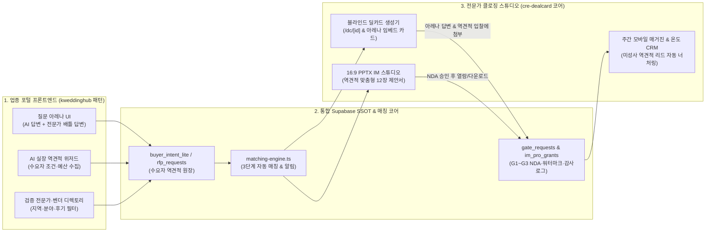

# 업종 포털·역견적 시스템(`kweddinghub.kr`형) × 거래·문서 자동화 OS(`CREDEAL`형) 결합 카테고리 킬러 플랫폼 구축 전략

> **문서 버전**: v1.0 (2026-10-23)
> **작성 목적**: 기구축된 **AI 업종 포털·역견적·Q&A 아레나 시스템(`kweddinghub.kr`)**과 **상업용 부동산 거래·문서(딜카드·PPTX IM·매거진) 자동화 OS(`cre-dealcard`)**를 결합할 때 창출되는 구조적 시너지를 규명하고, 두 시스템의 기술적 통합 아키텍처 및 **초기 적용 최우선 5대 카테고리 킬러 분야(Vertical)**와 단계별 사업화 로드맵을 도출함.

---

## 목차 (Table of Contents)

1. [Part I. 전략적 통찰: 왜 '업종 포털·역견적' × '거래·문서 자동화 OS' 결합이 무적의 방정식인가?](#part-i-전략적-통찰-왜-업종-포털역견적--거래문서-자동화-os-결합이-무적의-방정식인가)
2. [Part II. 두 시스템의 핵심 엔진 해부 및 End-to-End 결합 플라이휠](#part-ii-두-시스템의-핵심-엔진-해부-및-end-to-end-결합-플라이휠)
3. [Part III. 초기 적용 최우선 5대 카테고리 킬러 분야 평가 및 선정](#part-iii-초기-적용-최우선-5대-카테고리-킬러-분야-평가-및-선정)
4. [Part IV. [초기 적용 #1] 상업용 부동산 매수 역견적 & 블라인드 역제안 아레나 (`CRE Hub / 빌딩아레나`)](#part-iv-초기-적용-1-상업용-부동산-매수-역견적--블라인드-역제안-아레나-cre-hub--빌딩아레나)
5. [Part V. [초기 적용 #2] 병·의원 / 약국 개원 패키지(입지·양수·인테리어·장비) 통합 역견적 OS (`MediHub / 개원아레나`)](#part-v-초기-적용-2-병의원--약국-개원-패키지입지양수인테리어장비-통합-역견적-os-medihub--개원아레나)
6. [Part VI. [초기 적용 #3] 글로벌 K-뷰티·건기식 인디 브랜드 역발주(RFP) $\leftrightarrow$ OEM/ODM 제조사 역제안 포털 (`ODM Hub`)](#part-vi-초기-적용-3-글로벌-k-뷰티건기식-인디-브랜드-역발주rfp--oemodm-제조사-역제안-포털-odm-hub)
7. [Part VII. 통합 시스템 아키텍처(`Portal + Deal OS`) 및 90일 실행 로드맵](#part-vii-통합-시스템-아키텍처portal--deal-os-및-90일-실행-로드맵)

---

## Part I. 전략적 통찰: 왜 '업종 포털·역견적' × '거래·문서 자동화 OS' 결합이 무적의 방정식인가?

### 1.1 기존 B2B/고관여 플랫폼들이 절반의 성공에 그치는 이유

고관여·고단가 시장(빌딩 매매, 병·의원/약국 개원 및 양수, 프랜차이즈 점포 개발, B2B OEM 제조, 하이엔드 웨딩/MICE 등)에서 플랫폼을 구축할 때, 기존 플레이어들은 항상 **퍼널의 앞단(수요 집객)**과 **퍼널의 뒷단(기밀 실사·제안서·클로징)** 중 한쪽만 보유하는 구조적 한계를 겪습니다.

| 구분 | A. 업종 포털 · 역견적 시스템 단독 운영 시 *(예: `kweddinghub.kr`, 숨고, 위시켓, 강남언니 등)* | B. 전문가용 거래·문서 자동화 SaaS 단독 운영 시 *(예: `cre-dealcard` 단독, 리걸테크·M&A SaaS 등)* | **A × B 결합 카테고리 킬러 플랫폼** *(업종 포털/역견적 + 딜카드/PPTX IM/매거진 OS)* |
|:---|:---|:---|:---|
| **강점 영역** | **ToFU ~ MoFU (수요 집객 & 역견적 수집)** - AI 실장 맞춤 진단, 질문 아레나(Q&A), 디렉토리로 검색(SEO/GEO) 오가닉 트래픽 대량 흡수 - 수요자가 예산·조건을 먼저 올리는 **역견적(RFP)** 구조 | **MoFU ~ BoFU (전문 제안서 조판 & 클로징)** - 비정형 메모·원장 $\rightarrow$ 공공데이터 결합 $\rightarrow$ 결정론적 수지분석 - **블라인드 딜카드 + NDA 게이트 + 16:9 PPTX 제안서 + 주간 매거진 CRM** | **ToFU $\rightarrow$ MoFU $\rightarrow$ BoFU $\rightarrow$ Retention 전 주기 장악** - 포털로 진성 수요를 무비용 흡수하고, 역견적 입찰을 **검증된 딜카드·PPTX IM**으로 수행하여 성사율 극대화 |
| **구조적 병목 (한계)** | **고단가 거래에서의 클로징 병목** - 거래액이 수천만 원~수백억 원으로 커지면 단순 댓글/채팅 견적으로는 수요자가 결단하지 못함 - 공급자(전문가)가 매번 맞춤 제안서(PPT)를 수작업으로 만들다 지쳐 응답 품질 저하 - 미성사 리드가 일회성으로 휘발됨 | **초기 수요(Cold-Start) 확보 병목** - 공급자(중개사·컨설턴트·제조사)에게 강력한 무기(딜카드·PPTX IM)를 쥐여주어도, 정작 이를 받아볼 **신규 매수자/바이어 유입 채널**은 공급자 개인 인맥에 의존함 | **양측 병목의 완벽한 상호 소거** 1. 포털이 끊임없이 **역견적 리드(매수 의향서)**를 공급 2. 전문가는 **3분 만에 생성한 블라인드 딜카드 & PPTX IM**으로 초고속·고품격 역제안 3. 미결 리드는 **주간 매거진 & 열람 온도 CRM**이 자동 육성 |
| **수익 모델 한계 vs 확장** | 리드 열람비(소액) 또는 단순 입점비 위주 (거래 성사 파악이 어려워 수수료 누수 발생) | 공급자 월 구독료(SaaS) 위주 (리드 직접 공급이 약해 구독 저항 존재) | **4중 복합 수익 (SaaS 구독 + 역견적 입찰권 + 프리미엄 디렉토리 + NDA/실사 기반 성사 수수료)** |

---

## Part II. 두 시스템의 핵심 엔진 해부 및 End-to-End 결합 플라이휠

### 2.1 두 시스템의 8대 모듈 1:1 결합 매트릭스

사용자께서 이미 구축하신 **`kweddinghub.kr`의 4대 전면(Front-Stage) 엔진**과 **`cre-dealcard`의 4대 후면(Back-Stage) 클로징 엔진**은 놀라울 정도로 정교하게 아귀가 맞물립니다. 특히 `cre-dealcard` 코드베이스에는 이미 `/agora`(Q&A), `/services`(파트너 디렉토리), `/api/public/reverse-onboarding`(역방향 매수 의향서), `matching-engine.ts` 등 결합을 위한 연결 고리(Hook)가 모두 준비되어 있습니다.

### 2.2 결합 시 발생하는 3대 파괴적 차별화 (Unfair Advantage)

1. **"댓글 한 줄 견적" vs "공공데이터·수지분석이 검증된 16:9 PPTX 제안서 역견적"**
   - 기존 역견적 플랫폼에서는 전문가가 텍스트 몇 줄이나 단가 숫자만 던지기 때문에 고객이 신뢰하지 못합니다.
   - 반면 결합 플랫폼에서는 수요자가 역견적을 올리면, 공급자(중개사·개원 컨설턴트·인테리어사·제조사)가 CREDEAL 스튜디오를 통해 **수요자의 예산과 목적(포스처)에 딱 맞춘 `[블라인드 딜카드 + 12장 분량의 16:9 PPTX 분석 제안서]`**를 단 3분 만에 생성해 역제안합니다. 수요자 입장에서 체감하는 전문성과 전환율은 비교 자체가 불가능합니다.
2. **"질문 아레나(Q&A) 답변 안에 살아있는 블라인드 딜카드·포트폴리오 카드 임베딩"**
   - `kweddinghub.kr`의 핵심 무기인 **질문 아레나(AI 종합 분석 + 현장 전문가 비교 답변)**에 `cre-dealcard`의 **블라인드 딜카드(`/dc/[id]`)**를 결합합니다.
   - 예: 수요자가 *"강남·서초 예산 80억대 피부과 개원 가능한 역세권 꼬마빌딩이나 양수 매물 있을까요?"*라고 질문하면, AI 실장이 1차 상권·수익률 기준을 브리핑하고, 지역 전문 중개사 3명이 실제 보유한 **블라인드 딜카드(지번은 가리고 수익률·평수·역세권만 검증된 카드)**를 답변에 첨부하여 즉시 **[🔒 기밀 자료(IM) 열람 요청]**을 유도합니다.
3. **"일회성 역견적 증발 제로(Zero Leakage)" — 주간 모바일 매거진 자동 편입**
   - 모든 역견적 플랫폼의 가장 큰 골칫거리는 "견적만 받아보고 당장 계약하지 않은 85%의 잠재고객이 그대로 이탈한다"는 점입니다.
   - 결합 플랫폼에서는 역견적을 신청한 수요자에게 매주 월요일 **해당 업종의 AI 트렌드 브리프 + 신규 블라인드 딜카드 3선**이 담긴 **모바일 매거진**이 자동 발송되며, 수요자가 특정 카드를 3회 이상 열어보는 순간(`Buyer Temperature` $\ge 80$) 전문가에게 **"🔥 3개월 전 역견적 고객님이 다시 매물을 집중 검토 중입니다"**라는 골든타임 콜 신호를 보냅니다.

---

## Part III. 초기 적용 최우선 5대 카테고리 킬러 분야 평가 및 선정

`kweddinghub.kr`(포털·역견적·Q&A·디렉토리)과 `cre-dealcard`(SSOT·블라인드 딜카드·PPTX IM·매거진)를 결합했을 때, **초기 진입 장벽이 낮으면서도 폭발적인 수익성(LTV)과 해자(Moat)를 구축할 수 있는 5대 초기 적용 분야**를 도출·평가했습니다.

| 순위 | 초기 적용 분야 (가칭) | 결합 공식 (`kweddinghub` 역할 + `CREDEAL` 역할) | 건당 거래 규모 / 플랫폼 수익원 | 양 시스템 코드 재사용률 | 추천 진입 시기 |
|:---:|:---|:---|:---|:---:|:---:|
| **1순위** *(즉시 결합)* | **상업용 부동산 매수 역견적 & 연관 파트너 포털** (**`CRE Hub / 빌딩아레나`**) | **[포털]** 건물주·매수자 Q&A 아레나 + 매수 조건 역견적 발주 + 세무/법률/인테리어 디렉토리 **[Deal OS]** 오프마켓 블라인드 딜카드 + 5대 포스처 PPTX IM 역제안 + 주간 매거진 | 매매 30억~500억 원 - 중개사 SaaS 월 구독 - 역견적 입찰권 & 프리미엄 노출 - 건축·인테리어·세무·감정 파트너 매칭 수수료 | **95%** *(현재 코드베이스에 즉시 통합 가능)* | **Phase 1** (즉시 ~ 1개월) |
| **2순위** *(최고 수익성)* | **병·의원 / 약국 개원 패키지 & 양도·양수 역견적 플랫폼** (**`MediHub / 개원아레나`**) | **[포털]** AI 개원실장 진단 + 진료과별 개원 Q&A 아레나 + **개원 5대 패키지(입지·인테리어·장비·대출·마케팅) 역견적** **[Deal OS]** 심평원(HIRA)·상권 결합 블라인드 양수 딜카드 + 개원 타당성 PPTX IM + 원장님 라운지 매거진 | 권리금·개원비용 5억~30억 원 - 개원 컨설팅·인테리어·장비사 입점/구독료 - 개원 패키지 역견적 매칭 수수료 - 메디컬빌딩 임대·매매 연계 수수료 | **88%** *(웨딩 '스드메홀' 구조를 개원 5대 패키지로 1:1 치환)* | **Phase 1~2** (1 ~ 3개월) |
| **3순위** *(글로벌 수출)* | **글로벌 K-뷰티·건기식 바이어 역발주(RFP) & OEM/ODM 역제안 허브** (**`K-ODM Hub`**) | **[포털]** 글로벌 인디 브랜드 제형·성분 Q&A 아레나 + MOQ·타겟단가 역견적 발주 + 인증 제조사 디렉토리 **[Deal OS]** 블라인드 포뮬라 딜카드 + FDA/MoCRA 규제 검증 + 영문 12장 Pitch Deck PPTX + 샘플 트래커 | 발주액 3천만~5억 원(반복 발주) - 제조사 연간 멤버십(수출바우처 연동) - 글로벌 역견적 입찰·샘플 에스크로 수수료 | **84%** | **Phase 2** (3 ~ 6개월) |
| **4순위** *(공실 해결 직결)* | **프랜차이즈·대형 상업공간 점포개발 & 시공 역견적 허브** (**`SpaceHub / 점포아레나`**) | **[포털]** 예비창업자·프랜차이즈 본사 출점 역견적 + 상권 Q&A + 인테리어·설비 디렉토리 **[Deal OS]** 1층/대형 공실 임대 딜카드 + 상권 매출 시뮬레이션 PPTX IM | 보증금·권리금·시공비 1억~10억 원 - 프랜차이즈 본사·시공사 구독 및 리드 과금 | **90%** | **Phase 2~3** (4 ~ 6개월) |
| **5순위** *(웨딩 본진 확장)* | **프리미엄 웨딩·기업 MICE·연회 베뉴 & 벤더 B2B 제안 OS** (**`K-Wedding Pro / MICE Hub`**) | **[포털]** 기존 `kweddinghub.kr`의 웨딩·베뉴 역견적 & Q&A 아레나 **[Deal OS]** 기업 행사·학회·VIP 웨딩용 **16:9 맞춤형 베뉴 비교 제안서(PPTX) 자동 생성** + 견적 매트릭스 + 뉴스레터 이식 | 웨딩 2천만~1억 / 기업 MICE 5천만~10억 원 - 베뉴·플래너 Pro SaaS 구독 + 대량 행사 수수료 | **92%** (`kweddinghub`에 CREDEAL 문서엔진 역이식) | **Phase 1~2** (병행 가능) |

---

## Part IV. [초기 적용 #1] 상업용 부동산 매수 역견적 & 블라인드 역제안 아레나 (`CRE Hub / 빌딩아레나`)

가장 먼저 **단 2~4주 만에 기존 `cre-dealcard` 코드베이스와 `kweddinghub.kr`의 포털/역견적 모듈을 결합**하여 완성할 수 있는 본진 카테고리 킬러 모델입니다.

### 4.1 현재 `cre-dealcard` 내 준비된 포털 자산 진단

현재 `cre-dealcard` 코드베이스에는 이미 다음 3가지 퍼블릭 모듈이 구현되어 있으나, 서로 분절되어 있거나 휴면 상태입니다:
1. **Q&A 아고라 ([`src/app/(public)/agora/page.tsx`](../src/app/(public)/agora/page.tsx))**: 매매·임대·투자·법률·세무 카테고리별 질문과 AI 큐레이션 답변 + 블라인드 딜카드 연결 구조 보유.
2. **전문 서비스 파트너 디렉토리 ([`src/app/(public)/services/page.tsx`](../src/app/(public)/services/page.tsx))**: 인테리어(`interior`), 법률(`legal`), 세무(`tax`), 건물관리(`pm_fm`), 금융(`finance`), 감정평가(`appraisal`), 보험(`insurance`) 7대 카테고리 벤더 프로필 및 서비스 카드 보유.
3. **역방향 온보딩 API ([`src/app/api/public/reverse-onboarding/route.ts`](../src/app/api/public/reverse-onboarding/route.ts))**: 외부 매수자가 예산·연락처·희망 조건을 입력하면 `buyer_intent_lite` 테이블에 저장하고 `match_results`를 생성하는 백엔드 파이프라인 보유.

### 4.2 `kweddinghub.kr` 결합을 통한 3대 업그레이드

| 결합 포인트 | `kweddinghub.kr`에서 이식할 검증된 패턴 | `CREDEAL`과 결합된 작동 방식 |
|:---|:---|:---|
| **1. AI 빌딩실장 맞춤 매수 역견적 (RFP)** | 예비부부가 예산·스타일·일정을 고르면 AI 실장이 브리핑하고 업체 역견적을 받는 위저드 | 매수자(법인 대표·자산가·개원의)가 **① 예산(예: 80~120억), ② 목적(수익형/사옥/개발/메디컬), ③ 희망 권역(강남·성수·마포 등), ④ 대출/세무 조건**을 1분 만에 선택 $\rightarrow$ AI 빌딩실장이 권역별 평균 Cap Rate·평당가를 즉시 브리핑하고, 매칭된 상위 중개사 3~5명에게 **역제안 요청(RFP)** 발송 |
| **2. 질문 아레나 (AI + 중개사/세무사/건축사 다자간 배틀 답변)** | 하나의 질문에 AI 종합 분석과 현업 전문가들의 실시간 답변이 나란히 비교되는 아레나 | 건물주·매수자가 *"증여 끼고 100억대 빌딩 살 때 법인 vs 개인 명의 어느 쪽이 유리한가요? 추천 매물도 궁금합니다"* 질문 등록 $\rightarrow$ ① AI 세무/투자 기준 답변 + ② 세무사 파트너의 절세 팁 + ③ **대표공인중개사의 실제 블라인드 딜카드(`/dc/[id]`) 역제안**이 한 스레드에 결합 |
| **3. 빌딩 밸류업(리모델링·신축·법률·대출) 패키지 역견적** | 홀·스·드·메 원스톱 비교 견적 및 디렉토리 | 매수자가 빌딩을 매입할 때(또는 건물주가 매각 전 가치를 높일 때) 필요한 **건축사(설계) · 시공사(리모델링) · 감정평가 · 기업금융(대출) · 세무사** 역견적을 동시에 받아보는 애프터마켓(After-market) 창출 |

---

## Part V. [초기 적용 #2] 병·의원 / 약국 개원 패키지 & 양도·양수 역견적 OS (`MediHub / 개원아레나`)

> [!IMPORTANT]
> **핵심 통찰**: `kweddinghub.kr`의 **"예비부부 1쌍이 결혼 날짜와 예산을 정하고 5대 필수 카테고리(웨딩홀 + 스튜디오 + 드레스 + 메이크업 + 허니문)를 동시에 역견적 받는다"**는 비즈니스 로직을 **"개원의/약사 1명이 개원 시점과 예산을 정하고 5대 필수 개원 패키지(메디컬 입지/양수 + 병의원 인테리어 + 의료장비/전자차트 + 닥터론/팜론 금융 + 세무/마케팅)를 동시에 역견적 받는다"**로 치환하면, **코드 구조는 90% 동일한데 건당 거래 단가는 3,000만 원(웨딩)에서 10억~30억 원(개원)으로 최대 50배 점프**합니다.

### 5.1 `kweddinghub.kr` $\rightarrow$ `MediHub (개원아레나)` 구조적 1:1 치환표

| 구성 요소 | `kweddinghub.kr` (웨딩 허브) | `MediHub` (병·의원 / 약국 개원 & 양도·양수 허브) | 결합되는 `CREDEAL` 코어 엔진 |
|:---|:---|:---|:---|
| **수요자 (Buyer)** | 결혼을 앞둔 예비부부 | 신규 개원 또는 양수를 준비하는 봉직의·개원의·약사 | 의사/약사 면허번호 인증(`G1 게이트`) |
| **AI 큐레이터** | **AI 웨딩실장** (예산·성향별 스드메·홀 추천) | **AI 개원실장** (진료과·예산·희망지역별 입지 & 개원 패키지 진단) | `callLLM` + 심평원(HIRA)·상권 공공데이터 결합 |
| **5대 역견적 패키지** | ① 웨딩홀 ② 스튜디오 ③ 드레스 ④ 메이크업 ⑤ 허니문 | **① 메디컬 입지/양수 매물 ② 병·의원 전문 인테리어 ③ 의료기기·EMR ④ 닥터론/팜론 금융 ⑤ 병의원 세무·초기 마케팅** | `matching-engine.ts` (패키지별 가중치 매칭) |
| **핵심 기밀 문서** | 웨딩 견적서 및 화보 포트폴리오 | **블라인드 병원/약국 양수 딜카드** + **16:9 개원 타당성·수지분석 PPTX IM (12장)** | `MobileImPptxRenderer` + `financial-calculator.ts` |
| **기밀 보호 장치** | 프라이빗 딜 혜택 공개 | **4단계 블라인드 게이트(G0~G3)** + 전자 NDA + 동적 워터마크 (직원 동요·환자 이탈 완벽 차단) | `gate-request.ts` + `nda-watermark.ts` |
| **질문 아레나** | 스드메 견적·계약 주의사항 Q&A | *"정형외과 150평 개원 시 평당 인테리어비와 C-Arm 리스 조건, 추천 입지 문의"* $\rightarrow$ AI + 개원컨설턴트 + 인테리어사 답변 | `agora` 스레드 + 블라인드 딜카드 첨부 |
| **장기 리드 관리** | 웨딩 체크리스트 & 커뮤니티 | **주간 '원장님·약사님 라운지' 모바일 매거진** + 성공 원장님의 **메디컬 꼬마빌딩 매입(`CREDEAL` 본진)** 업셀링 | `weekly-generator.ts` + `buyer-temperature.ts` |

### 5.2 왜 병·의원/약국 시장에서 이 결합이 즉각적인 카테고리 킬러가 되는가?

1. **공급자(개원 컨설턴트·약국 중개사·병의원 인테리어사)의 극단적 지불용의(WTP)**
   - 병·의원 인테리어 1건 수주액은 보통 **2억~8억 원**, 의료장비 패키지는 **3억~15억 원**, 약국/병원 양도양수 중개·컨설팅 수수료는 **2,000만~1억 원**에 달합니다.
   - 따라서 진성 개원의/약사 역견적 리드 1건을 확보하고, 경쟁사보다 압도적인 **16:9 PPTX 개원 타당성 보고서(IM)**로 브리핑할 수 있다면 월 30만~100만 원의 구독료와 입찰 수수료는 주저 없이 결제합니다.
2. **CREDEAL 본진(꼬마빌딩·상업용 부동산)과의 완벽한 양방향 시너지**
   - 건물주/중개사 입장에서는 빌딩 가치를 가장 크게 올려주는 1등 임차인인 **병원·약국을 유치**할 수 있고, 개원에 성공해 현금흐름이 쌓인 원장님·약사님은 3~5년 뒤 **가장 확실한 꼬마빌딩·메디컬빌딩 매수자(Buyer)**로 전환됩니다.

---

## Part VI. [초기 적용 #3] 글로벌 K-뷰티·건기식 인디 브랜드 역발주(RFP) $\leftrightarrow$ OEM/ODM 제조사 역제안 포털 (`ODM Hub`)

세 번째 초기 적용 분야는 앞서 설계한 **`ODM Bridge`**에 `kweddinghub.kr`의 **글로벌 Q&A 아레나 + AI 제형 큐레이터 + 제조사 디렉토리**를 전면 결합하는 모델입니다.

- **글로벌 포뮬라 질문 아레나 (SEO/GEO 트래픽 엔진)**:
  - 미국·유럽·동남아 인디 브랜드 창업자들이 영어로 *"What is the realistic MOQ and lead time for a PDRN glass-skin serum in Korea with MoCRA compliance?"* 같은 질문을 올리면, AI 포뮬라 매니저가 한국 제조 표준 단가·리드타임을 답변하고, 한국 OEM/ODM 제조사 영업팀이 자사의 **블라인드 포뮬라 딜카드(처방비 비공개 티저)**를 꽂아 즉시 역견적 대화로 연결합니다.
- **1분 역발주(RFP) $\rightarrow$ 24시간 내 영문 12장 Pitch Deck PPTX 역제안**:
  - 바이어가 타겟 제형·수량(MOQ)·희망 단가·클린뷰티 인증 조건을 선택하면, 한국 제조사가 CREDEAL 엔진으로 자동 생성한 **영문 16:9 PPTX 제조 제안서(MOQ 구간별 단가표 + 유사 수출 레퍼런스 + FDA/CGMP 인증서 포함)**로 역제안하고 NDA 서명(`G2/G3`) 후 샘플 발송 에스크로로 직행합니다.

---

## Part VII. 통합 시스템 아키텍처(`Portal + Deal OS`) 및 90일 실행 로드맵

### 7.1 두 코드베이스의 통합 방식: 멀티테넌트 하이브리드 아키텍처

기존 `kweddinghub.kr`과 `cre-dealcard`를 물리적으로 처음부터 다시 짤 필요 없이, 아래 **3단계 결합 아키텍처**로 최소 공수 통합이 가능합니다.

### 7.2 90일 단계별 실행 로드맵 (Phased Rollout)

| 단계 | 기간 | 핵심 목표 | 세부 실행 과제 |
|:---:|:---:|:---|:---|
| **Phase 1** **본진 결합 (`CRE Hub`)** | **D+1 ~ D+30** | `cre-dealcard` 내부에 `kweddinghub.kr`의 **역견적 위저드 + 질문 아레나** 완전 결합 | 1. `/agora` 화면을 `kweddinghub` 스타일의 **'AI 빌딩실장 1차 진단 + 대표중개사 블라인드 딜카드 역제안 아레나'**로 고도화 2. `/api/public/reverse-onboarding`을 확장하여 매수자가 조건을 입력하면 매칭된 중개사 수신함(`/broker/inbox`)에 **[🔥 신규 매수 역견적 도착 — 내 딜카드/IM으로 1클릭 제안하기]** 버튼 생성 3. `/services` 파트너 디렉토리에 건축·리모델링·세무·감정평가 역견적 요청 연결 |
| **Phase 2** **메디컬 확장 (`MediHub`)** | **D+31 ~ D+60** | 병·의원/약국 개원 & 양도양수 카테고리 킬러 런칭 | 1. `medical_clinic` / `pharmacy` 전용 슬롯(심평원 청구액, 처방의원 수, 급여/비급여 비율, 권리금 3분할) 및 수지분석 공식 추가 2. `kweddinghub`의 스드메 패키지 위저드를 **'개원 5대 패키지(입지·인테리어·의료장비·닥터론·마케팅) 통합 역견적 위저드'**로 클론·개편 3. 의사·약사 면허번호 인증 게이트(`G1`) + 직원 비밀유지 특화 블라인드 양수 딜카드 런칭 |
| **Phase 3** **수출 & 웨딩 역이식 (`ODM Hub` / `Wedding Pro`)** | **D+61 ~ D+90** | 글로벌 B2B 역견적 확장 및 `kweddinghub.kr`에 PPTX 제안서 엔진 역이식 | 1. `kweddinghub.kr` 입점 웨딩홀·베뉴·기업 MICE 파트너에게 CREDEAL의 **16:9 PPTX 맞춤 견적·베뉴 비교 제안서 자동 생성기** 역이식 2. 미국 타겟 K-뷰티 역발주(RFP) 포털 및 영문 12장 Pitch Deck PPTX 생성기 오픈 |
