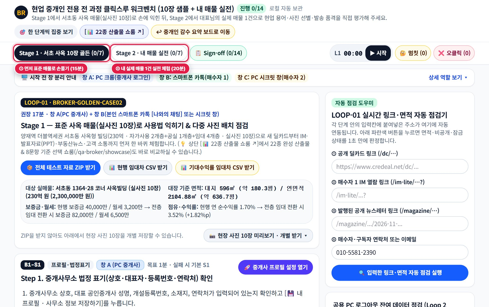
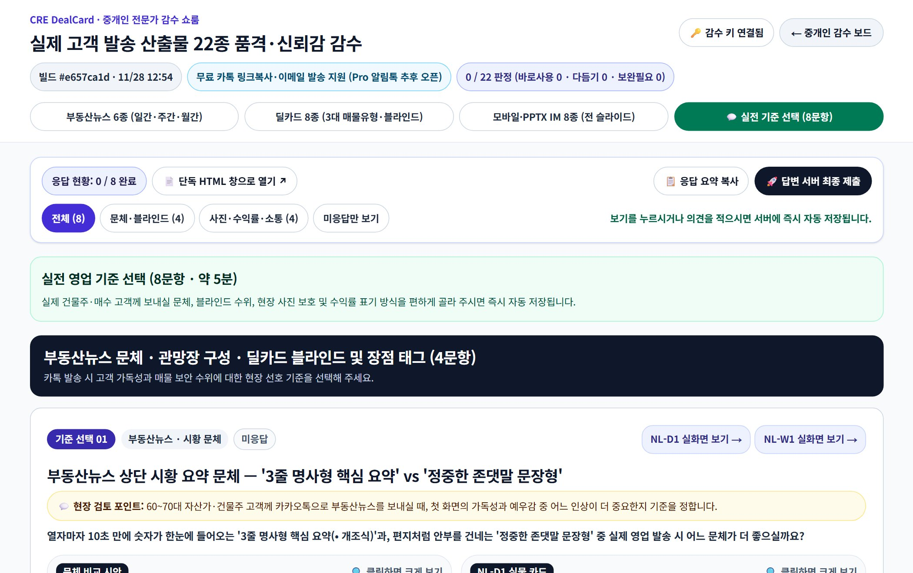
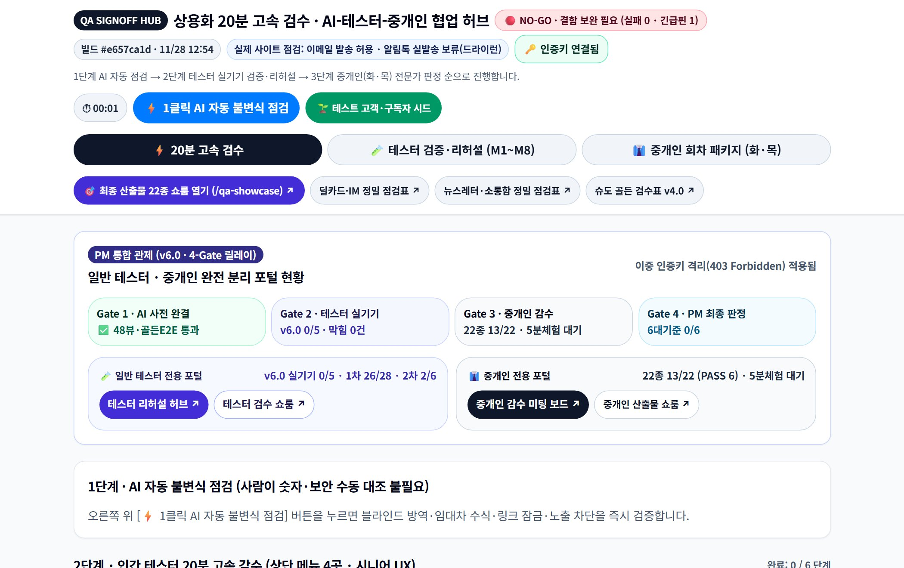

# [진행자 전용] 베타테스트 무개입 관찰 런북 & 데이터 환류 SOP

본 문서는 **현업 중개인 세션([BETA_GUIDE_FOR_BROKER.md](./BETA_GUIDE_FOR_BROKER.md))** 과 **일반인 모바일 세션([BETA_GUIDE_FOR_GENERAL_USER.md](./BETA_GUIDE_FOR_GENERAL_USER.md))** 을 진행하는 운영자(PM·리서처·창업자)를 위한 **표준 운영 절차서(Runbook)** 입니다. 진행자의 유도 질문을 원천 차단하고, 현장에서 수집된 이슈 핀과 빨간펜 교정을 **단 1건의 유실 없이 코드베이스와 3-Ring 골든 테스트로 환류(Flywheel)** 하는 전 과정을 규정합니다.

---

## 1. 회차(Cohort)별 배포 URL 조립 규격 (시크릿 보안 원칙)

> [!CAUTION]
> **시크릿 키 평문 노출 절대 금지**: 문서·슬랙·깃허브 커밋에는 반드시 `{{QA_BROKER_ACCESS_KEY}}`, `{{QA_TESTER_ACCESS_KEY}}`, `{{QA_ACCESS_KEY}}` 플레이스홀더만 표기하고, 실제 키 값은 발송 직전 카카오톡/문자에서만 치환합니다. 모든 URL 끝에 `&cohort=<회차ID>`를 붙여야 사후 클러스터링(`qa:redpen-insights`)에서 회차별 데이터가 자동 분리됩니다.

| 대상 그룹 | 권장 `cohort` 값 | 발송 URL 템플릿 |
|:---|:---:|:---|
| **현업 중개인 1회차** | `beta-1` | `https://www.credeal.net/qa-broker/full-loop?qaKey={{QA_BROKER_ACCESS_KEY}}&cohort=beta-1`<br>`https://www.credeal.net/qa-broker/showcase?qaKey={{QA_BROKER_ACCESS_KEY}}&tab=questions&cohort=beta-1` |
| **현업 중개인 2회차** | `beta-2` | `https://www.credeal.net/qa-broker/full-loop?qaKey={{QA_BROKER_ACCESS_KEY}}&cohort=beta-2`<br>`https://www.credeal.net/qa-broker/showcase?qaKey={{QA_BROKER_ACCESS_KEY}}&tab=questions&cohort=beta-2` |
| **일반인 모바일 회차** | `general-1` | `https://www.credeal.net/dc/<buildingId>?qa=1&qaKey={{QA_TESTER_ACCESS_KEY}}&cohort=general-1`<br>`https://www.credeal.net/im-lite/<buildingId>?token=<slkToken>&qa=1&qaKey={{QA_TESTER_ACCESS_KEY}}&cohort=general-1`<br>`https://www.credeal.net/magazine/<slug>/<issueDate>?qa=1&qaKey={{QA_TESTER_ACCESS_KEY}}&cohort=general-1` |
| **진행자 통합 관제 허브** | *(전체 조회)* | `https://www.credeal.net/qa-signoff?qaKey={{QA_ACCESS_KEY}}` |

---

## 2. 시작 10분 전 프리플라이트 체크리스트

- [ ] **액세스 키 게이트 점검**: 시크릿 창에서 치환된 URL이 `200 OK`로 열리고, `qaKey` 제거 시 `404`로 즉시 차단되는지 확인합니다.
- [ ] **왼쪽 아래 `📌 화면 검수 핀` 노출 확인**: 작업공간(`/broker/w/dealcards?qa=1&qaKey=...&cohort=beta-1`) 및 일반인 공개 링크 진입 시 좌측 하단(`left-4`)에 **`📌 화면 검수 핀`** 버튼이 정상 표시되는지 확인합니다.
- [ ] **중개인 세션 PC 2창 분할 세팅**:
  - 좌측 35% (`Win + ←`): `/qa-broker/full-loop` 워크벤치 안내 창
  - 우측 65% (`Win + →`): 실제 크리딜 작업 창 (`/broker`)
  - 스마트폰: 본인 카카오톡 **`[나와의 채팅]`** 열어 대기
- [ ] **일반인 세션 승인 링크 발급 확인**: `/qa-broker/showcase` 매니페스트 또는 워크벤치에서 만료되지 않은 `slk.*` 서명 토큰이 포함된 모바일 IM 링크를 준비합니다.
- [ ] **녹화·녹음 시작 (사전 동의 고지)**: 마우스 커서 위치 강조 표시 ON + 음성 녹음을 시작합니다.

---

## 3. 진행자 무개입 5대 원칙 (No-Leading Rules)

> [!WARNING]
> 진행자가 *"거기 오른쪽 아래 파란 버튼 누르시면 돼요"* 라고 알려주는 순간, **시니어 중개인이나 일반 고객이 혼자 썼을 때 이탈하는 결정적 UX 병목 데이터가 영구 소실**됩니다.

1. **15초 침묵의 법칙**: 참가자가 버튼을 찾지 못해 시선이나 마우스가 헤매더라도 **최소 15~20초간 절대 개입하지 않고**, 워크벤치 상단의 `🤔 멈칫 (+1)` / `❌ 오클릭 (+1)` 카운터만 기록합니다.
2. **정답 대신 역질문 표준 대본**: 참가자가 *"이건 어디 눌러야 해요?"* 라고 물으면 위치를 알려주는 대신 아래 문장 그대로 역질문합니다.
   - **표준 대본**: *"제가 말씀드리기 전에, 지금 화면에서 어디를 누르면 될 것처럼 보이시나요? 만약 안 보인다면 어떤 이름의 버튼이 어디에 있었으면 바로 누르셨을까요?"* (답변 확보 후 30초 경과 시에만 안내)
3. **칭찬 유도 질문 금지**: *"한눈에 들어오죠?"*, *"편해졌죠?"* 금지 → *"평소 보시던 자료와 비교했을 때 가장 어색하거나 불안한 지점이 어디인가요?"* 로 질문합니다.
4. **모호한 감상 즉시 `✏️ 빨간펜` 쌍으로 박제**: 참가자가 *"말투가 좀 딱딱하네요"* / *"단어가 어렵네요"* 라고 말하면 그 자리에서 왼쪽 아래 **`[📌 화면 검수 핀]` → `[✏️ 빨간펜 교정]`** 을 열어 `원래 문구 → 대체 문구` 쌍으로 직접 적게 유도합니다.
5. **실고객 오발송 물리 차단**: 중개인 `Stage 2`(실매물 체험)에서 `[카톡으로 보내기]` 실행 시 반드시 **대표님 본인의 `[나와의 채팅]`** 에만 붙여넣는지 옆에서 육안으로 확인합니다.

---

## 4. 중개인 세션(45분) 코스별 무개입 관찰표 & 필수 질문 대본



### [00:00 ~ 02:00] 오프닝 아이스브레이킹 대본
> *"대표님, 오늘 목표는 대표님이 프로그램을 잘 다루시는지 보는 게 아니라 저희 시스템이 현업 중개사님께 얼마나 불친절한지 잡아내는 것입니다. 사무실에서 혼자 쓰신다고 생각하시고, '어? 이게 뭐지?' 싶은 작은 혼잣말도 전부 소리 내어 말씀해 주세요."*

### [02:00 ~ 17:00] 코스 1 (`Stage 1` 표준 사옥 샘플) 관찰 체크리스트

| 구간 | 진행자 무개입 관찰 포인트 | 완료 직후 중립 질문 대본 |
|:---|:---|:---|
| **홈 & 글자 크기** | - [ ] 상단 `[가+ / 큰글씨]` 버튼을 스스로 인지하고 조절하는가?<br>- [ ] `큰글씨(18px)` 또는 `아주 크게(21px)` 전환 시 줄바꿈·잘림 불편 호소가 없는가? | *"글씨 크기를 키웠을 때 눈의 피로감이나 화면 답답함은 어떠신가요?"* |
| **딜카드 & 이어달리기 (`U-02`/`U-03`)** | - [ ] 메모 붙여넣기 후 생성 버튼을 10초 내 스스로 찾는가?<br>- [ ] 오른쪽 미리보기 카드를 클릭해 왼쪽 입력칸으로 점프(`U-03`)하는 동작을 자연스럽게 쓰는가?<br>- [ ] 저장 후 뜨는 **`[상세 IM 바로 만들기]` / `[뉴스레터 추천매물로 넣기]` 이어달리기 알약(`U-02`)** 을 스스로 발견해 클릭하는가? | *"손님께 첫 카톡을 보낼 때 이 정도 블라인드 수위면 위치 감은 주면서 매물 유출 걱정은 없으신가요?"* |
| **IM · 엑셀 표 · 사진 10장** | - [ ] 대장 자동 조회 면적(`㎡`/`평`)과 현행/기대수익률 탭 분리를 직관적으로 이해하는가?<br>- [ ] 오른쪽 `발표자료 9면` 슬라이드를 클릭해 수정 단계로 이동(`U-03`)하는가? | *"자가사용 층이 공실로 잡히지 않고 구분된 표기 방식이 실제 손님 브리핑 기준에 맞나요?"* |
| **소통함 승인 & 링크 잠금** | - [ ] 소통함에서 **1클릭 추천 매물 칩(`U-02`)** 을 활용하는가?<br>- [ ] 승인 발송 후 오른쪽 칸에서 **`[보낸 링크 잠그기]`** 를 15초 내 스스로 찾는가? | *"보낸 링크를 원할 때 바로 잠그는 기능이 전속 매물 보호에 실질적으로 도움이 되시나요?"* |

### [17:00 ~ 37:00] 코스 2 (`Stage 2` 대표님 실제 매물 BYOD) 집중 채굴표

- [ ] **날것 메모 미인식 어휘 기록**: 대표님의 실제 메모에 포함된 약어(`조절`, `무권리`, `렌트프리`, `부가세 별도`, `위반건축물`, `기계식 주차 불능` 등) 중 파서가 놓친 항목을 기록합니다.
- [ ] **대장 ↔ 현장 괴리 수정 관찰**: 공부상 면적·용도와 실제 업종·증축 현황이 다를 때 어디서 수정 막힘이 발생하는지 기록합니다.
- [ ] **실제 현장 사진 9장+ 검수**: 간판 상호·차량 번호판·임차인 내부 노출 때문에 업로드를 망설이는 사진이 있는지 관찰합니다.
- [ ] **`✏️ 빨간펜 교정` 최소 3건 확보**: 딜카드·모바일 IM·PPT 슬라이드 문구 중 어색한 AI 문체를 대표님의 실제 영업 문장으로 최소 3건 교정 제출하게 합니다.
- [ ] **★ 결정적 질문 (The Kill-Question — 카톡 `[나와의 채팅]` 열람 직후 원문 그대로 질문)**:
  > *"대표님, 솔직하게 여쭙겠습니다. 방금 대표님 휴대폰 카톡으로 열어보신 이 링크와 PPT 파일을 **오늘 오후 실제 매수 검토 중인 VIP 손님 카톡방에 지금 당장 보내실 수 있습니까?** 만약 보내기 전에 딱 한 가지를 손봐야 마음이 놓이신다면, 그 **단 1가지**가 무엇입니까?"*
- [ ] **★ 원클릭 삭제 직전 30초 비식별 메모 백업**: 대표님이 `[🧹 내 테스트 매물·딜카드·IM 서버에서 즉시 삭제]`를 누르기 직전, 동의하에(지번·건물명·실명 제외) **미인식 메모 용어 패턴**만 수첩에 백업한 뒤 대표님이 직접 삭제 버튼을 눌러 파기 결과를 확인하시게 합니다.

### [37:00 ~ 45:00] 코스 3 (`8문항 기준 선택` & `Sign-off`)



- `/qa-broker/showcase?qaKey={{QA_BROKER_ACCESS_KEY}}&tab=questions&cohort=beta-1` 에서 8문항 응답 및 **`[🚀 답변 서버 최종 제출]`** 완료 확인 → 워크벤치 **`[📋 Sign-off]` → `[☁️ 서버 최종 제출]`** 완료 배지를 확인합니다.

---

## 5. 일반인 모바일 세션(15분) 핵심 관찰 포인트

일반인 세션(대면 또는 비대면 카톡 참여)에서는 다음 4가지 생활형 지표를 중점 확인합니다.

1. **3초 가치 인지 (미션 1)**: 부동산 비전문가가 딜카드를 열었을 때 3초 안에 지역·용도·금액대를 말할 수 있는가?
2. **모바일 가상 키보드 비가림 (`U-01`, 미션 2)**: 스마트폰에서 `[상세 제안서 요청]` 모달의 이름·연락처 입력 시 가상 키보드가 입력칸이나 하단 제출 버튼·고정 푸터를 가리지 않는가?
3. **인앱 브라우저 탈출 유도 (`U-01`, 미션 3)**: 카카오톡 인앱 브라우저에서 파일 저장 시 `[외부 브라우저(Safari/Chrome)로 열기]` 및 `[링크 복사]` 배너만으로 스스로 해결하는가?
4. **전문용어 장벽 제보 (미션 4)**: `general-1` 회차 참가자들이 `📌 화면 검수 핀`으로 짚어낸 난해한 부동산 용어(예: `전용률`, `근린생활시설`, `공시지가 현실화율`, `NOI` 등)가 최소 2건 이상 수집되었는가?

---

## 6. 종료 직후 10분 무손실 회수 & 24시간 내 3-Ring 골든 환류 (`U-05`)



### Step 1. 세션 종료 직후 10분 내 적재 검증
1. `/qa-signoff?qaKey={{QA_ACCESS_KEY}}` 관제 허브를 열어 방금 세션에서 찍은 **`📌 오류·불편 핀`** 과 **`✏️ 빨간펜 교정(원래 문구 → 대체 문구)`** 건수가 실시간 반영되었는지 육안 확인합니다.
2. 중개인 워크벤치 `[📋 Sign-off]` 탭의 로컬 백업 파일(JSON/HTML)도 보조 보관합니다.

### Step 2. 회차별 빨간펜 · 이슈 핀 자동 클러스터링 실행 (`U-05`)
터미널에서 아래 명령어를 실행하여 `activity_events`에 적재된 핀과 빨간펜 데이터를 4대 버킷(`lexicon_candidate`, `prompt_tone`, `ui_ergonomics`, `data_accuracy`)으로 자동 분류합니다.

```powershell
# 중개인 1회차 데이터 클러스터링 리포트 생성
npm run qa:redpen-insights -- --cohort beta-1

# 일반인 1회차 데이터 클러스터링 리포트 생성
npm run qa:redpen-insights -- --cohort general-1
```

실행 즉시 `artifacts/qa/redpen-insights-report.md` 및 `artifacts/qa/redpen-insights-report.json`이 생성되며, 동일 문구 반복 지적 건과 시급도(`urgent` > `important` > `polish`) 순으로 우선순위가 자동 정렬됩니다.

### Step 3. 24시간 내 코드베이스 & 골든 테스트 영구 박제 매핑표

| 클러스터 분류 버킷 | 반영 대상 파일 (SSOT) | 회귀 검증 게이트 명령어 |
|:---|:---|:---|
| **`lexicon_candidate`**<br>(어색한 AI 상투어 · 난해한 한자어) | `src/lib/ux/lexicon.ts` 금지어/순화어 사전 추가 | `npm run golden:fast` |
| **`prompt_tone`**<br>(문체 · 인사말 · 브리핑 호흡 교정) | `src/ai/prompts/` Few-Shot 반영 후 해시 갱신 | `npm run golden:prompt-hash:update` → `npm run golden:judge` |
| **`ui_ergonomics`**<br>(15초 이상 헤맨 버튼 · 자판 가림 · 터치 미스) | 해당 UI 컴포넌트 수정 + `e2e/ux-golden-*.spec.ts` 단언 추가 | `npm run test:ux-golden` |
| **`data_accuracy`**<br>(미인식 메모 약어 · 엑셀 열 변형 · 수익률 표기) | 파서/도메인 보강 + 비식별 홀드아웃 케이스 추가 | `npm run preflight` → `npm run golden:fast` |
