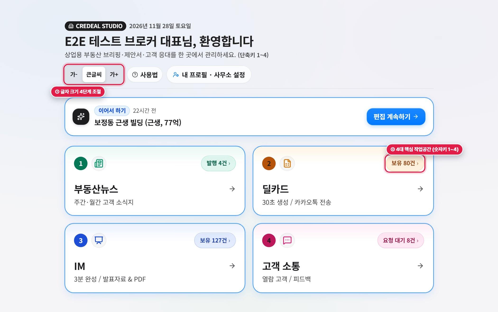
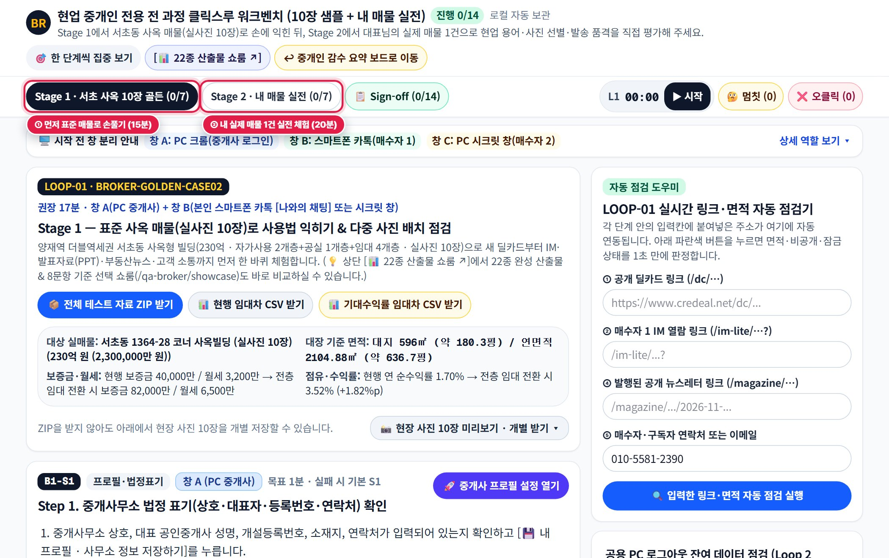
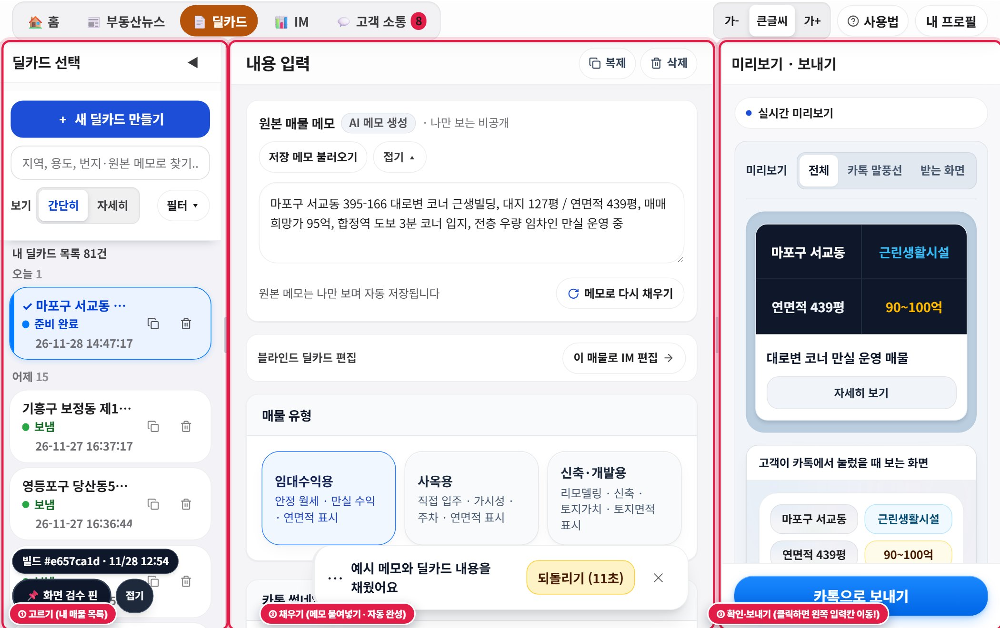
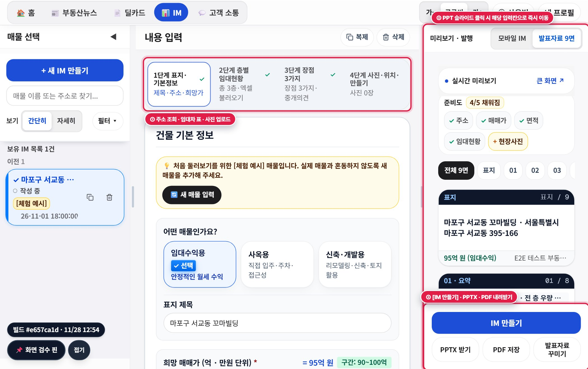
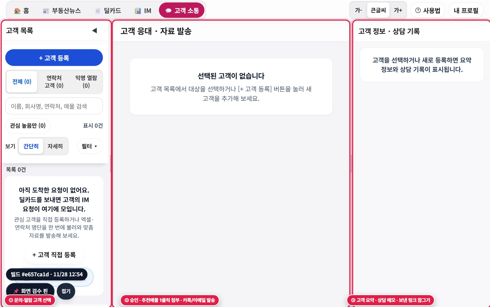
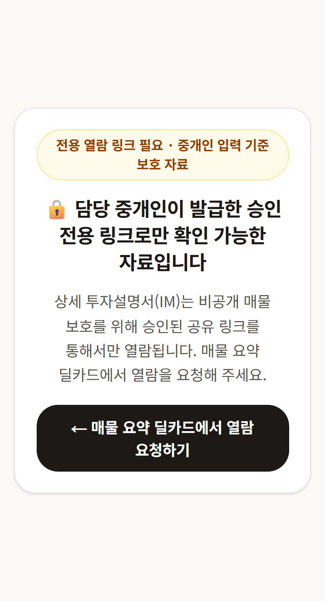
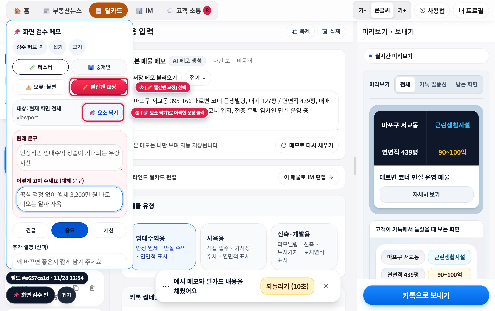
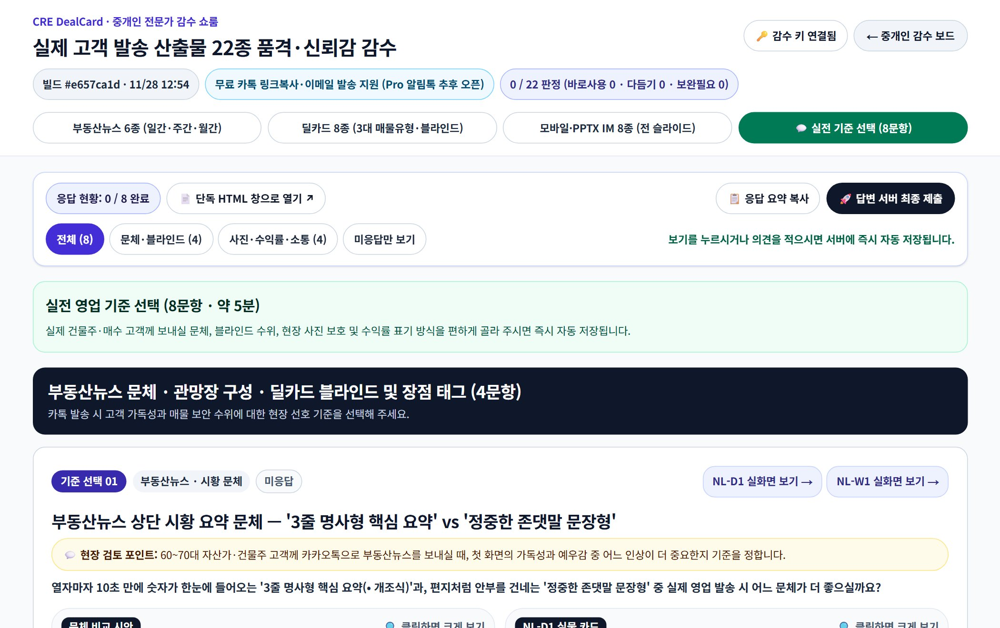

# [현업 중개인용] 크리딜(CREDEAL) 실전 베타테스트 안내서

> **바쁘신 중에도 귀한 시간 내어 주셔서 진심으로 감사드립니다, 대표님.**
> 오늘 자리는 대표님의 컴퓨터 실력을 평가하는 시험이 절대 아닙니다. 저희 프로그램이 **상업용 부동산 현장의 말투·관행·고객 응대 품격**을 제대로 갖추었는지 대표님의 눈높이로 **부족한 점을 매섭게 혼내주시는 자문 자리**입니다.

---

## 1. 사전 안내 메시지 (카카오톡 · 문자 발송용)

진행자가 테스트 전날 대표님께 보내드리는 안내문입니다. (그대로 복사해 카카오톡에 붙여넣어 보내실 수 있습니다.)

```text
[크리딜(CREDEAL) 현업 대표공인중개사 자문 테스트 안내]

안녕하세요, 대표님. 크리딜 실전 베타테스트에 귀한 시간 내어 주셔서 깊이 감사드립니다.

이번 시간은 대표님이 프로그램을 잘 다루시는지 보는 자리가 아니라, 저희 시스템이 실제 빌딩·상가 중개 현장의 말투와 영업 기준에 맞는지 '대표님께서 불편한 점을 가차 없이 짚어주시는 자리'입니다.

■ 소요 시간: 총 45분 (샘플 매물로 손풀기 15분 → 대표님 실제 매물 1건 체험 20분 → 영업 기준 8문항 선택 10분)
■ 준비 환경: 사무실 PC(크롬 권장) + 대표님 스마트폰(카카오톡 실행 가능 상태)

■ 미리 챙겨 주실 자료 3가지 (다듬지 않고 평소 쓰시는 날것 그대로가 가장 좋습니다!)
1) 수첩이나 카톡에 적어 두신 '실제 진행 매물 메모 1건' (임대수익형 또는 사옥형)
2) 평소 쓰시는 해당 매물의 '층별 임대 현황 엑셀(또는 표) 1개'
3) 스마트폰이나 PC에 찍어 두신 해당 매물 '현장 사진 9장 이상' (외관·내부·주차장 등 원본 그대로)

■ 대표님 매물 기밀 100% 보호 약속 (안심하고 가져오세요)
• 테스트 중 만든 모든 링크는 실제 손님이 아닌 대표님 본인의 카카오톡 [나와의 채팅]으로만 열어 봅니다.
• 테스트가 끝나는 즉시 화면의 [🧹 내 테스트 매물·딜카드·IM 서버에서 즉시 삭제] 버튼 하나로 대표님이 직접 서버에서 흔적 없이 완전 파기하실 수 있습니다.

■ 당일 접속 주소 (시작할 때 함께 열어 드립니다)
• 실전 테스트 보드: https://www.credeal.net/qa-broker/full-loop?qaKey={{QA_BROKER_ACCESS_KEY}}&cohort=beta-1
• 영업 기준 8문항 선택: https://www.credeal.net/qa-broker/showcase?qaKey={{QA_BROKER_ACCESS_KEY}}&tab=questions&cohort=beta-1
```

---

## 2. 시작 전 1분 화면 익히기 — 큰글씨 조절과 4가지 메뉴

크리딜은 복잡한 메뉴를 없애고 현업에서 매일 쓰시는 **딱 4가지 작업공간**만 상단에 두었습니다.



1. **눈이 편한 글자 크기 조절 (`①`)**: 화면 오른쪽 위 **`[가- / 큰글씨 / 가+]`** 버튼을 누르시면 화면 전체 글씨가 **4단계(작게 · 표준 · 큰글씨 · 아주 크게)** 로 즉시 커집니다. 눈이 가장 편안한 크기로 먼저 맞춰 보세요.
2. **어디서나 똑같은 3칸 화면 구조 (`②`)**: 상단의 **`부동산뉴스` · `딜카드` · `IM` · `고객 소통`** 어느 메뉴에 들어가셔도 화면 배치가 항상 똑같습니다.
   - **왼쪽 칸 (고르기)**: 내 매물이나 고객 목록에서 대상을 고릅니다. (좁으면 접어 둘 수 있습니다.)
   - **가운데 칸 (채우기)**: 평소 메모나 엑셀 표를 붙여넣고 내용을 다듬습니다.
   - **오른쪽 칸 (확인·보내기)**: 손님 휴대폰에 어떻게 보일지 실시간으로 확인하고 카톡이나 파일로 보냅니다.

---

## 3. 오늘 진행할 3가지 코스 한눈에 보기 (총 45분)

테스트 보드(`/qa-broker/full-loop`)를 열면 아래와 같이 **Stage 1(손풀기)** 과 **Stage 2(내 매물 실전)** 탭이 준비되어 있습니다.



| 순서 | 소요 시간 | 진행 내용 | 대표님께서 봐주실 핵심 포인트 |
|:---|:---:|:---|:---|
| **코스 1**<br>표준 매물 손풀기 | **15분** | 미리 준비된 **서초동 230억 사옥 샘플(사진 10장)** 로 딜카드 → 상세 IM·PPT → 부동산뉴스 → 고객 소통함을 한 바퀴 체험합니다. | 설명을 듣지 않고 화면만 보셨을 때 **다음에 누를 버튼이 한눈에 보이는지** 편하게 말씀해 주세요. |
| **코스 2**<br>내 매물 실전 체험 | **20분** | **대표님이 가져오신 실제 매물 1건**을 직접 넣고, 본인 카톡 `[나와의 채팅]`으로 열어 보며 발송 품격과 보안(지번·건물명 숨김)을 검증합니다. | **"오늘 오후 실제 VIP 매수 손님께 바로 보낼 수 있는 수준인지"**, 망설여진다면 무엇 때문인지 냉정하게 짚어 주세요. |
| **코스 3**<br>기준 선택 & 완전 삭제 | **10분** | 현업에서 선호하시는 표기 기준 **8문항(A/B 비교)** 을 고른 뒤, 테스트로 넣었던 대표님 매물을 **버튼 하나로 서버에서 완전 삭제**합니다. | 가격대 표기 수위, 공실 수익률 병기 방식 등 대표님의 평소 영업 철학을 골라 주세요. |

---

## 4. 코스 1 — 표준 매물 샘플로 가볍게 손풀기 (15분)

### ① 카카오톡용 '블라인드 딜카드' 만들기 (3분)

첫 손님께 매물 주소를 노출하지 않고 핵심 매력만 카톡으로 보낼 때 쓰는 화면입니다.



- 가운데 **`원본 매물 메모`** 칸에 수첩에 적어 두신 메모를 그대로 붙여넣고 **`[메모로 다시 채우기]`** 를 누르면, 오른쪽 칸에 손님 카톡방에 뜰 카드가 자동으로 만들어집니다.
- **매물 따이기(유출) 자동 방지**: 원본 메모에 건물 이름이나 상세 지번(`395-166`)이 적혀 있어도, 손님용 카드에는 **`마포구 서교동` · `90~100억`** 처럼 동 단위와 금액 구간만 안전하게 표시됩니다.
- **미리보기 클릭 바로 수정**: 오른쪽 미리보기 카드에서 고치고 싶은 문구가 보이면 **그 글자를 마우스로 바로 클릭**해 보세요. 왼쪽의 해당 입력칸으로 즉시 데려다줍니다!
- 저장이 끝나면 화면에 뜨는 **`[상세 IM 바로 만들기]`** 또는 **`[뉴스레터 추천매물로 넣기]`** 버튼을 눌러 다음 작업으로 두 번 입력할 필요 없이 1초 만에 이어갈 수 있습니다.

### ② 상세 제안서(IM)와 발표자료(PPT) 뽑기 (6분)

매수 의향이 확인된 진성 손님께 보내는 모바일 제안서와 인쇄·미팅용 파워포인트(PPT)를 만드는 화면입니다.



1. **1단계 표지·기본정보**: 주소를 검색하면 건축물대장의 대지면적·연면적(`㎡`와 `평` 자동 병기)과 공시지가 등을 자동으로 불러옵니다.
2. **2단계 층별 임대현황**: 평소 쓰시는 엑셀 표를 그대로 복사(`Ctrl+C`)해 붙여넣기(`Ctrl+V`)하면 보증금·월세 합계와 수익률이 자동 계산됩니다. (자가사용 층과 공실 층도 현업 기준에 맞게 구분됩니다.)
3. **4단계 사진·만들기 & PPT 확인**: 현장 사진 여러 장을 한 번에 올리고 대표 사진을 고릅니다. 오른쪽 **`[발표자료 9면]`** 탭에서 원하는 슬라이드를 클릭하면 해당 수정 칸으로 바로 이동하며, 아래 **`[PPTX 받기]`** 를 누르면 파워포인트 파일이 바로 내려받아집니다.

### ③ 부동산뉴스 발행 & 고객 소통함에서 승인·링크 잠그기 (6분)

손님이 카톡 딜카드에서 `[상세 제안서 요청]`을 누르면 **`[고객 소통]`** 메뉴에 요청이 도착합니다.

| ① 고객 소통함 3칸 작업공간 (승인·발송) | ② 보낸 링크 잠금 시 손님 스마트폰 화면 |
|:---:|:---:|
|  |  |

- 가운데 칸에서 **`[자료 보내기(승인)]`** 를 누르면 승인된 손님만 열 수 있는 전용 링크가 만들어집니다. 내 매물을 한 번의 클릭으로 손님 응대 메시지에 바로 첨부할 수도 있습니다.
- **전속·비공개 매물 안심 잠금**: 거래가 마무리되었거나 더 이상 열람을 원치 않으실 때 오른쪽 칸에서 **`[보낸 링크 잠그기]`** 를 누르시면, 이미 손님 카톡방에 보낸 링크라도 두 번째 사진처럼 **즉시 열람이 차단**됩니다.

---

## 5. 코스 2 — 대표님의 실제 매물 1건으로 실전 검증하기 (20분)

상단 탭에서 **`[Stage 2 · 내 매물 실전]`** 으로 이동한 뒤, 미리 준비해 오신 **대표님의 실제 매물 1건**을 평소 일하시는 방식 그대로 넣어 보세요.

> [!IMPORTANT]
> **코스 2에서 대표님께 꼭 여쭙고 싶은 4가지**
> 1. **평소 메모 인식력**: 평소 쓰시는 줄임말이나 조건(`조절 가능`, `렌트프리`, `부가세 별도`, `근생·주택 혼재`, `위반건축물` 등)을 넣었을 때 프로그램이 못 알아듣거나 입력칸이 없어 답답한 항목이 있으신가요?
> 2. **대장과 현장이 다를 때**: 건축물대장상 면적·용도와 실제 현장 상태가 다를 때, 대표님이 아시는 실제 내용으로 고쳐 적기 편하신가요?
> 3. **스마트폰 카톡 실전 품격**: 완성된 링크를 대표님 본인의 카카오톡 **`[나와의 채팅]`** 에 붙여넣고 스마트폰으로 직접 열어 보세요. **"오늘 오후 실제 VIP 매수 손님 카톡방에 지금 바로 보낼 수 있는 수준인지"**, 딱 한 가지가 걸린다면 무엇인지 솔직하게 말씀해 주세요.
> 4. **내 매물 비공개 단어 `0건` 직접 확인**: 테스트 보드의 `내 매물 비공개 확인 단어` 칸에 실제 건물명·지번을 입력하고 점검 버튼을 눌러, 손님용 카드에 기밀 정보가 단 한 글자도 새어 나가지 않았음을 직접 확인해 보세요.

---

## 6. [핵심 부탁] 어색한 문장은 왼쪽 아래 `📌 화면 검수 핀`으로 고쳐 주세요!

화면을 보시다가 **"현업 중개사는 손님께 이런 딱딱한 말투 안 쓴다!"** 싶거나 버튼이 불편할 때는 언제든 화면 **왼쪽 아래 검정색 `[📌 화면 검수 핀]`** 버튼을 눌러 주세요.



1. **`① [✏️ 빨간펜 교정]` 선택**: 문구·용어를 고칠 때는 빨간펜 교정을, 버튼이 안 눌리거나 깨질 때는 `⚠️ 오류·불편`을 누릅니다.
2. **`② [🎯 요소 찍기]` 클릭 후 문장 콕 찍기**: 화면에서 거슬리는 문장을 마우스로 클릭하면 `원래 문구` 칸에 자동으로 담깁니다.
3. **`③` 내 표현 적고 `[검수 허브로 보내기]` 클릭**: `이렇게 고쳐 주세요` 칸에 **대표님이 실제 손님께 카톡이나 브리핑하실 때 쓰시는 생생한 표현**을 적어 보내 주시면, 저희 AI와 화면 문구에 그대로 반영됩니다. *(오늘 테스트 중 3건 이상 편하게 남겨 주시면 큰 도움이 됩니다!)*

---

## 7. 코스 3 — 영업 기준 8문항 선택 & 내 매물 완전 삭제 (10분)

1. **현업 영업 기준 8문항 선택 (`/qa-broker/showcase?tab=questions`)**:
   
   부동산뉴스 인사말 말투, 가격대 공개 범위, 공실 건물 수익률 표기법 등 현업에서도 의견이 갈리는 **8가지 질문**에 대해 양쪽 예시 그림을 보시고 더 마음에 드는 쪽을 클릭해 주세요. 누르시는 즉시 자동 저장됩니다.
2. **내 테스트 매물 서버에서 즉시 완전 삭제**:
   다시 테스트 보드(`Stage 2` 마지막 단계)로 돌아와 **`[🧹 내 테스트 매물·딜카드·IM 서버에서 즉시 삭제]`** 버튼을 직접 눌러 주세요. 방금 테스트로 만드신 매물·딜카드·IM 링크가 서버에서 즉시 파기됩니다.
3. **마무리 제출**:
   상단 **`[📋 Sign-off]`** 탭에서 전체 소감 한 줄을 적어 주시고 **`[☁️ 서버 최종 제출]`** 을 누르시면 오늘 자문이 모두 끝납니다. 귀한 현장 지혜를 나누어 주셔서 다시 한번 감사드립니다!
