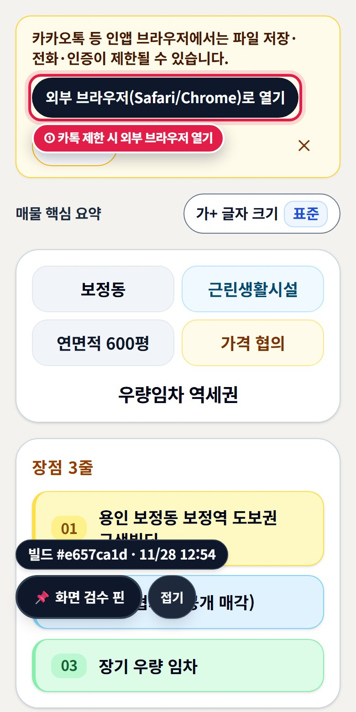
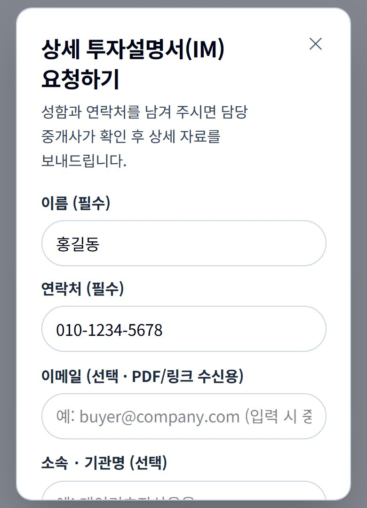
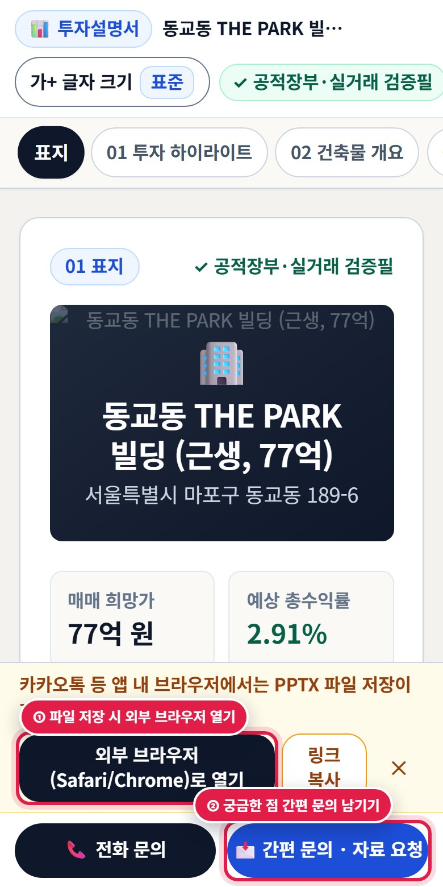
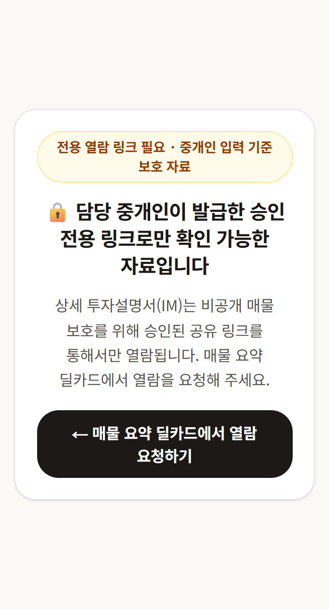
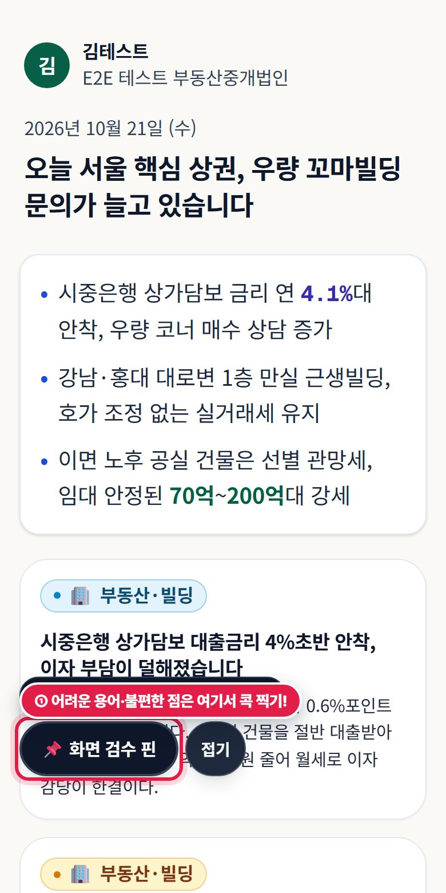
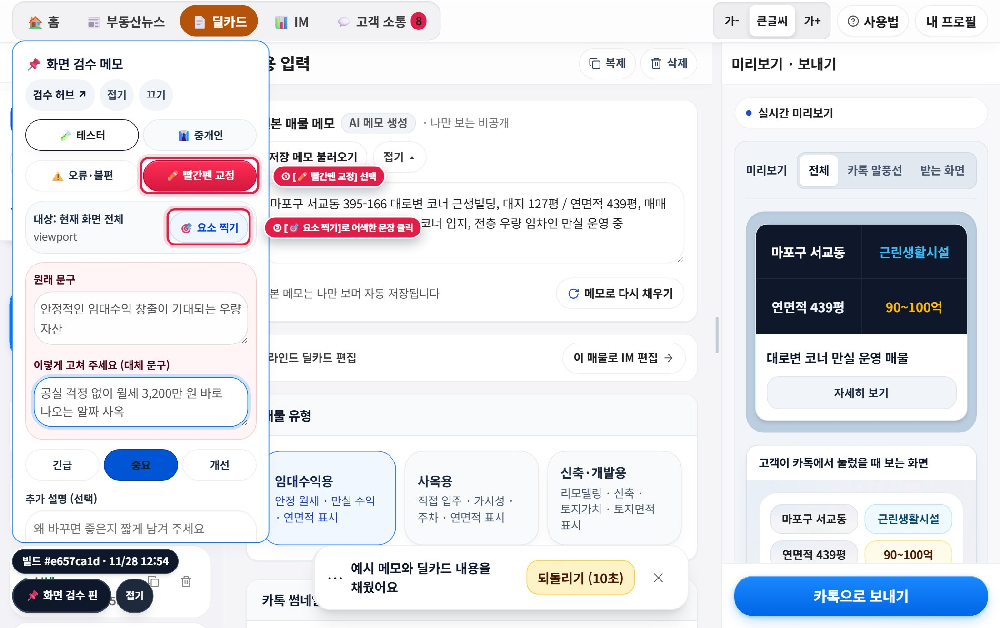

# [일반인 베타테스터용] 스마트폰 카카오톡 15분 체험 안내서

> **환영합니다! 부동산이나 컴퓨터를 잘 모르셔도 전혀 괜찮습니다.**
> 이번 체험은 회원가입이나 앱 설치 없이, **평소 쓰시는 스마트폰 카카오톡으로 건물 소개 링크를 받아 읽어 보시면서** *"글씨가 작다"*, *"이 단어가 무슨 뜻인지 어렵다"*, *"버튼이 잘 안 눌린다"* 같은 솔직한 느낌을 편하게 알려주시는 **15분짜리 가벼운 체험**입니다.

---

## 1. 카카오톡 초청 메시지 (진행자 전달용 · 복사 붙여넣기)

진행자가 일반인 테스터분께 카카오톡으로 보내드리는 안내 메시지입니다.

```text
[크리딜 모바일 화면 15분 체험 안내 (회원가입·앱 설치 없음)]

안녕하세요! 바쁘신 중에 15분 모바일 체험에 참여해 주셔서 감사합니다 😊

이번 테스트는 정답을 맞히는 자리가 전혀 아닙니다.
지인이나 부동산 중개사님께 카톡으로 건물 소개 링크를 받았다고 생각하시고, 스마트폰으로 편하게 열어 보시면서 '한눈에 잘 읽히는지 / 어려운 말은 없는지 / 자판으로 입력할 때 불편하지 않은지' 솔직하게 알려주시면 됩니다.

■ 걸리는 시간: 스마트폰으로 약 15분 (짧은 미션 4개)
■ 개인정보 안내: 체험 중 이름·전화번호 입력칸에는 본인 번호 대신 '홍길동 / 010-1234-5678' 처럼 연습용 가짜 정보를 입력해 주세요!

■ 오늘 순서대로 눌러 보실 링크 3개
1) 매물 요약 카드: https://www.credeal.net/dc/5c0ca5e0-0001-4000-8000-000000000001?qa=1&qaKey={{QA_TESTER_ACCESS_KEY}}&cohort=general-1
2) 상세 건물 소개서(승인 전용): (진행자가 함께 보내드리는 전용 링크 클릭)
3) 부동산 소식지: https://www.credeal.net/magazine/test-broker-kim/2026-10-21?qa=1&qaKey={{QA_TESTER_ACCESS_KEY}}&cohort=general-1
```

---

## 2. 스마트폰으로 해 보실 4가지 간단 미션 (총 15분)

### 미션 1 (3분) — 카톡으로 받은 '매물 요약 카드' 첫인상 보기

첫 번째 링크(`매물 요약 카드`)를 카카오톡 채팅방에서 그대로 눌러 열어 보세요.



- **3초 첫인상 확인**: 링크를 열자마자 스크롤을 내리기 전에 **"어느 동네에 있는 어떤 건물이고, 대략 얼마쯤 하는지"** 가 3초 안에 한눈에 들어오나요?
- **글자 크기 키워 보기**: 글씨가 작게 느껴지신다면 화면 위쪽의 **`[가+ 글자 크기]`** 버튼을 눌러 글자를 키워 보세요. 줄이 어색하게 끊기거나 답답한 곳은 없나요?
- **외부 브라우저 안내 확인 (`①`)**: 카카오톡 안에서는 파일 저장 등이 제한될 수 있어 **`[외부 브라우저로 열기]`** 안내가 표시됩니다. 무슨 뜻인지 이해하기 쉽고 누르기 편한지 봐주세요.

---

### 미션 2 (4분) — '상세 제안서 요청' 누르고 휴대폰 자판으로 입력해 보기

매물 요약 카드 아래쪽의 파란색 **`[상세 제안서 요청]`** (`②`) 버튼을 눌러 보세요.



1. 성함 칸에는 **`홍길동`**, 연락처 칸에는 **`010-1234-5678`** 처럼 **연습용 가짜 정보**를 입력해 보세요. (실제 본인 전화번호를 적지 마세요!)
2. **꼭 확인해 주실 점 (자판 가림 체크)**:
   - 스마트폰 아래에서 글자 자판(키보드)이 올라왔을 때, **내가 지금 치고 있는 입력칸이나 아래쪽 요청하기 버튼이 자판에 가려져 안 보이지는 않나요?**
   - 손가락으로 위아래로 살짝 올렸을 때 마지막 버튼까지 편하게 누를 수 있는지 확인해 주세요.

---

### 미션 3 (4분) — '상세 건물 소개서' 읽어보기 & 파일 저장 눌러보기

두 번째 링크(`상세 건물 소개서`)를 눌러 열어 보세요. 중개사님이 열람을 허락한 손님에게만 보내주는 상세 안내서입니다.

| ① 승인된 상세 건물 소개서 모바일 화면 | ② 잠긴 링크를 열었을 때 안내 화면 |
|:---:|:---:|
|  |  |

1. **사진과 표 읽기**: 상단의 동그란 목차(`표지`, `01 투자 하이라이트`, `02 건축물 개요` 등)를 옆으로 넘겨 눌러 보시고, 건물 사진과 층별 임대 내역 표의 숫자가 스마트폰 화면 밖으로 잘리지 않고 편하게 읽히는지 봐주세요.
2. **파일 저장 안내 (`①`)**: 카카오톡 안에서 발표자료(PPT/PDF) 저장을 누르면 **`[외부 브라우저(Safari/Chrome)로 열기]`** 와 **`[링크 복사]`** 버튼이 안내됩니다. 안내 문구만 보고도 어떻게 저장하면 되는지 바로 알 수 있나요?
3. **간편 문의 버튼 (`②`)**: 하단 **`[간편 문의 · 자료 요청]`** 버튼이 본문을 심하게 가리지 않으면서 필요할 때 바로 누르기 좋은 위치에 있는지 확인해 주세요.
4. *(참고)* 만약 오른쪽 사진처럼 **`"🔒 담당 중개인이 발급한 승인 전용 링크로만 확인 가능한 자료입니다"`** 라는 안내가 뜬다면 오류가 아니라, 중개사님이 아직 승인하지 않았거나 잠근 비공개 보호 기능이 정상 작동한 것입니다.

---

### 미션 4 (4분) — '부동산 소식지' 읽고 어려운 말·불편한 점 콕 찍어 주기!

세 번째 링크(`부동산 소식지`)를 열어 오늘의 부동산 소식을 가볍게 읽어 보세요.



소식지나 앞선 화면들을 보시면서 아래 중 **하나라도 느껴지신 순간**이 있다면, 화면 **왼쪽 아래의 검정색 `[📌 화면 검수 핀]`** (`①`) 버튼을 눌러 알려주세요!

- ❓ *"이 부동산 단어가 무슨 뜻인지 한 번에 이해가 안 돼요."*
- 🔍 *"이 부분 글씨가 너무 작거나 숫자 표가 복잡해서 눈이 피로해요."*
- 👆 *"이 버튼을 눌렀는데 반응이 없거나 손가락으로 누르기 너무 작아요."*

#### 📌 화면 검수 핀으로 30초 만에 의견 남기는 법



1. 화면 왼쪽 아래 **`[📌 화면 검수 핀]`** 버튼을 누릅니다.
2. 성격에 맞게 둘 중 하나를 고릅니다:
   - **`[⚠️ 오류·불편]`**: 버튼이 작거나 안 눌릴 때, 화면이 깨져 보일 때, 자판에 가려질 때
   - **`[✏️ 빨간펜 교정]`**: 어려운 한자어·전문용어를 **"이렇게 쉬운 말로 설명해 주세요!"** 하고 제안하실 때
3. **`[🎯 요소 찍기]`** 를 누른 뒤 화면에서 불편했던 글자나 버튼을 손가락으로 톡 찍고, 한 줄로 짧게 이유를 적어 **`[검수 허브로 보내기]`** 를 누르면 끝납니다!

> [!TIP]
> **오늘 체험 동안 편하게 2건 이상만 찍어 보내 주셔도 큰 도움이 됩니다!**
> 예쁜 칭찬보다 *"여기가 무슨 말인지 모르겠어요"*, *"글씨가 답답해요"* 같은 솔직한 의견이 서비스를 가장 크게 발전시킵니다. 소중한 시간 내어 주셔서 감사합니다!
