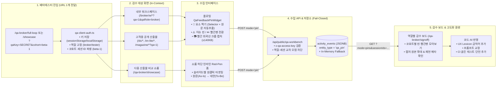

# 베타테스터용 이슈 핀(Issue Pin) & 빨간펜 교정(Red-Pen) 시스템 해설 및 타 프로젝트 이식 가이드

> **문서 목적**: 본 문서는 `cre-dealcard` 실전 클로즈드 베타에서 검증된 **인앱 이슈 핀(`⚠️ 오류·불편`)** 및 **빨간펜 문구 교정(`✏️ 빨간펜 교정`)** 시스템이 무엇인지, 어떤 기능을 수행하는지, 그리고 **타 프로젝트(웹·AI SaaS·버티컬 플랫폼)에 동일 기능을 베타테스터용으로 이식하려면 어떻게 구성해야 하는지**를 정리한 레포지토리 표준 해설서입니다.

---

## 1. 개요: 왜 ‘이슈 핀’과 ‘빨간펜 교정’인가?

### 1.1 기존 베타테스트 피드백 수집의 4대 실패 원인
일반적인 베타테스트에서 카카오톡 단톡방, 구글 시트, 자유 서술형 설문으로 피드백을 받으면 다음 문제가 반복됩니다.

1. **맥락 유실 (Lost Context)**: 테스터가 “모바일에서 표가 깨져요”라고 제보해도 어떤 URL, 어떤 해상도(`390×844`), 어떤 글자 크기 모드, 어떤 배포 버전(`buildSha`)에서 발생했는지 재현하기 어렵습니다.
2. **대안 없는 추상적 품평**: 도메인 전문가(중개인·의사·변호사·교사·마케터 등)가 AI 생성 문구를 보고 “말투가 좀 어색해요”라고만 말하면, 개발팀이 임의로 고쳤다가 또다시 “현장에서는 그렇게 안 써요”라는 재수정을 겪게 됩니다.
3. **작업 흐름 단절 (Context Switching)**: 화면을 캡처해 메신저를 열고 설명을 적는 과정에서 테스터 피로도가 급증해 피드백 수거율이 떨어집니다.
4. **역할·차수 오염 (Cohort & Role Mixing)**: QA 테스터의 기술 버그 리포트와 현업 전문가의 문체 감수, 1호 베타테스터와 2호 베타테스터의 기록이 한데 뒤섞여 의사결정 기준이 흐려집니다.

### 1.2 해결책: 화면 위에서 즉시 꽂는 2-모드 피드백 (Dual-Mode In-Context Feedback)

본 시스템은 **베타테스터가 보고 있는 실제 제품 화면(작업실 + 고객용 공개 산출물) 위에 초경량 플로팅 위젯과 슬라이드별 교정 패널을 띄워**, 단 10초 만에 구조화된 데이터를 서버로 수집합니다.

| 구분 | `⚠️ 이슈 핀 (Issue Pin)` | `✏️ 빨간펜 교정 (Red-Pen Correction)` |
| :--- | :--- | :--- |
| **핵심 목적** | 버그·레이아웃 깨짐·버튼 가림·가독성 불량 제보 | AI 생성 문구·전문 용어·UI 라벨의 **현업 언어 교정** |
| **주 사용자** | QA 테스터 및 실사용 베타테스터 | 현업 도메인 전문가 (1호 베타테스터 등) |
| **핵심 입력값** | 찍은 화면 요소 + 심각도(`긴급/중요/개선`) + 증상 메모 + **자동 하이라이트 캡처** | **`[원래 문구(As-Is)]`** (클릭 시 자동 추출) + **`[이렇게 고쳐 주세요(To-Be)]`** + 짧은 이유 |
| **개발팀 활용처** | CSS/반응형/기능 버그 즉시 재현 및 패치 | **용어 사전(Lexicon) 규칙화 · AI 프롬프트 Few-shot · 골든 테스트 단언(Assertion) 직결** |

---

## 2. 핵심 수행 기능 8가지

### 기능 1. 플로팅 인앱 위젯 & 쇼룸 인라인 패널의 이원화 배치
- **플로팅 위젯 (`QaFeedbackPinWidget`)**: 내부 에디터/워크스페이스뿐 아니라 **최종 고객이 받아보는 공개 웹페이지** 위에서도 좌측 하단에 작은 알약 버튼(`📌 화면 검수 핀`)으로 떠 있습니다.
  - 화면을 가리지 않도록 **`[접기]`**(초소형 버튼화), **`[끄기]`**(`sessionStorage` 도킹 후 `📌 핀 켜기`로 언제든 복귀), 인쇄 시 자동 숨김(`print:hidden`), 다크모드 영향 방지(`data-theme-lock="light"`)를 지원합니다.
- **쇼룸 슬라이드 연동 패널 (`ShowcaseDeliverableViewer`)**: 20여 종의 산출물이나 PPT 슬라이드를 한눈에 검수하는 쇼룸에서는 각 슬라이드 카드의 **`[✏️ 이 슬라이드 의견]`** 버튼을 누르면 하단 빨간펜 입력창의 대상이 `IM-01 · 슬라이드 03`으로 즉시 지정되고 포커스가 이동합니다.

### 기능 2. 원클릭 DOM 요소 찍기 (`🎯 요소 찍기` · Element Picker)
- 위젯에서 **`[🎯 요소 찍기]`**를 누르면 버튼이 호박색(`🎯 화면에서 불편한 곳을 클릭하세요`)으로 점멸하며 브라우저 `click` 이벤트를 **캡처 단계(`useCapture = true`)**에서 가로챕니다.
- 테스터가 화면의 어색한 문장이나 깨진 버튼을 클릭하면 원래의 페이지 이동·제출 동작을 막고(`preventDefault` + `stopPropagation`), 클릭된 요소에서 다음 3가지를 자동 추출합니다.
  1. **추적 선택자 (`targetSelector`)**: `[data-testid="..."]` → `#id` → `tagName` 우선순위로 결정적 선택자 생성
  2. **대상 요약 라벨 (`targetLabel`)**: `aria-label` → 입력값(`value`) → `innerText` → `placeholder` 순으로 최대 36자 요약
  3. **원문 자동 채움 (`sampleText` → `originalText`)**: 요소 안의 실제 텍스트(최대 220자)를 읽어 **빨간펜 모드의 `[원래 문구]` 칸에 자동으로 채워 넣습니다.** (테스터가 일일이 복사·붙여넣기할 필요 없음)

### 기능 3. 빨간 외곽선 자동 스크린샷 크롭 & 무중단 폴백 캡처
- 요소를 찍거나 제출할 때 클라이언트에서 현재 뷰포트를 자동 캡처하여 `≤ 140KB` 이하의 경량 JPEG Data URL로 첨부합니다.
- **실전 안정화 장치 4종**:
  1. **최신 CSS 색함수 치환기**: Tailwind v4 등이 생성하는 `oklch(...)`, `oklab(...)`, `color-mix(...)` 색상 때문에 `html2canvas` 파서가 멈추는 현상을 복제 DOM(`onclone`) 스타일시트 치환으로 원천 차단합니다.
  2. **자기 자신 제외 & 타겟 하이라이트**: 핀 위젯 자신(`data-qa-pin-widget="true"`)은 캡처에서 숨기고, 테스터가 찍은 대상 요소에만 **`3px solid #EF4444` 빨간색 외곽선**을 자동으로 그려 넣습니다.
  3. **주변 맥락 스마트 크롭**: 전체 화면을 축소해 글씨가 뭉개지지 않도록, 찍은 요소 상하좌우 `±200px` 영역만 잘라내어 최대 가로 `640px`로 리사이즈합니다(확대 모달 `🔍 눌러서 크게 보기` 및 `🔄 다시 캡처` 지원).
  4. **4.5초 타임아웃 & 순수 Canvas 진단 폴백**: 외부 이미지 CORS 등으로 캡처가 4.5초를 넘기거나 실패하더라도 저장이 막히지 않고, 경로·대상·뷰포트 내 빨간 박스 좌표를 그린 경량 진단 이미지(`renderDiagnosticCaptureCanvas`)로 자동 대체합니다.

### 기능 4. 무설문 환경·빌드 메타데이터 자동 스탬핑
- 피드백 1건을 보낼 때마다 테스터에게 묻지 않고 아래 기술 재현 정보를 자동으로 패킷에 담아 전송합니다.
  - `buildSha` / `builtAt` (어떤 배포 커밋에서 발생했는가)
  - `routePath` / `workspace` (어느 라우트·모듈인가)
  - `viewport: { width, height }` (모바일 `390×844`인가, 데스크톱 `1440×900`인가)
  - `fontScale` (`normal` / `large` / `xlarge` 시니어 큰글씨 여부)
  - `userAgent` / `createdAt`

### 기능 5. 원클릭 `[✏️ 빨간펜 켜고 열기 ↗]` 브리지
- 베타테스터가 자기 데이터(BYOD)로 직접 결과물(공개 링크)을 만든 뒤 테스트 가이드 화면에 URL을 붙여넣으면, 입력칸 바로 옆에 **`[✏️ 빨간펜 켜고 열기 ↗]`** 버튼이 자동 활성화됩니다.
- 이 버튼은 붙여넣은 공개 URL 뒤에 `?qa=1&qaRole=broker`를 안전하게 결합해 새 탭으로 열어 주므로, 베타테스터가 복잡한 쿼리스트링 규칙을 몰라도 **방금 만든 내 결과물 화면 위에서 곧바로 빨간펜 교정**을 수행할 수 있습니다.

### 기능 6. 역할 잠금(`tester` vs `expert`) 및 코호트(`cohort`) 데이터 격리
- URL 진입 시점(`?qaKey=...&cohort=beta-1`)에 브라우저 스토리지와 세션 ID가 자동 동기화됩니다.
  - **역할 잠금**: 전문가 전용 포털(`/qa-broker/*` 또는 `?qaRole=broker`)로 들어온 테스터에게는 위젯 역할이 `👔 전문가 감수 전용 모드`로 고정되며, 서버에서도 테스터 키로 전문가 세션을 덮어쓰지 못하도록 교차 검증(`FORBIDDEN_QA_ROLE`, HTTP `403`)합니다.
  - **코호트 격리**: `?cohort=beta-1`, `?cohort=beta-2` 파라미터만으로 쇼룸 판정(`qa-output-showcase-broker-beta-1`), 기준 질문지(`qa-broker-questions-beta-1`), 감수 핀 보드(`qa-signoff-broker-beta-1`) 세션 ID가 완전히 분리되어 **기존 자문단 기록 보존과 신규 베타테스터 독립 수집**을 동시에 달성합니다.

### 기능 7. 프로덕션 제로 노출(Zero-Leak) 3중 보안 게이트
실제 운영(Production) 도메인에서 일반 고객에게는 QA 핀 위젯이 **절대 보이지 않아야** 합니다. 이를 위해 3중 Fail-Closed 게이트를 적용합니다.
1. **최상위 프레임 검사 (`window.self === window.top`)**: 쇼룸 모바일 미리보기 `<iframe>` 내부에서는 위젯이 중복 렌더링되지 않도록 차단합니다.
2. **명시적 쿼리 스위치 (`?qa=1`)**: 공개 산출물 라우트에서는 URL에 `?qa=1`이 없으면 즉시 `null`을 반환합니다(`?qa=0` 입력 시 세션 즉시 해제).
3. **서버 키 검증 (`GET /api/public/qa-workbench?mode=pins&verifyQaKey=1`)**: 프로덕션 빌드에서는 `?qa=1`만 붙여서는 절대 열리지 않으며, 요청 헤더 `x-qa-access-key`가 서버 환경변수 비밀키와 일치해 `200 OK`를 반환한 경우에만 위젯이 마운트됩니다.

### 기능 8. 통합 감수 보드 집계 & 제품 고도화 직결 루프
- 제출된 모든 이슈 핀과 빨간펜 교정 내역은 역할별 감수 보드(`/qa-broker/signoff`, `/qa-tester/signoff`, 마스터 `/qa-signoff`)에서 실시간 조회됩니다(`GET ?mode=pins&sessionIds=...`).
- 특히 빨간펜 데이터(`originalText` → `suggestedText`)는 회의록 정리 없이 즉시 다음 3곳에 반영됩니다.
  1. **용어 금칙어·권장어 게이트 (`ux-lexicon`)**: 예) 현업에서 쓰지 않는 `'배당'` 금지 → `'임대수익'` 강제
  2. **AI 생성 프롬프트 & 결정론적 후처리기**: 체언형 종결, 글자 수 상한, 과장 수식어 제거
  3. **자동 회귀 골든 테스트**: 한 번 빨간펜으로 교정된 표현이 재발하면 CI가 빌드를 차단

---

## 3. 전체 아키텍처 및 데이터 흐름도



---

## 4. 표준 데이터 스키마 (`QaFeedbackPin`)

별도의 복잡한 DB 테이블 마이그레이션 없이도, 대부분의 프로젝트에 존재하는 범용 감사/이벤트 로그 테이블(`activity_events`의 `metadata JSONB` 컬럼)이나 단일 `qa_feedback_pins` 테이블 하나로 즉시 운영할 수 있습니다.

```ts
export interface QaFeedbackPin {
  /** 고유 식별자 (예: pin_m8x9k2_a1b2c) */
  id: string;
  /** 코호트·역할 격리 세션 ID (예: qa-signoff-broker-beta-1) */
  sessionId: string;
  /** 기능 도메인 구분 (예: dealcards | im | newsletter | checkout | onboarding) */
  workspace: string;
  /** 발생 경로 (예: /im-lite/5c0ca5e0-...) */
  routePath: string;

  /** 🎯 요소 찍기로 추출한 CSS 선택자 및 사람이 읽기 쉬운 대상 라벨 */
  targetSelector: string; // 예: '[data-testid="hero-yield-badge"]' 또는 'viewport'
  targetLabel: string;    // 예: '연 기대수익률 4.2%' 또는 'IM-01 · 슬라이드 03'

  /** 작성자 역할 및 핀 모드 */
  authorRole: "tester" | "broker"; // 타 프로젝트 이식 시 "tester" | "expert" 등 확장
  pinMode: "issue" | "redpen";
  severity: "critical" | "major" | "minor";

  /** 메모 본문 (빨간펜 모드에서 비워 두면 '[빨간펜] "원문" → "대안"' 자동 합성) */
  note: string;

  /** ✏️ 빨간펜 교정 전용 쌍대 텍스트 (pinMode === 'redpen') */
  originalText?: string | null;  // 현재 화면의 어색한 문구 (요소 찍기 시 자동 입력)
  suggestedText?: string | null; // 현업 전문가가 원하는 대체 표현

  /** 자동 수집 환경·빌드 메타데이터 */
  viewport: { width: number; height: number } | null;
  fontScale: string | null;
  buildSha?: string | null;
  builtAt?: string | null;
  userAgent?: string | null;
  createdAt: string;

  /** ≤ 140KB 압축 JPEG Data URL (비인증 조회 시 서버에서 null 마스킹) */
  screenshotDataUrl?: string | null;
}
```

---

## 5. 현 레포지토리 참조 구현 파일 맵

타 프로젝트로 코드를 복사하거나 구조를 참고할 때 아래 5개 파일이 핵심 골격입니다.

| 계층 | 파일 경로 | 핵심 역할 |
| :--- | :--- | :--- |
| **1. 인증·코호트 상태** | `src/lib/qa/qa-client-auth.ts` | `qaKey` 동기화, 역할 판별(`tester`/`broker`/`master`), `?cohort=beta-1` 기반 세션 ID 파생 및 링크 파라미터 보존 |
| **2. 서버 보안 게이트** | `src/lib/security/qa-gate.ts` | `QA_ACCESS_KEY` / `QA_TESTER_ACCESS_KEY` / `QA_BROKER_ACCESS_KEY` 상수시간(Timing-safe) 검증 |
| **3. 플로팅 핀·빨간펜 위젯** | `src/components/workspace/QaFeedbackPinWidget.tsx` | 플로팅 FAB, `🎯 요소 찍기`, `⚠️ 이슈` / `✏️ 빨간펜` 전환, `oklch` 안전 캡처·크롭, 프로덕션 `verifyQaKey` 활성화 |
| **4. 수집·조회 API** | `src/app/api/public/qa-workbench/route.ts` | `POST mode="pin"` 저장, `GET ?mode=pins&sessionIds=...` 다중 코호트 조회, `sanitizePinForViewer` 민감정보 마스킹 |
| **5. 워크벤치·쇼룸 연동** | `src/app/qa-broker/showcase/page.tsx`<br>`src/app/qa-full-loop/_components/QaFullLoopWorkbenchClient.tsx`<br>`src/app/qa-broker/signoff/page.tsx` | 슬라이드별 빨간펜 타겟팅, 생성 URL 옆 `[✏️ 빨간펜 켜고 열기 ↗]` 원클릭 브리지, 감수 보드 핀 모아보기 |
| **6. 빨간펜·수정률 환류 분석 CLI** | `src/lib/qa/redpen-flywheel-analyzer.ts`<br>`scripts/extract-beta-redpen-insights.ts` | `originalText → suggestedText` 반복 교정 클러스터링(`lexicon.ts` 승격 후보) 및 필드별 수정률 `>= 40%` `P0_PROMPT_TUNING` 자동 리포팅 (`npm run qa:redpen-insights`) |

---

## 6. 타 프로젝트 이식(Porting) 5단계 체크리스트

새로운 프로젝트에 베타테스터용 이슈 핀 & 빨간펜 교정을 도입할 때는 아래 순서대로 적용하면 반나절 이내에 구축됩니다.

### Step 1. 환경변수 3종 분리 설정
- `QA_ACCESS_KEY` (마스터/개발팀 전체 열람 키)
- `QA_TESTER_ACCESS_KEY` (내부/기능 QA 테스터용 키)
- `QA_EXPERT_ACCESS_KEY` (외부 현업 베타테스터용 키 — 본 레포의 `QA_BROKER_ACCESS_KEY`에 해당)
- 원칙: 프로덕션에서 위 키가 모두 비어 있으면 모든 QA API와 위젯은 무조건 **Fail-Closed(`404` / 미렌더링)** 처리합니다.

### Step 2. 코호트 슬러그 규칙 도입 (`?cohort=beta-1`)
- 베타테스터마다 코드를 고치지 않도록 URL 파라미터 `?cohort=beta-1`, `?cohort=beta-2`를 읽어 `sessionId` 접미사로 붙입니다.
- 정규식 제약(`/^[a-zA-Z0-9_-]{6,128}$/`)을 통과하도록 콜론(`:`) 대신 하이픈(`-`) 구분자를 사용합니다.

### Step 3. 플로팅 위젯 마운트 지점 2곳 연결
1. **로그인 워크스페이스 공통 레이아웃**: `<QaFeedbackPinWidget workspace="editor" />` (프로덕션에서는 `sessionStorage` + `verifyQaKey=1` 통과 시에만 노출)
2. **고객용 공개 산출물·공유 페이지**: `<QaFeedbackPinWidget workspace="public-view" requireExplicitQueryParam />` (`window.top` 최상위 창이면서 `?qa=1` + 유효한 `qaKey`가 확인될 때만 노출)

### Step 4. 핵심 UI 요소에 의미 있는 `data-testid` 또는 `aria-label` 부여
- `describeElement()`는 `data-testid`를 최우선 선택자로 삼습니다. 주요 카드, 헤드라인, 지표 배지, CTA 버튼에 명확한 `data-testid`를 달아 두면 이슈 핀 리포트만 보고도 수정할 컴포넌트 파일과 줄 번호를 1초 만에 특정할 수 있습니다.

### Step 5. 베타 종료 시 익명 수정 통계(Zero-PII Diff) 함께 수집 및 CLI 자동 환류
- 베타테스터가 본인 실제 데이터(BYOD)로 테스트한 뒤 테스트 데이터를 삭제하기 직전, 원문이나 개인정보 없이 **“AI 초안 대비 몇 개 필드를 직접 고쳤는지(수정 횟수 카운트)”**만 동의하에 전송받으면, 빨간펜 정성 피드백과 결합해 어느 필드의 AI 정확도가 부족한지 정량적으로 파악할 수 있습니다.
- 수집 완료 후에는 `npm run qa:redpen-insights -- --cohort beta-1` (오프라인 검증 시 `--dry-run`) 명령으로 반복 빨간펜 구문과 수정률 `>= 40%` 프롬프트 튜닝 타깃 리포트(`beta-redpen-flywheel-report.md` / `.json`)를 즉시 생성합니다. (전체 UI/UX 및 3-Ring 골든 테스트 연계 구조는 [UI_UX_PRINCIPLES_AND_3COL_ESSENTIALISM_GUIDE.md](./UI_UX_PRINCIPLES_AND_3COL_ESSENTIALISM_GUIDE.md) 참조)

---

## 7. 부록: 타 프로젝트 AI 에이전트 이식용 복붙 프롬프트

다른 레포지토리에서 코딩 에이전트에게 동일 시스템 구축을 지시할 때 아래 프롬프트를 그대로 복사해 사용할 수 있습니다.

```text
우리 프로젝트에도 베타테스터용 인앱 '이슈 핀(⚠️ 오류·불편)' 및 '빨간펜 교정(✏️ 원문 As-Is → 대체 문구 To-Be)' 피드백 시스템을 구축해줘.

필수 요구사항:
1. 플로팅 위젯(QaFeedbackPinWidget):
   - '⚠️ 오류·불편(issue)'과 '✏️ 빨간펜 교정(redpen)' 2가지 모드를 탭으로 전환할 것.
   - '🎯 요소 찍기' 클릭 시 캡처 단계(useCapture=true)에서 클릭을 가로채 대상 요소의 선택자([data-testid] > #id > tag), 라벨, 내부 원문 텍스트(originalText 자동 채움)를 추출할 것.
   - html2canvas 동적 임포트 시 oklch/oklab/color-mix 색함수를 안전 치환하고, 찍은 요소에 빨간 외곽선(#EF4444)을 그린 뒤 주변 ±200px 영역을 크롭해 140KB 이하 JPEG Data URL로 첨부할 것(실패·타임아웃 시 순수 Canvas 진단 이미지로 폴백).
   - 제출 시 routePath, viewport(width/height), buildSha, userAgent, severity(critical/major/minor)를 자동 포함할 것.
2. 프로덕션 보안(Zero-Leak) 및 코호트 격리:
   - 일반 사용자에게는 위젯이 절대 렌더링되지 않도록(?qa=1 + window.self===window.top + 서버 x-qa-access-key 검증 통과 시에만 활성화) Fail-Closed로 구현할 것.
   - URL의 ?cohort=beta-1 파라미터로 세션 ID를 분리해 1호·2호 베타테스터와 내부 QA 테스터 기록이 섞이지 않게 할 것.
3. 백엔드 API 및 감수 보드:
   - POST(핀 저장) 및 GET(다중 sessionIds 필터 조회, 비인증 시 이메일·스크린샷 마스킹) 엔드포인트를 구현하고, 수집된 이슈 핀과 빨간펜('원문' → '대안') 목록을 한눈에 필터링·확대 조회할 수 있는 감수 보드 페이지를 함께 만들어줘.
```
