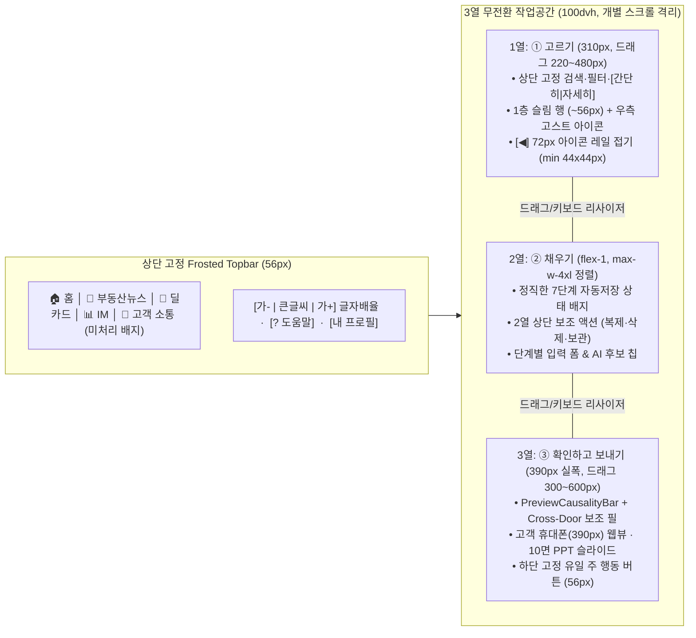

# CRE DealCard UI/UX 핵심 원칙 · 3열 에센셜리즘 프레임워크 해설 및 골든 검증 체계 (v2.0)

> **문서 목적 (v2.0 — `U-01 ~ U-05` & `G-UX-01 ~ G-UX-06` 프로덕션 반영판)**: 본 문서는 `cre-dealcard` 시스템 전반에 구현·배포된 **UI/UX 설계 원칙과 프론트엔드 프레임워크(그렉 맥커운식 에센셜리즘, 3열 콕핏, 원클릭 퍼널 이어달리기, 양방향 인과율 프리뷰, AI-1st/Human-2nd, 6070 시니어 인체공학, 주간 리퀴드 글래스 명도비 래칫, 도메인·런타임 언어 방역, 모바일 인앱 키보드 회피)**를 **타 프로젝트(B2B SaaS · AI 버티컬 플랫폼 · 전문가 저작 도구)에서도 그대로 이해하고 이식할 수 있도록 해설**하고, 실브라우저 골든 검증(`G-UX-01 ~ G-UX-06`)이 적발한 실전 엔지니어링 노하우와 차기 고도화 아젠다를 정리한 레포지토리 표준 문서입니다.

---

# Part I. 타 프로젝트 이식용 UI/UX 원칙 및 구현 프레임워크 해설

## 1. 핵심 설계 철학 한눈에 보기 (Why This Architecture?)

일반적인 B2B SaaS나 생성형 AI 도구는 **① 좌측에 15~20개의 메뉴를 나열하는 관리자 대시보드**이거나, **② 빈 프롬프트 입력창 하나만 던져주는 챗봇 래퍼(Chat Wrapper)**에 머무르기 쉽습니다. 그러나 현장 전문가(중개인·의사·회계사·변호사·커머스 셀러 등)와 고연령 의사결정자(60~70대 자산가·대표) 환경에서는 이 두 방식 모두 실패합니다.

`cre-dealcard`는 이를 해결하기 위해 **6대 직교(Orthogonal) UI/UX 원칙**을 코드 레벨의 프레임워크와 결정론적 골든 테스트로 강제했습니다.

| 원칙 축 | 기존 SaaS / AI 도구의 실패 패턴 | 본 시스템의 핵심 원칙 | 구현된 핵심 프레임워크 모듈 |
| :--- | :--- | :--- | :--- |
| **1. 에센셜리즘 IA & 이어달리기** | 20여 개 메뉴 나열로 선택 마비 · 완료 후 다음 기능으로 수동 재탐색 | 고객 영업 퍼널 순 **4대 핵심 문(`4-Doors`)** 단일화 + **단일 주 행동(`56px`) 법칙** + **`published_clean` 원클릭 이어달리기(`44px`)** | `workspace-identity.ts`<br>`BrokerHome4Doors.tsx` |
| **2. 3열 콕핏 셸** | 목록 → 폼 → 미리보기 모달 → 발송 페이지로 맥락 단절 | **`① 고르기(1열)` → `② 채우기(2열)` → `③ 확인하고 보내기(3열)`** 한 화면 완결 | `WorkspaceShell.tsx`<br>`WorkspaceList.tsx` |
| **3. 양방향 인과율 동기화** | 미리보기에서 오타를 발견해도 왼쪽 어느 입력칸인지 못 찾음 · 셀렉터 리팩터링 시 무음 단절 | 미리보기 클릭 시 **해당 입력칸 자동 오픈·스크롤·파동 포커스** + **`validateEditorUnitTargets` 무음 단절 차단** + **4단계 반영 상태바** | `useEditorPreviewSync.ts`<br>`PreviewEditableUnit.tsx`<br>`PreviewCausalityBar.tsx` |
| **4. AI-1st, Human-2nd** | 빈 텍스트박스 방치(백지 공포) 또는 AI 원문 검증 없는 날조 | **30초 출발 카드** + AI 다축 후보 선제시 → 인간 원클릭 스왑 + **결정론적 조판 가드 & 빨간펜 환류 CLI** | `ZeroBlankStarterCard.tsx`<br>`copy-limits.ts` · `blind-guard.ts`<br>`redpen-flywheel-analyzer.ts` |
| **5. 6070 시니어 인체공학** | `11~12px` 회색 다크모드 텍스트, `rem` 축소 시 `44px` 미달 버튼, 저대비 활성 탭 | 루트 **`17px` 기본**(`15~21px` 4단 배율), **고정 `px` 최소 `44~48px` 터치**, **주간 리퀴드 글래스 + 합성 명도비 래칫** | `FontScaleToggle.tsx`<br>`tokens.ts` · `wcag-contrast.ts`<br>`globals.css` |
| **6. 도메인·런타임 방역 & 카톡 생태계** | 내부 개발자 약어/DB 에러 노출 · 카톡 인앱 키보드 가림 및 다운로드 먹통 | **정적 + 런타임 7대 서피스/API 금지어 방역(`scanRuntimeSurfaceLexicon`)** + **카톡 키보드 회피 & 외부 브라우저 탈출 SSOT** | `lexicon.ts` · `clipboard.ts`<br>`inapp-webview.ts`<br>`use-mobile-keyboard-safe-zone.ts` |

---

## 2. 원칙별 상세 해설 및 구현 메커니즘

### 2.1 [원칙 1] 에센셜리즘 정보구조 & 원클릭 퍼널 이어달리기 (“Less, But Better”)

그렉 맥커운의 *에센셜리즘(Essentialism)* 원칙에 따라, 시스템 내 부가 기능(서클, 캠페인, 파이프라인, 매칭 등)을 홈과 상단 네비게이션에서 걷어내고 **현업 전문가의 실제 매출 퍼널을 이루는 단 4개의 공간**만 남겼습니다.

1. **영업 퍼널 직결 4대 공간 & 브랜드 키 vs 명도비 분리 (`WORKSPACE_IDENTITY`)**:
   - **① `📰 부동산뉴스` (브랜드 키 `#059669` / 흰 글씨 활성 필 `#047857` `5.48:1`)**: 잠재 고객에게 정기 시장 브리핑을 보내 관계 유지
   - **② `📄 딜카드` (브랜드 키 `#D97706` / 흰 글씨 활성 필 `#B45309` `5.02:1`)**: 주소·가격 비공개(블라인드) 상태로 10초 만에 매수 의향 타진
   - **③ `📊 IM` (브랜드 키 `#1D4ED8` / 흰 글씨 활성 필 `#1D4ED8` `6.70:1`)**: 관심 고객에게 보낼 모바일 웹 제안서 및 16:9 PPTX/PDF 발표자료 생성
   - **④ `💬 고객 소통` (브랜드 키 `#DB2777` / 흰 글씨 활성 필 `#BE185D` `6.37:1`)**: 열람 요청 승인, 전용 토큰 링크 발급 및 원클릭 링크 잠금(회수)
   - *핵심 컬러 원칙*: 시각적 아이덴티티를 나타내는 `accentHex`와 실제 흰 텍스트(`#FFFFFF`)가 올라가는 `activePillClass`/`doorAccentBgClass`를 분리하여, 4개 탭 모두가 **WCAG AA(`>= 4.5:1`) 이상**을 만족합니다.
2. **무마찰 진입 장치 3종 (`BrokerHome4Doors.tsx`)**:
   - **키보드 숫자 단축키 `1~4`**: 홈에서 `1`~`4` 키만 누르면 해당 작업공간으로 즉시 이동하되, 입력칸 포커스 중이거나 한글 IME 조합 중(`isComposing || keyCode === 229`)일 때는 단축키를 자동 차단(`shouldIgnoreDoorShortcut`)합니다.
   - **1줄 `이어서 하기` 재개 바 (`home-resume-bar`)**: 직전 작업물 1건만 최상단 카드에 띄워 `[편집 계속하기 →]` 원클릭 복귀를 지원합니다.
   - **완료 즉시 소멸하는 조건부 설정 카드 (`QuickStatutorySetupCard`)**: 필수 법정 정보 5항목이 비어 있을 때만 홈에 노출되고, 채우는 즉시 영구 소멸합니다.
3. **단일 주 행동 법칙 (Sole Primary Action Rule)**:
   - 화면 전체에서 가장 눈에 띄는 `56px` 프라이머리 액션 버튼(`primaryActionSlot`: 예 `카톡으로 보내기`, `IM 만들기`)은 **우측 3열 하단에 단 1개만** 존재합니다.
4. **원클릭 퍼널 이어달리기 (Cross-Door Handoff — `U-02`)**:
   - 단일 주 행동 법칙을 훼손하지 않으면서 공간 간 수동 탭 이동 마찰을 없애기 위해, **발행 완료(`published_clean`) 직후 인과율 바 하단 또는 고객 컨텍스트 영역에 `min-h-[44px]` 보조 글래스 필(Secondary Pill)**로 다음 퍼널을 직결합니다:
     - `📄 딜카드` 발행 완료 시 → `[📰 이번 호 부동산뉴스 추천 매물에 추가 →]`(`/broker/w/newsletter?addDealId=...`, 진입 즉시 `mergeAddedDealId`로 중복·한도 검증 후 추천 매물 자동 편입 및 쿼리 클린업) + `[📊 이 매물 상세 IM 만들기 →]`(`/broker/w/im?buildingId=...`)
     - `📊 IM` 발행 완료 시 → `[📄 공개 블라인드 딜카드 확인·편집 →]` + `[💬 이 매물 문의 고객 확인 →]`
     - `💬 고객 소통` 매수 문의 상담 시 → `rankMatchingInventoryDeals`가 고객 선호 권역·예산과 부합하는 보유 매물 상위 3건을 추천 칩(`inbox-recommend-inventory-bar`)으로 띄우고, 클릭 즉시 맞춤 제목·본문·공유 링크(`/im-lite/...` 또는 `/dc/...`)를 1클릭 세팅합니다.

---

### 2.2 [원칙 2] 3열 마스터-디테일-프리뷰 콕핏 (`WorkspaceShell.tsx`)

4대 작업공간 모두가 **단 하나의 공통 레이아웃 셸(`WorkspaceShell`)**을 공유합니다. 사용자는 어느 메뉴로 이동하더라도 학습 비용 없이 동일한 공간 감각(`목록 → 입력 → 결과 확인 및 발송`)으로 일할 수 있습니다.



#### 핵심 엔지니어링 디테일
1. **3단 무손실 반응형 변환 (Zero-Loss Responsive Collapse)**:
   - **데스크톱 와이드 (`>= 1280px`, `xl`)**: 1·2·3열 동시 전개. 좌우 분할선은 마우스 드래그뿐 아니라 키보드(`←/→` `16px`, `Shift+←/→` `48px`, `Home` 또는 더블클릭 시 기본 폭 `310px/390px` 복귀)를 지원합니다.
   - **노트북/태블릿 가로 (`1024~1279px`, `lg`)**: 입력 공간(`min 420px`) 확보를 위해 3열을 우측 슬라이드오버 드로어(`[미리보기 열기]`)로 자동 접고, **3열 하단 `primaryActionSlot`을 2열 하단 스티키 바(`workspace-primary-action-mirror`)로 자동 미러링**합니다.
   - **모바일 (`< 1024px`)**: URL 쿼리(`?buildingId=...&tab=list|editor|preview`)와 동기화되는 **푸시 내비게이션**으로 전환되며, 목록 화면에서는 하단 `64px` 5탭 바(`WorkspaceBottomNav`)와 상단 생성 버튼(`+ 새 매물`)을 노출하고 상세 편집 진입 시 하단 탭바를 자동 숨김 처리합니다.
2. **1열 목록 밀도 & `xlarge(21px)` 줄바꿈 방어 (`WorkspaceList.tsx`)**:
   - `SimpleListRow`(`~56px`) 1층 구조 + 우측 보더리스 고스트 아이콘(`⧉`, `🗑️`)으로 목록 표시량을 2배로 늘리되, `310px` 폭에서 `xlarge(21px)` 배율을 켜더라도 텍스트가 잘리지 않도록 내부 `<button>`에 `min-w-0 overflow-hidden`과 메타·날짜 행 `flex-wrap`을 적용했습니다.
3. **정직한 7단계 자동저장 상태머신 (`HonestSaveState`)**:
   - 실제 네트워크·DB CAS 버전에 따라 `idle` / `dirty(고친 내용 있음)` / `saving(저장 중…)` / `saved(저장됨 ✓ · 3분 전)` / `error(저장 안 됨 · 다시 시도)` / `conflict(다른 곳에서 고쳤어요 → [덮어쓰기] | [새로고침])` / `offline(인터넷 연결 없음)`을 정직하게 표시합니다.

---

### 2.3 [원칙 3] 양방향 인과율 프리뷰 동기화 & 무음 실패 차단 (`preview-sync` — `U-03`)

사용자가 2열 입력창과 3열 결과물 사이의 인과관계를 직관적으로 장악하도록 4개의 메커니즘이 맞물려 작동합니다.

1. **`PreviewEditableUnit` 4대 작업공간 1:1 전 구간 대칭**:
   - 딜카드(카톡 말풍선·수신 화면), 부동산뉴스(헤드라인·브리핑·추천매물·이슈), IM(모바일 웹 `01~10` 섹션 **및 10면 PPTX 슬라이드 카드 `ImSlideVisualCard` 전체**), 고객 소통함(`고객 요약` · `관심 매물/보낼 자료` · `요청·안내 메시지` · `열람·상담 기록` 4블록 전체) 어디서나 `✎ 눌러서 수정` 클릭 시 **① 닫힌 탭·아코디언(`im-unit-comps`, `im-unit-broker` 등) 자동 오픈 → ② 부드러운 스크롤 → ③ 순수 CSS 파동(`ws-editor-unit-pulse`) → ④ 입력칸 커서 포커스**가 동일하게 작동합니다.
2. **`validateEditorUnitTargets` & `onMissingTarget` (무음 단절 원천 차단)**:
   - 컴포넌트 리팩터링 중 `editorSelector`나 `focusSelector`가 변경되거나 `.hidden` / `[aria-hidden="true"]` 조상 아래 고립되면 사용자가 클릭해도 아무 반응이 없는 무음 실패(Silent Drop)가 발생할 수 있습니다.
   - `validateEditorUnitTargets(units, { root, activeTab })` 순수 검증기와 Ring 1 JSDOM 골든 오라클(`preview-editor-causality-oracle.test.ts`)이 4대 작업공간의 모든 프리뷰 `unitId` ↔ 에디터 DOM 셀렉터 정합성을 매 커밋마다 강제합니다.
3. **`notifyEditorFocus` (에디터 → 미리보기 순방향 추적)**:
   - 2열에서 특정 입력칸을 수정하기 시작하면 3열 스크롤 컨테이너가 대응 `data-preview-unit-id` 요소를 자동으로 시야 안에 맞춰 줍니다.
4. **`PreviewCausalityBar` (초안 vs 발행본 인과율 불일치 방어)**:
   - `pre_generation` → `live_draft` → `published_clean` → **`published_dirty`**(`"고친 내용이 아직 고객 화면에는 반영 전입니다"` + `[변경사항 바로 반영하기]`) 4단계로 발행본 불일치 착각을 원천 차단합니다.

---

### 2.4 [원칙 4] `AI-1st, Human-2nd` · 결정론적 조판 가드 & 베타 빨간펜 환류 플라이휠 (`U-04`)

1. **백지 공포 제거 (`ZeroBlankStarterCard.tsx`) & 다축 후보 스왑**:
   - 빈 폼 대신 `30초 빠른 시작` 대형 버튼 3종과 6개 관점 AI 장점 후보(`pointCandidates`) 원클릭 스왑 칩을 제공합니다.
2. **LLM 뒤를 지키는 3대 결정론적 한국어 가드레일**:
   - **완결 체언형 교정기 (`copy-limits.ts`)**: 말줄임표(`…`) 절단 금지, 서술어 체언화 및 불완전 관형어·조사 자동 제거.
   - **한국형 금액·가격대 SSOT (`price-band.ts`)**: 소수점 억(`1.5억`) 금지 → `1억 5,000만` 표기, 블라인드 가격대 최소 `5%` 구간 폭 강제.
   - **블라인드 & k-익명성 방역 (`blind-guard.ts`)**: 상세 지번·건물명·민감 프랜차이즈 자동 마스킹(법정동 `동4가` 숫자는 보존, 희소 용도는 `구` 단위 폴백).
3. **베타테스터 빨간펜 & 익명 수정률 자동 환류 플라이휠 (`redpen-flywheel-analyzer.ts` — `U-04`)**:
   - 현업 베타테스터가 남긴 인앱 빨간펜(`originalText → suggestedText`)과 Zero-PII 수정 통계(`qa_byod_anonymized_diff`)를 `npm run qa:redpen-insights -- --cohort beta-1` 명령 한 줄로 집계합니다.
   - 2회 이상 반복 교정된 표현은 `lexicon.ts` / `copy-limits.ts` 승격 후보로 자동 추출되고, **인간 수정률(`editRate`)이 `>= 40%`인 필드는 자동으로 `P0_PROMPT_TUNING` 타깃으로 플래깅**되어 다음 스프린트 `Ring 2` 프롬프트 개선으로 직결됩니다. (상세 수집 구조는 [BETA_ISSUE_PIN_AND_REDPEN_GUIDE.md](./BETA_ISSUE_PIN_AND_REDPEN_GUIDE.md) 참조)

---

### 2.5 [원칙 5] 6070 시니어 인체공학 · 주간 리퀴드 글래스 & 명도비 래칫 (`U-05`)

1. **4단계 실시간 글자 배율 (`FontScaleToggle.tsx`) & 고정 `px` 터치 플로어**:
   - 기본 루트 `17px`(`normal`)에서 `compact(15px)` / `normal(17px)` / `large(19px)` / `xlarge(21px)` 4단 즉시 전환을 지원합니다.
   - 최소 캡션 `max(14px, 0.875rem)`, 모든 입력창 `max(16px, 1rem)`(iOS 자동 줌 방지), 포커스 시 placeholder 즉시 투명화(`opacity: 0`), 모든 인터랙티브 버튼 고정 **`min-h-[44px]`~`min-h-[48px]`**을 강제합니다.
2. **4-Tier Cupertino Daylight 글래스 & 알파 합성 명도비 검증 (`wcag-contrast.ts`)**:
   - 쿨 알라바스터 캔버스(`#F5F5F7`) 위 반투명 유리(`rgba(255,255,255,0.72)`)를 실제 Porter-Duff 알파 합성하여 상대 휘도 명도비를 계산합니다:
     - 본문/핵심 수치 잉크(`#1D1D1F` `15.46:1`, `#515154` `7.26:1`) → **WCAG AAA (`>= 7.0:1`)**
     - 인터랙티브 블루·활성 세그먼트 필(`#0055D4` `6.46:1`, `#1D4ED8` `6.70:1`) 및 컨트롤 보더(`#64748B` `4.76:1`) → **WCAG AA (`>= 4.5:1`)**
     - 다크 프리뷰 격리 영역(`data-theme-lock="dark"`, `#0F172A` 바탕 `#FFFFFF`/`#93C5FD`/`#CBD5E1`) → **WCAG AAA (`>= 7.0:1`)**
3. **레거시 다크 클래스 제로 게이트 & CSS `!important` 단방향 감축 래칫**:
   - 4대 핵심 작업공간·브로커 홈·매거진 에디터·주요 보조 라우트 7종에서 레거시 다크 배경 클래스(`bg-[#0b0f19]`, `bg-neutral-950`, `bg-zinc-900` 등) 재유입을 **`0건` 하드 게이트**로 차단하고, `globals.css` `.broker-paper-theme` 내 `!important` 개수(`<= 82`)와 미전환 하위 서브라우트 다크 클래스 개수(`<= 50`)에 **단방향 감축 래칫(Ratchet Ceiling — 증가 절대 불가, 감소만 허용)**을 걸어 기술 부채 재발을 막았습니다.

---

### 2.6 [원칙 6] 정적·런타임 어휘 방역(`lexicon`) & 카카오톡 인앱 키보드·다운로드 안전망 (`U-01`, `U-04`)

1. **정적 JSX + 런타임 7대 서피스 + API 에러 2중 어휘 방역 (`lexicon.ts`)**:
   - 정적 소스 스캔(`ux-lexicon-guard.test.ts`)뿐 아니라, `scanRuntimeSurfaceLexicon`이 **최종 렌더링된 7대 산출물(딜카드 웹·모바일 IM·매거진·알림톡·이메일·OG·PPTX 텍스트)과 API `400/401/403/409/422` 에러 응답 문자열**을 전수 검사하여 내부 약어(`포스처`, `OG`, `SHA-256`, `캡레이트`, `배당`)와 원시 시스템 에러(`PGRST`, `NaN`, `undefined`, `SQLSTATE`, 마스킹 안 된 생 UUID) 노출을 `0건`으로 차단합니다.
2. **카카오톡 인앱 키보드 안전영역 & 파일 저장 탈출 배너 (`use-mobile-keyboard-safe-zone.ts`, `inapp-webview.ts` — `U-01`)**:
   - 공개 뷰어(`/dc/[id]`, `/im-lite/[buildingId]`)에서 매수 고객이 문의 입력칸을 터치하면 `window.visualViewport` 높이 축소(`< 78%`) 및 텍스트 입력 포커스를 즉시 감지해 하단 고정 액션바를 슬라이드 다운 숨김(`data-keyboard-hidden="true"`) 처리하여 **가상 키보드 위 입력 시야를 100% 확보**합니다.
   - 카카오톡·네이버·라인 인앱 브라우저(`isInAppWebView`)에서 `.pptx`/`PDF` 다운로드 클릭 시, 인앱 다운로드 제한에 대비해 `[외부 브라우저(Safari/Chrome)에서 저장 ↗]`(`buildKakaoExternalOpenUrl`, Android `S.browser_fallback_url` 포함) 비차단 안내 배너를 자동 노출합니다.

---

## 3. 타 프로젝트 이식 시 핵심 파일 매핑표 & 에이전트 지시 프롬프트 (v2.0)

### 3.1 이식용 코어 파일 매핑 (총 11종 모듈)
| 모듈 역할 | 현 레포지토리 참조 파일 | 타 프로젝트 이식 시 수정 포인트 |
| :--- | :--- | :--- |
| **1. 4대 핵심 서비스 아이덴티티** | `src/lib/ux/workspace-identity.ts` | 도메인 핵심 퍼널 3~4단계 명칭·순서 교체 (`accentHex`와 흰 글씨용 AA `activePillClass` 분리 유지) |
| **2. 도메인·런타임 용어 방역** | `src/lib/ux/lexicon.ts`<br>`src/tests/workspace/ux-lexicon-guard.test.ts`<br>`src/tests/golden/runtime-api-error-lexicon.test.ts` | 업계 현업 용어(`TERMS`), 노출 금지어(`BANNED_UI_TERMS`), API 에러 방역(`scanRuntimeSurfaceLexicon`) |
| **3. 시니어 배율 & 글래스 토큰** | `src/components/workspace/tokens.ts`<br>`src/components/workspace/FontScaleToggle.tsx`<br>`src/app/globals.css` | 무변경 재사용 가능 (`data-font-scale` 4단계 + `ios-glass-*` 유틸리티) |
| **4. 알파 합성 WCAG 명도비 엔진** | `src/lib/ux/wcag-contrast.ts`<br>`src/tests/golden/wcag-contrast-and-theme-ratchet.test.ts` | 도메인 무관 순수 수학 모듈 — **100% 그대로 복사하여 디자인 토큰 감시 가능** |
| **5. 3열 반응형 콕핏 셸 & 슬림 목록** | `src/components/workspace/WorkspaceShell.tsx`<br>`src/components/workspace/list/WorkspaceList.tsx` | `workspace` 유니온 타입만 프로젝트 도메인명으로 변경 후 재사용 |
| **6. 양방향 프리뷰 동기화 & 검증기** | `src/components/workspace/preview-sync/*`<br>`src/tests/golden/preview-editor-causality-oracle.test.ts` | 도메인 무관 순수 React 훅·검증기(`validateEditorUnitTargets`) — **100% 그대로 복사 가능** |
| **7. 제로 블랭크 & 실행 취소 토스트** | `src/components/workspace/ZeroBlankStarterCard.tsx`<br>`src/components/workspace/UndoConfirmToast.tsx` | 각 화면의 첫 시작 예시 3종만 주입하여 즉시 재사용 |
| **8. 인앱 웹뷰 & 키보드 회피 훅** | `src/lib/ux/inapp-webview.ts`<br>`src/lib/ux/use-mobile-keyboard-safe-zone.ts`<br>`src/components/public/InAppBrowserBanner.tsx` | 한국형 카톡·네이버·라인 공유가 있는 모든 모바일 웹 서비스에 **100% 무변경 이식 가능** |
| **9. 베타 이슈 핀 & 빨간펜 위젯** | `src/components/workspace/QaFeedbackPinWidget.tsx`<br>`docs/finaltest/BETA_ISSUE_PIN_AND_REDPEN_GUIDE.md` | `?qa=1` Fail-Closed 프로덕션 보안 그대로 이식 |
| **10. 빨간펜·수정률 환류 분석 CLI** | `src/lib/qa/redpen-flywheel-analyzer.ts`<br>`scripts/extract-beta-redpen-insights.ts` | 베타테스터 교정 문구 클러스터링 및 `>= 40%` 수정률 필드 자동 추출 |
| **11. 실브라우저 멀티배율·인앱 E2E** | `e2e/workspace-ux-physics-and-inapp.auth.spec.ts` | 라우트 목록(`WORKSPACES`)만 교체하면 3개 뷰포트 × 극단 배율 × 실측 명도비 자동 검증 |

### 3.2 타 프로젝트 AI 코딩 에이전트용 복붙 프롬프트 (v2.0)
```text
우리 프로젝트를 '에센셜리즘 4-Doors 홈 + 3열 마스터-디테일-프리뷰 콕핏(WorkspaceShell) + 양방향 프리뷰 인과율 동기화 + 시니어 고가독 주간 글래스(WCAG AA/AAA) + 모바일 인앱 안전망' 아키텍처로 구축해줘.

핵심 아키텍처 및 방어 규칙:
1. Essentialist IA & Cross-Door Handoff:
   - 부가 메뉴 나열을 금지하고 고객 가치 흐름 순 3~4개 핵심 작업공간만 상단/하단 탭과 홈 카드(숫자 단축키 1~4, 입력/한글 IME 조합 중 자동 차단)로 노출할 것.
   - 56px 주 행동 버튼(primaryActionSlot)은 우측 3열 하단(1280px 미만은 2열 하단 스티키 미러)에 단 1개만 두고, 발행 완료(published_clean) 시 다음 작업공간으로 이어주는 원클릭 이어달리기는 44px 보조 글래스 필로만 배치할 것.
2. 3-Column WorkspaceShell:
   - >=1280px: 1열 목록(310px, 드래그/키보드 리사이즈 + 72px 레일 접기 + 1층 슬림 행) | 2열 입력(flex-1, max-w-4xl, 7단계 정직한 자동저장 배지) | 3열 실시간 미리보기(390px 모바일 실폭).
   - 1024~1279px: 1·2열 유지 + 3열 슬라이드 드로어 + 2열 하단 CTA 자동 미러링.
   - <1024px: URL ?tab=list|editor|preview 동기화 푸시 내비게이션 + 목록 화면 하단 탭바(편집 진입 시 자동 숨김).
3. 양방향 인과율 동기화 & 무음 실패 차단:
   - 모든 3열 미리보기 블록을 PreviewEditableUnit으로 감싸 클릭 시 닫힌 탭/아코디언을 열고 2열 해당 입력칸으로 스크롤·파동(ws-editor-unit-pulse)·포커스 이동시킬 것.
   - validateEditorUnitTargets 검증 함수를 함께 작성해 리팩터링 시 깨진 셀렉터나 .hidden 고립이 없음을 Vitest JSDOM 테스트로 강제할 것.
   - 발행본 대비 미반영 수정이 있으면 PreviewCausalityBar에서 'published_dirty' 경고와 원클릭 재반영 버튼을 띄울 것.
4. 시니어 인체공학 · 명도비 · 모바일 인앱 안전망:
   - 루트 기본 17px(compact 15px / normal 17px / large 19px / xlarge 21px 4단 토글), 최소 캡션 14px, 입력창 >=16px, word-break: keep-all, 포커스 시 placeholder 즉시 투명화를 적용할 것.
   - 터치 타깃은 rem 축소 영향을 받지 않도록 반드시 고정 px(min-w-[44px] min-h-[44px])로 지정할 것.
   - 밝은 글래스(#F5F5F7 + rgba 흰색 카드) 위 본문은 #1D1D1F/#515154(>=7:1 AAA), 흰 배경 위 파란 활성 탭/흰 글씨 파란·초록 필은 #007AFF/#059669(명도비 미달) 대신 #0055D4(6.46:1)/#047857(5.48:1) 이상을 사용해 전 구간 WCAG AA(>=4.5:1)를 충족할 것.
   - 모바일 공개 뷰어에는 visualViewport 기반 키보드 오픈 감지 훅을 연결해 입력창 포커스 시 하단 고정 CTA 바를 자동 숨김 처리하고, 정적 JSX + 런타임 API 에러 응답 전체에서 개발자 약어/원시 DB 에러(NaN, undefined, SQL 코드, 생 UUID) 노출을 막는 Lexicon 골든 테스트를 함께 구축해줘.
```

---

## 4. 실브라우저 골든 테스트가 적발한 ‘반직관적 UI/UX 함정(Gotchas) 4선’

타 프로젝트에 동일 프레임워크를 이식할 때 눈대중 코드 리뷰만으로는 놓치기 쉬운 **실전 함정 4가지**(본 레포 `G-UX-01 ~ G-UX-05` 구동 중 실측 적발·해결된 사례)입니다.

| 함정 (Anti-Pattern) | 왜 실패하는가? (실측 수치 근거) | 표준 해법 (Verified Fix) |
| :--- | :--- | :--- |
| **1. `w-11 h-11` (`rem` 기반 터치 크기)** | Tailwind `h-11`은 `2.75rem`이므로 기본 `16~17px`에서는 `44~46.7px`로 통과하지만, 사용자가 `compact(15px)` 배율을 선택하면 **`2.75 × 15 = 41.25px`로 줄어들어 `44px` 터치 하한을 위반**함 | 모든 버튼·아이콘 토글의 최소 크기는 `rem` 유틸리티 대신 **절대 `px` 클래스(`min-w-[44px] min-h-[44px]`)**로 선언 |
| **2. `#007AFF` · `#059669` 흰색 조합** | 눈으로는 선명해 보이지만 실제 상대 휘도 계산 시 흰 바탕 위 `#007AFF` 글씨는 **`4.02:1`**, `#059669` 바탕 위 흰 글씨는 **`3.77:1`**로 둘 다 **WCAG AA(`4.5:1`) 불합격** | 브랜드 보더·장식 링에는 `#007AFF`/`#059669`를 쓰되, **텍스트 및 흰 글씨 배경 필은 `#0055D4`(`6.46:1`) · `#047857`(`5.48:1`)**로 한 톤 심화 |
| **3. `310px` 1열 + `xlarge(21px)` 배지 밀집** | `310px` 목록 열에서 좌우 패딩(`52px`)과 우측 복제·삭제 버튼 2개(`88px`)를 빼면 실제 텍스트 폭은 **`~140px`(21px 기준 약 6.5글자)**뿐이어서 `shrink-0` 배지와 날짜가 한 줄에 놓이면 우측 끝이 잘림 | 슬림 행 내부 `<button>`에 `min-w-0 overflow-hidden`을 부여하고, 상태·배지·날짜 줄은 `whitespace-nowrap` 고정을 풀어 `flex-wrap`으로 자연 개행 처리 |
| **4. 모바일 뷰어의 다중 하단 바 누락** | 공용 `FloatingActionBar`에만 키보드 회피를 걸었더라도, 특정 템플릿 뷰어(`mobile-im-viewer.tsx` 등)가 자체 고정 `<footer>`를 별도 렌더링하면 키보드 가림이 재발함 | 모든 `fixed bottom-0` 계열 스티키 바에 `useMobileKeyboardSafeZone()`과 `data-keyboard-hidden` 속성을 표준 계약으로 바인딩하고 `375×400` E2E로 검증 |

---

# Part II. UI/UX 물리·인과율 골든 테스트 체계 및 차기 고도화 아젠다

## 1. 상시 가동 중인 UI/UX 골든 테스트 6종 (`G-UX-01 ~ G-UX-06`)

기존 백엔드·수치 정합성 3-Ring 아키텍처에 아래 6종의 UI/UX 골든 스위트가 정식 편입되어 모든 배포 전 게이트에서 자동 검증됩니다.

| 테스트 ID | 골든 스위트 명칭 | 구현 테스트 파일 | 실행 명령어 (비용) | 핵심 합격 불변식 (Pass Invariants) |
| :--- | :--- | :--- | :--- | :--- |
| **`G-UX-01`** | **4-Workspace Multi-Scale & Breakpoint Physics** | `e2e/workspace-ux-physics-and-inapp.auth.spec.ts` | `npm run test:ux-golden` (`$0`) | 4대 공간 × 3 뷰포트(`1440×900` / `1180×820` / `390×844`) × `compact(15px)`·`xlarge(21px)` 전 매트릭스에서 가로 오버플로 `<= 2px`, 버튼 잘림 `0건`, 터치 높이 `>= 44px`, 주 행동 가시성 `100%` |
| **`G-UX-02`** | **Computed WCAG Contrast & Theme Ratchet** | `src/tests/golden/wcag-contrast-and-theme-ratchet.test.ts`<br>+ `workspace-ux-physics-and-inapp.auth.spec.ts` | `npm run golden:fast`<br>& `npm run test:ux-golden` (`$0`) | 알파 합성 명도비(본문 `>= 7.0:1`, 컨트롤/활성 필 `>= 4.5:1`) + 실브라우저 가시 노드 명도비 `>= 4.5:1` + 핵심/전환 라우트 다크 클래스 `0건` + `globals.css` `!important`(`<= 82`) 래칫 |
| **`G-UX-03`** | **Bidirectional Preview-Editor Causality** | `src/tests/golden/preview-editor-causality-oracle.test.ts` | `npm run golden:fast` (`$0`) | 4대 작업공간(IM 10면 슬라이드·소통함 4블록 포함) 모든 `unitId` ↔ 에디터 셀렉터 100% 실존, 클릭 시 `document.activeElement` 이동, `published_dirty` 경고 전환 |
| **`G-UX-04`** | **Runtime Surface & API Error Lexicon** | `src/tests/golden/runtime-api-error-lexicon.test.ts`<br>+ `stateful-cross-surface-oracle.test.ts` | `npm run golden:fast` (`$0`) | 7대 렌더링 산출물 + 주요 API `400/401/403/409/422` 에러 메시지에 금지어 및 원시 시스템 토큰(`PGRST`, `NaN`, `undefined`, 생 UUID) 노출 `0건` |
| **`G-UX-05`** | **KakaoTalk In-App (`375×660`) & Keyboard Safe-Zone (`375×400`)** | `src/tests/unit/inapp-keyboard-safe-zone.test.ts`<br>+ `workspace-ux-physics-and-inapp.auth.spec.ts` | `npm run golden:fast`<br>& `npm run test:ux-golden` (`$0`) | `KAKAOTALK`/`NAVER`/`Line/` UA 판별 및 외부 브라우저 URL 생성, `375×660` 첫 화면 타이틀 노출, 문의 입력 포커스 + `375×400` 축소 시 하단 바 `data-keyboard-hidden="true"` 즉시 회피 |
| **`G-UX-06`** | **4-Door Funnel Continuity & Edit-Rate Flywheel** | `src/tests/golden/four-door-funnel-continuity.test.ts`<br>+ `runtime-api-error-lexicon.test.ts` | `npm run golden:fast`<br>& `npm run qa:redpen-insights` (`$0`) | `딜카드 → 뉴스레터(?addDealId) → IM → 소통함 추천매물` 퍼널 간 블라인드·가격대·법정표기 무결성 보존 및 베타 수정률 `>= 40%` 필드 `P0_PROMPT_TUNING` 자동 플래깅 |

---

## 2. 1차 고도화 완료 요약 (`U-01 ~ U-05`, 커밋 `22917544`)

- **`U-01` 완료**: `useMobileKeyboardSafeZone` 공용 훅 신설, `/dc/[id]` 및 `/im-lite/[buildingId]`(`FloatingActionBar` + `MobileIMViewer`) 키보드 자동 회피 및 인앱 다운로드 탈출 배너 일원화.
- **`U-02` 완료**: 딜카드 ↔ 부동산뉴스(`?addDealId=`) ↔ IM ↔ 고객 소통함 보유 매물 추천 칩 원클릭 이어달리기 구축.
- **`U-03` 완료**: `validateEditorUnitTargets` 도입 및 IM 슬라이드 덱·고객 소통함 4블록 `PreviewEditableUnit` 1:1 대칭 완성.
- **`U-04` 완료**: `redpen-flywheel-analyzer.ts` + `npm run qa:redpen-insights` CLI 및 7대 서피스·API 에러 런타임 용어 방역 구축.
- **`U-05` 완료**: 보조 브로커 7개 페이지(`map-capture`, `circles`, `matching`, `tenant-intents`, `leasing`, `lease-card`, `pipeline`) 주간 글래스 전환, 죽은 다크 오버라이드 셀렉터 정리(`!important` `83 → 82`), 실브라우저 명도비·배율 결함 4건 적발·해결.

---

## 3. 차기 Phase 2 지속 고도화 아젠다 (`N-01 ~ N-03`)

1. **`N-01` — 1호 베타테스터(`beta-1`) 실전 빨간펜·수정률 1차 환류 스프린트**
   - 현업 중개인 베타 세션 종료 직후 `npm run qa:redpen-insights -- --cohort beta-1`을 실행하여, 반복 지적된 어색한 문구는 `lexicon.ts` / `copy-limits.ts` 결정론 규칙으로 즉시 편입하고 `P0_PROMPT_TUNING`(`editRate >= 40%`) 필드는 `Ring 2 (npm run golden:judge)` 프롬프트 튜닝으로 직결합니다.
2. **`N-02` — 잔여 하위 서브라우트 다크 클래스 래칫(`50 → 0`) 완전 청산 및 `globals.css` 슬림화**
   - 현재 래칫 천장(`MAX_LEGACY_SUBROUTE_DARK_CLASS_COUNT = 50`)으로 동결되어 있는 하위 상세 라우트(`leasing/[spaceId]`, `lease-card/*`, `tenant-intents/*`, `circles/[id]`, `deal/[id]`, `buyer-intents/[id]`)를 순차 주간 글래스로 이관하면서 `globals.css`의 `.broker-paper-theme` `!important` 오버라이드 블록(`82개`)을 최종 해체합니다.
3. **`N-03` — 실기기(iOS Safari · Android 카카오톡 인앱) 물리 필드 검증 피드백 루프**
   - Chromium 에뮬레이션(`G-UX-05`)을 넘어 실제 iOS/Android 기기에서의 한글 음성 받아쓰기(Dictation), 공유 시트(Web Share API), 저속 LTE 환경 이미지 로딩 체감을 베타 체크리스트와 연동해 지속 보강합니다.
