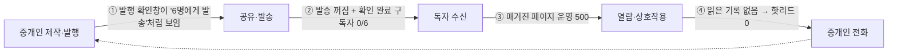

# 60대 UX E2E 마찰 분석 — 모바일 매거진 파이프라인 (통합본)

> 일자: 2026-10-16 · 방법: 페르소나 기반 실측(Playwright 자동 조작 + 화면 판독) + 정적 분석 + 운영 사이트 읽기 전용 점검
> 상세 보고서: [독자 여정](ux-60s-2026-10-16/ux60_reader.md) · [중개인 여정](ux-60s-2026-10-16/ux60_broker.md) · [채널·문구](ux-60s-2026-10-16/ux60_channel.md)
> 테스트 spec(재실행 가능): `e2e/magazine-ux60-reader.auth.spec.ts`, `e2e/magazine-ux60-broker.auth.spec.ts`
> 안전: 실발송 0, 운영 데이터 변경 0(테스트 픽스처는 생성 후 전부 삭제), LLM 실호출 1회

## 0. 페르소나와 기준

| | 독자 R — 박정자(64세) | 중개인 B — 김영수(62세) |
|:--|:--|:--|
| 상황 | 강남 꼬마빌딩 보유 은퇴 건물주. 카톡으로 받은 링크를 **카톡 인앱 브라우저**로 엶 | 상업용 중개법인 대표 30년. 엑셀·카톡PC 수준, 매주 30분 안에 발행하고 싶음 |
| 기기 | 갤럭시 360×780, **시스템 글꼴 크게(≈1.3배)**, 느린 LTE | 노트북 1366×768 + **브라우저 125%**, 외근 중 스마트폰 |
| 특성 | 노안, 영어 약어 낯섦, 스미싱 경계, 궁금하면 전화 | 아이콘·영어 UI에 약함, "저장됐나?" 불안, AI 결과를 그대로 믿기 꺼림 |

60대 기준(WCAG보다 엄격): 본문 ≥16px·보조 ≥14px, 터치 ≥48px, 본문 대비 7:1 권장, 아이콘 단독 버튼 금지, 영어 약어 풀이, 5초 미만에 사라지는 안내 금지, 되돌리기 가능.
마찰 등급: **F0** 이탈 확실 · **F1** 오해·오조작 큼 · **F2** 불편하지만 완수 · **F3** 다듬기.

## 1. 요약

| 영역 | F0 | F1 | F2 | F3 | 합계 |
|:--|:--:|:--:|:--:|:--:|:--:|
| 독자 여정 (R) | 2 | 9 | 16 | 2 | 29 |
| 중개인 여정 (B) | 1 | 7 | 15 | 5 | 28 |
| 채널·문구 (C) | 4 | 5 | 10 | 5 | 24 |
| **원시 합계** | **7** | **21** | **41** | **12** | **81** |
| **중복 통합 후 (F0·F1)** | **5** | **16** | | | |

### 한 줄 결론
**지금 파이프라인은 끝까지 한 바퀴도 돌지 못합니다.** 다음 네 곳에서 동시에 끊겨 있습니다.

- ③은 이번 테스트에서 발견한 **운영 장애**입니다. 원인을 고친 커밋(`5a280cd1`)이 배포를 기다리고 있습니다.
- ②의 구조적 원인은 **'카톡 중심으로 약속하고 이메일로만 확인하는' 불일치**입니다. 운영 구독자 6명 모두 이메일이 없어 영원히 '확인 대기'입니다.
- 이 두 가지가 풀려야 나머지 UX 개선이 의미를 갖습니다.

### 이전 감사 대비 좋아진 점 (회귀 보호 대상)
핀치 줌 허용, 슬라이더 접근성, 입력 16px, 설문 서버 확인 후 결과 표시, 카톡 공유 실패 시 링크 복사 안내, 모달 포커스·Esc, 저장 실패 시 거짓 성공 문구 제거, 닫기 전 미저장 경고, 125%·zoom 1.3에서 가로 넘침 0, 이메일 다크모드 정상, 해지 페이지 품질.

## 2. E2E 여정 지도 (감정 곡선)

| # | 단계 | 누구 | 감정 | 핵심 마찰 |
|:--:|:--|:--|:--:|:--|
| 1 | 대시보드에서 매거진 찾기 | B | 😐 | 타일이 하단 메뉴에 반쯤 가려짐, 성과 카드 미노출 (B-15) |
| 2 | 매거진 주소 설정 | B | 😟 | "slug" 노출, 영문만, 추천 없음, 원인 구분 없는 오류 (B-21) |
| 3 | 표지·현장 이야기·매물·뉴스 작성 | B | 😟→😣 | 편집 칸 195~360px (B-02), 글자 12~13px (B-12), AI 결과가 화면 밖 (**B-01 F0**), 직접 쓴 글이 "AI 분석"으로 표기 (B-08) |
| 4 | 저장 확인 | B | 🙂/😟 | "저장됨" 배지는 좋음. 실패 시 버튼 69×27, 토스트 4.2초 (B-09, B-10) |
| 5 | 미리보기 | B | 😕 | "실제 화면으로 보기" → "아직 발행되지 않은 매거진" (B-28) |
| 6 | 발행 | B | 😨 | 발송 꺼짐인데 "발송 요청" 체크가 기본 ON, "6명" 강조 (B-03) |
| 7 | 공유·QR | B | 🙂/😕 | "개인화 링크"가 실제로는 공용 주소 (B-16), QR 모달 버튼 잘림 (B-17) |
| 8 | 카톡·이메일 수신 | R | 😐→😟 | 173자 토큰 링크 2개, 영어 발신자 "CRE Magazine"+(광고) (C-05, C-07), 미리보기 설명문=제목, 이름 불일치 (R-04, R-05) |
| 9 | 링크 열기 | R | 😣 | **운영 500** (C-01). 정상화돼도 느린 망에서 12초 검은 화면, 전화 버튼 41초 (R-14) |
| 10 | 첫 화면·본문 | R | 😟 | 텍스트 74%가 14px 미만 (R-06), 영어 약어 (R-15), 15섹션 중 뉴스가 48%, 세금은 14번째 (C-19) |
| 11 | 관심 매물 | R | 😣 | 카드·'상세 정보' 모두 404 (**R-02 F0**), 가로 스크롤로 4/5 숨김 (R-18) |
| 12 | 수익 계산기 | R | 😟 | '25억' 입력 무시, '3,200,000,000' → 300억으로 바뀌어 적자 오계산 (R-07) |
| 13 | 설문 | R | 🙂 | 양호. 지연 시 5초간 표시 없음 (R-19) |
| 14 | 중개인에게 연락 | R | 🙂/😣 | 전화는 정상. 'IM 요청'은 영어이고, 요청 폼이 없는 프로필로 이동 (R-03) |
| 15 | 구독 신청 | R | 😀→😣 | 동의 3종 13px·법률 문구 (R-10), 키보드가 열려도 하단 바가 동의 칸을 가림 (R-09), **카톡 구독은 영원히 확인 대기인데 성공 화면 표시** (**R-01 F0**) |
| 16 | 구독 확인 | R | — | 카톡 전용 구독자는 이 단계에 도달할 수 없음. 이메일 입력자도 발송 꺼짐이면 미수신, 7일 뒤 만료, 재발송 없음 (C-04) |
| 17 | 지난 호·공유·뒤로가기 | R | 😐 | 본문에 지난 호 링크 없음, 첫 진입에서 뒤로가기 시 인앱 브라우저가 닫힘 (R-21) |
| 18 | 그만 받기 | R | 🙂 | 처리는 정상. 범위 불명, 취소·되돌리기 없음, 카톡 수신자에게 '메일' 안내 (C-11, R-23) |
| 19 | 성과 → 핫리드 → 전화 | B | 😟 | 핫리드가 870px(모바일 1.8화면) 아래, 0 KPI·개발 주석이 위를 차지 (B-06), 통화 템플릿에 이름 없음 (B-19), "investor" 영어 (B-25) |

**중개인 30분 루틴 실측 추정: 30~38분**(클릭 약 50, 화면 전환 13, 입력 약 450자). 초과분 대부분은 스크롤 탐색과 재확인입니다(B-01, B-02, B-06).

## 3. 통합 F0 (5건)

| ID | 문제 | 묶은 원시 ID | 60대에게 일어나는 일 | 조치 |
|:--|:--|:--|:--|:--|
| **U-F0-1** | 운영 매거진 호 페이지 전부 500 | C-01 | 카톡 링크를 눌러도 영어 오류 화면. 미리보기도 안 뜸 | **수정 완료·배포 대기**(`5a280cd1`): 서버 렌더 경로의 `isomorphic-dompurify`(jsdom `ERR_REQUIRE_ESM`) 제거 + 회귀 가드 |
| **U-F0-2** | 카톡 구독은 확인 불가 → 영구 미발송, 그런데 성공 화면 | R-01, C-02, C-04, C-08, B-04, R-24 | "신청 완료"를 믿고 기다리지만 아무것도 오지 않음. 중개인은 6명 전원 "확인 채널 없음"을 보고도 해결법을 모름 | ① 카톡 전용이면 성공 대신 "아직 구독이 끝나지 않았어요" + 번호 유지 + 이메일 1칸 ② 구독 페이지의 "카카오톡 무료 발송" 문구 수정 ③ 중기: SMS 인증번호 또는 알림톡 확인 템플릿으로 카톡 확인 경로 신설 ④ 확인 메일 재발송·리마인드(발송 활성화 시 pending 일괄 재발송) |
| **U-F0-3** | 매물 카드·'상세 정보'가 404 | R-02 | 관심 매물을 눌렀더니 "페이지를 찾을 수 없음" → 링크 전체를 의심 | `/building/{id}` 링크 제거 → "이 매물 문의하기"(전화·문자) 시트. 중기: 공개 매물 상세(지번 마스킹) |
| **U-F0-4** | 개인정보 처리방침·약관 본문 대비 1.36:1 | C-03 | 동의 근거 문서를 읽을 수 없음(법적 리스크). 관련 없는 하단 메뉴가 본문을 가림 | 본문 색 토큰 교체(대비 7:1), 매거진 경로에서 하단 메뉴 제외, 첫 화면 '3줄 요약' |
| **U-F0-5** | AI 말투 생성 결과가 화면 밖에 생김 | B-01, B-26 | 10초 기다려도 변화가 없어 실패로 판단 → 재클릭(비용 2배) 또는 AI 포기 | 완료 시 결과로 자동 스크롤·포커스, 사라지지 않는 "아래에 나왔어요" 안내, 생성 중 "약 10초" 진행 표시 |

## 4. 통합 F1 (16건)

| ID | 문제 | 원시 ID | 핵심 조치 |
|:--|:--|:--|:--|
| U-F1-01 | 발행 확인창: 발송 꺼짐인데 "발송 요청" 기본 체크, "6명" 강조 | B-03, B-11 | 발송 꺼짐이면 체크 숨김, 맨 위 16px 노란 박스 "지금은 아무에게도 보내지지 않아요", 버튼 "공개만 하기", 정정 방법 안내 |
| U-F1-02 | 핫리드가 첫 화면에 없음 | B-06, B-19, B-25 | "📞 오늘 전화할 고객 N명" 최상단(이름 18px, [전화 걸기][통화 메모]), 0 KPI는 한 줄로 접기, 개발 주석은 '자세히'로 |
| U-F1-03 | 125%에서 편집 칸 195~360px | B-02, B-20 | 헤더 1줄 압축, 하단 버튼 1개, 높이 700px 이하에서 미리보기 접기, 진행 표시를 "남은 일: 표지 제목, 현장 이야기"로 |
| U-F1-04 | 모바일 에디터 탭 8개 중 7개가 아이콘만 | B-05, B-24 | 가로 스크롤 + 라벨 상시(14px) 또는 단계형 드롭다운 |
| U-F1-05 | 속보 진입점이 ⋮ 메뉴뿐(삭제 옆) | B-07 | 딜카드 하단 바에 "⚡ 급매 소식 알리기", 삭제는 구분선 아래 |
| U-F1-06 | 직접 쓴 글이 "AI 브리핑·AI 분석"으로 표기 | B-08 | 라벨 "이번 주 한 줄 요약(직접 작성)", 독자 화면 "김영수 대표의 시장 요약", AI 배지는 AI 문장 사용 시에만 |
| U-F1-07 | 같은 중개인 이름이 화면마다 다름, 미리보기 설명문=제목 | R-04, R-05, C-09, C-23 | OG 이미지도 공개 표시명 SSOT 사용, `og:description` 문장화("김영수 대표가 보내는 이번 주 강남 빌딩 소식"), `og:site_name`, 구독·아카이브 og:image |
| U-F1-08 | 첫 메시지가 스미싱처럼 보임 | C-05, C-07 | 알림톡 웹링크 **버튼** 사용(본문 URL 제거), 링크 단축, 발신자 이름 "김영수 대표(강남빌딩중개)", 확인 메일에 연락처 전달 |
| U-F1-09 | 알림톡 코드 문안 ≠ 심사 문안, 광고성 알림톡 정책 미결 | C-06 | 문안 SSOT 1개로 통일 후 심사. 광고성은 친구톡/브랜드메시지 검토(법무) |
| U-F1-10 | 'IM 요청' 영어 + 요청 폼 없는 페이지로 이동 | R-03 | 라벨 "자료 받기", 요청 시트(이름·번호 2칸) 또는 전화 연결 |
| U-F1-11 | 독자 텍스트 74%가 14px 미만, 에디터 대부분 12~13px | R-06, R-25, B-12, C-12 | 토큰 상향(아래 §6), 이메일 본문 16px·`word-break: keep-all` |
| U-F1-12 | 계산기 입력 무음 무시·최댓값 clamp로 오계산 | R-07 | '억·만·원·쉼표' 해석, 범위 초과 시 사라지지 않는 안내, ±스테퍼 48px |
| U-F1-13 | 키보드가 열려도 하단 바가 입력·동의 칸을 가림 | R-09 | 입력 포커스만으로 하단 바 숨김(visualViewport 비율과 OR) |
| U-F1-14 | 동의 3종 13px 법률 문구, 비활성 제출 버튼 이유 없음, 보유기간·연결 여부 모순 | R-10, C-10 | "모두 동의하고 무료로 받아 보기" 1개 + 항목 접기, 쉬운 말 요약(상세 보고서 §4-3), 보유기간·추적 고지 SSOT 상수 |
| U-F1-15 | 느린 망에서 첫 글자 12초, 전화 버튼 41초 | R-14 | 하단 전화 버튼을 SSR `<a href="tel:">`로, 운영 빌드에서 재측정(FCP 3초 목표) |
| U-F1-16 | 매물 가로 스크롤, 큰 글꼴에서 4/5 숨김 | R-18 | 세로 목록 + "매물 5건 중 1~3" 표시 |

F2·F3(53건)은 상세 보고서의 마찰 목록에 근거·개선안과 함께 있습니다. 주제별 묶음은 §5를 참고하세요.

## 5. 근본 원인 (주제별)

| 주제 | 설명 | 대표 ID |
|:--|:--|:--|
| T1 **약속과 실제의 불일치** | 카톡으로 받는다고 약속하지만 확인은 이메일 전용, 발송 꺼짐을 "발송 요청"으로 표시, "개인화 링크"가 공용 주소 | R-01, C-02, B-03, B-16 |
| T2 **보이지 않는 결과** | 결과·상태가 화면 밖, 12px 노란 글씨, 4초 토스트로만 전달 | B-01, B-09, B-10, B-11, B-22, R-11, R-22 |
| T3 **글자·터치 기준 미달** | 토큰 `caption 12px / label 13px`이 60대 기준 미달, 체크박스 14~20px, 버튼 높이 44px | R-06, B-12, B-18, C-12 |
| T4 **신뢰 신호 불일치** | 이름 3종, 영어 발신자, 긴 토큰 URL, AI 배지 오표기, 업셀 광고, 기술 용어로 쓴 추적 고지 | R-04, R-05, B-08, C-05, C-07, R-17, R-29 |
| T5 **언어** | slug·IM·NOI·Cap Rate·핫리드·아웃리치·investor, 말투 혼재(35개 파일), 맥락 없는 버튼 9개 | R-03, R-15, B-14, B-21, B-25, C-14, C-17 |
| T6 **막다른 길** | 404 매물, 엉뚱한 IM 페이지, 다음 행동이 없는 오류 페이지, 지난 호 링크 없음, 해지 되돌리기 없음 | R-02, R-03, R-21, C-11, C-16 |
| T7 **정보 구조** | 15섹션, 뉴스가 글자의 48%, 건물주 관심사(시세·세금)는 아래쪽, CTA 6종 경쟁 | C-19, R-13 |
| T8 **화면 공간** | 125% 에디터 크롬, 모바일 아이콘 탭, 하단 바 가림 | B-02, B-05, R-09, B-17 |
| T9 **입력 해석** | 계산기 단위 무시, 영문 전용 주소 | R-07, B-21 |
| T10 **법률 문서 가독성** | 처리방침 대비 1.36:1, 동의 문구·처리방침 간 모순, 문의처 미확정 | C-03, C-10, C-24 |

## 6. 60대 디자인 기준 제안 (토큰)

| 항목 | 현재 | 제안 |
|:--|:--|:--|
| `--text-caption` | 12px | **14px** |
| `--text-label` | 13px | **15px** |
| `--text-body` / `--text-reader` | 15 / 16px | **17 / 18px** (독자 화면) |
| 입력칸 | 16px | 16~17px 유지 |
| 터치 타깃 | 44px | **48px**, 체크박스 터치 영역 48px(시각 24px) |
| 토스트 | 약 4초, 상단 중앙 | **8초 이상**, 오류는 수동 닫기, 모달이 열려 있으면 모달 안 인라인 안내 |
| 본문 대비 | 일부 4.5 미만 | **7:1**(보조 텍스트 4.5:1 이상) |
| 아이콘 | 단독 다수 | 텍스트 라벨 병기 |
| 줄바꿈 | 기본 | `word-break: keep-all`(이메일 포함) |

> [!IMPORTANT]
> `globals.css` 토큰은 IM 화면과 공유합니다. 매거진 전용 토큰(`--mag-*`)을 새로 두거나 `(magazine)` 레이아웃 범위에서만 덮어써야 IM 화면에 영향이 없습니다.

## 7. 개선 로드맵

### 즉시 (오늘)
1. **운영 500 수정 배포**(`5a280cd1`) 후 실제 발행본 페이지 200 확인.
2. `insight/[slug]`, `im-lite` section-card, `MorningIntelligence`도 같은 라이브러리를 쓰므로 운영 500 여부 점검(IM 담당과 협의).

### Quick win (1주, 변경 규모 작음)
| 순위 | 조치 | 해소 |
|:--:|:--|:--|
| 1 | 카톡 전용 구독 결과 화면 정직화 + 이메일 1칸 + "카카오톡 무료 발송" 문구 수정 + 중개인 추가 화면 경고·목록 요약 줄 | U-F0-2(부분), B-04 |
| 2 | 매물 링크 → "이 매물 문의하기" 시트 | U-F0-3 |
| 3 | 처리방침·약관 대비, 매거진 경로 하단 메뉴 제외 | U-F0-4 |
| 4 | AI 결과 자동 스크롤·인라인 안내·진행 표시 | U-F0-5 |
| 5 | 발행 확인창 재설계("공개만 하기") | U-F1-01 |
| 6 | 토스트 8초 이상·위치 변경, 저장 실패 전폭 띠 | T2 |
| 7 | 'IM 요청' → '자료 받기', "AI 브리핑" 라벨 정정, "investor" 한글화, 용어 사전 일괄 적용 | U-F1-06, U-F1-10, T5 |
| 8 | OG 이름 SSOT·설명문·site_name | U-F1-07 |
| 9 | 입력 포커스 시 하단 바 숨김, 계산기 단위 해석 | U-F1-12, U-F1-13 |
| 10 | 독자 토큰 상향(매거진 범위) | U-F1-11 |

### 중기 (2~4주)
- 카톡 확인 경로 신설(SMS 인증 또는 알림톡 확인 템플릿) + 확인 재발송·리마인드 → U-F0-2 완전 해소
- 알림톡 버튼형 템플릿·문안 SSOT·심사, 발신자 이름 정책 → U-F1-08, U-F1-09
- 성과 탭 재배치(핫리드 최상단), 에디터 크롬 압축, 모바일 탭 라벨 → U-F1-02~04
- 동의 UI '모두 동의 + 쉬운 말 요약', 보유기간·추적 고지 SSOT → U-F1-14
- 하단 전화 버튼 SSR화, 운영 빌드 성능 재측정 → U-F1-15
- 매물 세로 목록, 지난 호 링크, 해지 범위·되돌리기

### 구조 개편 (1~2개월)
- 건물주용 4블록 고정 순서: ① 이번 주 한 줄 요약 → ② 우리 동네 시세(실거래·임대료) → ③ 세금 한 가지 → ④ 대표의 한마디 + [전화하기]. 나머지는 '더 보기'로 접기, 뉴스는 최대 3건·제목만
- CTA는 '전화하기' 1개 고정, 이미 구독한 방문자(`sid` 보유)에게는 구독 카드 숨김
- 섹션 이름 SSOT(이메일·뷰어·에디터 공통)

## 8. 성공 지표와 재검증

| 지표 | 현재 | 목표 |
|:--|:--|:--|
| 운영 매거진 페이지 응답 | 500 | 200 |
| 구독 확인 완료율 | 0/6 (0%) | 신규 신청자 70% 이상 |
| 독자 화면 14px 미만 텍스트 (기본 글꼴) | 136개(74%) | 0 |
| 독자 화면 48px 미만 터치 타깃 | 53개 | 5 이하 |
| 중개인 주간 루틴 소요 | 30~38분 | 25분 이하 |
| 핫리드 도달 클릭 수 | 탭 이동 + 스크롤 1~2회 | 탭 이동 1회(첫 화면) |
| 느린 망 전화 버튼 표시 | 41초(dev) | 3초 이내(운영 빌드) |

재검증: 개선 후 `e2e/magazine-ux60-reader.auth.spec.ts`, `e2e/magazine-ux60-broker.auth.spec.ts`를 같은 조건으로 다시 실행해 위 수치를 비교합니다.

## 9. 측정 한계
- 성능은 dev 서버 기준 상대 지표입니다(운영 빌드 재측정 필요).
- 키보드 가림은 뷰포트 높이 축소로 근사했습니다.
- 핫리드 실데이터가 0이라 테스트 리드 1명을 주입해 화면을 확인했습니다.
- 운영 매거진 페이지가 500이라, 독자 화면 측정은 로컬 격리 서버(같은 운영 DB의 발행본 복제 픽스처)로 했습니다.
