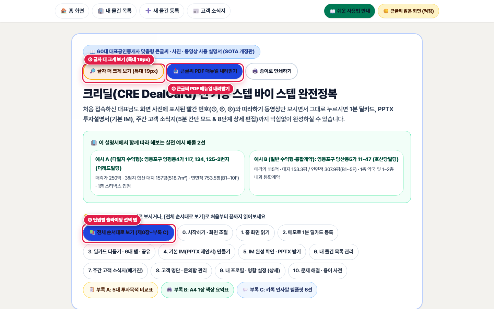

# 제0장. 시작하기 — 상단 메뉴바와 눈이 편안한 '큰글씨 밝은 화면' 사용법

> **소요 시간**: 약 2분 | **관련 화면**: `/broker` (🏠 홈 화면 열기)
> 어두운 화면이 침침하실 때 단 한 번의 클릭으로 종이 제안서처럼 밝고 선명한 화면(WCAG AAA 고대비)으로 바꾸는 방법과, 어디서든 길을 잃지 않는 상단·하단 메뉴바 및 설명서 인쇄 기능을 안내해 드립니다.

## 🎯 이 장에서 꼭 기억하실 핵심 포인트

- **화면 맨 위 고정 메뉴바(🏠 홈 화면 · 🏢 내 물건 목록 · ➕ 새 물건 등록 · 📰 고객 소식지)로 언제든 한 번에 이동합니다.**
- **우측 상단 [☀️ 큰글씨 밝은 화면 (켜짐)] 버튼은 눈부심 없는 따뜻한 종이 질감(4단계 입체 표면)과 진한 먹색 글씨를 기본 제공합니다.**
- **글씨를 더 크게 보시려면 사용 설명서 상단의 [🔎 글자 더 크게 보기 (특대 19px)]를 누르시거나, 키보드 [Ctrl] 키를 누른 채 마우스 바퀴(휠)를 위로 굴리세요.**

> 🎬 **따라하기 동영상**: [🎬 [따라하기 영상 1] 상단 메뉴바 · 큰글씨 밝은 화면 전환 · 홈 화면 둘러보기](./videos/video-01-home-and-theme.webm)

---

## [0-1단계] 상단 고정 메뉴바와 [☀️ 큰글씨 밝은 화면] 확인하기

*▲ [화면 안내] 상단 고정 메뉴바(① 좌측 4대 핵심 메뉴, ② 쉬운 사용법 안내, ③ 큰글씨 밝은 화면 전환 버튼)*

1. **👆 어디를 누르거나 입력하나요?**
   화면 맨 위쪽(상단 바) 왼쪽의 4개 메뉴 버튼(🏠 홈 화면, 🏢 내 물건 목록, ➕ 새 물건 등록, 📰 고객 소식지)과 오른쪽 끝의 노란색 [☀️ 큰글씨 밝은 화면 (켜짐)] 버튼을 확인합니다.

2. **✅ 화면에서 무엇이 바뀌나요?**
   기본으로 눈부심과 빛번짐(Halation)을 막아주는 '따뜻한 스톤 종이색 밝은 화면(#F3F2EE 바탕 + #FFFFFF 입체 카드)'이 켜져 있어 작은 숫자도 또렷하게 보입니다. 현재 선택된 메뉴에는 파란색 알약 표시가 부드럽게 이동하여 지금 어느 화면에 계신지 즉시 알려줍니다.

3. **💡 왜 이 기능이 중요한가요? (중개 실무 포인트)**
   작업 도중 어느 화면에 들어가 계시더라도 맨 위 [🏠 홈 화면]이나 [🏢 내 물건 목록] 버튼만 누르시면 처음 자리로 안전하게 돌아오실 수 있습니다.

   > 📌 **따라하기 꿀팁**: 키보드 왼쪽 아래 [Ctrl] 키를 누른 상태에서 마우스 가운데 바퀴(휠)를 위로 올리시면 화면 글씨가 125%, 150%로 시원하게 커집니다.

4. **⚠️ 자주 하시는 실수 & 안심 예방법**
   실수로 [🌙 어두운 화면]을 눌러 화면이 검게 바뀌었더라도 당황하지 마세요. 같은 자리의 버튼을 한 번 더 누르시면 즉시 밝은 종이 화면으로 돌아옵니다.

---

## [0-2단계] 화면 아래쪽 [더보기] 메뉴로 고객 명단·내 프로필 열기

![하단 바 오른쪽 끝 [더보기] 버튼을 눌렀을 때 열리는 전체 메뉴 화면](./images/step-00-bottom-nav-and-more.png)
*▲ [화면 안내] 하단 바 오른쪽 끝 [더보기] 버튼을 눌렀을 때 열리는 전체 메뉴 화면*

1. **👆 어디를 누르거나 입력하나요?**
   화면 아래쪽 탐색 바의 오른쪽 끝에 있는 [⋯ 더보기] 버튼을 마우스로 클릭합니다.

2. **✅ 화면에서 무엇이 바뀌나요?**
   화면 아래에서 전체 메뉴 서랍이 부드럽게 올라오면서 ① 주간 소식지(매거진) 만들기, ② 고객·구독자 명단, ③ 내 프로필·사무소 정보, ④ 쉬운 이용 안내 메뉴가 큰 글씨로 나타납니다.

3. **💡 왜 이 기능이 중요한가요? (중개 실무 포인트)**
   평소 매일 쓰는 4가지 핵심 기능은 상단·하단 바에 바로 나와 있고, 고객 명단 관리나 내 명함(프로필) 수정이 필요하실 때만 [더보기]를 눌러 들어가시면 됩니다.

   > 📌 **따라하기 꿀팁**: 열린 [더보기] 창을 닫으실 때는 우측 상단 [✕ 닫기]를 누르거나 바깥 배경을 가볍게 클릭하시면 됩니다.

---

## [0-3단계] 사용 설명서 글씨 특대 확대(19px) · 단원별 바로가기 · 큰글씨 PDF 내려받기

*▲ [화면 안내] 사용 설명서 상단: ① 특대 글씨(19px) 전환, ② 큰글씨 PDF 다운로드·인쇄, ③ 단원별 슬라이딩 선택 탭*

1. **👆 어디를 누르거나 입력하나요?**
   상단 바 [📖 쉬운 사용법 안내]를 눌러 열린 설명서 맨 위에서 ① [🔎 글자 더 크게 보기 (특대 19px)], ② [📥 큰글씨 PDF 매뉴얼 내려받기], ③ [🖨️ 종이로 인쇄하기], 그리고 아래 단원 선택 알약 탭을 클릭합니다.

2. **✅ 화면에서 무엇이 바뀌나요?**
   • [🔎 글자 더 크게 보기]: 설명서 본문 글씨가 17px에서 19px 특대 크기로 즉시 커집니다.
   • [📥 큰글씨 PDF 매뉴얼 내려받기]: 모든 화면 사진이 포함된 고화질 PDF 책자가 내 컴퓨터에 저장됩니다.
   • 단원 선택 탭: 원하는 장(예: '4. 기본 IM 만들기' 또는 '7. 주간 고객 소식지')만 골라서 집중해서 보실 수 있습니다.

3. **💡 왜 이 기능이 중요한가요? (중개 실무 포인트)**
   컴퓨터 화면으로 보시기 답답하실 때 종이로 인쇄해 책상 옆에 펼쳐두시거나, 태블릿·휴대폰에 PDF 파일로 넣어 다니시며 언제든 참고하실 수 있습니다.
