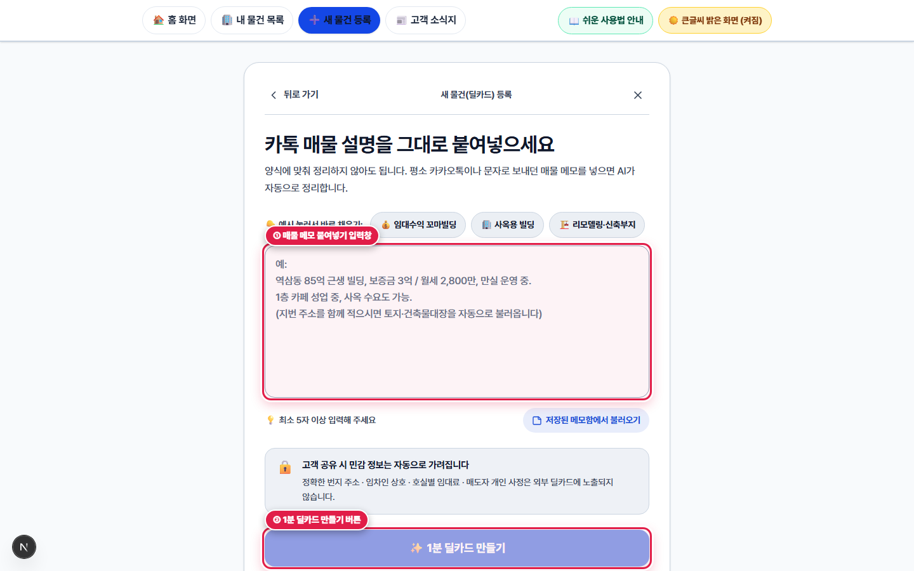

# 제2장. 메모로 새 물건 등록 — 1분 딜카드 만들기

> **소요 시간**: 약 1분 | **관련 화면**: `/broker/deal-card/new` (➕ 새 물건 등록 화면 열기)
> 복잡한 표를 일일이 채울 필요 없이, 카카오톡이나 수첩에 적어두신 매물 메모를 그대로 복사해 붙여넣기만 하면 AI가 주소·가격·면적을 자동으로 읽어 모바일 딜카드를 만들어 드립니다.

## 🎯 이 장에서 꼭 기억하실 핵심 포인트

- **카카오톡으로 받은 물건 내역이나 직접 적은 3~5줄 메모를 큰 입력창에 그대로 붙여넣습니다.**
- **처음 연습해 보실 때는 입력창 아래 [오피스 예시], [상가 예시], [건물 통매각 예시] 버튼을 눌러 체험해 보실 수 있습니다.**
- **우측 하단 파란색 [1분 딜카드 만들기] 버튼을 누르면 정부 공적장부(토지·건축물대장)와 연결된 딜카드가 즉시 생성됩니다.**

> 🎬 **따라하기 동영상**: [🎬 [따라하기 영상 2] 카톡 메모 붙여넣기로 1분 만에 딜카드 만들고 다듬기](./videos/video-02-memo-to-dealcard.webm)

---

## [2-1단계] 새 물건 등록 화면 열기 및 예시 버튼 살펴보기

*▲ [화면 안내] 새 물건 등록 화면(① 큰 메모 입력창, ② 클릭 한 번으로 채워지는 3종 예시 버튼)*

1. **👆 어디를 누르거나 입력하나요?**
   상단 메뉴바의 [➕ 새 물건 등록] 또는 홈 화면 첫 번째 [새 물건 등록 (1분)] 카드를 클릭합니다.

2. **✅ 화면에서 무엇이 바뀌나요?**
   '한줄 메모 → 딜카드 생성' 화면이 열립니다. 아직 입력할 메모가 준비되지 않으셨다면 입력창 아래의 [오피스 예시], [상가 예시], [건물 통매각 예시] 버튼 중 하나를 눌러보세요. 예시 문구가 자동으로 채워집니다.

3. **💡 왜 이 기능이 중요한가요? (중개 실무 포인트)**
   정해진 양식 없이 평소 쓰시는 중개 메모 그대로 넣으셔도 작동한다는 점을 바로 체험해 보실 수 있습니다.

---

## [2-2단계] 매물 메모 입력 후 [1분 딜카드 만들기] 버튼 누르기

![양평동 수익형 빌딩 메모를 입력하고 우측 하단 [1분 딜카드 만들기] 버튼을 누르는 모습](./images/step-02-dealcard-new-filled.png)
*▲ [화면 안내] 양평동 수익형 빌딩 메모를 입력하고 우측 하단 [1분 딜카드 만들기] 버튼을 누르는 모습*

1. **👆 어디를 누르거나 입력하나요?**
   큰 네모 입력창에 매물 메모(예: '양평동4가 117 더레드빌딩 매각 / 매각가 250억 / 대지 157평 / 준공업지역, 2018년 신축 B1~10F / 선유도역 도보 1분')를 입력하거나 붙여넣은 뒤, 오른쪽 아래 파란색 [1분 딜카드 만들기] 버튼을 클릭합니다.

2. **✅ 화면에서 무엇이 바뀌나요?**
   약 3~5초 동안 AI가 메모에서 지번 주소, 매각 희망가, 대지·연면적, 층수, 역세권 강점을 자동으로 분석하여 깔끔하게 정리된 '1분 딜카드' 화면으로 이동합니다.

3. **💡 왜 이 기능이 중요한가요? (중개 실무 포인트)**
   주소(동·번지)와 매매가 두 가지만 정확히 적어주시면 나머지 대지면적, 연면적, 용도지역, 준공연도는 다음 단계에서 정부 건축물대장·토지대장에서 자동으로 불러올 수 있습니다.

   > 📌 **따라하기 꿀팁**: 복사/붙여넣기 단축키: 카카오톡에서 글을 마우스로 긁은 뒤 [Ctrl + C]를 누르고, 크리딜 메모창을 클릭한 뒤 [Ctrl + V]를 누르시면 그대로 붙여넣어집니다.
