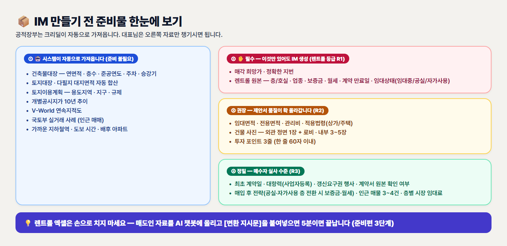
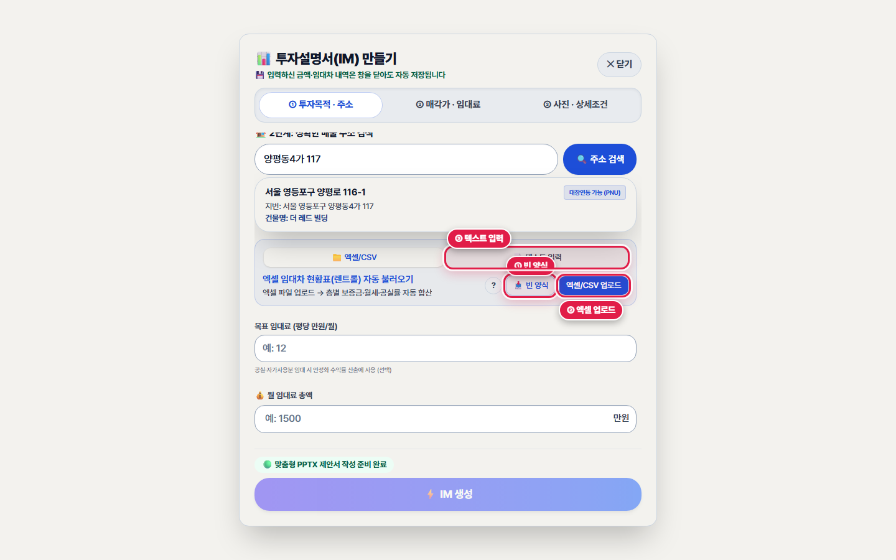
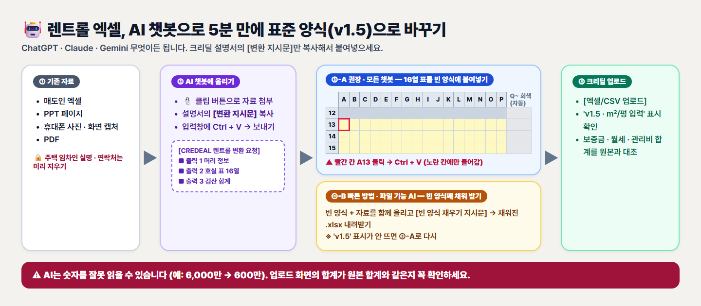
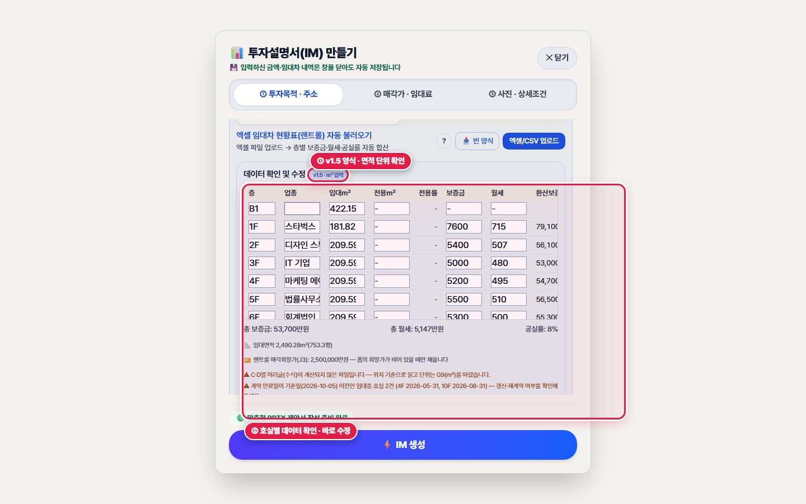
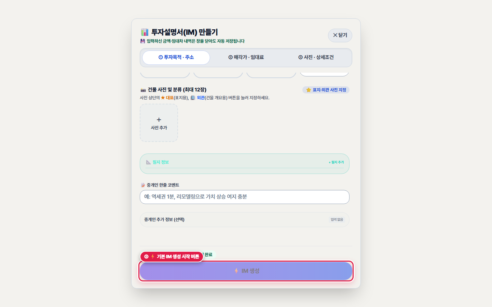

# 준비편. IM 만들기 전 10분 자료 준비 — 렌트롤 엑셀은 AI 챗봇으로 변환하고, 입력 시트 자료는 미리 모으기

> **소요 시간**: 약 10분 (자료가 모여 있으면 5분) | **관련 화면**: `/broker/buildings` (🏢 내 물건에서 IM 입력 시트 열기)
> 고품질 IM을 가로막는 가장 큰 벽은 '렌트롤 엑셀 작성'과 '입력 시트(바텀시트)에 넣을 자료 모으기'입니다. 공적장부는 시스템이 자동으로 가져오므로, 대표님은 매도인 자료를 모아 ChatGPT·Claude·Gemini 같은 AI 챗봇에 '변환 지시문'과 함께 붙여넣기만 하시면 표준 렌트롤(v1.5)을 5분 안에 완성하실 수 있습니다.

## 🎯 이 장에서 꼭 기억하실 핵심 포인트

- **건축물대장·토지이용계획·공시지가·지적도·실거래는 시스템이 자동으로 가져옵니다. 대표님이 챙기실 것은 ① 매각 희망가 ② 정확한 지번 ③ 렌트롤 원본 ④ 건물 사진 ⑤ 투자 포인트·매입 후 전략·인근 매물 메모입니다.**
- **렌트롤은 처음부터 손으로 칠 필요가 없습니다. 매도인에게 받은 엑셀·PPT 페이지·사진 캡처를 AI 챗봇에 올리고 이 장의 [변환 지시문]을 붙여넣으면, 표준 양식 A13 칸에 그대로 붙여넣을 16열 표가 나옵니다.**
- **AI는 숫자를 잘못 읽을 수 있습니다. 업로드 후 화면에 뜨는 보증금·월세·관리비 합계를 원본과 꼭 대조하시고, 주택 임차인 실명·연락처 같은 개인정보는 AI에 올리기 전에 지워 주세요.**

> 🎬 **따라하기 동영상**: [🎬 [따라하기 영상 3-준비] 빈 렌트롤 양식 받기 · 변환된 엑셀 업로드 · 자동 검산 확인](./videos/video-03p-prep-rentroll.webm)

---

## [준비-1단계] IM 품질을 좌우하는 준비물 한눈에 보기 — 자동으로 오는 것 vs 대표님이 챙기실 것


*▲ [화면 안내] IM 준비물 한눈에 보기: ① 시스템 자동 수집 ② 필수(R1) ③ 권장(R2) ④ 정밀(R3) 자료*

1. **👆 어디를 누르거나 입력하나요?**
   IM을 만들기 전에 아래 그림 오른쪽의 '대표님이 챙기실 것' 목록을 보시고, 매도인·건물 관리인에게 받을 자료를 미리 모아 둡니다. (준비-6단계의 '자료 요청 카톡 문구'를 그대로 보내셔도 됩니다.)

2. **✅ 화면에서 무엇이 바뀌나요?**
   • 자동 수집(준비 불필요): 건축물대장(연면적·층수·준공연도·주차·승강기), 토지대장·다필지 합산, 토지이용계획(용도지역·규제), 개별공시지가 10년 추이, V-World 지적도, 국토부 실거래 사례, 가까운 지하철역 도보 시간
   • 필수(이것만 있어도 IM 생성): 매각 희망가, 정확한 지번, 렌트롤 원본(층·업종·보증금·월세·만기·임대상태)
   • 권장(제안서 품질 상승): 임대·전용면적, 관리비, 건물 사진(외관 정면 1장 + 내부), 투자 포인트 3줄
   • 정밀(매수자 실사 수준): 최초 계약일, 대항력(사업자등록), 갱신요구권 행사 여부, 계약서 원본 확인 여부, 매입 후 전략, 인근 매물 3~4건, 층별 시장 임대료

3. **💡 왜 이 기능이 중요한가요? (중개 실무 포인트)**
   렌트롤에 적힌 항목이 많을수록 IM의 분석 깊이가 R1(발행 최소선) → R2(평당 단가·전용률 분석) → R3(갱신권·명도 계획까지 정밀 실사)로 올라갑니다. 같은 건물이라도 준비한 자료에 따라 제안서의 설득력이 크게 달라집니다.

   > 📌 **따라하기 꿀팁**: 필수 3가지만 있어도 IM은 만들어집니다. 처음에는 필수 자료로 빠르게 만들어 보시고, 매도인 자료가 더 들어오면 렌트롤을 다시 올려 재생성하셔도 됩니다.

---

## [준비-2단계] 빈 렌트롤 양식(v1.5) 내려받기 & 매도인 자료(엑셀·PPT·사진 캡처) 한 폴더에 모으기


*▲ [화면 안내] IM 입력 시트의 렌트롤 불러오기 상자: ① 빈 양식 내려받기 ② 엑셀/CSV 업로드 ③ 간단 텍스트 입력 탭*

1. **👆 어디를 누르거나 입력하나요?**
   딜카드 화면에서 [⚡ 기본 IM 만들기]를 눌러 입력 시트를 연 뒤, 주소 칸 아래 '엑셀 임대차 현황표(렌트롤) 자동 불러오기' 상자에서 ① [📥 빈 양식] 버튼을 눌러 'CREDEAL_렌트롤_표준양식_v1.5.xlsx'를 내 컴퓨터에 저장합니다. 매도인에게 받은 엑셀·PPT·사진 파일도 한 폴더(예: 바탕화면 '당산동 렌트롤')에 모아 둡니다.

2. **✅ 화면에서 무엇이 바뀌나요?**
   빈 양식은 4개 시트(기입요령 · 렌트롤 · 자동검증 · 컬럼정의)로 되어 있습니다. 대표님이 채우실 곳은 '렌트롤' 시트의 노란 칸뿐이며, 회색 칸(평 환산·전용률·환산보증금·만기 구간 등)은 수식이 자동으로 계산합니다. 13행에는 '← 예시 행입니다' 표시가 붙은 견본 1줄이 들어 있습니다.

3. **💡 왜 이 기능이 중요한가요? (중개 실무 포인트)**
   표준 양식은 칸 위치가 정해져 있어 크리딜이 한 칸도 놓치지 않고 읽습니다. 매도인마다 제각각인 엑셀을 그대로 올려도 기본 항목(층·업종·보증금·월세)은 읽히지만, 면적·대항력·최초 계약일 같은 정밀 항목은 표준 양식으로 옮겨야 IM에 빠짐없이 반영됩니다.

   > 📌 **따라하기 꿀팁**: 임차인이 3~4곳뿐인 작은 건물은 같은 상자의 ③ [📝 텍스트 입력] 탭에 '1F 약국 보증금 8,000 월세 600'처럼 적고 [✨ AI 분석]을 누르셔도 됩니다. 다만 텍스트 입력은 렌트롤 기준일·면적 단위·근거 같은 정밀 항목을 담지 못하므로, 고품질 IM에는 표준 양식을 권장합니다.

---

## [준비-3단계] [방법 A · 모든 AI 챗봇 · 권장] 자료와 '변환 지시문'을 붙여넣어 16열 표 받기


*▲ [화면 안내] AI 챗봇 렌트롤 변환 흐름: ① 기존 자료 ② AI 챗봇 + 변환 지시문 ③ 방법 A(16열 표 붙여넣기) · 방법 B(파일째 받기) ④ 크리딜 업로드·검산*

1. **👆 어디를 누르거나 입력하나요?**
   ChatGPT·Claude·Gemini 중 평소 쓰시는 AI 챗봇을 열고, ① 클립(📎) 또는 [+] 버튼으로 매도인 자료(엑셀·PPT 페이지·사진 캡처·PDF)를 올린 뒤, ② 아래 [변환 지시문 복사하기]로 복사한 글을 입력창에 붙여넣고(Ctrl + V) 보내기를 누릅니다.

2. **✅ 화면에서 무엇이 바뀌나요?**
   AI가 세 가지를 돌려줍니다.
   • 출력 1 — 머리 정보: 물건명·소재지·렌트롤 기준일·면적 단위(㎡/평)·매각 희망가·연면적
   • 출력 2 — 호실 표: 탭으로 구분된 16열 표(코드 상자 1개). 상자 오른쪽 위 [복사] 버튼을 누르면 한 번에 복사됩니다.
   • 출력 3 — 검산: 보증금·월세·관리비 합계와 호실 수, 읽기 어려웠거나 비워 둔 칸 목록

3. **💡 왜 이 기능이 중요한가요? (중개 실무 포인트)**
   AI 챗봇에게 '엑셀 파일을 새로 만들어 달라'고 하면 챗봇마다 결과가 들쭉날쭉하고 수식·드롭다운이 깨지기 쉽습니다. 방법 A는 AI에게서 '표'만 받고, 칸 구조와 수식은 크리딜 빈 양식이 그대로 지키게 하므로 어떤 챗봇을 쓰셔도 결과가 안정적입니다.

   > 📌 **따라하기 꿀팁**: 사진 캡처는 글자가 잘 보이도록 크게 확대해서 찍어 주세요. 여러 장이면 한꺼번에 올리셔도 됩니다. 결과 표에 빈칸이 많으면 '원본 2쪽 3층 월세를 다시 확인해 줘'처럼 다시 물어보시면 됩니다.

4. **⚠️ 자주 하시는 실수 & 안심 예방법**
   • AI는 숫자를 잘못 읽거나(예: 6,000만 → 600만) 원본에 없는 날짜를 지어낼 수 있습니다. '출력 3 검산'의 합계를 원본 자료의 합계와 반드시 대조해 주세요.
   • 개인정보 주의: 주택 임차인의 실명·주민번호·연락처는 AI에 올리기 전에 지우거나 '주택 임차인 A'처럼 바꿔 주세요. 회사 계정을 쓰시거나 '대화 내용 학습' 설정을 끄시면 더 안전합니다.

5. **📋 바로 복사해서 따라 해보는 실전 문구 예시 (AI 챗봇용 렌트롤 변환 지시문 (방법 A · 16열 표) 복사하기)**
   ```text
   [CREDEAL 렌트롤 변환 요청]
   첨부한 자료(엑셀·PPT 페이지·사진 캡처·PDF)는 한 건물의 임대차 현황입니다. 아래 규칙대로 'CREDEAL 렌트롤 표준 양식 v1.5'에 붙여넣을 표로 바꿔 주세요.
   
   ■ 출력 1 — 머리 정보 (모르면 빈칸)
   C3 물건명:
   C4 소재지:
   C5 렌트롤 기준일(YYYY-MM-DD):
   G9 면적 단위(㎡ 또는 평):
   J3 매각 희망가(원):
   J4 연면적(㎡):
   
   ■ 출력 2 — 호실 표 (가장 중요)
   · 탭(Tab)으로 구분한 16열, 머리글 없이 데이터 행만, 코드 블록 1개로 출력
   · 열 순서: 호실/층 | 계약그룹 | 임대면적 | 전용면적 | 업종/상호(원문) | 적용법령 | 보증금(원) | 월세(원) | 관리비(원) | 최초 계약일 | 현 계약 시작일 | 현 계약 만료일 | 갱신요구권 행사 | 대항력 요건 | 임대상태 | 비고
   
   ■ 규칙
   1. 1행 = 1임대호실. 한 층에 여러 호실(예: 1층 식당·커피숍 3곳)이 있으면 행을 나누고 호실/층(A열)마다 '1F'처럼 층 표기를 적습니다. 원본 맨 아래의 '계·합계·소계·연 수입' 행과 임대 대상이 아닌 공용 '기계실·전기실·무료 주차장' 행은 호실 표에서 빼고(유료 임대 주차장만 포함) 출력 3에 알려 주세요.
   2. 금액은 '원' 단위 숫자만 적습니다 (원본 단위가 '만원'이면 5,000 → 50000000, '천원'이면 80,000 → 80000000). 쉼표·괄호·'만'·'천'·'원' 글자 금지. 월세·관리비는 VAT 별도 금액.
   3. 날짜는 YYYY-MM-DD. 연·월만 있거나 불확실하면 날짜 칸은 비우고 비고에 원문을 적습니다.
   4. 면적은 원본에 적힌 단위 그대로 숫자만 적고, 그 단위를 G9에 적습니다(㎡와 평을 한 표에 섞지 않음). 원본에 호실별 면적 열이 아예 없으면 면적(C·D열)은 비워 두세요.
   5. 한 계약서로 여러 호실을 쓰는 통합계약은 계약그룹에 같은 이름(A, B…)을 적고, 보증금·월세·관리비는 대표 1행에만 적고 나머지 행은 비웁니다.
   6. 공실·자가사용: 공실은 업종/상호 '공실'·임대상태 '공실', 소유주 직접 사용 층은 임대상태 '자가사용'으로 적고, 보증금·월세·관리비(G·H·I열)는 반드시 비웁니다(실수입 합계 왜곡 방지). 원본에 적힌 희망 임대료나 괄호 금액(예: (40,000)/(4,000))은 버리지 말고 비고(P열)에 '희망 보증 4,000만/월 400만'처럼 남겨 주세요.
   7. 정해진 단어만 사용 — 적용법령: 상가/주택/미확인 · 갱신요구권 행사: 있음/없음/모름 · 대항력 요건: 사업자등록/주민등록/미확인 · 임대상태: 임대중/공실/자가사용
   8. 원본에 없는 값은 절대 추측하지 말고 빈칸으로 둡니다(정해진 단어 열은 '미확인' 또는 '모름'). 업종/상호는 원문 그대로 옮깁니다.
   
   ■ 출력 3 — 검산
   보증금 합계, 월세 합계, 관리비 합계(원, 공실·자가 제외 실수입 기준), 호실 수, 그리고 원본에서 읽기 어려웠거나 비워 둔 칸 목록.
   ```

---

## [준비-4단계] 빈 양식 A13 칸에 붙여넣고 머리 칸을 채운 뒤 업로드 → 'v1.5' 표시와 합계로 검산하기


*▲ [화면 안내] 표준 양식 업로드 직후: ① 'v1.5 · ㎡ 입력' 버전 표시 ② 호실별 데이터 확인·수정 표와 자동 합계*

1. **👆 어디를 누르거나 입력하나요?**
   ① 내려받은 빈 양식을 엑셀로 열고 아래쪽 '렌트롤' 시트 탭을 누릅니다. ② 13행 맨 왼쪽 A13 칸(예시 행 '3F')을 한 번 클릭하고 Ctrl + V로 붙여넣습니다. ③ AI의 '출력 1'을 보고 C3(물건명)·C4(소재지)·C5(기준일)·G9(면적 단위)·J3(매각가, 원)·J4(연면적, ㎡) 칸을 채우고 저장합니다. ④ 크리딜 입력 시트의 [엑셀/CSV 업로드]로 저장한 파일을 올립니다.

2. **✅ 화면에서 무엇이 바뀌나요?**
   업로드하면 '데이터 확인 및 수정' 표가 펼쳐지고 제목 옆에 'v1.5 · ㎡ 입력'(또는 '평 입력') 표시가 붙습니다. 호실 수, 보증금·월세·관리비 합계(공실·자가사용 희망금액 제외 실수입), 임대·전용면적과 전용률이 자동 계산되어 입력 시트의 월 임대료·보증금 칸에도 바로 채워집니다. 표 안의 숫자는 이 자리에서 바로 고치실 수도 있습니다.

3. **💡 왜 이 기능이 중요한가요? (중개 실무 포인트)**
   16열 표가 A~P열(호실/층 ~ 비고)에 딱 맞게 들어가면 오른쪽 회색 칸의 수식(평 환산·전용률·환산보증금·만기 구간·금액 판정)이 그대로 살아 있어, 엑셀의 '자동검증' 시트에서도 누락·중복을 미리 확인하실 수 있습니다.

   > 📌 **따라하기 꿀팁**: AI의 검산 합계와 업로드 화면의 합계가 같으면 변환이 정확하게 된 것입니다. 통신사 안테나(예: SK 중계기 연 325만 원)·옥상 광고판 같은 부가수입이 있으면 렌트롤 시트 우측 상단 J8(기타수입, 원/월)과 M8(내역)에 적어 주세요.

4. **⚠️ 자주 하시는 실수 & 안심 예방법**
   • A13이 아닌 다른 칸(예: B13)에 붙여넣으면 열이 한 칸씩 밀립니다. 붙여넣은 뒤 A열에 '1F·2F' 같은 층이, O열에 '임대중·공실'이 보이는지 확인하세요.
   • 회색 칸(Q열부터 오른쪽)에는 아무것도 붙여넣지 마세요. 자동 계산 수식이 지워집니다.
   • ⛔ '면적 단위 확인 필요'가 뜨면 대부분 G9(㎡/평)와 실제 숫자의 단위가 다른 경우입니다. 예: 평으로 적고 G9를 ㎡로 둔 경우 → G9를 '평'으로 바꿔 다시 저장·업로드하세요. 원본에 호실별 면적 칸이 아예 없어 C·D열을 비워 둔 경우에는 차단되지 않고 건축물대장 연면적으로 안전하게 보완됩니다.

---

## [준비-5단계] [방법 B · 빠른 방법] 파일 기능이 있는 AI(ChatGPT·Claude 등)에게 빈 양식째 채워 받기


*▲ [화면 안내] 방법 B: 빈 양식 파일과 매도인 자료를 함께 올려 채워진 xlsx로 돌려받는 흐름 (그림 ③-B)*

1. **👆 어디를 누르거나 입력하나요?**
   AI 챗봇에 ① 빈 양식 파일(CREDEAL_렌트롤_표준양식_v1.5.xlsx)과 ② 매도인 자료를 함께 올리고, 아래 [빈 양식 채우기 지시문 복사하기]로 복사한 글을 붙여넣어 보냅니다. AI가 채운 .xlsx 파일 내려받기 링크를 주면, 받아서 바로 크리딜 입력 시트에 업로드합니다.

2. **✅ 화면에서 무엇이 바뀌나요?**
   엑셀에 붙여넣는 과정 없이 채워진 양식 파일을 바로 받습니다. 업로드 화면에 'v1.5' 표시가 뜨고 호실 수·합계가 원본과 같으면 성공입니다.

3. **💡 왜 이 기능이 중요한가요? (중개 실무 포인트)**
   엑셀 붙여넣기도 번거로우실 때 가장 빠른 길입니다. 다만 파일을 만들어 주는 기능은 AI 서비스·요금제·설정에 따라 다르고, AI가 양식의 칸이나 시트를 바꿔 버리는 경우도 있어 검산이 꼭 필요합니다.

   > 📌 **따라하기 꿀팁**: 파일 만들기가 어려운 챗봇(예: Gemini)에서는 방법 A(16열 표 붙여넣기)를 쓰시거나, 표 아래에 'Sheets로 내보내기'가 보이면 구글 시트로 내보낸 뒤 그 표를 복사해 빈 양식 A13에 붙여넣으시면 됩니다.

4. **⚠️ 자주 하시는 실수 & 안심 예방법**
   업로드했더니 'v1.5'가 아니라 '레거시 양식'으로 표시되거나 호실 수가 원본과 다르면, AI가 제목(A1)이나 칸 위치를 바꾼 것입니다. 이때는 방법 A로 다시 하시는 것이 가장 확실합니다.

5. **📋 바로 복사해서 따라 해보는 실전 문구 예시 (파일 기능 AI용 빈 양식 채우기 지시문 (방법 B) 복사하기)**
   ```text
   [CREDEAL 렌트롤 빈 양식 채우기 요청]
   첨부 1: CREDEAL_렌트롤_표준양식_v1.5.xlsx (빈 양식)
   첨부 2: 기존 임대차 자료 (엑셀·PPT 페이지·사진 캡처·PDF)
   
   첨부 2의 내용을 첨부 1 양식의 '렌트롤' 시트에 채워, 같은 형식의 .xlsx 파일로 돌려주세요.
   
   ■ 어디에 넣나요
   · C3 물건명 · C4 소재지 · C5 렌트롤 기준일(YYYY-MM-DD) · G9 면적 단위(㎡ 또는 평) · J3 매각 희망가(원) · J4 연면적(㎡)
   · 13행부터 A~P열 (1행 = 1호실): 호실/층 | 계약그룹 | 임대면적 | 전용면적 | 업종/상호(원문) | 적용법령 | 보증금(원) | 월세(원) | 관리비(원) | 최초 계약일 | 현 계약 시작일 | 현 계약 만료일 | 갱신요구권 행사 | 대항력 요건 | 임대상태 | 비고
   · 13행의 '예시 행'은 지우고 그 자리부터 채웁니다.
   
   ■ 절대 바꾸지 마세요
   · A1 제목(CREDEAL 렌트롤 표준 양식 v1.5), 1~12행 머리글, Q~Y열·AC~AF열(회색 자동계산 칸)의 수식
   · 다른 시트(기입요령·자동검증·컬럼정의)와 드롭다운 설정
   
   ■ 입력 규칙
   1. 1행 = 1임대호실. 한 층에 여러 호실이 있으면 행을 나누고, 원본 맨 아래 '계·합계·연 수입' 행과 공용 '기계실·무료 주차장' 행은 뺍니다.
   2. 금액은 '원' 단위 숫자만 (만원 단위 5,000 → 50000000, 천원 단위 80,000 → 80000000). 월세·관리비는 VAT 별도.
   3. 날짜는 YYYY-MM-DD 날짜 값. 연·월만 있거나 불확실하면 비우고 비고에 원문을 적습니다.
   4. 면적은 원본 단위 그대로 숫자만 적고 그 단위를 G9에 고릅니다(㎡와 평 혼용 금지). 원본에 면적이 없으면 C·D열을 비웁니다.
   5. 통합계약(한 계약서로 여러 호실)은 계약그룹에 같은 이름(A, B…)을 적고, 보증금·월세·관리비는 대표 1행에만 적습니다.
   6. 공실·자가사용: 공실은 임대상태 '공실', 소유주 직접 사용 층은 '자가사용'으로 적고 보증금·월세·관리비(G·H·I열)는 비웁니다. 원본의 희망 임대료·괄호 금액은 비고(P열)에 남깁니다.
   7. 정해진 단어만 사용 — 적용법령: 상가/주택/미확인 · 갱신요구권 행사: 있음/없음/모름 · 대항력 요건: 사업자등록/주민등록/미확인 · 임대상태: 임대중/공실/자가사용
   8. 원본에 없는 값은 추측하지 말고 빈칸(정해진 단어 열은 '미확인' 또는 '모름')으로 둡니다.
   
   ■ 작업 후 채팅으로 알려 주세요
   보증금·월세·관리비 합계(원, 공실·자가 제외 실수입 기준), 호실 수, 비워 둔 칸 목록.
   ```

---

## [준비-6단계] 입력 시트(바텀시트)를 알차게 채우는 자료 체크리스트 & 매도인 자료 요청 카톡 문구


*▲ [화면 안내] IM 입력 시트 ③ 사진·상세조건 단계 — 미리 모은 사진·투자 포인트·매입 후 전략·인근 매물을 채우는 곳*

1. **👆 어디를 누르거나 입력하나요?**
   IM 입력 시트의 ② 매각가·임대료, ③ 사진·상세조건 단계에서 아래 항목을 미리 준비한 자료로 채웁니다. 자료가 아직 없으면 아래 [자료 요청 카톡 문구 복사하기]로 매도인·관리인에게 먼저 보내 두세요.

2. **✅ 화면에서 무엇이 바뀌나요?**
   • 건물 사진: 외관 정면 1장(★ 대표 · 🏢 외관 지정) + 로비·내부·주변 3~5장 → 표지 · 물건 개요 · 사진첩 슬라이드
   • 투자 포인트 3줄(한 줄 60자 이내, 최대 5개) → 02 요약 슬라이드 핵심 포인트
   • 매입 후 전략(공실·자가사용 층 전환 시 예상 보증금·월세) → 안정화 기대수익률
   • 인근 매물·실거래 3~4건(주소 + 가격) → 08 인근 시세 비교 9열 표
   • 규제 메모(지구단위계획 등) · 입지 메모(주간선도로·상권) → 04 입지 · 05 토지 슬라이드
   • 렌트롤 양식 J5~J8 칸: 층별 시장 임대료(출처)와 기타수입(주차·광고·안테나) → 임대료 정상화 · 수익률

3. **💡 왜 이 기능이 중요한가요? (중개 실무 포인트)**
   공적장부만으로 만든 IM은 '어느 건물이나 비슷한 제안서'가 됩니다. 매도인만 아는 임대 이력과 대표님만 아는 현장 정보(상권 흐름·매입 후 전략·인근 호가)가 들어가야 매수자가 '이 중개인은 건물을 제대로 안다'고 느낍니다.

   > 📌 **따라하기 꿀팁**: 자료가 한 번에 다 모이지 않아도 괜찮습니다. 입력 중인 내용은 같은 컴퓨터·같은 인터넷 창에 임시 저장되며, 자료가 더 들어오면 입력 시트를 다시 열어 보완한 뒤 IM을 재생성하시면 됩니다.

5. **📋 바로 복사해서 따라 해보는 실전 문구 예시 (매도인·관리인 자료 요청 카톡 문구 복사하기)**
   ```text
   안녕하세요, ○○부동산 ○○○입니다.
   매수 고객께 드릴 투자설명서를 정확하게 만들기 위해 아래 자료를 부탁드립니다. 엑셀이 없으시면 사진이나 캡처로 보내주셔도 됩니다.
   
   1. 층·호실별 임대 현황: 임차인 업종, 보증금, 월세, 관리비, 계약 시작일·만료일
   2. 호실별 임대면적(전용면적도 있으면 함께), 공실·직접 사용 층 표시
   3. 한 계약으로 여러 층을 쓰는 임차인이 있으면 표시
   4. 임차인별 최초 입주일, 사업자등록 여부, 계약갱신 요구 이력(아시는 범위에서)
   5. 주차·광고·안테나 등 임대료 외 수입
   6. 건물 외관·로비·내부 사진 몇 장
   
   감사합니다.
   ```
