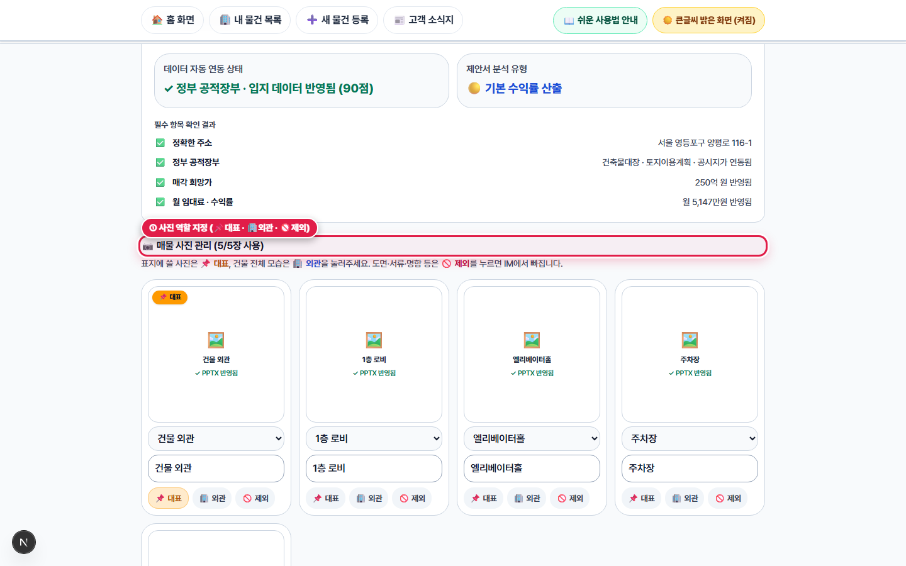

# 제5장. IM 완성 확인 · 문구/사진 다듬기 · PPTX 제안서 파일 받기

> **소요 시간**: 약 2분 | **관련 화면**: `/broker/im-approval/4a7e0693-2fb5-4071-81e1-7a39248e48c6` (📄 양평동 IM 완성 화면 열기)
> 생성된 투자설명서(IM)의 4대 필수 항목을 점검하고, 표지 사진이나 핵심 투자 포인트 3가지를 다듬은 뒤 파워포인트(PPTX) 파일로 내려받거나 매수자용 웹 화면 링크로 전달하는 방법입니다.

## 🎯 이 장에서 꼭 기억하실 핵심 포인트

- **화면 맨 위 액션 바에서 기다릴 필요 없이 [📥 PPTX 제안서 파일 받기], [🔗 카톡용 링크 복사], [🖥️ 웹 화면 열기]를 즉시 실행할 수 있습니다.**
- **'필수 데이터 자동 점검(4항목)'에서 소재지·매각가·대지면적·임대료가 모두 초록색(✅)인지 한눈에 확인합니다.**
- **사진 썸네일 아래 [📌 대표(표지)], [🏢 외관], [🚫 제외] 버튼과 3대 핵심 투자 포인트 입력창으로 제안서 품질을 10초 만에 마감합니다.**

> 🎬 **따라하기 동영상**: [🎬 [따라하기 영상 3 & 4] IM 완성 화면 점검 · PPTX 다운로드 · 매수자용 웹 제안서 확인](./videos/video-03-basic-im-generation.webm)

---

## [5-1단계] 상단 즉시 다운로드 바 & 필수 데이터 4항목 자동 점검 확인하기

![IM 완성 확인 화면 상단: ① [📥 PPTX 제안서 파일 받기], ② [🖥️ 웹 화면 열기], ③ 필수 데이터 4항목 자동 점검 완료](./images/step-05-im-approval-checklist.png)
*▲ [화면 안내] IM 완성 확인 화면 상단: ① [📥 PPTX 제안서 파일 받기], ② [🖥️ 웹 화면 열기], ③ 필수 데이터 4항목 자동 점검 완료*

1. **👆 어디를 누르거나 입력하나요?**
   IM 완성 화면(`/broker/im-approval/[id]`) 맨 위의 파란색 [📥 PPTX 제안서 파일 받기] 액션 바와 그 아래 [제안서 필수 데이터 자동 점검] 박스를 확인합니다.

2. **✅ 화면에서 무엇이 바뀌나요?**
   소재지, 매각 희망가, 대지 면적, 월 임대료(비수익형은 용도지역) 4가지가 모두 초록색 체크(✅ 확인됨)로 표시됩니다. 바로 위 액션 바에서 파워포인트 파일을 내려받거나 웹 제안서를 새 창으로 열 수 있습니다.

3. **💡 왜 이 기능이 중요한가요? (중개 실무 포인트)**
   제안서를 고객에게 보내기 전에 빠진 숫자가 없는지 3초 만에 눈으로 검증할 수 있습니다.

---

## [5-2단계] 매물 사진 역할(📌대표/🏢외관/🚫제외) 지정 및 3대 핵심 투자 포인트 2줄 편집

*▲ [화면 안내] ① 매물 사진 역할 지정(📌대표 · 🏢외관 · 🚫제외) 및 ② 상단 투자 요약 · 3대 핵심 포인트 2줄 편집창*

1. **👆 어디를 누르거나 입력하나요?**
   화면 중간의 [매물 사진 관리]에서 표지에 쓸 사진의 [📌 대표] 버튼을 누르거나 뺄 사진의 [🚫 제외]를 누르고, 그 아래 [상단 투자 요약 편집]에서 3대 핵심 투자 포인트(#01, #02, #03)를 다듬은 뒤 저장 버튼을 클릭합니다.

2. **✅ 화면에서 무엇이 바뀌나요?**
   수정한 사진 설정과 투자 포인트 문구가 즉시 반영되며, 다시 [📥 PPTX 제안서 파일 받기]를 누르면 방금 고친 내용 그대로 파워포인트(`.pptx`) 파일이 내 컴퓨터 '다운로드(Downloads)' 폴더에 저장됩니다.

3. **💡 왜 이 기능이 중요한가요? (중개 실무 포인트)**
   회장님·법인 대표님께 보고할 때는 격식 있는 파워포인트(PPTX) 파일이나 인쇄물로 전달하고, 카카오톡으로 빠르게 브리핑할 때는 웹 제안서 링크로 보낼 수 있어 두 가지 무기를 동시에 갖게 됩니다.

   > 📌 **따라하기 꿀팁**: 등기부 캡처나 어두운 화장실 사진 등이 섞여 있다면 [🚫 제외] 버튼만 눌러주세요. 제안서 사진첩에서 깔끔하게 빠집니다.

---

## [5-3단계] 내려받은 PPTX 투자설명서 10장 지면 편집 표준(기관급 레이아웃) 확인하기

*▲ [화면 안내] 실제 생성된 PPTX 투자설명서 슬라이드 예시(표지 · 투자 요약 · 토지이용계획확인원 양식 토지 정보)*

1. **👆 어디를 누르거나 입력하나요?**
   내 컴퓨터 '다운로드' 폴더에 저장된 PPTX 파일을 열어 01번 표지부터 마지막 문의·유의사항까지 각 지면이 기관급 편집 기준에 맞게 완성되었는지 확인합니다.

2. **✅ 화면에서 무엇이 바뀌나요?**
   • [01 표지]: 상단 군더더기 문구(CREDEAL 등)나 중복 주소·가격 박스 없이 건물명과 도로명/지번만 품격 있게 배치되고, 하단에는 대표님의 중개법인명(16pt 굵은 글씨)·성함·연락처·등록번호가 선명하게 인쇄됩니다.
   • [02 요약]: 구 '투자 포인트·제안' 슬라이드가 통합되어 좌측에 3대 핵심 투자 포인트(우량 임차 안정성 / 시세 대비 평당가 경쟁력 / 매입 후 전환 시 안정화 기대수익률), 우측에 6대 지표 카드(매각가 · 대지 · 연면적 · 현행수익률 · 안정화 기대수익률 · 당산역 도보거리)가 한눈에 들어옵니다.
   • [03 물건 개요]: 1번 '소재지' 행에만 도로명과 (지번)이 2줄로 깔끔하게 병기됩니다.
   • [04 입지 정보]: '당산역(2·9호선)'처럼 환승 노선이 하나로 묶여 표시되고, 도로·접근성(영신로·올림픽대로·국회대로·여의하류IC), 배후·상권(건축물대장 총괄표제부 기준 대단지명 및 반경 1km 아파트 총 세대수, 예: 당산삼성래미안 1,391세대 등 4,407세대), 주요시설(롯데마트 맥스·한강공원 등)이 우측 '입지 및 접근성 분석'과 함께 정렬됩니다.
   • [05 토지 정보]: 별도 규제 슬라이드를 나열하는 대신 정부 '토지이용계획확인원' 공문서 양식(■ 토지개요 4행 + ■ 토지이용계획 국계법·타법령·시행령 제9조제4항·중개인 확인사항 + 우측 V-World 지적도 및 범례 스와치)으로 한 장에 압축됩니다.
   • [06 렌트롤]: 좌측 층별 스태킹 플랜에는 용도(근린생활 등)만 깔끔히 표기되고, 하단에는 '매입 후 전략 — 전환 시 안정화 기대수익률 2.75% (현행 2.08% 대비 +0.67%p)' 박스가 들어갑니다.
   • [07 수익률]: 영문 Cap Rate 대신 '안정화 기대수익률'을 중심으로 구성하고, 우측 상단에 '한국부동산원(R-ONE) 지가변동률 10년 평균(+3.90%)'과 개별공시지가 추이를 병기하며 하단에 '운영수익률 + 자본수익률 = 단순 합산 기대수익률(6.65%)'을 제시합니다.
   • [08 인근 시세 비교]: 9개 열(구분·소재지·도로·지하철·토지면적·연면적·가격·토지평당가·본건 대비) 비교표와 매물 평균 대비 할인율(-44.6%)이 표시됩니다.
   • [09 사진첩 & 10 문의 및 유의사항]: 건물 사진과 마무리 투자 한 줄 요약, 중개사무소 연락처가 마지막 장을 장식합니다.

3. **💡 왜 이 기능이 중요한가요? (중개 실무 포인트)**
   직접 파워포인트를 만들면 하루 종일 걸리던 기관급 편집 작업이 1분 만에 끝나며, 파워포인트 프로그램에서 글자나 표를 추가로 자유롭게 수정하실 수도 있습니다.

---

## [5-4단계] [🖥️ 웹 화면 열기]로 매수자용 모바일·웹 제안서(`/im-lite`) 상단 확인하기

*▲ [화면 안내] 매수자용 웹 투자설명서(/im-lite) 상단: 매매가 · 평당가(만 원/평) · 핵심 투자 포인트*

1. **👆 어디를 누르거나 입력하나요?**
   IM 완성 화면에서 [🖥️ 웹 화면 열기] 버튼을 클릭하여 고객에게 공유되는 웹 제안서 화면 상단을 확인합니다.

2. **✅ 화면에서 무엇이 바뀌나요?**
   건물 대표 사진과 함께 매매가(250억 원), 평당가(약 3,318만 원/평), 현행 수익률, 대지·연면적이 큰 글씨로 나오고, 3대 핵심 투자 포인트가 읽기 쉽게 배치되어 있습니다.

3. **💡 왜 이 기능이 중요한가요? (중개 실무 포인트)**
   평당 단가가 '약 3,318만 원/평'처럼 한국 부동산 표준 단위로 명확히 표기되고, 각 숫자가 정부 공적장부(🟢)인지 중개인 입력(🔵)인지 투명하게 표시되어 매수인의 신뢰를 얻습니다.

---

## [5-5단계] 매수자용 웹 제안서 하단 — 지적도 · 공시지가 · 층별 임대현황 · 출처 안내 확인

*▲ [화면 안내] 매수자용 웹 투자설명서 하단: V-World 지적도 · 층별 임대현황 스태킹 플랜 · 한글 데이터 출처 안내*

1. **👆 어디를 누르거나 입력하나요?**
   웹 제안서 화면을 아래로 내려 토지 지적도, 공시지가 추이, 층별 임대차 테이블과 맨 아래 데이터 출처 안내 바를 확인합니다.

2. **✅ 화면에서 무엇이 바뀌나요?**
   각 층(B1~10F)에 어떤 업종이 입점해 있는지, 보증금과 월세가 얼마인지 한눈에 보이며, 맨 아래에는 A/B/C 같은 알 수 없는 영문 등급 대신 '공적장부 및 임대차 확인 완료'처럼 쉬운 한글로 데이터 출처를 설명해 줍니다.

3. **💡 왜 이 기능이 중요한가요? (중개 실무 포인트)**
   고객이 궁금해하는 토지 모양(지적도)과 임대 내역이 한 페이지에 다 들어 있어 불필요한 단순 질문 전화를 줄여줍니다.
