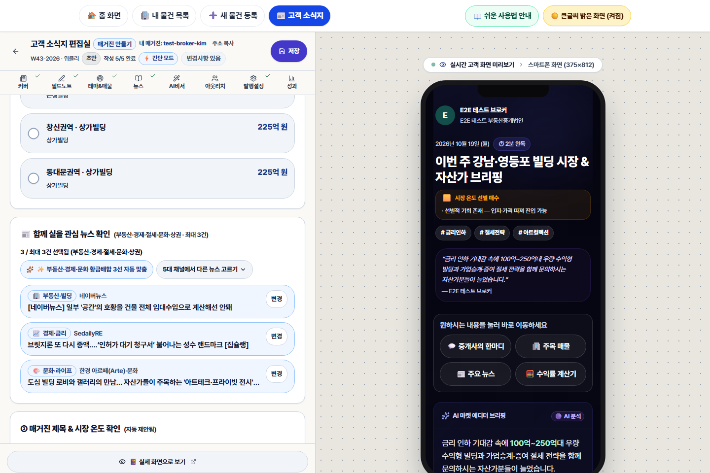

# 제7장. 주간 고객 소식지(모바일 매거진) — 5분 간단 모드 & 8단계 상세 편집 완전정복

> **소요 시간**: 약 5분 | **관련 화면**: `/broker/magazine-editor?mode=simple` (📰 고객 소식지 편집실 열기)
> 매주 건물주·매수 고객에게 안부 인사와 추천 매물, 부동산 뉴스, 세금 계산기를 담은 품격 있는 '모바일 부동산 소식지'를 5분 만에 만들어 보내는 방법과, 필요시 8단계 상세 탭을 세밀하게 편집하는 방법입니다.

## 🎯 이 장에서 꼭 기억하실 핵심 포인트

- **기본으로 열리는 [⚡ 간단 모드 (5분 완성)]에서는 ① 이번 주 한마디 → ② 소개할 매물 체크(최대 3건) & 5대 관심 채널 뉴스 3선 확인(✨ 황금배합 자동 맞춤) → ③ 제목·시장 온도 확인 후 [🚀 발행하기]만 누르면 끝납니다!**
- **부동산 기사만 실으면 딱딱해지기 쉬우므로, 🏢 부동산·빌딩뿐 아니라 📈 경제·금리·금융, ⚖️ 절세·상속·자산관리, 🎨 문화·예술·라이프(전시·건축·골프·웰니스), ☕ 상권·트렌드·교양까지 5대 매수자 관심 채널에서 최신 콘텐츠를 받아 골라 실을 수 있습니다.**
- **커버 사진, 금주의 테마, 5대 채널 실시간 뉴스 수집·키워드 검색·직접 기사 추가(최대 6건), 세무 클리닉, 발행 통계를 더 세밀하게 다루고 싶으실 때는 상단 [🛠️ 상세 편집 (8단계)] 알약 탭을 눌러 언제든 전환하실 수 있습니다.**

> 🎬 **따라하기 동영상**: [🎬 [따라하기 영상 5] 5분 간단 모드로 이번 주 고객 소식지 작성 · 미리보기 · 발행하기](./videos/video-05-weekly-magazine.webm)

---

## [7-1단계] [5분 간단 모드] ① 이번 주 한마디 작성하기 (시작 문장 추천 칩 3종 활용)


*▲ [화면 안내] 고객 소식지 5분 간단 모드 — ① 한마디 시작 문장 추천 버튼, ② 이번 주 한마디 입력창, ③ 우측 아이폰 14 Pro 실시간 미리보기*

1. **👆 어디를 누르거나 입력하나요?**
   상단 메뉴바 [📰 고객 소식지]를 눌러 편집실을 연 뒤, 왼쪽 [① 이번 주 한마디] 영역에서 시작 문장 추천 버튼([📞 이번 주 문의 분위기], [👀 요즘 매수자 관심사], [🏢 건물주분들께 한마디]) 중 하나를 누르거나 직접 1~3문장을 입력합니다.

2. **✅ 화면에서 무엇이 바뀌나요?**
   추천 버튼을 누르면 파란색으로 활성화되며 자연스러운 첫 문장이 입력창에 자동으로 들어갑니다. 10자 이상 적으시면 2초 뒤 AI가 그 글을 바탕으로 소식지 제목과 3줄 요약을 자동으로 만들어 채워주며, 오른쪽 아이폰 14 Pro 미리보기 화면에 실시간으로 반영됩니다.

3. **💡 왜 이 기능이 중요한가요? (중개 실무 포인트)**
   글쓰기가 부담스러우신 날에도 시작 문장 버튼 한두 개만 누르시면 훌륭한 주간 시장 인사말이 완성됩니다.

5. **📋 바로 복사해서 따라 해보는 실전 문구 예시 (이번 주 한마디 실전 예시 복사하기)**
   ```text
   이번 주 영등포·당산 권역 현장에서는 금리 인하 기대감으로 100억~250억대 역세권 우량 수익형 빌딩을 찾는 법인 및 자산가분들의 실수요 매수 문의가 꾸준히 이어지고 있습니다. 특히 공실 위험이 적은 메디컬·스타벅스 입점 빌딩에 관심이 집중되는 한 주입니다.
   ```

---

## [7-2단계] [5분 간단 모드] ② 소개할 매물 체크 & 5대 관심 채널 뉴스 3선(부동산·경제·절세·문화·상권) 확인 후 [🚀 발행하기]


*▲ [화면 안내] ② 추천 매물 선택 및 5대 관심 채널(부동산·경제·절세·문화·상권) 뉴스 3선 큐레이션 · ③ 시장 온도 선택 및 발행하기*

1. **👆 어디를 누르거나 입력하나요?**
   아래로 내려 [② 소개할 매물 확인]에서 이번 주 소식지에 실을 내 물건(최대 3건)을 체크하고, 바로 아래 [📰 함께 실을 관심 뉴스 확인]에서 [✨ 부동산·경제·문화 황금배합 3선 자동 맞춤]을 누르거나 [5대 채널에서 다른 뉴스 고르기]를 펼쳐 기사를 고른 뒤, [③ 매거진 제목 & 현장 시장 온도]에서 온도를 선택하고 [🚀 이번 주 매거진 발행하기]를 누릅니다.

2. **✅ 화면에서 무엇이 바뀌나요?**
   • [매물 체크]: 매물 카드를 누를 때마다 우측 아이폰 미리보기의 '주목 매물 하이라이트'에 즉시 추가됩니다.
   • [5대 관심 채널 뉴스 큐레이션]: 깜깜이 자동 포함이 아니라 현재 선택된 3건의 기사 제목과 채널 배지(🏢 부동산·빌딩 / 📈 경제·금리 / ⚖️ 절세·상속 / 🎨 문화·라이프 / ☕ 상권·트렌드)를 눈으로 직접 확인하고, 버튼 하나로 '부동산 1 + 경제·절세 1 + 문화·라이프 1' 황금배합으로 맞추거나 다른 기사로 교체할 수 있습니다.

3. **💡 왜 이 기능이 중요한가요? (중개 실무 포인트)**
   50~70대 건물주·자산가 고객은 매물 정보뿐 아니라 금리·상속·증여 절세 전략이나 미술 전시·건축·웰니스 같은 품격 있는 교양 읽을거리가 함께 실려 있을 때 소식지를 끝까지 읽고 주변 지인에게도 전달합니다.

---

## [7-3단계] [8단계 상세 편집 모드] 5대 관심 채널 실시간 뉴스 수집 · 키워드 검색 · 직접 기사 추가(최대 6건) 및 세부 편집

![상세 편집(8단계) 모드의 [뉴스] 탭 — ① 5대 매수자 관심 분류 채널 탭(부동산·경제·절세·문화·상권), ② ✨ 황금배합 자동 선별 및 채널 구성 바, ③ 최신 뉴스 불러오기 · 직접 기사 추가](./images/step-07-magazine-news-channels.png)
*▲ [화면 안내] 상세 편집(8단계) 모드의 [뉴스] 탭 — ① 5대 매수자 관심 분류 채널 탭(부동산·경제·절세·문화·상권), ② ✨ 황금배합 자동 선별 및 채널 구성 바, ③ 최신 뉴스 불러오기 · 직접 기사 추가*

1. **👆 어디를 누르거나 입력하나요?**
   소식지의 세부 항목까지 직접 다듬고 싶으실 때는, 왼쪽 상단 모드 선택 바에서 오른쪽 [🛠️ 상세 편집 (8단계)] 버튼을 클릭하거나 그 위 8개 탭([커버], [필드노트], [테마&매물], [뉴스], [AI비서], [아웃리치], [발행설정], [성과]) 중 원하는 탭을 클릭합니다.

2. **✅ 화면에서 무엇이 바뀌나요?**
   슬라이딩 알약 표시가 [🛠️ 상세 편집 (8단계)]로 이동하면서 8개 전문 편집 탭이 열립니다.
   • [뉴스 탭 — 5대 매수자 관심 채널 큐레이션]: 🗂️ 전체 · 🏢 부동산·빌딩 · 📈 경제·금리 · ⚖️ 절세·상속 · 🎨 문화·라이프 · ☕ 상권·트렌드 6개 탭으로 분류된 기사를 살펴보고, [✨ 매수자 관심 황금배합 자동 선별]로 5대 채널 균형 배합(최대 6건)을 1초 만에 완성할 수 있습니다. 또한 추천 키워드 칩 검색, [최신 뉴스 불러오기(실시간 RSS·뉴스 피드)], [직접 기사 추가(인상 깊게 읽은 칼럼·전시 소식 직접 입력)], [원문 확인 ↗]까지 모두 지원합니다.
   • [커버 / 필드노트 / 테마&매물]: 표지 배경 이미지·헤드라인, 현장 질문·매수/매도자 반응, 이번 주 집중 테마 글을 세밀하게 작성합니다.

3. **💡 왜 이 기능이 중요한가요? (중개 실무 포인트)**
   평소에는 [⚡ 간단 모드 (5분 완성)]로 빠르게 쓰시다가, 특별한 기획호나 분기별 리포트를 내실 때는 [🛠️ 상세 편집]으로 깊이 있게 꾸미실 수 있습니다.

---

## [7-4단계] [8단계 상세 편집 모드] [발행설정] & [성과] 탭에서 발송 대상 선택 및 열람 통계 확인하기

![상세 편집 모드의 [발행설정] 탭 — 섹션별 포함 여부 스위치, 독자 타깃 설정 및 발행 관리](./images/step-07-magazine-full-publish-analytics.png)
*▲ [화면 안내] 상세 편집 모드의 [발행설정] 탭 — 섹션별 포함 여부 스위치, 독자 타깃 설정 및 발행 관리*

1. **👆 어디를 누르거나 입력하나요?**
   상단 8개 탭 중 [발행설정] 또는 [성과] 탭을 클릭합니다.

2. **✅ 화면에서 무엇이 바뀌나요?**
   • [발행설정]: 소식지에 포함할 섹션(브리핑, 현장노트, 주목 매물, 시장 데이터, 뉴스, 수익률 계산기, 세무 클리닉, 투표 등)을 스위치로 켜고 끌 수 있으며, 발송 대상(전체 고객 / 매수 희망 고객 / 건물주·매도 고객)을 맞춤 설정할 수 있습니다.
   • [성과]: 발행한 소식지를 몇 명의 고객이 읽었는지, 어떤 매물을 가장 많이 클릭했는지 통계를 보여줍니다.

3. **💡 왜 이 기능이 중요한가요? (중개 실무 포인트)**
   단순히 소식지를 보내는 데 그치지 않고, 어떤 고객이 어느 매물에 관심을 보였는지 데이터로 확인해 영업에 활용하실 수 있습니다.

---

## [7-5단계] 고객이 스마트폰에서 읽어보는 실제 모바일 소식지 리더 화면 확인하기


*▲ [화면 안내] 고객이 카카오톡 링크나 이메일로 열어본 주간 모바일 부동산 소식지(매거진) 실제 화면*

1. **👆 어디를 누르거나 입력하나요?**
   편집실 왼쪽 아래 [👁️ 📱 실제 화면으로 보기 ↗] 버튼을 누르거나 카카오톡으로 공유된 소식지 링크를 열어봅니다.

2. **✅ 화면에서 무엇이 바뀌나요?**
   어두운 네이비 톤의 고급스러운 모바일 매거진 화면에 대표님의 사진과 인사말, 현장 시장 온도, 빠른 이동 버튼(💬 중개사의 한마디 · 🏢 주목 매물 · 📰 주요 뉴스 · 🧮 수익률 계산기), AI 마켓 브리핑이 잡지처럼 펼쳐집니다.

3. **💡 왜 이 기능이 중요한가요? (중개 실무 포인트)**
   매주 월요일이나 화요일 아침에 이 소식지 링크를 단골 건물주·매수 고객 카톡방에 보내드리면, 물건 의뢰와 매수 문의가 자연스럽게 대표님께 모이게 됩니다.
