# 📖 60대 대표공인중개사를 위한 크리딜(CRE DealCard) 전 기능 완전정복 큰글씨 매뉴얼

> **버전**: 2026.10 상용화 골든 에디션 (고대비 따뜻한 종이 주간 모드 · 큰글씨 표준 적용)
> **실전 따라하기 예시 매물**:
> - **예시 A (다필지 수익형)**: 서울특별시 영등포구 양평동4가 117, 134, 125-2번지 (더레드빌딩 · 매각가 250억 · 3필지 대지 157평 / 연면적 753.5평 · B1~10F · 1층 스타벅스 입점)
> - **예시 B (일반 수익형·통합계약)**: 서울특별시 영등포구 당산동5가 11-47 (호산당빌딩 · 매각가 115억 · 대지 153.3평 / 연면적 307.9평 · B1~5F · 1층 약국 및 1~2층 내과 통합계약)
> - **웹 내장 대화형 안내서 주소**: 프로그램 상단 바 **`[📖 쉬운 사용법 안내]`** 버튼 (`/broker/tutorial`)
> - **인쇄용 큰글씨 PDF 매뉴얼**: [`CREDEAL_60대_중개인_큰글씨_매뉴얼.pdf`](./CREDEAL_60대_중개인_큰글씨_매뉴얼.pdf)

---

## 📚 목차 (단원별 바로가기)

- [제0장. 시작하기 — 상단 메뉴바와 눈이 편안한 '큰글씨 밝은 화면' 사용법](./00-시작하기-화면조절.md)
- [제1장. 홈 화면(대시보드) 100% 활용하기](./01-홈화면-100퍼센트-활용.md)
- [제2장. 메모로 새 물건 등록 — 1분 딜카드 만들기](./02-메모로-1분-딜카드-등록.md)
- [제3장. 딜카드 확인 · 문구 직접 다듬기 · 카카오톡으로 보내기](./03-딜카드-다듬기-카톡공유.md)
- [제4장. 기본 IM(맞춤형 PPTX 투자설명서) 만들기 — 다필지·수익률·렌트롤 완벽 지원](./04-기본IM-맞춤형-PPTX-만들기.md)
- [제5장. IM 완성 확인 · 문구/사진 다듬기 · PPTX 제안서 파일 받기](./05-IM완성확인-PPTX받기-웹화면.md)
- [제6장. 내 물건 목록(딜카드 & IM 보관함) 검색 · 다시 열기 · 삭제하기](./06-내물건-보관함-관리.md)
- [제7장. 주간 고객 소식지(모바일 매거진) 5분 간편 발행 및 발송하기](./07-주간-고객소식지-5분발행.md)
- [제8장. 고객 · 구독자 명단 등록 및 고객 문의함(열람 알림) 확인하기](./08-고객명단-문의함-열람알림.md)
- [제9장. 내 프로필 · 중개사무소 설정 완전 정복 (어디에 어떻게 인쇄되나요?)](./09-내프로필-명함설정-완전정복.md)
- [제10장. 당황하지 않는 문제 해결(FAQ 15선) & 쉬운 부동산 디지털 용어 사전](./10-문제해결-FAQ15-용어사전.md)
- [부록 A. 5대 투자 목적(포스처)별 추천 매물 · 필수 입력값 · 자동 생성 슬라이드 비교표](./부록A-5대투자목적별-맞춤가이드.md)
- [부록 B. 모니터 옆에 붙여두는 A4 1장 큰글씨 요약표 (Cheat Sheet)](./부록B-A4-한장-큰글씨-요약표.md)

---

## 제0장. 시작하기 — 상단 메뉴바와 눈이 편안한 '큰글씨 밝은 화면' 사용법

> **소요 시간**: 약 2분 | **관련 화면**: `/broker` (🏠 홈 화면 열기)
> 어두운 화면이 침침하실 때 단 한 번의 클릭으로 종이 제안서처럼 밝고 선명한 화면으로 바꾸는 방법과, 어디서든 길을 잃지 않는 상단·하단 메뉴바를 안내해 드립니다.

### 🎯 이 장에서 꼭 기억하실 핵심 포인트

- **화면 맨 위 고정 메뉴바(홈 · 내 물건 · 새 물건 등록 · 고객 소식지)로 언제든 한 번에 이동합니다.**
- **우측 상단 [☀️ 큰글씨 밝은 화면] 버튼을 누르면 침침한 검은 배경이 선명한 흰 종이 화면으로 바뀝니다.**
- **글씨가 더 크게 보고 싶으실 때는 키보드 [Ctrl] 키를 누른 채 마우스 바퀴(휠)를 위로 굴리시면 화면 전체가 확대됩니다.**

> 🎬 **따라하기 동영상**: [🎬 [따라하기 영상 1] 상단 메뉴바 · 큰글씨 밝은 화면 전환 · 홈 화면 둘러보기](./videos/video-01-home-and-theme.webm)

---

### [0-1단계] 상단 고정 메뉴바와 [☀️ 큰글씨 밝은 화면] 확인하기

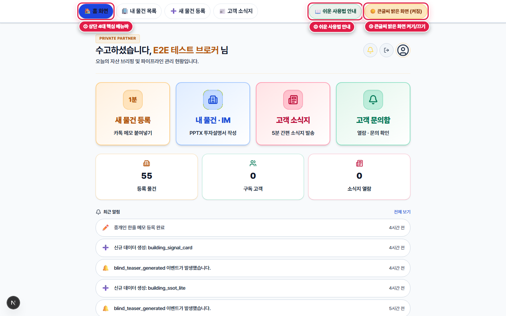
*▲ [화면 안내] 상단 고정 메뉴바(① 좌측 4대 핵심 메뉴, ② 사용법 안내, ③ 큰글씨 밝은 화면 전환 버튼)*

1. **👆 어디를 누르거나 입력하나요?**
   화면 맨 위쪽(상단 바) 왼쪽의 4개 메뉴 버튼(🏠 홈 화면, 🏢 내 물건 목록, ➕ 새 물건 등록, 📰 고객 소식지)과 오른쪽 끝의 노란색 [☀️ 큰글씨 밝은 화면 (켜짐)] 버튼을 확인합니다.

2. **✅ 화면에서 무엇이 바뀌나요?**
   기본으로 눈부심과 빛번짐(Halation)을 막아주는 '따뜻한 종이색 밝은 화면'이 켜져 있어 작은 숫자도 또렷하게 보입니다. 만약 밤에 어두운 화면을 원하시면 이 버튼을 한 번 눌러 전환하실 수 있고, 내 컴퓨터가 선택한 모드를 자동으로 기억합니다.

3. **💡 왜 이 기능이 중요한가요? (중개 실무 포인트)**
   작업 도중 어느 화면에 들어가 계시더라도 맨 위 [🏠 홈 화면]이나 [🏢 내 물건 목록] 버튼만 누르시면 처음 자리로 안전하게 돌아오실 수 있습니다.

   > 📌 **따라하기 꿀팁**: 키보드 왼쪽 아래 [Ctrl] 키를 누른 상태에서 마우스 가운데 바퀴(휠)를 위로 올리시면 화면 글씨가 125%, 150%로 시원하게 커집니다.

---

### [0-2단계] 화면 아래쪽 [더보기] 메뉴로 고객 명단·내 프로필 열기

![하단 바 오른쪽 끝 [더보기] 버튼을 눌렀을 때 열리는 전체 메뉴 화면](./images/step-00-bottom-nav-and-more.png)
*▲ [화면 안내] 하단 바 오른쪽 끝 [더보기] 버튼을 눌렀을 때 열리는 전체 메뉴 화면*

1. **👆 어디를 누르거나 입력하나요?**
   화면 아래쪽 탐색 바의 오른쪽 끝에 있는 [⋯ 더보기] 버튼을 마우스로 클릭합니다.

2. **✅ 화면에서 무엇이 바뀌나요?**
   화면 아래에서 전체 메뉴 서랍이 부드럽게 올라오면서 ① 주간 소식지(매거진) 만들기, ② 고객·구독자 명단, ③ 내 프로필·사무소 정보, ④ 쉬운 이용 안내 메뉴가 큰 글씨로 나타납니다.

3. **💡 왜 이 기능이 중요한가요? (중개 실무 포인트)**
   평소 자주 쓰는 4가지 기능은 상단·하단 바에 바로 나와 있고, 고객 명단 관리나 내 명함(프로필) 수정이 필요하실 때만 [더보기]를 눌러 들어가시면 됩니다.

---

## 제1장. 홈 화면(대시보드) 100% 활용하기

> **소요 시간**: 약 2분 | **관련 화면**: `/broker` (🏠 홈 화면 바로가기)
> 로그인 후 가장 먼저 보이는 홈 화면에서 오늘 해야 할 중개 업무 4가지로 바로 이동하고, 내 물건·고객 현황과 알림을 확인하는 방법입니다.

### 🎯 이 장에서 꼭 기억하실 핵심 포인트

- **상단 4개의 큼직한 색깔 카드로 (1) 새 물건 등록, (2) 내 물건·IM, (3) 고객 소식지, (4) 고객 문의함에 즉시 들어갑니다.**
- **가운데 3칸 숫자판에서 현재 등록된 물건 수, 소식지 구독 고객 수, 이달 소식지 열람 횟수를 한눈에 봅니다.**
- **아래쪽에서는 고객이 내 제안서를 열어본 알림과 주간 시장 브리핑을 확인할 수 있습니다.**

> 🎬 **따라하기 동영상**: [🎬 [따라하기 영상 1] 홈 화면 4대 바로가기 카드와 알림·브리핑 확인하기](./videos/video-01-home-and-theme.webm)

---

### [1-1단계] 4대 핵심 업무 바로가기 카드와 3대 현황 숫자 확인하기

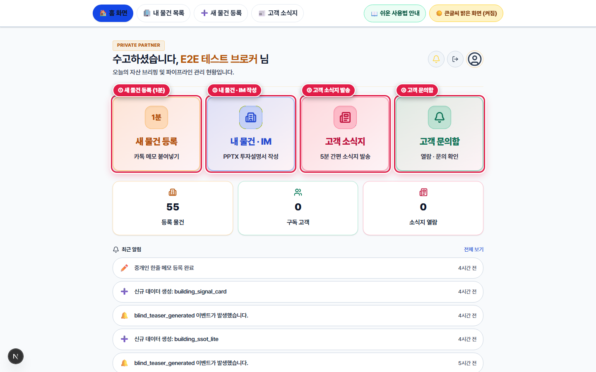
*▲ [화면 안내] 홈 화면 상단 ① 4대 핵심 업무 대형 바로가기 카드와 ② 3대 핵심 현황 숫자판*

1. **👆 어디를 누르거나 입력하나요?**
   홈 화면 인사말 바로 아래에 나란히 배치된 4개의 큰 네모 카드([새 물건 등록], [내 물건 · IM], [고객 소식지], [고객 문의함]) 중 원하시는 업무 카드를 클릭합니다.

2. **✅ 화면에서 무엇이 바뀌나요?**
   복잡한 메뉴를 찾을 필요 없이 원하는 작업 화면으로 바로 이동합니다. 그 아래 [등록 물건 / 구독 고객 / 소식지 열람] 숫자 카드를 눌러도 해당 목록 화면으로 바로 연결됩니다.

3. **💡 왜 이 기능이 중요한가요? (중개 실무 포인트)**
   출근 후 컴퓨터를 켜셨을 때 이 4개의 큰 버튼만 기억하시면 크리딜의 모든 기능을 막힘없이 쓰실 수 있습니다.

---

### [1-2단계] 최근 알림 확인 및 [📊 시장 브리핑 · 주간 리포트 더보기] 펼쳐보기

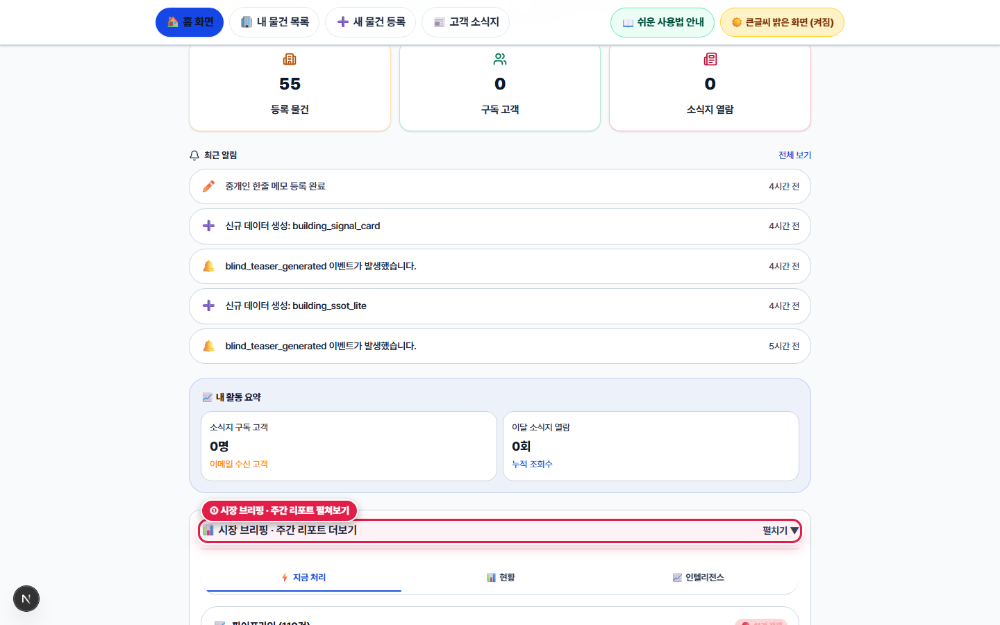
*▲ [화면 안내] 홈 화면 하단 ① 최근 알림 피드, ② 내 활동 요약, ③ 시장 브리핑 펼쳐보기*

1. **👆 어디를 누르거나 입력하나요?**
   홈 화면 아래쪽의 [🔔 최근 알림] 목록을 확인하거나, 맨 아래 [📊 시장 브리핑 · 주간 리포트 더보기 (펼치기 ▼)] 막대를 클릭합니다.

2. **✅ 화면에서 무엇이 바뀌나요?**
   고객이 내 투자설명서(IM)를 열어보았거나 반복해서 본 경우(🔥 관심 높은 고객 감지) 알림에 표시되며, 클릭하면 상세 내역으로 이동합니다. [시장 브리핑 더보기]를 누르면 접혀 있던 권역별 시장 동향과 주간 리포트가 펼쳐집니다.

3. **💡 왜 이 기능이 중요한가요? (중개 실무 포인트)**
   평소에는 화면을 깔끔하게 유지해 눈의 피로를 줄이고, 시장 동향 자료가 필요하실 때만 눌러서 확인하실 수 있도록 설계되어 있습니다.

---

## 제2장. 메모로 새 물건 등록 — 1분 딜카드 만들기

> **소요 시간**: 약 1분 | **관련 화면**: `/broker/deal-card/new` (➕ 새 물건 등록 화면 열기)
> 복잡한 표를 일일이 채울 필요 없이, 카카오톡이나 수첩에 적어두신 매물 메모를 그대로 복사해 붙여넣기만 하면 AI가 주소·가격·면적을 자동으로 읽어 모바일 딜카드를 만들어 드립니다.

### 🎯 이 장에서 꼭 기억하실 핵심 포인트

- **카카오톡으로 받은 물건 내역이나 직접 적은 3~5줄 메모를 큰 입력창에 그대로 붙여넣습니다.**
- **처음 연습해 보실 때는 입력창 아래 [오피스 예시], [상가 예시], [건물 통매각 예시] 버튼을 눌러 체험해 보실 수 있습니다.**
- **우측 하단 파란색 [1분 딜카드 만들기] 버튼을 누르면 정부 공적장부(토지·건축물대장)와 연결된 딜카드가 즉시 생성됩니다.**

> 🎬 **따라하기 동영상**: [🎬 [따라하기 영상 2] 카톡 메모 붙여넣기로 1분 만에 딜카드 만들고 다듬기](./videos/video-02-memo-to-dealcard.webm)

---

### [2-1단계] 새 물건 등록 화면 열기 및 예시 버튼 살펴보기

*▲ [화면 안내] 새 물건 등록 화면(① 큰 메모 입력창, ② 클릭 한 번으로 채워지는 3종 예시 버튼)*

1. **👆 어디를 누르거나 입력하나요?**
   상단 메뉴바의 [➕ 새 물건 등록] 또는 홈 화면 첫 번째 [새 물건 등록 (1분)] 카드를 클릭합니다.

2. **✅ 화면에서 무엇이 바뀌나요?**
   '한줄 메모 → 딜카드 생성' 화면이 열립니다. 아직 입력할 메모가 준비되지 않으셨다면 입력창 아래의 [오피스 예시], [상가 예시], [건물 통매각 예시] 버튼 중 하나를 눌러보세요. 예시 문구가 자동으로 채워집니다.

3. **💡 왜 이 기능이 중요한가요? (중개 실무 포인트)**
   정해진 양식 없이 평소 쓰시는 중개 메모 그대로 넣으셔도 작동한다는 점을 바로 체험해 보실 수 있습니다.

---

### [2-2단계] 매물 메모 입력 후 [1분 딜카드 만들기] 버튼 누르기

![양평동 수익형 빌딩 메모를 입력하고 우측 하단 [1분 딜카드 만들기] 버튼을 누르는 모습](./images/step-02-dealcard-new-filled.png)
*▲ [화면 안내] 양평동 수익형 빌딩 메모를 입력하고 우측 하단 [1분 딜카드 만들기] 버튼을 누르는 모습*

1. **👆 어디를 누르거나 입력하나요?**
   큰 네모 입력창에 매물 메모(예: '양평동4가 117 더레드빌딩 매각 / 매각가 250억 / 대지 157평 / 준공업지역, 2018년 신축 B1~10F / 선유도역 도보 1분')를 입력하거나 붙여넣은 뒤, 오른쪽 아래 파란색 [1분 딜카드 만들기] 버튼을 클릭합니다.

2. **✅ 화면에서 무엇이 바뀌나요?**
   약 3~5초 동안 AI가 메모에서 지번 주소, 매각 희망가, 대지·연면적, 층수, 역세권 강점을 자동으로 분석하여 깔끔하게 정리된 '1분 딜카드' 화면으로 이동합니다.

3. **💡 왜 이 기능이 중요한가요? (중개 실무 포인트)**
   주소(동·번지)와 매매가 두 가지만 정확히 적어주시면 나머지 대지면적, 연면적, 용도지역, 준공연도는 다음 단계에서 정부 건축물대장·토지대장에서 자동으로 불러올 수 있습니다.

   > 📌 **따라하기 꿀팁**: 복사/붙여넣기 단축키: 카카오톡에서 글을 마우스로 긁은 뒤 [Ctrl + C]를 누르고, 크리딜 메모창을 클릭한 뒤 [Ctrl + V]를 누르시면 그대로 붙여넣어집니다.

---

## 제3장. 딜카드 확인 · 문구 직접 다듬기 · 카카오톡으로 보내기

> **소요 시간**: 약 2분 | **관련 화면**: `/broker/buildings` (🏢 내 딜카드 목록 열기)
> 방금 만들어진 1분 딜카드의 제목과 핵심 강점을 대표님의 표현으로 손쉽게 고치고, 카카오톡이나 문자메시지로 매수 고객에게 멋지게 보내는 방법입니다.

### 🎯 이 장에서 꼭 기억하실 핵심 포인트

- **화면 한가운데에 고객에게 보일 딜카드 모양이 그대로 표시됩니다.**
- **[✏️ 딜카드 제목 · 카톡 공유 문구 직접 다듬기] 버튼을 누르면 제목, 3대 강점, 카톡 소개글을 자유롭게 고칠 수 있습니다.**
- **상단에서는 상세 번지(예: 117번지) 대신 '영등포구 양평동4가 역세권'처럼 권역만 표시되어 물건 주소 유출(타 중개사 가로채기)을 막아줍니다.**

> 🎬 **따라하기 동영상**: [🎬 [따라하기 영상 2] 딜카드 문구 직접 수정하고 카카오톡으로 공유하기](./videos/video-02-memo-to-dealcard.webm)

---

### [3-1단계] 완성된 딜카드 확인하기

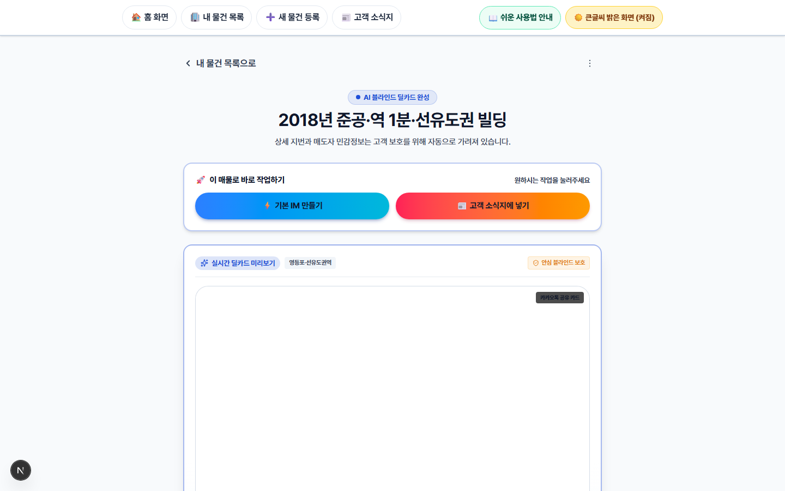
*▲ [화면 안내] 완성된 1분 딜카드 상세 화면(① 다음 단계 안내 배너, ② 딜카드 실시간 미리보기, ③ 문구 다듬기 버튼)*

1. **👆 어디를 누르거나 입력하나요?**
   딜카드 생성이 끝나면 자동으로 열리는 상세 화면에서 권역명, 매각 희망가, 면적, 주요 강점 3가지를 눈으로 확인합니다.

2. **✅ 화면에서 무엇이 바뀌나요?**
   맨 위 파란 안내상자에 '현재 딜카드 완성 — 바로 카톡 공유가 가능합니다'라고 안내되며, 아래에 깔끔하게 디자인된 딜카드 미리보기가 나타납니다.

3. **💡 왜 이 기능이 중요한가요? (중개 실무 포인트)**
   상업용 빌딩 중개에서는 매수 의향이 확인되기 전까지 정확한 지번을 가리는 것(블라인드 티저)이 중요합니다. 딜카드는 자동으로 동·역세권까지만 안전하게 노출합니다.

---

### [3-2단계] [✏️ 딜카드 제목 · 카톡 공유 문구 직접 다듬기] 열어 수정하기

![딜카드 제목 · 3대 강점 · 카톡 공유 문구를 직접 고치고 [변경사항 저장하기]를 누르는 화면](./images/step-03-dealcard-editor-open.png)
*▲ [화면 안내] 딜카드 제목 · 3대 강점 · 카톡 공유 문구를 직접 고치고 [변경사항 저장하기]를 누르는 화면*

1. **👆 어디를 누르거나 입력하나요?**
   딜카드 바로 아래에 있는 큼직한 [✏️ 딜카드 제목 · 카톡 공유 문구 직접 다듬기 (펼치기 ▼)] 버튼을 클릭합니다.

2. **✅ 화면에서 무엇이 바뀌나요?**
   수정 상자가 열리면서 ① 딜카드 상단 제목(권역/건물 소개), ② 핵심 투자 강점 3가지(한 줄에 하나씩), ③ 카카오톡 공유 설명 문구를 직접 고칠 수 있는 큰 입력창이 나타납니다. 원하는 대로 고치신 후 파란색 [변경사항 저장하기] 버튼을 누르면 위쪽 딜카드와 카카오톡 공유 카드에 즉시 반영됩니다.

3. **💡 왜 이 기능이 중요한가요? (중개 실무 포인트)**
   AI가 자동으로 만든 문구 중 마음에 들지 않는 단어(예: '기타', 어색한 약어)가 있더라도 대표님께서 현장에서 쓰시는 정확한 표현으로 10초 만에 고치실 수 있습니다.

---

### [3-3단계] 카카오톡 공유 · 링크 복사 · 고객 소식지에 바로 넣기

![① 카톡 공유 · 링크 복사 · 수신자 화면 버튼, ② 고객 소식지에 바로 넣기, ③ 하단 [⚡ 기본 IM 만들기] 버튼](./images/step-03-dealcard-actions-bar.png)
*▲ [화면 안내] ① 카톡 공유 · 링크 복사 · 수신자 화면 버튼, ② 고객 소식지에 바로 넣기, ③ 하단 [⚡ 기본 IM 만들기] 버튼*

1. **👆 어디를 누르거나 입력하나요?**
   문구 수정 버튼 아래의 3개 버튼([카톡 공유], [링크 복사], [수신자 화면]) 또는 그 아래 보라색 [📰 이 매물을 주간 고객 소식지(매거진)에 바로 넣기] 버튼을 클릭합니다.

2. **✅ 화면에서 무엇이 바뀌나요?**
   • [카톡 공유]: 카카오톡 공유 창이 열려 원하는 고객에게 사진 카드 형태로 바로 전송합니다.
   • [링크 복사]: 인터넷 주소가 복사되어 컴퓨터 카카오톡 대화창에 붙여넣기(Ctrl+V)만 하면 깔끔한 매물 카드가 뜹니다.
   • [수신자 화면]: 고객이 휴대폰에서 링크를 눌렀을 때 어떻게 보이는지 새 창으로 미리 확인합니다.

3. **💡 왜 이 기능이 중요한가요? (중개 실무 포인트)**
   긴 글자로만 보내던 매물 정보를 깔끔한 그래픽 카드로 보내면 건물주와 매수 고객의 열람률이 눈에 띄게 높아집니다.

---

### [3-4단계] 고객이 스마트폰에서 받아보는 '수신자 화면' 확인하기

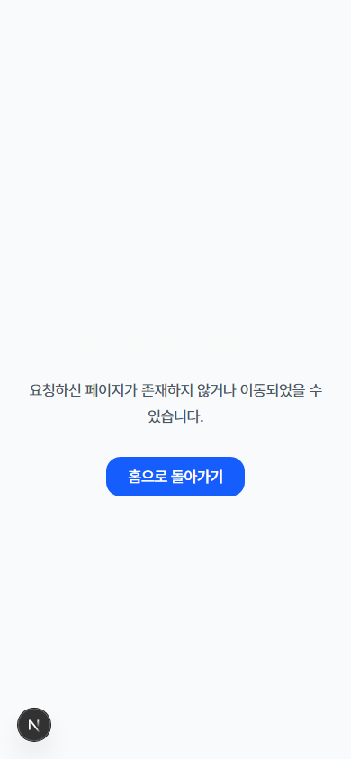
*▲ [화면 안내] 매수 고객이 카카오톡에서 링크를 눌렀을 때 스마트폰에 열리는 공개 딜카드 화면*

1. **👆 어디를 누르거나 입력하나요?**
   [수신자 화면] 버튼을 눌러 매수 고객의 스마트폰 화면에 딜카드가 어떻게 보이는지 확인합니다.

2. **✅ 화면에서 무엇이 바뀌나요?**
   고객 화면에는 매물 핵심 제원과 투자 포인트, 그리고 하단에 대표님의 이름·소속·전화걸기 버튼이 명함처럼 함께 표시됩니다.

3. **💡 왜 이 기능이 중요한가요? (중개 실무 포인트)**
   고객이 카드를 읽고 바로 [전화 문의]나 [상세 자료(IM) 요청]을 누를 수 있어 즉각적인 상담 연결이 이루어집니다.

---

## 제4장. 기본 IM(맞춤형 PPTX 투자설명서) 만들기 — 다필지·수익률·렌트롤 완벽 지원

> **소요 시간**: 약 3분 | **관련 화면**: `/broker/buildings` (🏢 내 물건에서 IM 만들기)
> 딜카드 화면 하단의 [⚡ 기본 IM 만들기] 버튼만 누르면 정부 토지·건축물대장, V-World 연속지적도, 10년 공시지가, 실거래 사례를 자동으로 모아 8~12장 분량의 고품질 파워포인트(PPTX) 제안서를 만들어 드립니다.

### 🎯 이 장에서 꼭 기억하실 핵심 포인트

- **① 투자 목적(임대수익 · 자가사용 · 신축/리모델링 등)을 고르면 그 목적에 꼭 맞는 입력칸과 슬라이드 구성이 자동으로 준비됩니다.**
- **② 주소를 검색하면 토지·건축물대장이 자동 연결되며, '양평동4가 117 외 2필지(134, 125-2)' 같은 다필지 합산도 손쉽게 처리됩니다.**
- **③ 매각가(+100억/+10억/+1억 버튼), 층별 임대현황(또는 엑셀 파일 업로드), 매물 사진을 넣고 [⚡ IM 생성]을 누르면 약 45초 만에 완성됩니다.**

> 🎬 **따라하기 동영상**: [🎬 [따라하기 영상 3] 양평동 다필지 수익형 빌딩(250억) 기본 IM 만들기 전 과정](./videos/video-03-basic-im-generation.webm)

---

### [4-1단계] [⚡ 기본 IM 만들기] 클릭 후 ① 투자 목적 선택 & ② 주소·다필지 대장 연결

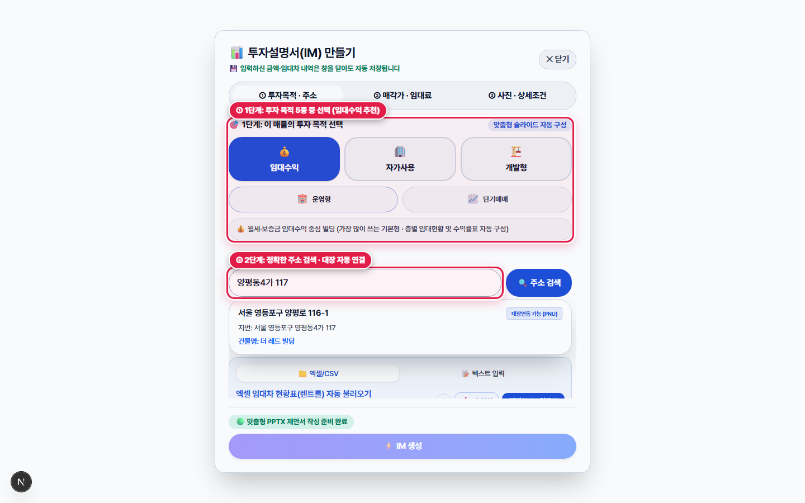
*▲ [화면 안내] 기본 IM 입력 시트 상단: ① 투자 목적(임대수익) 선택 및 ② 양평동4가 다필지 주소·건축물대장 자동 연결*

1. **👆 어디를 누르거나 입력하나요?**
   딜카드 상세 화면 맨 아래 노란색 [⚡ 기본 IM 만들기] 버튼을 누른 뒤, 열리는 입력 시트에서 ① 투자 목적([💰 임대수익 (추천)], [🏢 자가사용(사옥)], [🏗️ 신축·리모델링] 중 택1)을 고르고 ② 주소 입력란을 확인합니다.

2. **✅ 화면에서 무엇이 바뀌나요?**
   주소를 입력하고 검색하면 정부 건축물대장·토지대장에서 대지면적, 연면적, 층수, 준공연도, 용도지역을 자동으로 불러옵니다. 특히 영등포구 양평동4가 117번지처럼 여러 필지(117, 134, 125-2번지)로 이루어진 다필지 건물의 경우, 부속 필지가 함께 표시되며 합산 대지면적(518.7㎡, 약 157평)이 자동 계산됩니다.

3. **💡 왜 이 기능이 중요한가요? (중개 실무 포인트)**
   등기부나 건축물대장을 일일이 떼서 손으로 옮겨 적다가 오타가 나는 일을 원천 차단하고, 다필지 지번도 제안서 토지 슬라이드에 깔끔한 번지 표로 자동 수록됩니다.

   > 📌 **따라하기 꿀팁**: 사옥용(자가사용)이나 나대지(신축·리모델링) 물건이라면 맨 위에서 해당 목적을 눌러주세요. 불필요한 임대료 입력창이 사라지고 사옥·개발 전용 입력창으로 바뀝니다(부록 A 참조).

---

### [4-2단계] ③ 매각 희망가 빠른 입력(+10억/+1억) 및 목표 수익률 역산 확인

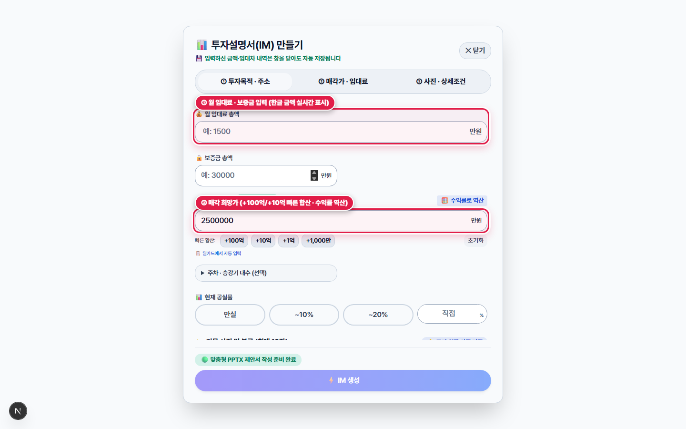
*▲ [화면 안내] 매각 희망가 빠른 금액 버튼(+100억/+10억/+1억)과 보증금·월 임대료 및 목표 수익률 역산 화면*

1. **👆 어디를 누르거나 입력하나요?**
   ③ 매각 희망가 입력칸에 금액(만원 단위)을 입력하거나, 바로 아래에 있는 [+100억], [+10억], [+1억], [초기화] 빠른 합산 버튼을 클릭합니다.

2. **✅ 화면에서 무엇이 바뀌나요?**
   숫자 '0' 개수를 세느라 눈이 피로할 필요 없이 [+100억] 두 번, [+10억] 다섯 번을 누르면 '250억 원 (2,500,000만 원)'이 정확히 입력됩니다. 또한 오른쪽 [목표 수익률 역산(예: 3.5%, 4.0%, 4.5%)] 버튼을 누르면 현재 월세 기준으로 적정 매각가가 얼마인지 즉시 계산해 보여줍니다.

3. **💡 왜 이 기능이 중요한가요? (중개 실무 포인트)**
   100억대 이상 빌딩에서 '0' 하나를 잘못 쳐서 25억이나 2,500억으로 표기되는 치명적인 실수를 완벽히 예방합니다.

---

### [4-3단계] 층별 임대현황(렌트롤) 입력/엑셀 업로드 및 사진 12장 분류 후 [⚡ IM 생성]

![층별 임대현황(렌트롤) 입력표, 사진 ★대표/🏢외관 지정 및 하단 [⚡ IM 생성] 버튼](./images/step-04-bottomsheet-rentroll-photos.png)
*▲ [화면 안내] 층별 임대현황(렌트롤) 입력표, 사진 ★대표/🏢외관 지정 및 하단 [⚡ IM 생성] 버튼*

1. **👆 어디를 누르거나 입력하나요?**
   층별 임대차 현황 표를 확인(또는 [📊 엑셀(xlsx) 렌트롤 업로드] 버튼으로 파일 첨부)하고, 아래 사진 영역에서 건물 사진을 올린 뒤 가장 잘 나온 사진의 [★ 대표]와 [🏢 외관] 버튼을 누르고 맨 아래 노란색 [⚡ IM 생성] 버튼을 클릭합니다.

2. **✅ 화면에서 무엇이 바뀌나요?**
   • 층별 임대현황: 양평동 더레드빌딩(B1 공실, 1F 스타벅스 보증금 7,600만/월세 715만, 2F~10F 우량 임차인)이나 당산동 호산당빌딩(1F 약국·내과 통합계약 등)의 층별 내역이 표로 정리됩니다.
   • 사진 자동 분류: 사진을 여러 장 올리면 AI가 외관·로비·내부·주변을 자동 분류하고, 제안서 표지에 들어갈 [★ 대표] 사진과 물건 개요에 들어갈 [🏢 외관] 사진을 지정할 수 있습니다.
   • [⚡ IM 생성] 클릭 시 6단계 진행 안내와 함께 약 40~50초 만에 제안서가 완성됩니다.

3. **💡 왜 이 기능이 중요한가요? (중개 실무 포인트)**
   1층·2층 통합계약이나 자가사용 층, 공실 층이 섞여 있어도 크리딜 엔진이 중복 합산 없이 현행 수익률(As-Is)과 만실 가정 안정화 수익률(Stabilized)을 정확히 계산해 줍니다.

---

## 제5장. IM 완성 확인 · 문구/사진 다듬기 · PPTX 제안서 파일 받기

> **소요 시간**: 약 2분 | **관련 화면**: `/broker/im-approval/32867a6c-04c0-4ac1-80a0-2242cbc9a1f8` (📄 양평동 IM 완성 화면 열기)
> 생성된 투자설명서(IM)의 4대 필수 항목을 점검하고, 표지 사진이나 핵심 투자 포인트 3가지를 다듬은 뒤 파워포인트(PPTX) 파일로 내려받거나 매수자용 웹 화면 링크로 전달하는 방법입니다.

### 🎯 이 장에서 꼭 기억하실 핵심 포인트

- **상단 '필수 데이터 자동 점검(4항목)'에서 소재지·매각가·대지면적·임대료가 모두 초록색(✅)인지 한눈에 확인합니다.**
- **사진 썸네일 아래 [★ 대표(표지)], [🏢 외관], [🚫 제외] 버튼으로 제안서에 들어갈 사진을 클릭 한 번에 바꿀 수 있습니다.**
- **[📥 PPTX 제안서 파일 받기]를 누르면 내 컴퓨터 '다운로드' 폴더에 파워포인트 파일이 저장되어 인쇄하거나 이메일로 보낼 수 있습니다.**

> 🎬 **따라하기 동영상**: [🎬 [따라하기 영상 3 & 4] IM 완성 화면 점검 · PPTX 다운로드 · 매수자용 웹 제안서 확인](./videos/video-03-basic-im-generation.webm)

---

### [5-1단계] 필수 데이터 4항목 자동 점검 및 매물 사진(대표/외관/제외) 관리하기

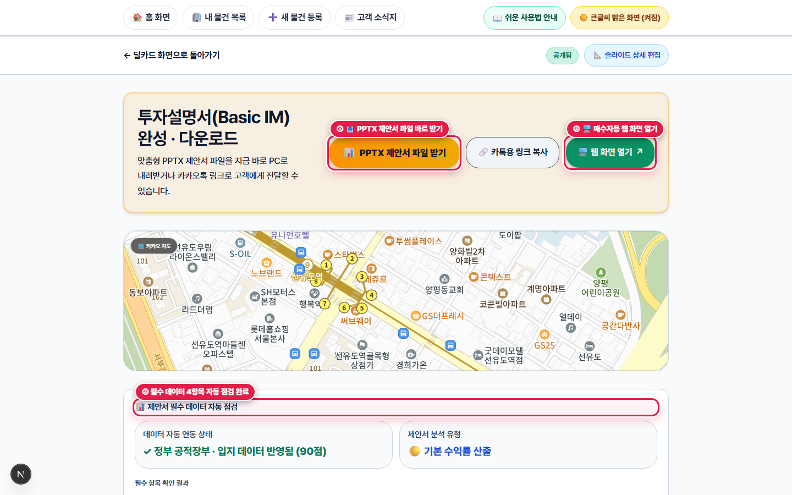
*▲ [화면 안내] IM 완성 확인 화면 상단: ① 4대 필수 데이터 자동 점검 완료, ② 등록된 매물 사진(대표/외관/제외) 관리*

1. **👆 어디를 누르거나 입력하나요?**
   IM 완성 화면(`/broker/im-approval/[id]`) 상단의 [필수 데이터 자동 점검] 박스와 그 아래 [등록된 매물 사진] 목록을 확인합니다.

2. **✅ 화면에서 무엇이 바뀌나요?**
   소재지, 매각 희망가, 대지 면적, 월 임대료(비수익형은 용도지역) 4가지가 모두 초록색 체크(✅)로 표시됩니다. 사진 목록에서는 표지에 쓰고 싶은 사진의 [★ 대표] 버튼을 누르거나, 제안서에서 빼고 싶은 서류 캡처 사진의 [🚫 제외] 버튼을 누르고 [사진 설정 저장]을 누르면 즉시 반영됩니다.

3. **💡 왜 이 기능이 중요한가요? (중개 실무 포인트)**
   제안서를 고객에게 보내기 전에 빠진 숫자가 없는지, 표지 사진이 반듯하게 들어갔는지 10초 만에 점검할 수 있습니다.

---

### [5-2단계] 핵심 투자 포인트 2줄 편집 및 [📥 PPTX 제안서 파일 받기]

![① 상단 투자 요약 및 3대 핵심 포인트 2줄 편집창, ② [📥 PPTX 제안서 파일 받기] 및 [🔗 카톡용 링크 복사] 버튼](./images/step-05-im-approval-narrative-download.png)
*▲ [화면 안내] ① 상단 투자 요약 및 3대 핵심 포인트 2줄 편집창, ② [📥 PPTX 제안서 파일 받기] 및 [🔗 카톡용 링크 복사] 버튼*

1. **👆 어디를 누르거나 입력하나요?**
   화면 중간의 [상단 투자 요약]과 [핵심 투자 포인트 (#01, #02, #03)] 2줄 입력창에서 문구를 확인·수정한 뒤 [문구 저장]을 누르고, 아래 파란색 [📥 PPTX 제안서 파일 받기] 버튼을 클릭합니다.

2. **✅ 화면에서 무엇이 바뀌나요?**
   수정한 투자 포인트가 그대로 반영된 8~10장 분량의 전문가용 파워포인트(`.pptx`) 파일이 내 컴퓨터 '다운로드(Downloads)' 폴더에 즉시 저장됩니다. 또한 그 옆의 [🔗 카톡용 링크 복사]나 [🖥️ 웹 화면 열기]를 누르면 파워포인트가 없는 고객도 스마트폰에서 바로 볼 수 있는 웹 제안서 주소가 복사·실행됩니다.

3. **💡 왜 이 기능이 중요한가요? (중개 실무 포인트)**
   회장님·법인 대표님께 보고할 때는 격식 있는 파워포인트(PPTX) 파일이나 인쇄물로 전달하고, 카카오톡으로 빠르게 브리핑할 때는 웹 제안서 링크로 보낼 수 있어 두 가지 무기를 동시에 갖게 됩니다.

---

### [5-3단계] 내려받은 PPTX 투자설명서 슬라이드 품질 확인하기

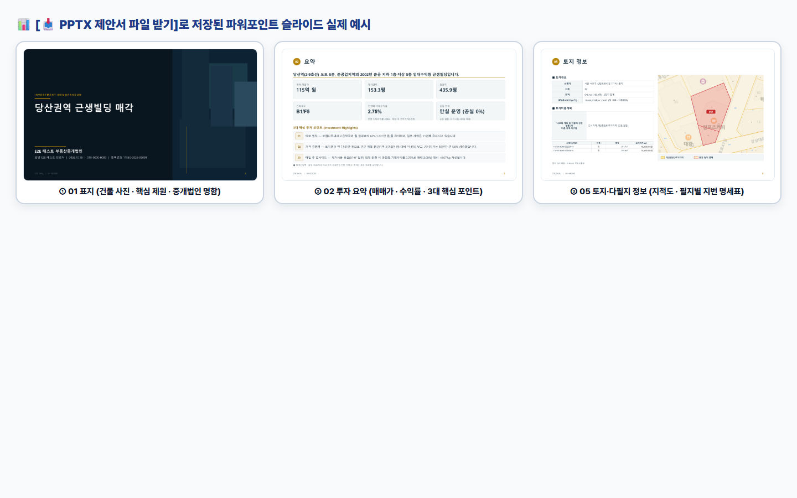
*▲ [화면 안내] 실제 생성된 PPTX 투자설명서 슬라이드 예시(표지 · 투자 요약 · 다필지 토지 정보)*

1. **👆 어디를 누르거나 입력하나요?**
   내 컴퓨터 '다운로드' 폴더에 저장된 PPTX 파일을 열어 표지(01), 투자 요약(02), 물건 개요(03), 입지·교통(04), 토지·다필지 정보(05), 수익률 분석(06), 층별 임대현황(07), 실거래 비교(08) 슬라이드를 확인합니다.

2. **✅ 화면에서 무엇이 바뀌나요?**
   기관투자자 수준의 깔끔한 표지와 요약표, 다필지 지번 명세표, 10년 공시지가 추이 그래프, V-World 연속지적도, 현행 vs 안정화 수익률 비교표가 오차 없이 정렬되어 있습니다.

3. **💡 왜 이 기능이 중요한가요? (중개 실무 포인트)**
   직접 파워포인트를 만들면 하루 종일 걸리던 작업이 1~2분 만에 끝나며, 파워포인트에서 글자나 표를 추가로 고치실 수도 있습니다.

---

### [5-4단계] [🖥️ 웹 화면 열기]로 매수자용 모바일·웹 제안서(`/im-lite`) 확인하기

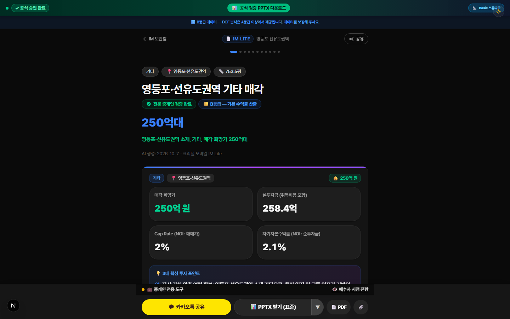
*▲ [화면 안내] 매수자용 웹 투자설명서(/im-lite) 상단: 매매가 · 평당가(만 원/평) · 핵심 투자 포인트*

1. **👆 어디를 누르거나 입력하나요?**
   IM 완성 화면에서 [🖥️ 웹 화면 열기] 버튼을 클릭하여 고객에게 공유되는 웹 제안서 화면을 위에서 아래로 스크롤해 확인합니다.

2. **✅ 화면에서 무엇이 바뀌나요?**
   상단에는 건물 사진과 함께 매매가(250억 원), 평당가(약 3,318만 원/평), 현행 수익률, 대지·연면적이 큰 글씨로 나오고, 아래로 내리면 V-World 지적도(중복 없이 1회 깔끔 표시), 10년 공시지가 상승 그래프, 층별 임차인 현황(스태킹 플랜), 그리고 맨 아래 데이터 신뢰도 안내(공적장부 대조 완료 등)와 중개사 명함이 표시됩니다.

3. **💡 왜 이 기능이 중요한가요? (중개 실무 포인트)**
   평당 단가가 '약 3,318만 원/평'처럼 한국 부동산 표준 단위로 명확히 표기되고, 각 숫자가 정부 공적장부(🟢)인지 중개인 입력(🔵)인지 투명하게 표시되어 매수인의 신뢰를 얻습니다.

---

### [5-5단계] 매수자용 웹 제안서 하단 — 지적도 · 공시지가 · 층별 임대현황 · 출처 안내 확인

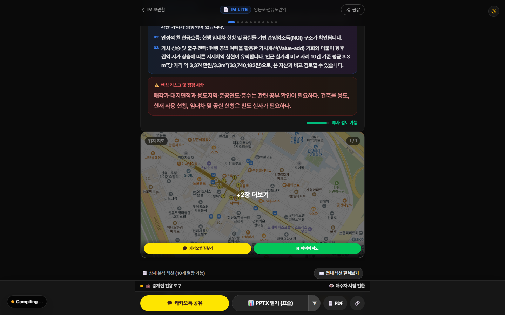
*▲ [화면 안내] 매수자용 웹 투자설명서 하단: V-World 지적도 · 층별 임대현황 스태킹 플랜 · 한글 데이터 출처 안내*

1. **👆 어디를 누르거나 입력하나요?**
   웹 제안서 화면을 아래로 내려 토지 지적도, 공시지가 추이, 층별 임대차 테이블과 맨 아래 데이터 출처 안내 바를 확인합니다.

2. **✅ 화면에서 무엇이 바뀌나요?**
   각 층(B1~10F)에 어떤 업종이 입점해 있는지, 보증금과 월세가 얼마인지 한눈에 보이며, 맨 아래에는 A/B/C 같은 알 수 없는 영문 등급 대신 '공적장부 및 임대차 확인 완료'처럼 쉬운 한글로 데이터 출처를 설명해 줍니다.

3. **💡 왜 이 기능이 중요한가요? (중개 실무 포인트)**
   고객이 궁금해하는 토지 모양(지적도)과 임대 내역이 한 페이지에 다 들어 있어 불필요한 단순 질문 전화를 줄여줍니다.

---

## 제6장. 내 물건 목록(딜카드 & IM 보관함) 검색 · 다시 열기 · 삭제하기

> **소요 시간**: 약 1분 | **관련 화면**: `/broker/buildings` (🏢 내 물건 목록 열기)
> 지금까지 등록해 둔 모든 매물의 딜카드와 투자설명서(IM)를 한곳에서 찾아보고, 언제든 다시 열어 수정하거나 다 팔린 물건을 정리하는 방법입니다.

### 🎯 이 장에서 꼭 기억하실 핵심 포인트

- **상단 메뉴바 [🏢 내 물건 목록]을 누르면 그동안 만든 모든 딜카드와 IM이 최신순·점수순으로 나옵니다.**
- **[딜카드] 탭과 [모바일 IM] 탭을 눌러 전환할 수 있으며, 동 이름(예: 양평동, 당산동)으로 즉시 검색할 수 있습니다.**
- **삭제할 때는 실수로 지워지지 않도록 한 번 더 확인 버튼([삭제 확인])이 나타나므로 안심하셔도 됩니다.**

> 🎬 **따라하기 동영상**: [🎬 [따라하기 영상 4] 내 물건 보관함에서 딜카드·IM 다시 열기 및 관리하기](./videos/video-04-buyer-im-viewer.webm)

---

### [6-1단계] [딜카드] 탭에서 내 매물 검색하고 다시 열기

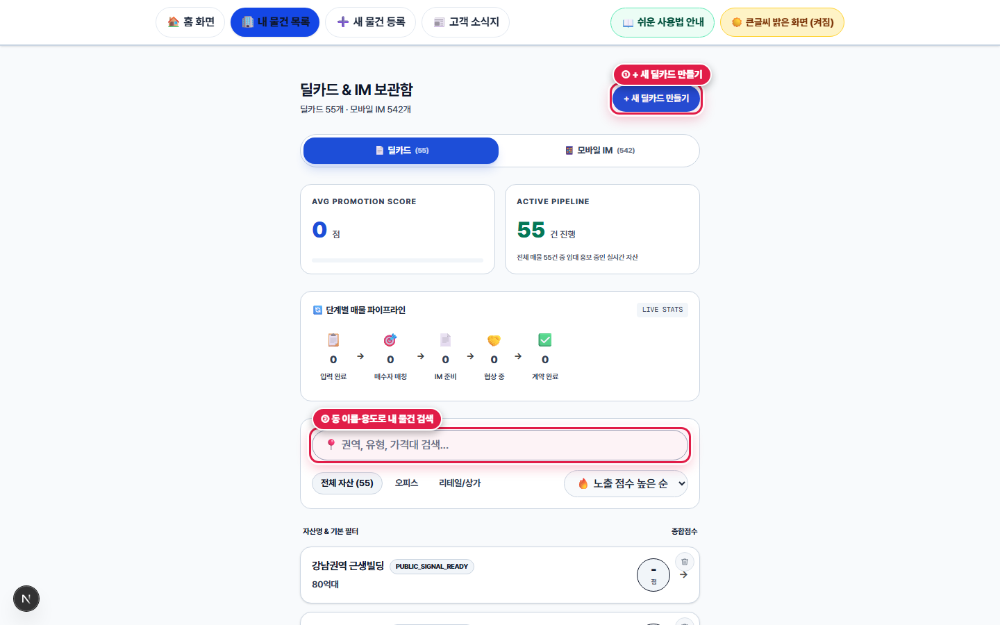
*▲ [화면 안내] 내 물건 목록(딜카드 & IM 보관함) — ① 딜카드/모바일 IM 탭 전환, ② 검색창 및 필터, ③ 등록 매물 카드*

1. **👆 어디를 누르거나 입력하나요?**
   상단 메뉴바 [🏢 내 물건 목록]을 누른 뒤, 검색창에 동 이름(예: '양평동' 또는 '당산동')을 입력하거나 목록에서 원하는 물건 카드를 클릭합니다.

2. **✅ 화면에서 무엇이 바뀌나요?**
   클릭한 물건의 딜카드 상세 화면(`/broker/deal-card/[id]`)이 다시 열려 언제든 카톡으로 재전송하거나 [⚡ 기본 IM 만들기]를 이어서 진행할 수 있습니다.

3. **💡 왜 이 기능이 중요한가요? (중개 실무 포인트)**
   한 번 등록해 둔 물건은 사라지지 않고 내 보관함에 안전하게 저장되어 있으므로, 손님이 갑자기 물건을 찾으실 때 10초 만에 꺼내 보낼 수 있습니다.

---

### [6-2단계] [모바일 IM] 탭에서 완성된 제안서 다시 열기 및 삭제 방법

![내 물건 목록의 [모바일 IM] 탭 — 생성 완료된 투자설명서 목록 확인 및 관리](./images/step-06-buildings-im-list.png)
*▲ [화면 안내] 내 물건 목록의 [모바일 IM] 탭 — 생성 완료된 투자설명서 목록 확인 및 관리*

1. **👆 어디를 누르거나 입력하나요?**
   보관함 상단 탭에서 오른쪽 [모바일 IM] 탭을 클릭합니다.

2. **✅ 화면에서 무엇이 바뀌나요?**
   지금까지 생성한 투자설명서(IM) 목록이 표시됩니다. 카드를 누르면 웹 제안서 화면이 열리고, 불필요한 연습용 문서는 휴지통 아이콘을 눌러 안전하게 삭제할 수 있습니다.

3. **💡 왜 이 기능이 중요한가요? (중개 실무 포인트)**
   주의: [딜카드] 탭에서 물건 자체를 삭제하시면 그 물건에 연결된 IM 문서도 함께 정리되므로, IM만 지우고 싶으실 때는 [모바일 IM] 탭에서 삭제해 주세요.

---

## 제7장. 주간 고객 소식지(모바일 매거진) 5분 간편 발행 및 발송하기

> **소요 시간**: 약 5분 | **관련 화면**: `/broker/magazine-editor?mode=simple` (📰 고객 소식지 편집실 열기)
> 매주 건물주·매수 고객에게 안부 인사와 추천 매물, 부동산 뉴스, 세금 계산기를 담은 품격 있는 '모바일 부동산 소식지'를 단 5분 만에 만들어 카카오톡과 이메일로 보내는 방법입니다.

### 🎯 이 장에서 꼭 기억하실 핵심 포인트

- **복잡한 8단계 편집 대신, 60대 대표님께 딱 맞춘 [⚡ 5분 간단 모드(3단계)]가 기본으로 열립니다.**
- **① 이번 주 한마디(시작 문장 버튼 제공) → ② 소개할 매물 체크(최대 3건) → ③ 제목·시장 온도 확인 후 [🚀 이번 주 매거진 발행하기]만 누르면 끝납니다!**
- **금리·시장 지표, 이번 주 주요 부동산 뉴스 3건, 수익률·취득세 계산기는 직접 쓰지 않으셔도 자동으로 소식지에 들어갑니다.**

> 🎬 **따라하기 동영상**: [🎬 [따라하기 영상 5] 5분 간단 모드로 이번 주 고객 소식지 작성 · 미리보기 · 발행하기](./videos/video-05-weekly-magazine.webm)

---

### [7-1단계] ① 이번 주 한마디 작성하기 (시작 문장 추천 버튼 활용)

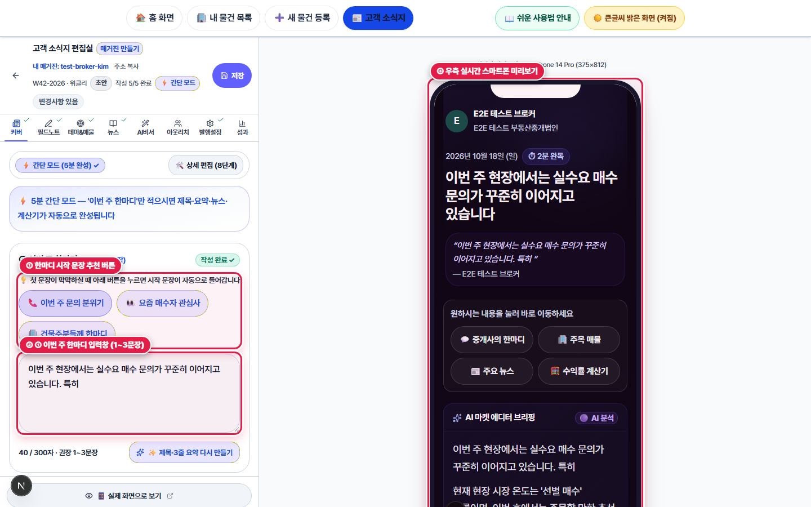
*▲ [화면 안내] 고객 소식지 5분 간단 모드 — ① 시작 문장 추천 칩, ② 이번 주 한마디 입력창, ③ 우측 실시간 휴대폰 미리보기*

1. **👆 어디를 누르거나 입력하나요?**
   상단 메뉴바 [📰 고객 소식지]를 눌러 편집실을 연 뒤, 왼쪽 [① 이번 주 한마디] 영역에서 추천 문장 버튼(예: '📈 금리·수요 동향으로 시작', '🏢 현장 문의 분위기로 시작')을 누르거나 직접 1~3문장을 입력합니다.

2. **✅ 화면에서 무엇이 바뀌나요?**
   한 문장(10자 이상)만 적으셔도 2초 뒤 AI가 그 글을 바탕으로 소식지 제목과 3줄 요약을 자동으로 만들어 채워주며, 오른쪽 스마트폰 미리보기 화면에 실시간으로 반영됩니다.

3. **💡 왜 이 기능이 중요한가요? (중개 실무 포인트)**
   글쓰기가 부담스러우신 날에도 시작 문장 버튼 두 개만 누르시면 훌륭한 주간 시장 인사말이 완성됩니다.

---

### [7-2단계] ② 소개할 매물 체크(최대 3건) & ③ 제목·시장 온도 확인 후 [🚀 발행하기]

![② 추천 매물 클릭 선택(최대 3건), ③ 제목·시장 온도 선택, ④ 자동 포함 4종 안심 안내 및 [🚀 발행하기] 버튼](./images/step-07-magazine-simple-step2-step3.png)
*▲ [화면 안내] ② 추천 매물 클릭 선택(최대 3건), ③ 제목·시장 온도 선택, ④ 자동 포함 4종 안심 안내 및 [🚀 발행하기] 버튼*

1. **👆 어디를 누르거나 입력하나요?**
   아래로 내려 [② 소개할 매물 확인]에서 이번 주 소식지에 실을 내 물건(예: 양평동 더레드빌딩, 당산동 근생빌딩)을 마우스로 클릭해 체크(✓)하고, [③ 매거진 제목 & 현장 시장 온도]에서 온도(예: '선별 매수')를 고른 뒤 파란색 [🚀 이번 주 매거진 발행하기] 버튼을 누릅니다.

2. **✅ 화면에서 무엇이 바뀌나요?**
   발행 확인 창이 뜨며, 확인을 누르면 이번 주 모바일 소식지가 즉시 발행되어 구독 고객에게 이메일이 발송되고 카카오톡 공유 창이 열립니다.

3. **💡 왜 이 기능이 중요한가요? (중개 실무 포인트)**
   팁: 딜카드 상세 화면에서 [📰 이 매물을 주간 고객 소식지에 바로 넣기] 버튼을 눌러 들어오시면 그 매물이 이미 자동으로 체크(✓)되어 있어 더욱 편리합니다!

---

### [7-3단계] 고객이 스마트폰에서 읽어보는 실제 모바일 소식지 화면 확인하기

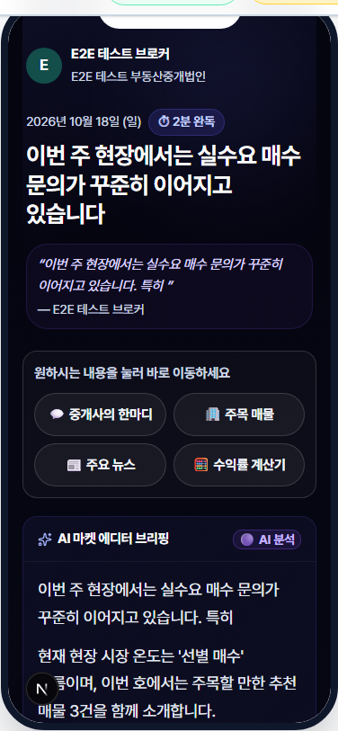
*▲ [화면 안내] 고객이 카카오톡 링크나 이메일로 열어본 주간 모바일 부동산 소식지(매거진) 실제 화면*

1. **👆 어디를 누르거나 입력하나요?**
   편집실 왼쪽 아래 [📱 실제 화면으로 보기] 버튼을 누르거나 카카오톡으로 공유된 소식지 링크를 열어봅니다.

2. **✅ 화면에서 무엇이 바뀌나요?**
   대표님의 사진과 인사말, 현장 시장 온도, 이번 주 추천 매물 카드, 주요 뉴스, 그리고 고객이 직접 눌러볼 수 있는 수익률·취득세 계산기가 잡지처럼 고급스럽게 펼쳐집니다.

3. **💡 왜 이 기능이 중요한가요? (중개 실무 포인트)**
   매주 월요일이나 화요일 아침에 이 소식지 링크를 단골 건물주·매수 고객 카톡방에 보내드리면, 물건 의뢰와 매수 문의가 자연스럽게 대표님께 모이게 됩니다.

---

## 제8장. 고객 · 구독자 명단 등록 및 고객 문의함(열람 알림) 확인하기

> **소요 시간**: 약 2분 | **관련 화면**: `/broker/inbox` (🔔 고객 문의함 열기)
> 소식지를 받아볼 VIP 건물주·매수 고객 명단을 등록하고, 누가 내 딜카드와 투자설명서(IM)를 몇 번이나 열어보았는지 확인하여 타이밍 좋게 안부 전화를 거는 방법입니다.

### 🎯 이 장에서 꼭 기억하실 핵심 포인트

- **[고객 관리](/broker/clients)에서 매도인·매수인 연락처와 등급(VIP/일반)을 정리해 두실 수 있습니다.**
- **[고객 문의함](/broker/inbox)에서는 고객의 상세 주소 열람 요청과 제안서 반복 열람(🔥 관심 고객) 알림을 한눈에 확인합니다.**
- **제안서를 3번 이상 반복해서 열어본 고객이 뜨면 바로 전화를 걸어 미팅을 잡으실 수 있습니다.**

> 🎬 **따라하기 동영상**: [🎬 [따라하기 영상 6] 고객 명단 등록 · 문의함 열람 알림 확인 · 내 프로필 설정](./videos/video-06-clients-inbox-profile.webm)

---

### [8-1단계] 고객 · 구독자 명단 조회 및 [+ 등록] 버튼으로 새 고객 추가하기

![고객 관리 화면(① 신규 고객 [+ 등록] 버튼, ② 이름·연락처 검색창, ③ 매도자/매수자/VIP 필터)](./images/step-08-clients-list.png)
*▲ [화면 안내] 고객 관리 화면(① 신규 고객 [+ 등록] 버튼, ② 이름·연락처 검색창, ③ 매도자/매수자/VIP 필터)*

1. **👆 어디를 누르거나 입력하나요?**
   하단 바 [더보기] → [고객 · 구독자 명단]을 누른 뒤, 우측 상단 파란색 [+ 등록] 버튼을 클릭합니다.

2. **✅ 화면에서 무엇이 바뀌나요?**
   고객 이름, 회사/직함, 전화번호, 구분(🏠 매도자 / 🎯 매수자 / 🔄 매도·매수), 등급(VIP / 일반 / 잠재)을 입력해 저장할 수 있습니다.

3. **💡 왜 이 기능이 중요한가요? (중개 실무 포인트)**
   평소 명함을 교환하신 건물주와 매수 고객을 이곳에 등록해 두시면 언제든 이름이나 전화번호로 검색해 연락하실 수 있습니다.

---

### [8-2단계] 신규 고객 정보 입력 후 저장하기

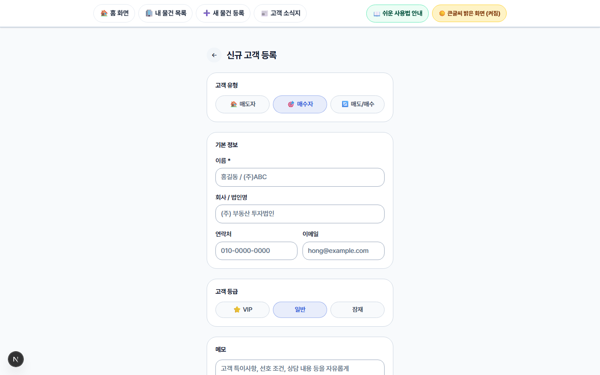
*▲ [화면 안내] 신규 고객 등록 화면 — 매도자/매수자 구분, 성함, 연락처, 고객 등급 선택*

1. **👆 어디를 누르거나 입력하나요?**
   신규 고객 등록 화면에서 성함, 연락처, 매도자/매수자 구분을 선택하고 하단 저장 버튼을 누릅니다.

2. **✅ 화면에서 무엇이 바뀌나요?**
   고객 명단에 즉시 추가되며, VIP로 지정된 고객은 필터 버튼 하나로 따로 모아 보실 수 있습니다.

3. **💡 왜 이 기능이 중요한가요? (중개 실무 포인트)**
   수첩에 흩어져 있던 VIP 매수 고객 명단을 체계적으로 관리할 수 있습니다.

---

### [8-3단계] 고객 문의함에서 [🔑 요청/열람] 및 [🔔 알림] 확인하기

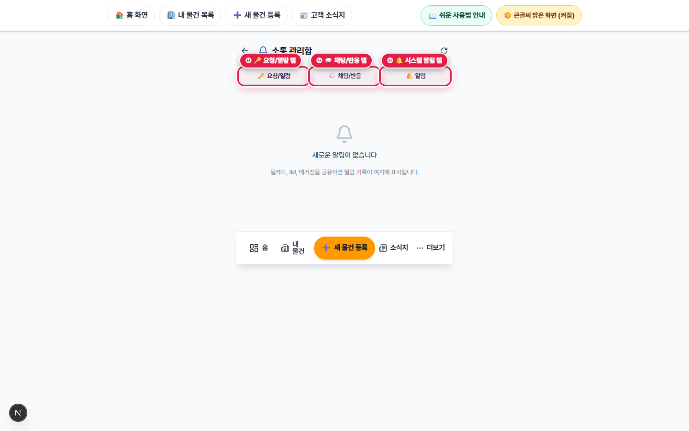
*▲ [화면 안내] 고객 문의함(/broker/inbox) — ① 요청/열람 탭, ② 채팅/반응 탭, ③ 시스템 알림 탭*

1. **👆 어디를 누르거나 입력하나요?**
   홈 화면 4번째 카드인 [고객 문의함]을 눌러 상단 3개 탭([🔑 요청/열람], [💬 채팅/반응], [🔔 알림])을 차례로 확인합니다.

2. **✅ 화면에서 무엇이 바뀌나요?**
   고객이 딜카드를 보고 상세 자료(Gate) 열람을 요청한 내역이 [🔑 요청/열람] 탭에 나타나며, [승인] 버튼을 누르면 고객에게 상세 투자설명서 열람 권한이 부여됩니다.

3. **💡 왜 이 기능이 중요한가요? (중개 실무 포인트)**
   아무에게나 건물 상세 번지와 임대료를 공개하지 않고, 중개사님이 승인하신 진성 매수 고객에게만 상세 제안서를 열어줄 수 있어 안전합니다.

---

## 제9장. 내 프로필 · 중개사무소 설정 완전 정복 (어디에 어떻게 인쇄되나요?)

> **소요 시간**: 약 3분 | **관련 화면**: `/broker/profile` (👤 내 프로필 설정 화면 열기)
> 대표님의 성함, 전화번호, 중개사무소 상호, 사진, 자격증 번호가 딜카드·PPTX 제안서 표지·고객 소식지 어디에 각각 인쇄되는지 하나하나 알기 쉽게 설명해 드립니다.

### 🎯 이 장에서 꼭 기억하실 핵심 포인트

- **가장 중요한 [① 필수 기본 명함 정보 3가지(성함 · 전화번호 · 중개사무소 상호)]만 정확히 적어두셔도 모든 제안서와 딜카드 명함이 자동으로 완성됩니다.**
- **[📷 내 컴퓨터/폰에서 사진 선택하기] 버튼으로 인물 사진이나 사무소 로고를 손쉽게 올릴 수 있습니다.**
- **긴 인사말을 직접 쓰실 필요 없이 [✨ AI로 자기소개 자동 작성하기] 버튼을 누르면 경력과 전문 지역에 맞춘 품격 있는 인사말이 자동 작성·저장됩니다.**

> 🎬 **따라하기 동영상**: [🎬 [따라하기 영상 6] 내 프로필 필수 3대 명함 정보 입력 및 AI 자기소개 자동 생성](./videos/video-06-clients-inbox-profile.webm)

---

### [9-1단계] ① 가장 중요한 기본 명함 정보(사진 · 성함 · 연락처 · 상호 · 한줄 소개) 입력하기

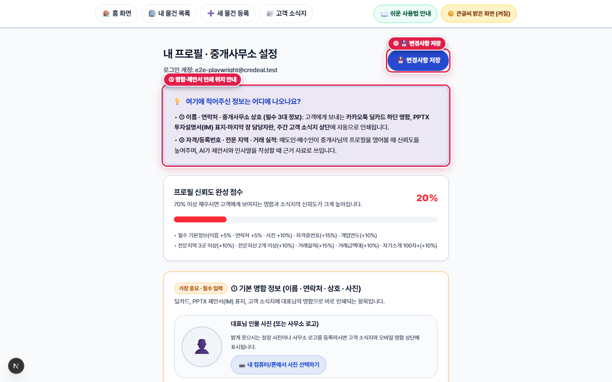
*▲ [화면 안내] 내 프로필 설정 상단: ① 어디에 표시되는지 알려주는 안내 배너, ② 신뢰도 점수, ③ 가장 중요한 필수 기본 명함 정보 입력란*

1. **👆 어디를 누르거나 입력하나요?**
   하단 바 [더보기] → [내 프로필 · 사무소 정보]로 들어간 뒤, 상단 노란 테두리로 강조된 [① 기본 명함 정보] 상자에서 사진, 성함, 전화번호, 중개사무소 상호, 명함 한줄 소개를 입력합니다.

2. **✅ 화면에서 무엇이 바뀌나요?**
   • 성함 (예: 홍길동 대표공인중개사): PPTX 제안서 첫 장 표지 하단, 마지막 장 담당자란, 딜카드 하단, 소식지 상단에 인쇄됩니다.
   • 휴대폰/사무실 전화번호 (예: 010-1234-5678): 숫자만 치셔도 하이픈(-)이 자동 입력되며, 고객이 모바일에서 [전화 문의]를 누를 때 바로 걸리는 번호가 됩니다.
   • 중개사무소 상호 (예: 양평 삼성 공인중개사사무소): 제안서 표지 기관명과 매수자용 웹 화면 상단에 표시됩니다.
   • 명함 한줄 소개: 카카오톡으로 명함이나 소식지를 보낼 때 제목으로 표시됩니다.

3. **💡 왜 이 기능이 중요한가요? (중개 실무 포인트)**
   처음 시작하실 때 이 1번 상자만 꼭 채우고 [💾 변경사항 저장]을 눌러두시면, 앞으로 만드시는 수백 개의 딜카드와 PPTX 제안서에 대표님의 명함이 자동으로 찍혀 나갑니다!

---

### [9-2단계] ② 자격/등록번호 · ③ 전문 지역/자산 · ⑧ [✨ AI로 자기소개 자동 작성하기] 후 저장

![내 프로필 하단: 전문 지역·자산 버튼 선택(✓), [✨ AI로 자기소개 자동 작성하기], [💾 내 프로필 저장하기]](./images/step-09-profile-details-and-bio.png)
*▲ [화면 안내] 내 프로필 하단: 전문 지역·자산 버튼 선택(✓), [✨ AI로 자기소개 자동 작성하기], [💾 내 프로필 저장하기]*

1. **👆 어디를 누르거나 입력하나요?**
   아래로 내려 공인중개사 자격증 번호·개업 연도를 입력하고, 주로 활동하시는 지역(예: 영등포구, 강남구, 서초구)과 건물 종류(꼬마빌딩, 오피스빌딩, 근린상가) 버튼을 클릭해 파란색 체크(✓)로 켠 뒤, 맨 아래 [✨ AI로 자기소개 자동 작성하기 (추천)] 버튼과 [💾 내 프로필 · 사무소 정보 저장하기] 버튼을 누릅니다.

2. **✅ 화면에서 무엇이 바뀌나요?**
   • 개업 연도(예: 2006)를 적으면 '경력 20년차'가 자동 계산됩니다.
   • 지역과 자산 칩을 켜고 [✨ AI로 자기소개 자동 작성하기]를 누르면 약 3초 만에 '영등포·강남 권역에서 20년간 꼬마빌딩과 수익형 빌딩을 전문 중개해 온...'과 같은 정중한 인사말이 자동으로 작성되고 즉시 저장됩니다.

3. **💡 왜 이 기능이 중요한가요? (중개 실무 포인트)**
   나머지 항목(블로그·유튜브 주소 등)은 운영하시는 분만 적으시면 되며, 없으시면 비워두셔도 아무 지장이 없습니다.

---

## 제10장. 당황하지 않는 문제 해결(FAQ 15선) & 쉬운 부동산 디지털 용어 사전

> **소요 시간**: 상시 참고 | **관련 화면**: `/broker/tutorial#faq-section` (❓ FAQ & 용어 사전 바로 보기)
> 사용하시다가 궁금하거나 막히실 때 바로 찾아보실 수 있는 질문·답변 15가지와, 어려운 영어·IT 용어를 우리말로 쉽게 풀어쓴 사전입니다.

### 🎯 이 장에서 꼭 기억하실 핵심 포인트

- **화면이 너무 작거나 어두울 때, 주소 검색이 안 될 때, PPTX 파일이 어디에 저장되었는지 모를 때 등 15가지 상황별 즉시 해결법을 제공합니다.**
- **IM, 딜카드, 렌트롤, 캡레이트(Cap Rate), NOI, 다필지, 블라인드 티저 등 화면에 나오는 용어를 60대 중개인 눈높이에서 명쾌하게 설명합니다.**

> 🎬 **따라하기 동영상**: [🎬 [따라하기 영상] 전체 화면 전환 및 도움말 활용법](./videos/video-01-home-and-theme.webm)

---

### 🛠️ 자주 묻는 질문과 즉시 해결법 (FAQ 15선)

#### [Q1 · 화면·글씨 크기] 화면 글씨가 작아서 눈이 피로합니다. 더 크게 볼 수 있나요?
- **해결 방법**: 네, 두 가지 방법이 있습니다. ① 상단 오른쪽 [☀️ 큰글씨 밝은 화면]이 켜져 있는지 확인하세요(기본 17px 큰글씨 적용). ② 키보드 왼쪽 맨 아래 [Ctrl] 키를 누른 채로 마우스 가운데 바퀴(휠)를 위로 굴리시면 화면 전체가 125%, 150%로 시원하게 커집니다.
- **👉 바로 해보기**: 원래 크기로 되돌리실 때는 [Ctrl] 키를 누른 채 숫자 [0]을 누르시면 됩니다.

#### [Q2 · 화면·글씨 크기] 화면이 갑자기 검은색(어두운 화면)으로 바뀌었어요. 다시 밝은 흰 종이 화면으로 바꾸려면요?
- **해결 방법**: 화면 맨 위쪽 오른쪽 끝에 있는 [🌙 어두운 화면 (켜짐)] 버튼을 마우스로 한 번만 클릭해 주세요. 즉시 [☀️ 큰글씨 밝은 화면 (켜짐)]으로 돌아오며 다음번에 접속하실 때도 밝은 화면이 그대로 유지됩니다.
- **👉 바로 해보기**: 상단 바 오른쪽 끝 노란색/남색 버튼을 눌러보세요.

#### [Q3 · 딜카드·주소 보안] 딜카드를 카카오톡으로 보내면 다른 부동산에서 정확한 번지를 보고 가로채지 않나요?
- **해결 방법**: 걱정하지 않으셔도 됩니다! 1분 딜카드와 카카오톡 공유 카드에는 '117번지' 같은 상세 지번이 자동으로 가려지고 '영등포구 양평동4가 역세권'처럼 권역까지만 안전하게 표시됩니다. 상세 번지가 담긴 제안서(IM)는 대표님이 승인하신 고객에게만 따로 보내실 수 있습니다.
- **👉 바로 해보기**: 보내기 전에 딜카드 화면의 [수신자 화면] 버튼을 눌러 고객에게 어떻게 보이는지 직접 확인해 보세요.

#### [Q4 · 다필지 처리] 건물 하나가 여러 번지(예: 양평동4가 117, 134, 125-2번지)에 걸쳐 있는 '다필지' 매물은 어떻게 하나요?
- **해결 방법**: [⚡ 기본 IM 만들기]에서 대표 지번(양평동4가 117)을 검색하시면 연결된 부속 필지를 함께 확인·추가하실 수 있으며, 토지 면적이 자동 합산(예: 3필지 합계 518.7㎡ / 157평)되고 PPTX 제안서 '05 토지 정보' 슬라이드 하단에 각 필지별 지번과 면적표가 깔끔하게 수록됩니다.
- **👉 바로 해보기**: 제4장 양평동 수익형 빌딩(3필지) 예시 화면을 참고해 보세요.

#### [Q5 · 가격 입력] 매매가 입력할 때 '250억'을 넣으려는데 '0'이 몇 개인지 헷갈려요.
- **해결 방법**: 직접 숫자를 치실 필요 없이, 매각 희망가 입력칸 바로 아래에 있는 [+100억], [+10억], [+1억] 버튼을 마우스로 눌러보세요! 예를 들어 [+100억] 2번, [+10억] 5번을 누르시면 정확히 '250억 원(2,500,000만 원)'이 입력되며 한글 금액('250억 원')이 함께 표시됩니다.
- **👉 바로 해보기**: 잘못 누르셨을 때는 옆의 [초기화] 버튼을 누르고 다시 누르시면 됩니다.

#### [Q6 · 임대현황(렌트롤)] 1층과 2층을 한 임차인(예: 내과 의원)이 통으로 계약해서 2층 월세가 '1층 포함'으로 되어 있는데 중복 계산되지 않나요?
- **해결 방법**: 네, 크리딜 엔진은 '1층 계약 포함 / 통합계약'을 자동으로 인식하여 보증금이나 월세를 두 번 더하지 않고 정확히 1회만 합산합니다. 또한 건물주가 직접 쓰는 층(자가사용)이나 공실 층은 만실 가정 시 얼마의 추가 수익이 나는지(안정화 수익률)까지 자동으로 분석해 줍니다.
- **👉 바로 해보기**: 층별 임대현황 비고란에 '통합계약' 또는 '자가사용'이라고 적어두시면 더욱 정확합니다.

#### [Q7 · 비수익형 매물] 사옥용 건물이나 건물이 없는 나대지(신축 부지)라서 월세 내역이 없는데, IM을 만들 때 오류가 나지 않나요?
- **해결 방법**: [⚡ 기본 IM 만들기] 맨 위 ①번 단계에서 [🏢 자가사용(사옥)]이나 [🏗️ 신축·리모델링]을 선택해 주세요! 그러면 월 임대료를 요구하지 않으며, IM 완성 화면의 4대 필수 점검에서도 '월 임대료' 대신 '용도지역 확인'으로 자동 전환되어 초록색 통과(✅) 처리됩니다.
- **👉 바로 해보기**: 투자 목적에 맞게 선택하시면 불필요한 임대차 표 대신 사옥·개발 전용 슬라이드가 생성됩니다.

#### [Q8 · PPTX 파일 찾기] [📥 PPTX 제안서 파일 받기]를 눌렀는데 내려받은 파일이 내 컴퓨터 어디에 있나요?
- **해결 방법**: 컴퓨터 화면 맨 아래 노란색 폴더 모양(파일 탐색기)을 여신 뒤, 왼쪽 메뉴에서 [다운로드(Downloads)] 폴더를 누르시면 방금 받은 파워포인트 파일(.pptx)이 맨 위에 들어 있습니다. 또는 인터넷 창 오른쪽 위 '다운로드 화살표(↓)' 아이콘을 누르셔도 바로 열립니다.
- **👉 바로 해보기**: 바탕화면으로 옮겨두시면 고객에게 이메일을 보내거나 인쇄하실 때 찾기 쉽습니다.

#### [Q9 · 문구·사진 수정] 제안서(IM)가 완성되었는데 표지 사진이나 투자 포인트 문구를 조금 고치고 싶어요. 처음부터 다시 만들어야 하나요?
- **해결 방법**: 아닙니다! IM 완성 화면(/broker/im-approval/[id])에서 사진 아래 [★ 대표(표지)] 버튼을 다른 사진으로 바꾸어 누르고 [사진 설정 저장]을 누르거나, 핵심 투자 포인트 입력창의 글자를 고친 뒤 [문구 저장]을 누르시고 다시 [📥 PPTX 제안서 파일 받기]를 누르시면 수정된 내용으로 즉시 내려받아집니다.
- **👉 바로 해보기**: 제안서를 처음부터 재생성할 필요 없이 몇 초 만에 수정본을 받으실 수 있습니다.

#### [Q10 · 고객 소식지(매거진)] 주간 고객 소식지를 보내고 싶은데 제가 매주 뉴스 기사와 세금 정보를 다 찾아서 써야 하나요?
- **해결 방법**: 전혀 쓰실 필요 없습니다! [⚡ 5분 간단 모드]에서는 대표님이 '① 이번 주 한마디(1~3문장)'만 적으시면, ① 주요 부동산 뉴스 3건, ② 금리·시장 지표, ③ 수익률·취득세 계산기, ④ 매수 문의 버튼 4가지가 자동으로 소식지에 포함됩니다.
- **👉 바로 해보기**: 한마디조차 막막하실 때는 입력창 위의 '시작 문장 추천 버튼'을 눌러보세요.

#### [Q11 · 고객 소식지(매거진)] 소식지를 이미 발행했는데 오타를 발견했어요. 고칠 수 있나요?
- **해결 방법**: 네, 언제든 고치실 수 있습니다. 소식지 편집실에서 글자를 고치신 뒤 하단의 [🚀 이번 주 매거진 정정 발행하기] 버튼을 누르시면, 이미 고객에게 보낸 카카오톡 링크의 내용까지 새로운 내용으로 자동 교체됩니다.
- **👉 바로 해보기**: 고객에게 링크를 다시 보내지 않아도 고객이 링크를 열면 고쳐진 화면이 보입니다.

#### [Q12 · 내 프로필·명함] 제안서 표지와 딜카드에 나오는 제 이름과 사무실 상호, 전화번호는 어디서 바꾸나요?
- **해결 방법**: 하단 바 오른쪽 끝 [더보기] → [내 프로필 · 사무소 정보]로 들어가셔서 맨 위 노란 테두리 상자(① 기본 명함 정보)의 성함, 연락처, 중개사무소 상호를 수정하시고 [💾 변경사항 저장]을 누르시면 모든 딜카드와 제안서 표지에 자동 반영됩니다.
- **👉 바로 해보기**: 제9장 내 프로필 설정 안내를 참고해 보세요.

#### [Q13 · 카카오톡 PC 전송] 컴퓨터(PC)에서 작업 중인데 카카오톡으로 고객에게 어떻게 보내나요?
- **해결 방법**: 컴퓨터에서 가장 편한 방법은 [링크 복사] 버튼을 누른 뒤, PC용 카카오톡 대화창을 열고 키보드 [Ctrl + V](붙여넣기)를 눌러 전송하는 것입니다. 링크만 붙여넣어도 카카오톡에 건물 사진과 제목이 들어간 멋진 그래픽 카드가 자동으로 뜹니다.
- **👉 바로 해보기**: 마우스 오른쪽 버튼을 눌러 [붙여넣기]를 선택하셔도 똑같이 작동합니다.

#### [Q14 · 길 찾기] 이것저것 누르다가 지금 어느 화면에 와 있는지 모르겠어요. 처음으로 돌아가려면요?
- **해결 방법**: 어떤 화면에 계시든 화면 맨 위 왼쪽 첫 번째에 있는 [🏠 홈 화면] 버튼만 누르시면 가장 익숙한 처음 홈 화면으로 즉시 돌아옵니다.
- **👉 바로 해보기**: 상단 메뉴바는 모든 중개 화면 맨 위에 항상 고정되어 있습니다.

#### [Q15 · 사용법 다시 보기] 작업하다가 이 사용 설명서를 다시 보고 싶을 때는 어디를 누르나요?
- **해결 방법**: 화면 맨 위쪽 상단 바의 초록색 [📖 쉬운 사용법 안내] 버튼을 누르시거나, 하단 바 [더보기] → [쉬운 이용 안내 (사진·영상 매뉴얼)]을 누르시면 언제든 이 안내서가 열립니다. 우측 상단 [🖨️ 큰글씨 매뉴얼 인쇄] 버튼으로 종이에 인쇄해 책상 옆에 두고 보실 수도 있습니다.
- **👉 바로 해보기**: 부록 B의 'A4 1장 책상 요약표'만 인쇄해 모니터 옆에 붙여두시면 더욱 편리합니다!

---

### 📖 60대 중개인을 위한 쉬운 부동산 디지털 용어 사전

| 화면 용어 | 쉬운 우리말 뜻 | 어디에 나오나요? |
|:---|:---|:---|
| **1분 딜카드 (Deal Card)** | 상세 번지를 가린 채 건물 사진·권역·매매가·3대 강점만 깔끔하게 요약해 카카오톡으로 보내는 '모바일 매물 소개 카드'입니다. | 새 물건 등록, 내 물건 목록, 카카오톡 공유 |
| **기본 IM (Information Memorandum · 투자설명서)** | 건물주나 매수 고객(회장님·법인)께 브리핑할 때 쓰는 8~12장 분량의 정식 '매각 제안서 / 투자설명서(파워포인트 PPTX 파일 및 웹 제안서)'입니다. | 딜카드 하단 [⚡ 기본 IM 만들기], IM 완성 확인 화면 |
| **포스처 (Posture · 투자 목적)** | 매수자가 이 건물을 어떤 목적으로 사는지를 뜻합니다. 크리딜에서는 ① 임대수익, ② 자가사용(사옥), ③ 신축·리모델링, ④ 운영형(호텔·병원 등), ⑤ 매매차익(단기 시세차익) 5가지로 나뉩니다. | [⚡ 기본 IM 만들기] 첫 번째 선택 단계 |
| **렌트롤 (Rent Roll · 층별 임대차 현황표)** | 건물의 지하부터 지상 각 층에 어떤 임차인(업종)이 들어와 있고 보증금·월세·관리비가 얼마인지 정리한 '층별 임대 내역표'입니다. | 기본 IM 만들기 임대현황 입력 및 제안서 07번 슬라이드 |
| **Cap Rate (캡레이트 · 자본환원율 / 순수익률)** | 건물 매매가 대비 1년 동안 손에 쥐는 순수 임대수익(연간 순영업소득 NOI ÷ 매매가)의 비율을 뜻하는 대표적인 '연간 임대수익률' 지표입니다. | 수익형 IM 요약 슬라이드 및 수익률 분석 슬라이드 |
| **NOI (Net Operating Income · 연간 순영업소득)** | 1년 치 월세와 관리비 수입에서 건물 유지관리 비용을 뺀 뒤 실제로 건물주에게 남는 '연간 순임대수익' 금액입니다. | 수익형 IM 수익률 분석표 |
| **현행 수익률(As-Is) vs 안정화 수익률(Stabilized)** | 현행 수익률은 '지금 현재 받고 있는 월세 그대로 계산한 수익률'이고, 안정화 수익률은 '현재 비어 있는 공실이나 건물주 자가사용 층까지 주변 시세대로 세를 놓았을 때 기대되는 만실 기준 수익률'입니다. | 수익형 IM 02 요약 및 06 수익률 분석 슬라이드 |
| **다필지 (Multi-Parcel)** | 하나의 건물이 여러 개의 지번(예: 양평동4가 117, 134, 125-2번지) 토지 위에 지어진 경우를 말합니다. 크리딜은 여러 필지의 면적을 자동으로 합산해 줍니다. | 기본 IM 만들기 주소 검색 및 05 토지 정보 슬라이드 |
| **스태킹 플랜 (Stacking Plan · 층별 단면도)** | 건물의 맨 위층부터 지하층까지 층별 임차인과 면적, 공실 여부를 건물 모양의 층별 그림표로 한눈에 보여주는 시각 자료입니다. | 매수자용 웹 제안서(/im-lite) 및 PPTX 임대차 슬라이드 |
| **고객 소식지 (모바일 매거진)** | 대표님의 현장 한마디와 추천 매물, 부동산 뉴스, 세금 계산기를 묶어 매주 단골 고객에게 카카오톡이나 이메일로 보내는 '모바일 주간 부동산 신문'입니다. | 상단 메뉴바 [📰 고객 소식지] |

---

## 부록 A. 5대 투자 목적(포스처)별 추천 매물 · 필수 입력값 · 자동 생성 슬라이드 비교표

> `[⚡ 기본 IM 만들기]` 맨 위 ①번 단계에서 투자 목적을 선택하시면, 각 매물의 성격에 꼭 맞는 입력칸과 슬라이드 구성이 자동으로 준비됩니다.

| 투자 목적 | 어떤 매물에 쓰나요? | 주요 입력 항목 | 자동 생성되는 PPTX 슬라이드 구성 |
|:---|:---|:---|:---|
| **💰 임대수익 (Income)** | 꼬마빌딩, 근린상가, 임대용 오피스 등 다달이 나오는 월세와 수익률이 가장 중요한 매물 | 매각 희망가, 보증금·월 임대료 합계, 층별 임대차 내역(렌트롤 또는 엑셀 업로드) | 01 표지 · 02 투자 요약 · 03 물건 개요 · 04 입지 및 교통 · 05 토지 정보 · 06 수익률 분석(현행 vs 안정화) · 07 층별 임대차 현황 · 08 인근 실거래 비교 · 09 매물 사진첩 |
| **🏢 자가사용 / 사옥 (Owner-Use)** | 법인 단독 사옥, 병원·학원·클리닉 직접 입주용 빌딩 (임대료보다 사용 가능 면적과 교통이 중요한 매물) | 매각 희망가, 즉시 입주(명도) 가능 면적/층수, 주차 대수 (임대료 미입력 시에도 정상 통과) | 01 표지 · 02 사옥 투자 요약 · 03 물건 개요 · 04 임직원 출퇴근 입지·교통 · 05 토지 정보 · 06 사옥 활용 층별 구성 · 07 인근 실거래 비교 · 08 매물 사진첩 |
| **🏗️ 신축 · 리모델링 (Development)** | 노후 건물 신축 부지, 나대지(건물 없음), 다필지 합병 개발, 리모델링 밸류애드 매물 | 매각 희망가, 다필지 지번, 허가/목표 용적률, 계획 주용도, 신축 목표 연면적(평) | 01 표지 · 02 개발 검토 요약 · 03 물건 및 개발 개요 · 04 입지 및 상권 · 05 다필지 토지 및 법정 용적률 정보 · 06 인근 토지·빌딩 실거래 비교 · 07 현장 사진첩 |
| **🏨 운영형 자산 (Operating)** | 비즈니스 호텔, 모텔/숙박시설, 대형 병원, 골프연습장 등 운영 매출(GOP)이 핵심인 특수 상업용 부동산 | 매각 희망가, 객실 수(또는 병상 수), 연평균 객실가동률(OCC), 객실단가(ADR), 연간 운영순이익 | 01 표지 · 02 운영자산 요약 · 03 시설 개요 · 04 관광·상권 입지 · 05 토지 정보 · 06 객실·운영 수지 분석 · 07 인근 실거래 비교 · 08 시설 사진첩 |
| **📈 매매차익 / 단기매매 (Trading)** | 인근 시세 대비 저평가된 급매물, 공시지가 급등 지역, 단기 보유 후 매각 차익을 노리는 우량 빌딩 | 매각 희망가, 인근 시세 대비 할인율(저평가 폭), 목표 보유기간 수익률(HPR) | 01 표지 · 02 시세차익 투자 요약 · 03 물건 개요 · 04 핵심 상권 입지 · 05 토지 및 10년 공시지가 상승률 · 06 인근 실거래가 비교 분석 · 07 매물 사진첩 |

---

## 부록 B. 모니터 옆에 붙여두는 A4 1장 큰글씨 요약표 (Cheat Sheet)

> 💡 **이 페이지만 인쇄하셔서 사무실 모니터 옆에 붙여두시면 언제든 10초 만에 따라 하실 수 있습니다.**

### ① 1분 딜카드 만들기 (소요시간 1분)
1. 상단 메뉴바 **`[➕ 새 물건 등록]`** 클릭
2. 카톡 매물 메모 복사(**`Ctrl + C`**) 후 입력창에 붙여넣기(**`Ctrl + V`**)
3. 우측 하단 파란색 **`[1분 딜카드 만들기]`** 클릭
4. **`[✏️ 딜카드 제목 · 카톡 공유 문구 직접 다듬기]`** 확인 후 **`[카톡 공유]`** 또는 **`[링크 복사]`**

### ② PPTX 제안서 · 기본 IM 만들기 (소요시간 3분)
1. 딜카드 화면 맨 아래 노란색 **`[⚡ 기본 IM 만들기]`** 클릭
2. **① 투자 목적**(임대수익 / 자가사용 / 신축·리모델링) 선택 → **② 주소 검색**(다필지 지번·면적 자동 합산)
3. **③ 매각 희망가**(`+100억` / `+10억` 버튼) · 층별 임대현황(또는 엑셀 업로드) · 사진 등록(`★ 대표` / `🏢 외관`) 후 **`[⚡ IM 생성]`** 클릭
4. 완성 화면에서 4대 점검(✅) 확인 후 **`[📥 PPTX 제안서 파일 받기]`** 또는 **`[🔗 카톡용 링크 복사]`** 클릭

### ③ 주간 고객 소식지 5분 발행 (매주 월·화요일 아침 추천)
1. 상단 메뉴바 **`[📰 고객 소식지]`** 클릭 (5분 간단 모드 자동 실행)
2. **① 이번 주 한마디**: 시작 문장 추천 버튼 클릭 후 1~2문장 작성 (제목·3줄 요약·뉴스·계산기 자동 포함)
3. **② 소개할 매물**: 이번 주 추천할 내 물건(최대 3건) 클릭해 체크(✓)
4. 하단 파란색 **`[🚀 이번 주 매거진 발행하기]`** 클릭 후 카카오톡·이메일 전송

### ④ 평생 써먹는 컴퓨터 단축키 & 안심 조작법 4가지
- **글씨 크게 확대**: 키보드 **`[Ctrl]`** 누른 채 **마우스 바퀴(휠) 위로 굴리기** (원래 크기는 `Ctrl + 0`)
- **복사 / 붙여넣기**: **`[Ctrl + C]`** (복사) → **`[Ctrl + V]`** (붙여넣기)
- **눈이 편한 밝은 화면**: 상단 우측 **`[☀️ 큰글씨 밝은 화면 (켜짐)]`** 버튼 확인
- **길을 잃었을 때**: 어느 화면에서든 상단 왼쪽 첫 번째 **`[🏠 홈 화면]`** 클릭
